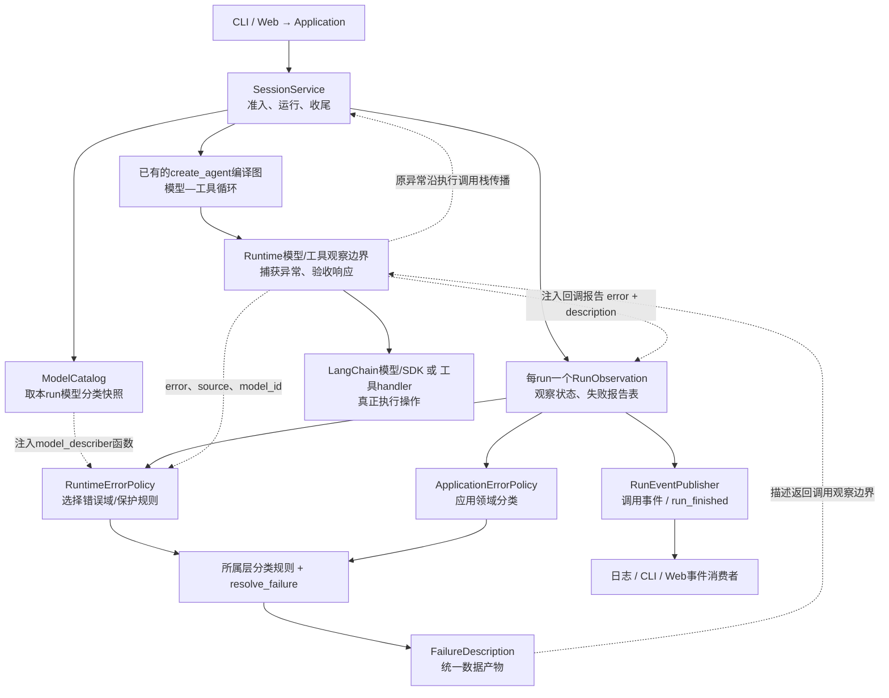
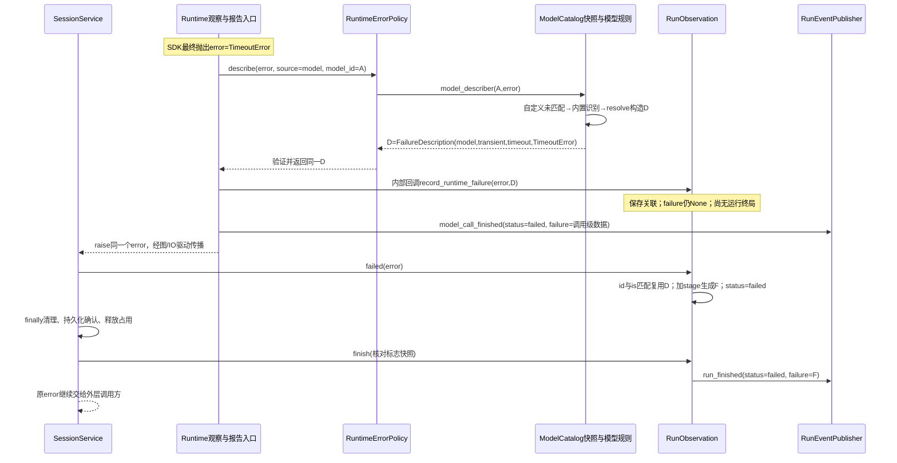
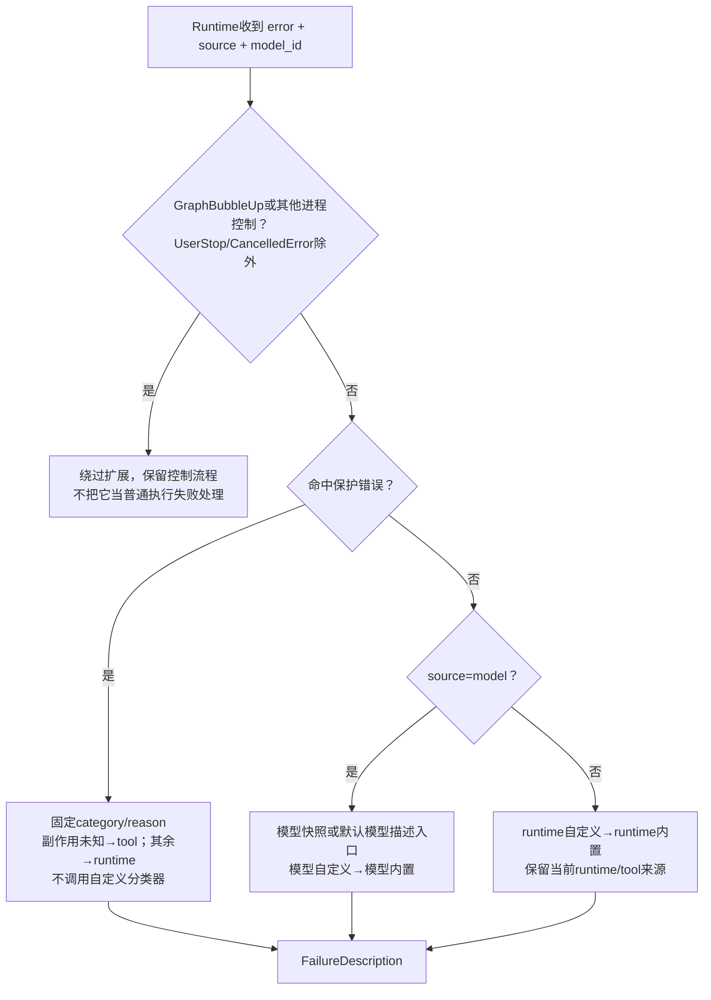
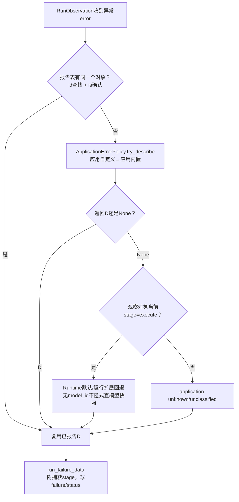
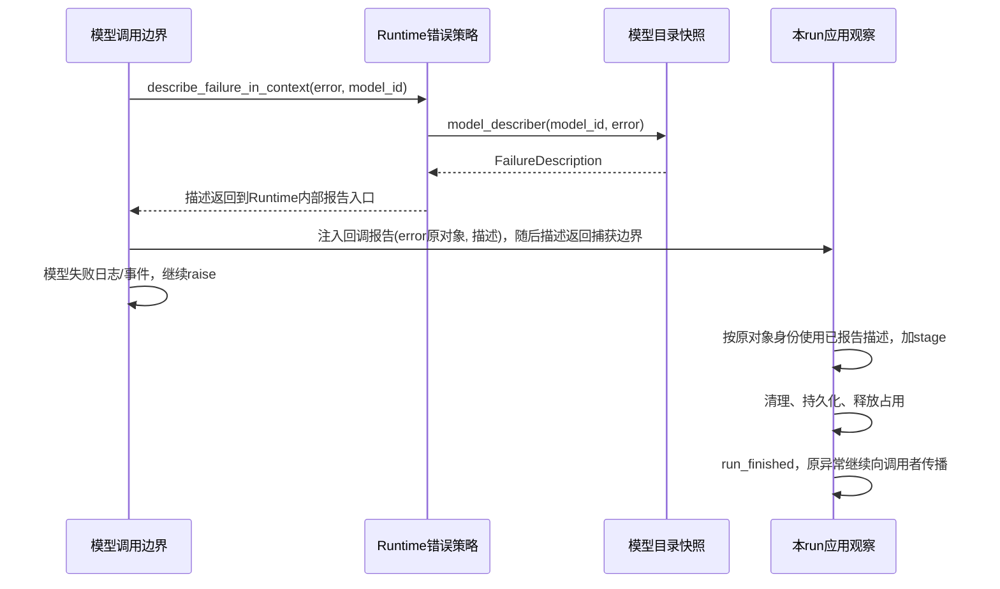
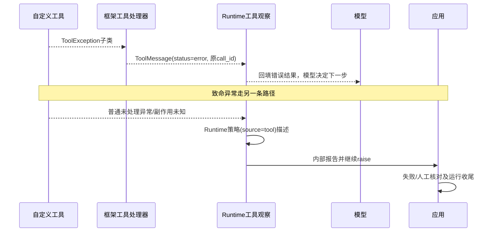
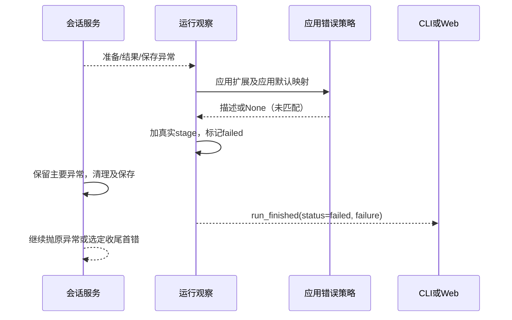

# 异常职责地图与扩展使用指南

状态：2026-10-11，当前接线以[Spec081](../specs/081-event-exception-convergence.md)和[Lesson38](lessons/lesson-38.md)为准：失败描述标注原异常后裸raise，App读取本run标注；运行依赖由RunServices集中绑定；observe使用绑定方法并在测试显式验收观察健康。后文总图和详细时序保留Spec079历史，其中reporter/id表与分散ContextVar属于旧结构，不能用作当前接线事实。用户已确认分层独立、全局脉络与自定义扩展目标；本机测试不等于全部供应商或生产负载已验证。此前设计取舍见exception-design-review.md。

接口清理更新：[Spec082](../specs/082-remove-obsolete-runtime-bridges.md)已删除旧分项bind/getter、failure_data及旧交互/workspace包装；当前以bind_run_services/current_run_services和明确的描述转换为入口，Bash停止和应用关闭读取已迁移。以下涉及旧名字的图/记录仅作历史比较，当前清理范围和保留消费者见Spec082。

## 1. 从这里开始读

| 职责 | 当前文件 |
|---|---|
| 标准库共享安全描述与分类函数契约 | [contracts/failures.py](../../naiyue_test_agent/contracts/failures.py) |
| 模型错误归一化（框架ModelError优先，SDK补充） | [model_access/errors.py](../../naiyue_test_agent/model_access/errors.py) |
| 每个model_id的映射配置和本run快照 | [ModelCatalog](../../naiyue_test_agent/model_access/__init__.py) |
| Runtime错误目录、保护分类、模型描述端口 | [agent_runtime/errors.py](../../naiyue_test_agent/agent_runtime/errors.py) |
| 模型/工具真正的捕获、记录及原异常传播 | [call_observation.py](../../naiyue_test_agent/agent_runtime/call_observation.py) |
| Runtime上下文的集中运行依赖接线 | [invocation_context.py](../../naiyue_test_agent/agent_runtime/invocation_context.py) |
| App会话准入/持久化错误目录 | [application/errors.py](../../naiyue_test_agent/application/errors.py) |
| App自己的分类与自定义映射 | [application/failure_policy.py](../../naiyue_test_agent/application/failure_policy.py) |
| 本run读取原异常标注、记录状态与终局 | [run_events.py](../../naiyue_test_agent/application/run_events.py) |
| 运行占用、主要/次要异常、保存与清理 | [session_service.py](../../naiyue_test_agent/application/session_service.py) |
| 公共HTTP错误映射 | [web/errors.py](../../naiyue_test_agent/web/errors.py) |

读完一行代码不等于能独立追踪全链。当前课堂暂停逐行推进，先用以下总图定位：对象/职责→数据→分支→终局。后面的源码与扩展指南是查阅材料，不要求连续读完。

## 1A. 总图：先认对象，再沿数据读

本图覆盖当前异常与运行结果主线；项目四层不变，测试策略属于业务层，本通用异常图聚焦Application、Runtime、Model Access及共享contracts。框架编译图在装配时已创建，每次run执行已有图；分类不是再次请求模型。

### 对象角色

| 对象/类或函数 | 实例与保存的数据 | 功能与输出 |
|---|---|---|
| LocalApplication / AsyncApplication | 应用实例，持有目录、会话服务、编译图 | 提供run/arun、配置和控制入口 |
| SessionService | 多会话状态：model_id/thread_id/busy/审批/核对；每run一个run_id | 准入→准备→执行→结果处理→清理保存；保留并传播主异常 |
| ModelCatalog | 每model_id模型对象、分类函数tuple、锁 | 按模型配置规则；failure_describer返回本run快照函数 |
| RuntimeErrorPolicy | 本run的runtime规则与model_describer函数 | 保护错误优先；普通模型委托；普通runtime/tool使用运行层规则 |
| ApplicationErrorPolicy | 本run应用规则与领域默认映射 | 应用错误描述；try_describe未匹配返回None |
| RunObservation | 本run的stage/status/failure、策略、stop_control、报告表 | 收描述、按原异常身份复用、记录结果、收尾后发终局 |
| _ModelSelectionMiddleware | resolve_model/record_selection入口 | 调模型、验收AIMessage、捕获/描述/报告/记录异常、继续raise |
| 工具观察/框架工具处理 | 单个tool_call/handler/ToolMessage | 可恢复反馈回模型；未处理异常描述后raise |
| RunControl / StopModelMiddleware | 本run停止信号/登记模型任务 | 用户停止→UserStop→图停止结果；不强杀任意工具线程 |
| Classifier（Callable） | 配置中的同步函数或适配函数 | 读异常并给分类结果；它是函数，不是描述对象 |
| resolve_failure（函数） | error/source/候选规则/内置/诊断回调 | 选择或构造FailureDescription，未匹配可返回None；普通诊断故障回退 |
| FailureDescription（数据类） | source/category/reason/error_type | 内部失败事实；不修改run、不raise、不决定重试 |
| RunFailureData（数据类） | stage/category/reason/error_type | 事件中的失败信息，未新增source字段 |
| RunEventPublisher / RuntimeEvent | session_id/run_id/sequence、各事件payload | 发布调用、控制及终局事实；不执行模型、不替代异常或保存 |
| SessionPersistence / Web公开错误入口 | 持久状态门禁/受限公开code | 保存确认；把入口错误安全展示，不直接暴露SDK对象 |



图表示对象关系与数据路线，不表示每条箭头都是连续执行的下一行。实线表示调用/持有/生产关系；虚线标注异常传播或注入函数/数据回传。Runtime没有导入RunObservation具体类，回调由Application装配；Model Access不导入Runtime/App。

### 装配与执行必须分开

```text
配置/装配：
  函数列表 → normalize_classifiers → 适配后的函数tuple
  ModelCatalog规则字典 → failure_describer() → 快照函数
  SessionService → RunObservation + RuntimeErrorPolicy + ApplicationErrorPolicy
  observation.bind → ContextVar绑定 → make_invocation_context
  → request.runtime.context中的_failure_policy与_failure_reporter

执行/生成：
  发生异常error → 调策略选择入口 → 执行具体分类器 → 描述D
  内部reporter(error,D) → 本run报告表id(error):(error,D)
  边界继续raise error → SessionService捕获 → observation.failed/cancelled
  → 失败数据F → 收尾/保存/占用释放 → 终局事件T
```

normalize与快照创建不执行具体分类。快照固定模型规则映射，不固定会话模型；自定义分类器返回完整D或None，内置模型分类返回(category,reason)元组再由resolve构造D。

### 普通模型失败的完整调用/回流时序



示例仅是普通未被恢复的模型超时。ContextOverflow恢复在模型执行包装内另行拦截；成功恢复不走这里的运行failed路径。不同run的报告表分开，原异常报告失败后App另走下述回退。

### 描述选择的完整优先级



保护集合当前为UserStop、asyncio.CancelledError、WriteOutcomeUnknown/BashOutcomeUnknown、ModelResponseRejected、ContextCompactionError、ToolBatchSchedulingError。Graph/进程控制在策略里若需描述，返回受限runtime unknown事实，但调用/应用控制边界不会因此伪造普通失败终局。

每个resolve内部：第一个合法自定义D直接返回（unknown也算命中）；None继续；都没匹配才内置；内置None且fallback=False则None，否则unknown；普通诊断故障记录并返回描述原异常类型的unknown，不调用后续规则、不重试。原异常是否传播由外层决定。

### App未收到报告时怎么描述



该图用于普通failed路径；外部取消用cancelled专门入口，控制异常failed入口会设置_suppress_terminal。显式stage='cleanup'优先用于事件失败字段，未匹配回退判断使用的是观察对象当前stage，不应把两者混成同一变量。

### 所有主要分支与最终去向

| 条件/异常由谁产生 | 中途处理 | 本次运行去向（收尾/发布正常时） |
|---|---|---|
| 启动配置/模型构造失败 | ModelConfigError等交入口 | 尚无run；不造run终局 |
| 会话busy/待审批/待核对 | SessionService在创建RunObservation前拒绝 | 直接抛准入异常；不造新run终局 |
| 正常模型/工具执行结束 | 图返回结果 | completed；不证明答案质量 |
| SDK普通超时/连接/鉴权/限流等未被恢复 | 模型归一化D→报告→raise | failed，F记录execute分类；调用方收到异常 |
| 明确输入上下文溢出 | recovery强制压缩并最多重发该请求一次 | 成功继续图；压缩或重发失败才传播；不重放已执行工具 |
| 主动压缩摘要失败 | 仅满足非force、可回退原因、原输入仍在发送上界且历史完整才回原上下文 | 可继续；其他ContextCompactionError传播→failed |
| 返回消息stop_reason=length | 有工具调用时防护返回未执行错误ToolMessage；无调用则正常结束边界/待消息判断 | 不自动等同run failed；可能继续，也可能completed但回答截断 |
| 返回消息stop_reason=unknown | 记录受限诊断，仍检查其他门禁并按实际tool_calls路由 | 不自动硬停；与异常分类unknown/unclassified不同 |
| 模型响应无效/缺AI消息/无效工具调用 | _accept产生ModelResponseRejected，runtime保护分类 | failed；无效工具不执行 |
| 工具参数验证/配置处理的ToolException | 框架产生ToolMessage(status=error) | 回填模型继续；该工具反馈不直接决定run终局 |
| 工具未处理致命异常 | tool观察→runtime规则(source=tool)→报告→raise | failed；异步未闭合工具结果可能另触发核对 |
| Write/BashOutcomeUnknown | 固定tool_outcome_unknown；保留原因链/业务异常 | failed + manual_review_required；收尾释放busy不解除门禁 |
| 模型等待中的用户主动停止 | 取消登记任务→UserStop→StopModel或摘要控制转run_stopped | stopped/active，无伪AI回答；有工具/收尾失败则失败优先 |
| 外部取消正在执行的异步run任务 | 保留CancelledError；observation.cancelled | failed/task_cancelled + 当前保守核对门禁；异常继续传播 |
| 审批interrupt由框架正常处理 | 图返回待审批结果，App登记pending | interrupted，无failure；后续批准/拒绝再恢复 |
| 审批后恢复 | 批准执行工具；拒绝交错误工具结果给模型 | 恢复图继续；审批拒绝不自动等于run failed |
| GraphBubbleUp/进程控制直接逃逸到App | 保留控制异常、抑制普通终局 | 不伪造completed/failed事件；沿原控制路径传播 |
| 工具批次调度/不可恢复压缩错误 | runtime保护分类固定原因 | failed；保持与模型SDK错误不同的归属 |
| 应用准备/结果处理/保存故障 | App描述；无报告时按回退图 | failed，真实prepare/finalize/cleanup等阶段 |
| 分类器/描述生成自身普通故障 | 固定诊断日志，unknown/unclassified回退 | 原业务/控制流程不因诊断故障替换为诊断异常 |
| 普通事件订阅者回调失败 | publisher记录、停用该订阅者 | 不自动取消生产任务或改run状态 |
| publisher入口/终局发布失败 | 记录；已有主错保留，无主错按原逻辑传播 | 消费者不保证收到终局，不递归伪造新终局 |

SDK内部重试与输入溢出恢复是不同机制；分类不发请求。最多一次指此溢出恢复，不是整轮SDK调用总次数上限。

### 收尾决定最终状态，不能跳过

```text
图正常返回 → 暂定completed / stopped / interrupted
执行异常   → failed / 特殊控制出口
                    ↓
  清理本run + 持久化finish + 释放运行占用
    ├─ 原来已有主异常：普通次要清理/保存故障只记录，保留主异常
    ├─ 没有主异常：首个清理/保存故障成为失败并最终抛出
    └─ 保存状态不确定：busy可释放，持久化blocked仍可阻止下一run
                    ↓
  flush观察事实 → 发布run_finished（控制抑制/发布失败例外）
```

这也是用户停止后还可能最终failed的原因：stopped只是执行结果候选，保存或工具致命失败不能被停止掩盖。状态completed/stopped/interrupted的failure为None，failed必须有RunFailureData；manual_review_required独立字段，busy与持久化ready/blocked也独立。

### 三份数据的生产者与消费者

| 数据 | 谁生产 | 谁消费 |
|---|---|---|
| E：原异常对象/显式包装后的业务异常 | SDK/工具/响应验收/应用IO | 分类函数；上层catch；特殊控制middleware |
| D：FailureDescription(source,category,reason,error_type) | 所属层resolve/规则 | Runtime调用日志/事件投影；内部报告表；App失败投影 |
| F：RunFailureData(stage,category,reason,error_type) | run_failure_data/观察入口 | model/tool/turn/run等事件payload |
| T：RunFinishedData(status,stop_mode,manual_review_required,failure) | RunObservation.finish | Publisher→日志/CLI/Web消费者 |
| RuntimeEvent关联封装 | RunEventPublisher | 消费者按session_id/run_id/sequence关联；不是原SDK对象 |

E与D不互相替换；D转F时不含source；T也不是异常对象。HTTP公开WebError是入口安全展示契约，和运行事件F不同；流消费故障不自动等于run生产失败。不存在覆盖所有类型的自定义全局Exception父类，复用的是安全描述数据契约与同步Callable接口。

session_id是逻辑会话，thread_id送框架checkpoint配置关联状态，run_id是本次运行。D不带这些ID，RuntimeEvent封装带session_id/run_id/sequence；本run报告表的id(error)是Python对象身份，不是session/thread/run ID。

### 阅读方式与证据

本轮只是现有源码全图整理，无产品/测试/环境修改，无新实网或全量测试声明。对象与分支核对了SessionService、RunObservation、Runtime/App策略、模型目录、context恢复/压缩、工具观察、停止middleware、Publisher和Web公开映射；功能证据沿Spec079及Lesson29–37已记录测试，不将源码地图当运行证明。

用户明确反馈逐行阅读疲劳，当前暂停新分支/新小课。先按本图定位执行者、规则、数据、状态四种角色；用户指定节点/场景后再深入。新图已提供不代表已理解，独立实现/追问仍未评估。

## 2. 依赖与四种对象

Application调用Runtime；Runtime调用Model Access。各层可以依赖标准库contracts，contracts不是新增业务运行层。模型层没有Agent/会话/应用事件依赖；运行层不导入App或Web类型。注入的报告回调只实现协议，下层不依赖其上层具体类。

| 对象 | 表达什么 | 不负责什么 |
|---|---|---|
| 原异常 | 中断执行、保留输入对象/原因链 | 不直接给前端序列化 |
| FailureDescription | source/category/reason/error_type安全事实 | 不包含stage/session/run，不决定重试或恢复 |
| RunFailureData | 在描述上附本次捕获的stage | 不替代原异常，不含原始SDK对象 |
| RunFinishedData与事件 | status/manual_review/failure及外层关联 | completed不证明回答质量或业务效果 |

source是内部错误领域/分类边界：model/runtime/tool/application；已知运行控制、门禁、压缩/调度错误由runtime负责，副作用未知归tool。事件类型可以仍是model_call_finished，因为它描述发生失败的调用边界；不能将所有在模型包装中出现的异常都归为SDK错误。stage是App记录阶段prepare/execute/finalize/cleanup，与source不同。

## 3. 默认异常目录

| 来源/类型 | 默认类别/原因或处理 | 主要边界 |
|---|---|---|
| 框架ModelAuthentication/PermissionDenied | access_denied / authentication_failed或permission_denied | 模型 |
| 框架ModelNotFound/InvalidRequest | request_rejected / not_found或bad_request | 模型 |
| 框架ModelRateLimit/API/Timeout/Connection | limit_exceeded/limit_unspecified；transient/server_error、timeout、connection_error | 模型 |
| 框架ContextOverflowError或明确SDK输入溢出 | request_rejected/context_window_exceeded，恢复层另决定强制压缩一次 | 模型归一化，Runtime恢复 |
| 原SDK异常补充 | 沿既有OpenAI/Anthropic/Ollama已实现规则；未识别仍unknown | 模型 |
| ModelResponseRejected | model_response_rejected与固定门禁原因 | Runtime |
| ContextCompactionError | context_error/compaction_failed；保留摘要原因链 | Runtime |
| ToolBatchSchedulingError | runtime_error/tool_batch_scheduling_failed | Runtime |
| UserStop/CancelledError | cancelled/user_stop或task_cancelled；原控制流程保持 | Runtime/取消边界 |
| GraphBubbleUp/进程控制 | 不进入普通扩展；沿原控制路径，不虚构普通终局 | Runtime/App控制 |
| 可恢复ToolException及参数验证 | 错误ToolMessage，模型可继续；并非所有异常均可恢复 | 工具/框架 |
| WriteOutcomeUnknown/BashOutcomeUnknown | tool_outcome_unknown；人工核对/不得盲重放 | 工具/应用 |
| SessionBusy/PendingApproval | request_rejected/session_busy或approval_required；准入拒绝不伪造run | App |
| SessionManualReviewRequired | tool_outcome_unknown/manual_review_required | App |
| SessionPersistenceError | persistence_error，受限已知reason或session_unavailable | App保存/恢复 |
| ProjectInstructionsError | request_rejected/project_instructions_unavailable | App准备 |
| ModelConfigError | 模型配置加载/构造错误，可能尚未进入run；Web固定公开码 | 模型/应用装配 |
| _SkillError | 按发现/准备契约处理软错误，不全部硬停 | App技能发现 |
| EventStreamOverflow | 消费流需要重同步，不意味着生产任务被取消 | App消费者 |
| WebError/public_error | 公开HTTP固定code/status；通用operation_failed兜底 | Web |
| 其余异常 | unknown/unclassified，故障继续传播，不自行猜测恢复 | 捕获它的所属层 |

描述代码要求固定格式，合法unknown描述也算匹配；只有None才表示未匹配。源码中的具体原SDK分支是补充规则，不代表所有HTTP状态在所有供应商中都有同一语义。

## 4. 时序一：模型请求或新供应商异常



内部报告表只属于一个RunObservation，保存原对象引用确认身份，既不进checkpoint也不进公共JSON；它不是可丢弃的UI订阅者。报告普通故障有日志，原异常仍保持。不同run各自新建表，不用全局异常缓存。

摘要调用同样用本run策略及真实model_id归一化；没有应用上下文时用模型默认入口。它的失败可以按预算回退或包装ContextCompactionError，cause保留原摘要异常；分类器故障不能改成诊断异常。分类不改变压缩切点/预算/恢复上限。

## 5. 时序二：自定义工具



已有工具handle_tool_error/handle_validation_error继续工作。新增工具可用ToolException子类+安全handler，或框架ToolErrorMiddleware显式选择处理；本片没有再装配一个吞掉全部工具异常的中间件。工具是否可恢复与类别名称是不同契约，普通未知故障不能自动当安全完成。

## 6. 时序三：应用准备/保存/自定义报告错误



已有Runtime报告时优先复用它；没有报告的execute异常由Runtime策略兜底；其他阶段按App未知兜底。合法的应用unknown描述保留具体reason，不因category=unknown而被Runtime覆盖。保存失败可释放busy但阻止重跑，不把busy=False当ready。

## 7. 自定义分类器的实际用法

```python
from naiyue_test_agent.contracts.failures import FailureDescription, safe_error_type

class VendorQuotaError(Exception):
    pass

def quota(error, source):  # source必填，来自实际边界
    if isinstance(error, VendorQuotaError):
        return FailureDescription(
            source, 'limit_exceeded', 'vendor_quota', safe_error_type(error),
        )
    return None

app.configure_error_classifiers(model_id=app.default_model_id, model=[quota])
```

上述是接入示例，没有真实供应商请求。runtime=[...]配置循环/工具的致命错误描述，application=[...]配置应用领域错误；App与AsyncApplication都有同名方法，异步应用需在所属事件循环调用。不传的类别保留已有配置，传空列表清空该类别；模型配置同时给model_id/model。任何会话busy时拒绝修改，配置先全部校验再提交。

原单参classifier(error)仍支持。能单参调用的函数保持其默认参数语义；只有必须接收两个参数才收到source。映射必须同步可检查签名，不能联网/重试，返回None交后续映射。来源/错误类型不合契约、非法代码或普通异常均安全回退，不暴露原正文。Graph/取消/副作用未知/响应拒绝等保护先执行，普通扩展不能覆盖控制语义。

模型映射按ModelCatalog实例/model_id保存；运行开始复制目录及Runtime/App元组快照，换模型用对应model_id映射。默认两个应用各有独立目录；手工共享同一个目录意味着明确共享其模型映射，不宣称多租户隔离。没有新的HTTP函数注入接口或.env配置项。

## 8. 兼容、证据与后续

ModelResponseRejected协议类型在contracts定义，runtime.errors为自然运行入口；旧model_access.errors响应拒绝导入/分类兼容分支已按Spec082删除；当前从runtime.errors导入，模型describe只负责模型请求分类。ContextCompactionError/ToolBatchSchedulingError归runtime.errors，旧模块重导出同一类；App会话/存储错误归application.errors，旧路径仍可导入。没有反向导入来做兼容。

旧failure_data(error)无model_id，因此使用确定默认映射，不隐式读取目录；新边界显式传source/model_id。RunFailureData/RunFinishedData/旧日志字段和DB保持，source只在内部描述和映射匹配中使用。

验证矩阵及实际结果见[Spec079](../specs/079-runtime-failure-projection.md)。已实现不代表用户已会独立追踪/实现；新增代码下一次按这三条时序学习。仍需更多供应商真实故障、未知样本评测、外部重试/尝试观测、公开HTTP错误扩展和长期存储故障验证；不将本机测试称完整生产保证。
