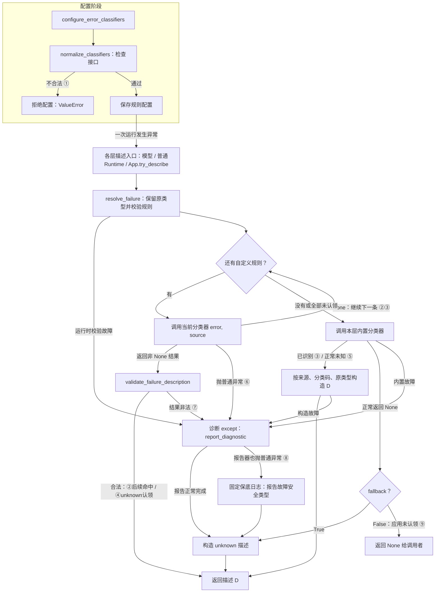

# 异常分类：按分支运行与调试

> 当前对应Lesson41和Spec083。用户首选VS Code从测试入口单步走完整调用链；输入/返回/副作用配精简观察，定点断点与终端Pdb作为备选。案例为合成异常，不请求模型或网络、不修改环境配置。单元测试验证分类选择；middleware原异常传播另由既有测试验证。

## 模块边界

原异常E、source和规则→resolve_failure选择合法描述D。分类模块不执行重试，不决定run状态。原异常上抛、应用收尾和事件发布分别在各自模块。本页先提供选择分支的单元调试入口，后续学习其他模块时同步补相应测试导航。

## 分支与独立测试

以下测试均在`tests/test_classifier_contract.py`。执行一条测试时，把最后的测试名换成表内名称即可：

```bash
.venv/bin/python -m pytest -q tests/test_classifier_contract.py::test_none_classifier_continues_to_builtin
```

| 分支 | 独立测试名 | 预期结果/重点观察 |
|---|---|---|
| 配置接口错误 | test_single_argument_classifier_is_rejected_without_invoking | 单参数规则拒绝，规则未执行；配置阶段的ValueError由pytest.raises预期捕获 |
| 自定义合法D命中（前一条None） | test_none_classifier_continues_to_next_rule | skip→match，返回同一份custom_timeout描述 |
| 全部自定义不认领，内置命中 | test_none_classifier_continues_to_builtin | None→内置transient/timeout |
| 合法unknown已经认领 | test_valid_unknown_stops_later_rules_and_builtin | 采用unknown D，后续规则和内置都不执行 |
| 内置也未识别 | test_builtin_unknown_keeps_safe_type_without_raw_text | unknown/unclassified/ValueError，无原文 |
| 分类器自己抛错 | test_classifier_failure_returns_unknown_without_continuing | 报诊断→unknown/TimeoutError，不继续后续规则/内置 |
| 分类器返回非法描述 | test_invalid_description_returns_unknown_without_continuing | tool来源与期望model不符→诊断回退，不继续选择 |
| 诊断报告再次失败 | test_diagnostic_report_failure_still_returns_unknown | 分类器故障→报告器故障→固定安全日志→unknown，内置未调用 |
| 应用不认领（fallback=False） | test_application_no_match_returns_none | try_describe返回None，允许App继续寻找描述 |

既有配置接口测试复用；其余8条是为缺少独立可调试入口的行为补充的正常断言测试。没有新产品功能或修复，没有人为制造红灯，不称为TDD红绿实现。

2026-10-11当前课堂：9条入口均有正确复述，分支讲解收束；独立debug/规则编写未独立验收。最新正确回答App未认领None不代表成功。下一主题为本run规则来源/快照/接线，见Lesson42。

## 九类分支的完整调用图

图限定分类规则准备、普通选择及诊断回退；Runtime保护类型、原异常上抛、应用收尾/终局属于外围模块。①–⑨对应上表测试。配置错误由配置调用方拒绝；运行时resolve再次检查规则出现普通故障，才走诊断回退。输入E由描述入口提供，D是描述而非异常包装。



③包括自定义全部未认领后内置命中；②通过None回到规则迭代，随后合法D命中；④合法unknown同样在校验后立即结束；⑤是正常内置未知，不走诊断except。fallback只控制正常builtin=None时是否补unknown，⑥⑦⑧即使fallback=False也会返回回退D。当前⑧保底日志只记录报告故障类型，初始诊断类型的日志缺口仍是待办，未在图中假设已经修复。

`forbidden`用于断言某分支不应执行：如果错误地继续，测试会失败；不是替代要学习的选择算法。诊断报告再次失败的用例直接调用resolve，注入会抛错的报告器；其他选择测试经过真实模型描述入口。没有共用新测试helper或修改conftest。

## VS Code从测试入口单步（当前首选）

用户进一步要求不在两个中途位置停，而是自己单步走完整单元测试。只在tests/test_classifier_contract.py第121行（测试函数第一条语句）设入口断点，使用Debug Test启动。进入后F10执行普通语句；遇到想追的项目函数用F11进入；Shift+F11执行当前函数剩余部分并返回调用方。默认justMyCode=True主要学习项目调用链；它不保证进入原生/C函数或所有框架实现。该模式不要求再设中途断点。

### 当前测试的输入/返回地图

| 调用 | 输入 | 返回/关键状态 |
|---|---|---|
| describe_model_failure | error=TimeoutError，classifiers=[skip] | 最终D；本例source由此入口传model |
| safe_error_type | 原异常 | TimeoutError类型标签 |
| normalize_classifiers | [skip] | (skip,)；只检查，不执行skip |
| skip | current=原异常，source=model | 返回None；同时向calls追加一条记录 |
| classify_model_failure | 原异常 | ('transient','timeout') |
| FailureDescription构造 | source/category/reason/error_type | 经__post_init__校验的D |
| 返回测试函数 | 整个describe调用结束 | result=D，随后两条断言检查分类与调用记录 |

分类函数内还有input_context_overflow_reason等辅助调用。此地图只列主要合同；可以F11进入需要理解的函数，其他用F10完成，保留完整测试时序。停止于某行表示该行尚未执行，输出通常要执行完调用才能看到。

### 自动显示刚返回的值

debugpy支持测试调试配置`showReturnValue: true`，在单步时把函数返回值加入VARIABLES。核对本机ms-python.debugpy-2026.6.0-darwin-arm64扩展配置声明及vendored源码：返回项以`(return)`加函数名显示。扩展配置声明默认true，但当前测试适配器实际传值/UI尚未实测，不能保证当前会话已启用。它是暂停时的返回值观察，不是永久完整调用历史。[官方设置说明](https://github.com/microsoft/debugpy/wiki/Debug-configuration-settings)。

若需要显式固定，可采用以下launch.json内容。本轮仅提供配置文本，未创建或修改IDE配置；按项目规则，代为修改须获得用户明确授权。

```json
{
  "version": "0.2.0",
  "configurations": [
    {
      "name": "Python: 分支测试单步",
      "type": "debugpy",
      "request": "launch",
      "program": "${file}",
      "purpose": ["debug-test"],
      "console": "integratedTerminal",
      "justMyCode": true,
      "showReturnValue": true
    }
  ]
}
```

purpose=debug-test用于Debug Test/Test: Debug Test at Cursor，不能把它当普通F5启动当前文件的配置。F5在已暂停的调试会话中仍是继续，完整单步时主要用F10/F11/Shift+F11。官方测试配置见[Python测试](https://code.visualstudio.com/docs/python/testing#debug-tests)。

### 随当前函数求值的精简WATCH

当前这条测试可以加入以下表达式；locals以当前选中调用栈帧为准，缺少变量时显示—而非报未定义。仅适用于本例的已知对象形状，不宣传为任意模块自动摘要器。

```python
type(error).__name__ if 'error' in locals() else type(current).__name__ if 'current' in locals() else '—'
locals().get('source', '—')
locals().get('classified', '—')
vars(result) if 'result' in locals() and hasattr(result, '__dict__') else locals().get('result', '—')
locals().get('calls', '—')
```

输入类型兼容上层error与skip的current两个参数名；source只在当前帧存在时显示；classified用于内置分类二元组；result当前为None则显示None，当前为本例dataclass D则vars只显示4个实例字段；calls观察规则的记录副作用。vars不是任意对象的业务字段过滤器，只因本例D的实例字段就是4项而适合。

函数返回后看调用方接收变量，或VARIABLES中(return)项；如果返回表达式未绑定局部变量，showReturnValue更方便。普通返回、抛出异常和状态副作用不同：抛错没有正常返回值，例外分支观察异常/except；不重新执行生产函数来取返回值。WATCH表达式在暂停时重新求值，避免放有执行/写入副作用的调用。

后续讲分支默认提供这类输入/返回地图和精简表达式，不按每行插入检查题；用户实际单步未验证，未记独立debug。

### 当前第三条：分类器自己抛错

用户已正确复述None→内置和合法D→停止两条选择顺序。下一条test_classifier_failure_returns_unknown_without_continuing从测试160行入口单步：E=TimeoutError，broken(current,source)抛ValueError，resolve捕获为diagnostic_error，记录诊断并返回针对E的unknown描述。

| 位置 | 输入/输出观察 |
|---|---|
| broken | current类型TimeoutError，source=model；不正常return，而是抛ValueError |
| resolve的except | diagnostic_error类型ValueError；error仍为TimeoutError |
| 返回测试 | result为model/unknown/unclassified/TimeoutError；calls单条，forbidden_calls=[] |

`type(diagnostic_error).__name__`与`type(error).__name__`在except帧内比较；回到测试后看`vars(result)`、`calls`、`forbidden_calls`。不把D叫包装异常：D是描述，E是原异常，fault是分类器自身故障。这条测试不向外抛E，middleware传播另有边界测试。

守卫函数除抛错还记录是否调用，测试明确断言记录为空：即使守卫抛出的AssertionError被诊断回退接住，也不能掩盖错误继续选择。

### 下一条：返回描述不符合当前边界

test_invalid_description_returns_unknown_without_continuing从182行入口单步。wrong_source的current=TimeoutError、source=model，正常返回source=tool的D；结构构造通过，validate_failure_description检查description.source与期望source不一致时抛ValueError，resolve报告诊断并返回model/unknown/unclassified/TimeoutError，forbidden_calls为空。

在validate当前帧看`description.source`、`source`和`description.error_type`；回退D是另一份新描述，未把D_wrong改成model。上一条是规则体抛错，本条是结果校验抛错，两者都停止选择。诊断报告lambda对诊断ValueError取安全类型并日志，D里的error_type来自原TimeoutError。

### 再下一条：诊断报告器自己也失败

test_diagnostic_report_failure_still_returns_unknown从202行入口单步。本测试直接调resolve以注入broken_report，原error=TimeoutError，分类器抛fault=ValueError，报告器输入fault并抛RuntimeError。resolve内层except记录报告故障，再返回原异常的unknown D。

内层except帧看`type(error).__name__`、`type(diagnostic_error).__name__`、`type(report_error).__name__`，分别TimeoutError/ValueError/RuntimeError。回测试看vars(result)、reports只有fault、builtin_calls为空。报告器抛出故障不应从resolve逃出；当前固定logger.error正常可用，不宣称所有日志IO故障已验证。

用户发现当前保底日志只留RuntimeError，已按该单元ERROR日志复现；初始ValueError类型缺少日志证据，reports只是测试内存。最小增强候选与完成判据见[待办](../future-work.md)，当前未修复。

### 当前下一条：内置正常返回unknown

test_builtin_unknown_keeps_safe_type_without_raw_text入口152行，输入ValueError，无自定义规则。单步描述入口→resolve→builtin正常返回('unknown','unclassified')→D；不进入诊断except。builtin返回后看classified，回测试看vars(result)为model/unknown/unclassified/ValueError。该单元无诊断故障日志，不包含完整middleware原调用失败日志。

### 当前配置检查：非法签名拒绝

test_single_argument_classifier_is_rejected_without_invoking入口19行，pytest.raises准备F10，normalize调用F11；normalize帧看item.__name__和str(signature)，预期legacy/(error)。signature.bind(None,'model')检查两位置参数的匹配，不执行legacy；抛TypeError后转换固定ValueError，回测试calls=[]。normalize内部result是已校验规则列表，不是之前resolve中的分类结果；泛用WATCH应结合当前函数解释。

该单元直接调用配置检查，不进resolve/不造D；resolve运行时再次调用normalize若遇错误，才由其诊断回退处理。预期ValueError被pytest.raises接住，因此看到异常不等于测试失败。

### 最后应用未认领：正常None返回

test_application_no_match_returns_none入口229行。policy.try_describe给resolve传source=application、空规则、_application_classification、fallback=False；ValueError未匹配应用领域，builtin正常None→resolve直接None→测试result is None。在resolve帧看classified、fallback，在测试看result/error.args。没有进入except或构造D。

真实RunObservation先读本run下层描述，无可复用描述才调用App try_describe；None后execute委托Runtime、非execute补应用unknown。单元只测本层未认领，不执行整个App后续。fallback=False不禁止所有unknown：合法unknown仍认领，机制故障仍安全回退。ApplicationErrorPolicy.describe会自行兜底unknown，与try_describe的消费者合同不同。

## VS Code定点观察（备选）

已核对项目`.vscode/settings.json`：pytestEnabled=true、pytestArgs=['tests']，没有launch.json。本次不修改这些配置。

1. VS Code打开整个`/Users/zmw/naiyue-test-agent`文件夹，确认Microsoft Python与Python Debugger扩展可用。
2. 命令面板运行Python: Select Interpreter，选择`/Users/zmw/naiyue-test-agent/.venv/bin/python`。调试器默认使用工作区所选解释器。
3. 打开tests/test_classifier_contract.py，找到test_none_classifier_continues_to_builtin。
4. 在contracts/failures.py第111行与测试文件第129行下断点。第111行停在调用自定义分类器之前；第129行是最终断言，result已由真实描述入口返回。
5. 测试函数左侧测试图标右键选Debug Test，或把光标放入函数并运行Test: Debug Test at Cursor。测试未发现时运行Test: Refresh Tests。用测试调试入口启动pytest；直接运行Python文件不会自动执行这些测试函数。

VS Code官方依据：[Python测试调试](https://code.visualstudio.com/docs/python/testing)、[Python调试与解释器](https://code.visualstudio.com/docs/python/debugging)。本轮未操作用户VS Code UI，不能记为本机IDE调试已验收。

### 观察点A：resolve中的输入与规则返回

111行停下时，Run and Debug→WATCH添加`type(error).__name__`、`source`，预期TimeoutError/model。Step Over（F10，或工具栏跨过按钮）执行该行，停在112，查看`result`为None。111行执行前result可能尚未赋值，显示未定义是时点问题。

### 观察点B：测试中的最终描述形状

Continue（F5，或继续按钮）到测试129行。当前帧result是最终D，已与resolve中局部变量result区分。WATCH只添加业务字段投影：

```python
{'source': result.source, 'category': result.category, 'reason': result.reason, 'error_type': result.error_type}
```

预期只有四个业务字段，值分别model/transient/timeout/TimeoutError。在Debug Console可以用`print`包裹这段表达式，直接输出普通字典文本；也可求值`__import__('dataclasses').asdict(result)`，仅适用于当前dataclass，不用于普通异常/任意框架对象。已用当前真实描述入口验证该字段投影输出。

WATCH和Debug Console在当前选中的调用栈帧内求值；点击CALL STACK中的测试函数或resolve会改变可见局部变量。同名result在两个帧中意义不同：前者最终D，后者单条自定义规则的结果。不在正确帧或变量未产生时，表达式可能报未定义或None属性错误。

默认折叠全局变量和不需要的对象树，优先看WATCH里的命名字段及Debug Console的普通字典输出。数据较大时只投影当前分支所需字段或有限列表；不默认展开整个Runtime、模型对象或框架状态。官方说明见[变量、WATCH与调用栈](https://code.visualstudio.com/docs/debugtest/debugging#data-inspection)。

`justMyCode`控制单步进入用户代码/第三方与标准库的范围，不是对象属性过滤器。当前先走默认用户代码调试；需要追第三方时再调整，不为减少对象字段而修改此选项。[官方选项说明](https://code.visualstudio.com/docs/python/debugging#justmycode)。

后续每条分支配“停在哪个函数/帧、输入看什么、返回后看什么”的精简表达式。用户未实际调试前，不记掌握。

## 终端备选：None→内置超时

输入E=TimeoutError、source=model、一条返回None的同步规则。

```text
test_none_classifier_continues_to_builtin
→ describe_model_failure
→ resolve_failure
→ skip(E, 'model')返回None
→ classify_model_failure(E)返回transient/timeout
→ FailureDescription('model', 'transient', 'timeout', 'TimeoutError')
```

普通运行：

```bash
.venv/bin/python -m pytest -q tests/test_classifier_contract.py::test_none_classifier_continues_to_builtin
```

预期`1 passed`。测试本身不把E抛出，只验证描述选择。

进入调试（在项目根目录执行）：

```bash
.venv/bin/python -m pytest -q -s --trace tests/test_classifier_contract.py::test_none_classifier_continues_to_builtin
```

pytest自带--trace会停在测试函数第一行，无需安装新调试依赖。在`(Pdb)`输入：

```text
b /Users/zmw/naiyue-test-agent/naiyue_test_agent/contracts/failures.py:111
b /Users/zmw/naiyue-test-agent/naiyue_test_agent/contracts/failures.py:121
c
p type(error).__name__
p source
n
p result
c
p (category, reason, error_type)
c
```

断点111停在调用自定义规则前：类型TimeoutError、source=model；`n`执行这一行，`result`为None。继续后断点121停在构造内置描述前，三个值应为`('transient', 'timeout', 'TimeoutError')`。最后继续完成断言，得到1 passed。行号是当前版本，以函数和语句定位为准。

## 再跑：unknown认领结束

```bash
.venv/bin/python -m pytest -q -s --trace tests/test_classifier_contract.py::test_valid_unknown_stops_later_rules_and_builtin
```

在resolve第111行下断点；调用规则后result是一份unknown描述。第116行通过validate返回，内置构造第121行的断点不会命中。观察“内置能识别超时，但合法自定义unknown优先”这个选择合同。先比较这两条完整分支，再选择故障分支，不要求逐行读完辅助函数。

## 其他分支的断点与变量

| 场景 | 函数/当前行号 | 观察对象 |
|---|---|---|
| 注册拒绝 | normalize_classifiers，failures.py:98 | signature.bind是否接受两个位置参数，规则体尚未执行 |
| 合法/非法返回 | validate_failure_description，failures.py:53 | error、description、期望source；非法返回被拒绝 |
| 普通诊断回退 | resolve_failure，failures.py:122、124、127 | diagnostic_error、原error、fallback D |
| 报告器再次故障 | resolve_failure，failures.py:125–127 | report_error与diagnostic_error是两次诊断故障；原error仍是TimeoutError |
| 应用未认领 | resolve_failure，failures.py:118–119 | classified=None、fallback=False→返回None |

基础命令：`n`执行当前行并跳过函数内部，`s`进入调用函数，`r`运行到当前函数返回，`p 表达式`查看值，`w`看调用栈，`c`继续，`q`退出。主动q会中断该测试，不表示断言失败。已有代码会主动捕获的诊断故障，不一定触发`--pdb`；使用`--trace`与断点观察，不依赖测试失败才进入调试。

## 验证记录与学习证据

命令、结果以及实际调试验收见Lesson41和handoff。本指南写明预期，不代表用户已经运行；本人断点观察、分支复述和独立修改分别待用户提供证据。
