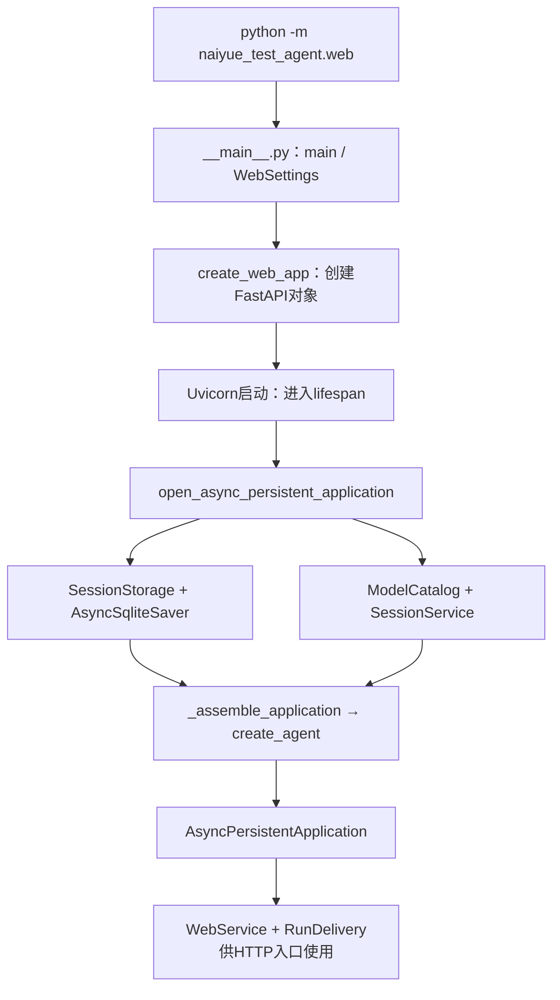

# Lesson 18：Web启动入口与对象装配地图

> 第1章第一小课，2026-10-09。目标：区分服务启动、创建会话、执行一次run，知道模型目录、会话服务、Agent编译图和SQLite怎样接在一起。

## 本课范围

沿当前代码定位装配链，不修改产品实现。依赖模块只说明职责，不把定位当作逐行通读；不提前讲后续章节的异步、工具、压缩与存储算法。



图表示当前装配关系，不表示模型已经收到请求。lifespan负责启动/退出期间的资源，create_web_app调用时尚未执行lifespan的主体。

## 最小代码地图

| 文件与位置 | 本课定位 | 后续阅读 |
|---|---|---|
| naiyue_test_agent/web/__main__.py:18、62 | -m入口调用main；45创建HTTP应用，49–51启动服务器 | 下一段18–35：参数到WebSettings；余下启动/退出行稍后逐段 |
| naiyue_test_agent/web/app.py:30–47 | 创建HTTP应用与lifespan装配时点不同 | 闭包、异步上下文管理和路由第9章详读 |
| naiyue_test_agent/application/async_persistent.py:31–46 | 资源、目录、会话服务、Agent及应用对象装配 | 清理/取消与SQLite第5/8章 |
| naiyue_test_agent/model_access/__init__.py:157 | 配置→ModelCatalog，不发模型API请求 | 模型接入第2章 |
| naiyue_test_agent/application/__init__.py:87 | 会话回调和工具等参数传给runtime | middleware装配第3章 |
| naiyue_test_agent/agent_runtime/__init__.py:138、215、232 | 实际链为_assemble_interactive_runtime→_build_runtime_agent→create_agent | 编译图和循环第3章 |

## 核心理解

- 命令示意：`.venv/bin/python -m naiyue_test_agent.web --config .env/models.json --workspace /Users/zmw/naiyue-test-agent`。此处是讲解示例，未启动服务、读取私有配置或调用模型。
- `--config`是路径输入，不是把配置文件正文传给main；`--workspace`是工具使用的工作区输入。
- 启动先得到WebSettings及FastAPI对象，服务器进入lifespan后才组装资源和Agent。构造模型客户端/编译图不等于执行模型请求。
- 模型接入层负责目录与供应商适配；运行层负责框架循环装配与middleware；应用层拥有会话/运行/持久化协调；Web是应用入口与显示交付边界。当前通用Web链没有强行经过早期discount测试策略。
- 应用对象持有catalog、sessions、agent；SessionService管理各会话状态；多个会话复用该装配好的编译图，通过上下文/checkpoint区分历史。会话不是Agent对象，run不是会话。
- SessionStorage保存应用会话元数据；AsyncSqliteSaver保存官方checkpoint，两者使用同一数据库路径但职责不同；不代表当前已具备完整聊天归档或分支恢复。
- 实际发送消息时，HTTP入口→WebService/RunDelivery→应用arun→会话/运行层→模型/工具；具体链后续逐段读。

## 入口两行

```python
if __name__ == '__main__':
    raise SystemExit(main())
```

`python -m`执行包的__main__.py；入口条件成立后先执行main，main返回退出码再交给SystemExit。正常服务路径中main在server.run返回后才返回；这不是一次Agent调用的返回结果。仅import入口模块不会因为这两行启动服务。

## 验证与边界

本课运行 `.venv/bin/python -m naiyue_test_agent.web --help`，实际退出0，显示config/workspace/session-db/host/port/frontend-dist等选项。只证明入口导入和帮助路径可运行；不启动HTTP、加载模型目录、验证模型调用或生产能力。没有新增功能，因此不宣称本轮构建/全量测试通过，也不伪造TDD红灯。

## main:18–35：启动参数到WebSettings

本段数据流：命令行字符串→argparse.Namespace→WebSettings；普通argparse注册简略，重点是输入来源、默认值、条件表达式与关键字展开。

- main(argv=None)：正常启动解析进程命令行；传显式列表时解析该列表，便于入口测试。ArgumentParser用模块docstring作帮助描述。
- config必填并转Path；workspace未给是None；host-bash是布尔开关。session-db默认用户目录/.naiyue-test-agent/sessions.sqlite，frontend-dist从入口文件绝对路径的parents[2]定位项目根的frontend/dist。
- host/port显式命令行优先于对应NAIYUE_WEB_HOST/NAIYUE_WEB_PORT环境默认；port环境值是字符串，先int转换，默认0表示后面绑定socket时请OS分配端口，不是此时已获得实际端口。
- parse_args产生Namespace；日志basicConfig设WARNING及固定格式。这两步在try前；argparse无效参数会自行报错退出，环境port的int转换异常也不在下方try范围内。
- options行等价于if环境中存在NAIYUE_WEB_TOKEN则构造{'access_token': 值}，否则{}。此token是本地Web访问凭据，不是供应商API key；检查的是是否存在，空值不会当作未配置。
- **options将字典键值展开为关键字参数；{}不传access_token，WebSettings的default_factory才生成随机值。显式传入时校验min_length，不因空值自动补默认。
- settings调用逐项映射config_path/workspace_root/database_path/frontend_dist/host/port/host_bash，输出Pydantic对象。extra=forbid拒绝多余字段，frozen=True限制属性重新赋值；port范围0..65535，host限定loopback，workspace存在时做expanduser/resolve(strict=True)，host-bash需workspace。这些是在构造对象时执行的检查。
- WebSettings没有读取模型JSON或打开数据库；workspace校验会访问文件系统，不能把全部构造称为零IO。参数构造失败进入main下方安全错误展示，尚未调用create_web_app。

本轮离线示例构造使用不存在的模型配置路径not-read-model-config.json，不读取私有配置。输出：settings_type=WebSettings、config_path=not-read-model-config.json、workspace_is_absolute=True、port=0、generated_access_token_present=True；非法port=-1报告ValidationError，退出0。未输出token、启动服务、创建DB或调用模型，仅验证构造边界，不是应用全量测试。

## main:36–44：前端检查、监听socket与实际端口

- 用户对上一段说“继续”，据此推进阅读，不把它记为独立实现或逐项理解通过。
- frontend_dist/index.html的is_file检查失败时打印构建提示并return 1，尚未创建socket或装配持久应用。只是启动前产物检查，不证明全部静态资源正确或构建通过。
- host含冒号选择AF_INET6，否则AF_INET；因WebSettings此前限定127.0.0.1/::1，此判断足以覆盖本地入口。SOCK_STREAM在此创建TCP监听socket，socket不是模型客户端。
- with socket.socket(...)管理socket生命周期；正常退出或块内抛异常都会关闭。实际块还包含后面的server.run，并非第44行之后马上关闭。
- setsockopt(SOL_SOCKET, SO_REUSEADDR, 1)设置套接字层的地址复用选项，主要缓解POSIX端重启时TIME_WAIT的地址复用等待；不保证可以抢占已有监听端口，也不创建多个服务共享同一端口。核对Python3.12官方socket文档。
- bind((host, port))向OS绑定地址；port=0让OS选择实际端口，非0则尝试指定端口。端口占用等异常沿main的except展示安全失败，不自动另选指定端口。
- listen(128)进入监听状态，参数是未accept连接的backlog请求值，受OS约束；不是线程数、模型并发数或最大用户数。此时还没有由Uvicorn接管并处理HTTP请求。
- IPv4的getsockname示例为('127.0.0.1', 49665)，[1]取实际端口；IPv6元组另含flowinfo/scope_id，端口仍为[1]。
- settings.model_copy(update={'port': actual_port})返回新WebSettings对象，settings名称改绑新对象，旧对象仍port=0。因为frozen=True，直接settings.port=...会被拒绝。model_copy(update=...)不重新验证更新字段，这里取值来自成功绑定后的OS结果；不能把这写法当成不可信输入校验。
- 下一段创建Web应用和生成origin时要使用实际端口；server.run(sockets=[listener])使用同一已绑定socket，保持端口归属，避免先探测空闲端口、关闭后重新绑定的竞争窗口。

离线探针在本机只创建临时loopback socket、没有接受连接或启动HTTP/模型：bound_address=('127.0.0.1', 49665)、old_port=0、new_port=49665、new_object=True、direct_assignment=ValidationError、socket_closed=True，进程退出0。49665是这一次实测值，后续运行可能不同。同时读取本机Pydantic model_copy的文档确认update不重验；未输出访问凭据、读取模型JSON或创建DB。

参考：[Python3.12 socket文档](https://docs.python.org/3.12/library/socket.html#socket.socket.listen)。

## main:45–59：HTTP应用、Uvicorn运行与退出

- 用户说继续后读本段，前段socket未做独立练习。app=create_web_app(settings)返回FastAPI对象，注册HTTP入口和lifespan，此处app不是Agent图，也不是AsyncPersistentApplication；实际资源组装在server.run触发的lifespan中。
- 访问链接用settings.origin property生成http://authority，IPv4为host:实际port、IPv6host加方括号；/#access_token=...携带本地入口凭据，非模型API key。flush=True及时刷新输出；它不是流式API。链接在server.run之前打印，打印成功不等于服务已ready。不输出任何真实链接/凭据到课堂笔记。
- 下一行说明持久模式/工具/Bash/退出方式，是用户提示而非这些能力已成功执行的验证。
- uvicorn.Config承载app/host/port/workers=1/log_level=warning/access_log=False等服务器选项，uvicorn.Server对象执行启动/服务/关闭。关闭HTTP访问日志不等于关闭项目诊断日志；workers=1不等于只处理一个连接或一个请求，也不是模型并发额度。
- server.run(sockets=[listener])复用预绑定socket，并让主调用等待服务运行结束。本机uvicorn0.54.0源码：run→asyncio_run(serve)；_serve→startup→main_loop→shutdown；startup先await lifespan.startup，再设started=True，非强制退出时shutdown调用lifespan.shutdown。server.run是同步进程入口，内部异步事件循环可处理请求，不能推断所有模型/工具IO均非阻塞。
- return 0 if server.started else 1是在run返回后依据“曾成功启动”决定返回码；started不是业务调用成功或关闭后仍运行的标记。某些Uvicorn启动失败会sys.exit，SystemExit不是Exception，不由这里的except Exception捕获；正常返回码分支不覆盖所有退出路径。
- KeyboardInterrupt单独打印退出提示并return130；它不属于Exception。except Exception记录固定事件名和异常类名，给本地用户安全失败提示，return1；不打印原始异常正文。这是服务入口边界，不是把单个模型/工具失败全部叫成启动失败，业务请求有自己的处理链。
- with包住server.run及return，return或异常退出块仍关闭listener。Ctrl-C正常收尾路径与强制退出不同，不能因提示文字宣称强停/任意工具副作用均已完成。

验证：`.venv/bin/python -m pytest -q tests/test_web_startup.py`本轮实际`1 passed in 0.90s`。现有用例使用临时index.html、测试凭据和monkeypatch把create_web_app替成None、Server.run替成抛KeyboardInterrupt，验证main返回130及退出提示；不执行真实lifespan、模型、数据库或真实信号收尾。测试文件未修改，无本轮产品改动或全量构建验证。

## 本课掌握与下一步

检查题：服务已启动但还未创建会话或发送消息时，Agent图是否已创建？模型是否已被请求回答？

用户首次回答：“还没有创建，模型还没被请求”。第二点正确；第一点需纠偏：正常服务启动进入lifespan后已调用_assemble_application，最终create_agent创建编译图。尚未发送消息只意味着还未执行用户run，不意味着图未创建。补充“启动组装图→创建会话→发送消息执行图”的时间线后，用户回复“理解了”，记为纠偏后的自述理解，不代表独立复述或实现。

| 维度 | 当前记录 |
|---|---|
| 已讲解 | 启动装配地图、三种生命周期、入口两行；main:18–59参数、socket、HTTP服务与退出 |
| 引导后理解 | 创建/执行图区别经纠偏后用户自述理解；参数/socket段用户要求继续；服务器段尚待反馈 |
| 独立实现 | 未评估 |
| 可应对面试追问 | 未评估 |
| 功能验证 | 帮助入口、WebSettings及loopback探针、现有模拟KeyboardInterrupt入口测试；与用户掌握无关 |

入口main已讲解至59行，不等于用户已独立掌握。下一步已进入[Lesson19](lesson-19.md)：web/app.py的create_web_app/lifespan注册/执行、闭包及asynccontextmanager/yield资源生命周期，随后再读具体工具/factory装配。

2026-10-10用户明确“第一章我都学会了”，记为本章已讲范围的自述理解；独立实现与面试追问尚未评估，不改变后续章节的待阅读文件范围。
