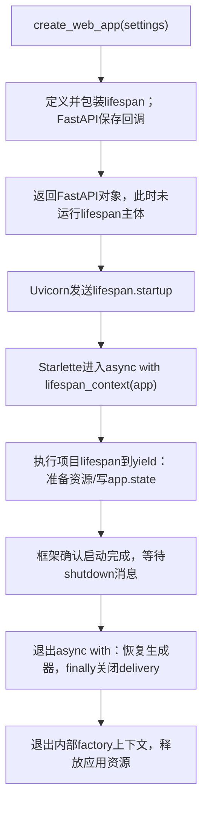

# Lesson 19：lifespan的注册、执行与资源生命周期

> 第1章第二小课，2026-10-09。承接Lesson18入口，读web/app.py:30–32、40–47、52及return app的连接；33–39工具和factory具体构造留待下一段，不计为已通读。

## 调用与状态地图



## 项目核心代码

- create_web_app的settings是启动参数对象；application_factory是可选上下文管理器工厂，用于替换持久应用的资源获取路径，后续具体读。外层是普通def，返回FastAPI对象。
- 内层lifespan定义时创建函数；并未执行其主体。函数引用外层settings/application_factory形成闭包；外层返回之后，框架保留该回调及所需引用。捕获引用不是复制一份settings的全部数据。
- @asynccontextmanager等价于把定义好的异步生成器函数交给asynccontextmanager包装；内层同时有async def与yield，原函数属于异步生成器。包装后调用lifespan(app)得到异步上下文管理器，不是立刻跑启动代码，也不是普通协程await一次跑到底。
- FastAPI(lifespan=lifespan, ...)传函数对象而非lifespan(app)调用结果。框架注册函数，再在生命周期时调用。FastAPI构造也注册路由等信息，不自动执行lifespan主体。
- lifespan的形参app由框架传入，是对应的FastAPI对象；这个名字不是外层局部app的自动赋值，也不是Agent或AsyncPersistentApplication。
- async with factory() as application先进入持久应用资源上下文，获得应用对象，再创建RunDelivery/WebService。这里先讲进出与数据归属，factory的lambda和工具表达式尚未详读。
- app.state.delivery/service保存供后续HTTP处理读取的应用级对象。它是FastAPI挂载状态，与LangGraph messages状态、SQLitecheckpoint不同；yield本身没有自动保存这些对象。
- 裸yield交出None，暂停当前生成器，表示启动准备完成；它不是返回模型消息、退出整个应用或逐token流。HTTP服务运行发生在框架async with的主体期间。
- shutdown使框架退出上下文，正常路径由__aexit__再anext恢复生成器，执行finally的await delivery.close，再退出factory上下文。异常路径上下文管理器会向生成器注入异常，finally提供清理；启动准备尚未进入该try时失败，由已进入的外围资源上下文清理，不声称这处finally覆盖所有启动行。
- try/finally不能提供进程强杀或断电下的清理保证，正常生命周期与强制退出区分。

## 框架源码依据

本机Python3.12、Starlette1.7.0、Uvicorn0.54.0必要源码：

1. Uvicorn LifespanOn.main使用type=lifespan的scope并await app(scope, receive, send)，经ASGI应用转给生命周期处理。
2. Starlette Router保存传入的lifespan为lifespan_context；Router.lifespan先receive启动消息，async with self.lifespan_context(app)，send lifespan.startup.complete，再receive等待关闭；退出上下文后send lifespan.shutdown.complete。启动/关闭异常分别发送failed，不把失败伪装成complete。
3. contextlib._AsyncGeneratorContextManager.__aenter__使用await anext(self.gen)执行到第一次yield；正常__aexit__再次anext让它完成，异常__aexit__使用athrow。这是asynccontextmanager/yield连接启动/关闭的实际机制。

不无目的通读FastAPI或Uvicorn，不以API异步形式宣称全部业务IO非阻塞。

## 离线验证

用FastAPI+TestClient的最小生命周期示例，记录trace；没有创建项目真实模型/数据库、启动网络服务或调用收费API。代码在临时Python进程执行，没有改产品或测试文件。

```python
trace = []

def build_demo():
    @asynccontextmanager
    async def lifespan(app):
        trace.append('startup')
        app.state.ready = True
        try:
            yield
        finally:
            trace.append('shutdown')
    return FastAPI(lifespan=lifespan)

app = build_demo()
manager = app.router.lifespan_context(app)
with TestClient(app):
    assert trace == ['startup']
assert trace == ['startup', 'shutdown']
```

实际输出：after_create_app=[]、manager_type=_AsyncGeneratorContextManager、after_create_manager=[]、while_serving=['startup']、app_state_ready=True、after_shutdown=['startup', 'shutdown']，退出0。只验证生命周期注册/进入/退出机制，不验证真实持久应用收尾或生产能力。

## web/app.py:33–40：工具列表和应用工厂

- 用户回答“没有”，正确指出停在yield时尚未执行delivery.close；只证明这一时点判断，不升级为独立实现或完整异常路径掌握。
- tools外层先判workspace_root是否None；无工作区直接[]，不创建工具。有工作区构造read/ls/find/grep/write/edit的StructuredTool对象；host_bash为True才构造bash并用列表内*展开。不是工具名字符串列表，也未实际读写/搜索/跑命令。
- 等价普通写法：tools=[]；有工作区则依次构造六工具，if host_bash再append bash。列表内*展开可迭代对象，与之前调用参数中的**字典展开不同。
- 工具工厂无需workspace参数，实际调用从ToolRuntime.context获取可信会话工作区。启动注册/可用工具选择不等于执行权限校验；工具/审批/调度第6章详读。host_bash开关不等于跳过审批或沙箱保证。
- factory=application_factory or (lambda: open_async_persistent_application(...))取truthy的显式工厂，否则创建无参数lambda；赋值不执行lambda主体。lambda捕获tools/settings，调用时交配置路径/数据库路径/工具/基础prompt/response_format=None给资源入口。
- config_path是路径引用，database_path是DB位置，tools是实对象列表，BASE_SYSTEM_PROMPT是基础提示词；response_format=None不强制当前通用聊天使用Pydantic输出格式。本段不提前详读prompt加载。
- factory()得到_AsyncGeneratorContextManager；async with进入才执行持久资源函数主体。该函数装配AsyncPersistentApplication并yield app，值绑定到as application；不是factory直接return普通应用，也不是执行Agent模型。
- 两层yield：持久资源函数yield app交对象给Weblifespan；Weblifespan裸yield交控制权给框架；关闭时先delivery.close，再退出持久应用上下文。存储/SDK/取消清理算法尚未详读。

离线构造输出：无工作区tool_names=[]；有工作区未开Bash为['read','ls','find','grep','write','edit']，开启后追加'bash'；first_tool_type=StructuredTool。默认工厂factory_callable=True、factory_result_type=_AsyncGeneratorContextManager，退出0。未进入持久上下文、未读模型JSON/打开DB/执行工具/调用模型，不记为这些集成能力通过。

## 当前掌握记录

| 维度 | 当前状态 |
|---|---|
| 已讲解 | 嵌套函数/闭包、注册生命周期、app.state、框架路径；33–40工具列表/*展开/factory与两层yield |
| 引导后理解 | 正确回答yield处close未执行；工具/factory段待反馈 |
| 独立实现 | 未评估 |
| 面试追问 | 未评估 |
| 功能验证 | 最小生命周期trace、工具构造与未进入的资源管理器类型，与用户掌握分开 |

理解检查已回答：yield处close未执行。下一步收束启动对象装配地图，按知识地图进入第2章model_access配置→模型目录；具体持久化、资源取消/清理和HTTP路由保留第5/8/9章详读，定位不算通读。若用户点名本段某行，先停在该行。

2026-10-10用户自述“第一章我都学会了”，按要求进入[Lesson20](lesson-20.md)的第2章。此处只记录已讲范围的自述理解，独立实现和连续追问仍未评估。
