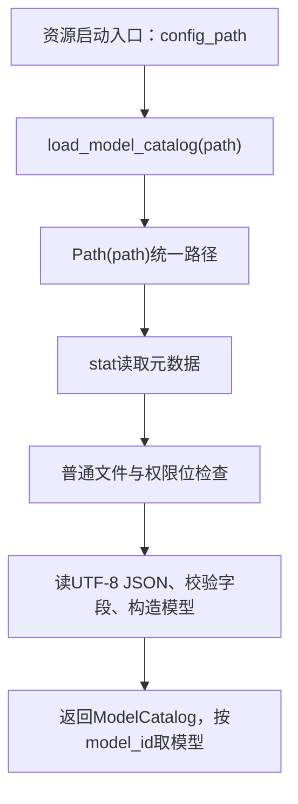

# Lesson 20：模型配置入口的路径、类型与权限检查

> 第2章第一小课，2026-10-10。现已讲到model_access/__init__.py:182及_unique_object/_object/_nonempty；供应商/模型具体校验下一段读，不把整层算成已通读。

## 章节位置与调用图



ModelCatalog是已校验的配置快照，保存default_model_id与_models字典，get(model_id)返回BaseChatModel派生对象。不是供应商模型发现接口，不等于模型回答；本次先定位输入/输出，类内部后续详读。

模型接入模块地图：__init__.py负责配置/目录/客户端构造，thinking.py负责等级解析和供应商参数，errors.py负责失败分类，stop_reason.py负责响应终止原因统一，catalog_lifecycle.py负责拥有的HTTP资源生命周期。已定位不等于已通读。

## 逐行说明

```python
def load_model_catalog(path: str | Path = '.env/models.json') -> ModelCatalog:
    """Read, validate, and construct models without making model API requests."""
    config_path = Path(path)
    try:
        file_stat = config_path.stat()
        if not stat.S_ISREG(file_stat.st_mode):
            raise ModelConfigError(f'{config_path}: model configuration must be a regular file')
        if stat.S_IMODE(file_stat.st_mode) & 0o077:
            raise ModelConfigError(f'{config_path}: model configuration permissions must be private')
```

- path可接字符串或Path；默认路径相对于当前工作目录。注解并不自动转换或校验；Path(path)才统一后续路径接口，不自动expanduser/resolve。函数完成全部后续步骤才返回ModelCatalog；本段尚未构造任何模型。
- stat()读取文件系统元数据，未读取正文。file_stat是os.stat_result，st_mode整数同时编码文件类型/权限；路径缺失或stat访问失败的OSError交下方异常边界（下一段详读）。Path.stat默认跟随符号链接，本段不是完整防链接/竞态/ACL安全保证。
- stat.S_ISREG(st_mode)判断指向的对象是否普通文件；目录等不通过，抛ModelConfigError（ValueError子类），不会继续读取或返回空目录。
- stat.S_IMODE(st_mode)提取权限位；0o077是八进制掩码，保留group/other两组权限。整数&是按位与，不是布尔and；if对结果非零判断。
- 0644的rwx位可写为110 100 100；0077为000 111 111；相与000 100 100即0044非零，拒绝。0600相与为0允许继续；0640为0040拒绝。不是必须精确0600，代码允许任意group/other权限位为零的情况；是否可被当前进程读取仍由后续read_text决定。
- ModelConfigError体现本地配置不可用，与模型请求/工具失败分开；权限检查在正文读取和SDK构造前，异常传播给启动调用方，不生成正常模型回答。日志安全展示由外层入口负责，函数不静默返回默认目录。

## 验证

本轮命令：`.venv/bin/python -m pytest -q tests/test_model_access.py::test_missing_or_readable_config_is_rejected tests/test_model_access.py::test_duplicate_json_key_is_rejected`。

实际输出：`2 passed in 0.81s`。权限用例先验证缺失路径，再由测试临时目录生成配置并chmod0644，断言ModelConfigError含permissions；重复JSON键用例也通过，其解析算法留下一段。没有改测试或产品代码，没有读写用户真实.env。

临时sample.json的元数据探针实际输出：permission=0o600 mask=0o0 regular=True；permission=0o640 mask=0o40 regular=True；permission=0o644 mask=0o44 regular=True。退出0，临时目录自动清理，未调用模型。这只证明该权限位机制与现有测试，不是模型接入全量/生产验证。

## 补充：原生Windows的权限语义

用户正确回答0640不会读正文，并追问Windows逻辑是否相同。本轮保持只讲解/记录，不修改加载器。

- Path/stat/S_ISREG/S_IMODE与整数&在Windows存在；接口或表达式能运行不等于POSIX权限语义适用。Windows的实际用户访问授权由DACL的ACE等决定，不能用这三个八进制权限组代替ACL判断。
- 核对CPython v3.12.14的Python/fileutils.c：attributes_to_mode从Windows文件属性生成模式，普通文件只读时加入0444，否则0666；_Py_attribute_data_to_stat等使用该函数设置st_mode。由源码推导，现有&0077对这些普通文件两种情况均非零，造成误拒绝，即使ACL已只允许当前用户。
- Python3.12官方os.chmod说明Windows只设置只读属性，其他权限位忽略；chmod0600不是Windows独占读取ACL设置方案。
- 来源：[CPython3.12.14实现](https://github.com/python/cpython/blob/v3.12.14/Python/fileutils.c#L1004)、[Python chmod文档](https://docs.python.org/3.12/library/os.html#os.chmod)、[微软ACL文档](https://learn.microsoft.com/en-us/windows/win32/secauthz/access-control-lists)。这是源码/文档结论，本机darwin、Python3.12.14，没有Windows运行环境或真实ACL验收。
- 本机仅对源码给定模式做整数计算：0666&0077=0066、0444&0077=0044，均rejected=True；不是Windows探针。Windows配置私有权限适配及真实平台验证记future-work，不在课堂中偷偷跳过检查或实现新功能。

用户明确“先学习，双系统适配后面再做”，当前继续模型加载主线，不做兼容功能。

## 166–170与_unique_object：JSON及异常边界

- 第166行先read_text(encoding='utf-8')读严格UTF-8字符串，再json.loads解析，成功后才给data赋值。示意片段{"schema_version":1,"default_model_id":"demo"}解析成Python字典，仅演示解析，不是完整可用模型配置。
- object_pairs_hook=_unique_object传函数对象，由JSON解析器在解析每个对象时交有序(key,value)列表并使用回调返回值；同一对象的重复键会保留在pairs里。不是先生成普通字典再检查，后者会丢失重复信息。嵌套对象同样执行，键重复以各对象分别判定。
- _unique_object逐行：result={}；for key,value in pairs解包；key已在result则抛ModelConfigError，不覆盖；否则result[key]=value；遍历结束return result。例pairs=[('schema_version',1),('schema_version',2)]在第二项拒绝，第166行data赋值未完成，后续root检查不执行。
- 默认json.loads对重复键保留最后值，实测相同示例得到{'schema_version':2}；我们的回调使配置失败显式。参考[Python3.12 JSON文档](https://docs.python.org/3.12/library/json.html#json.load)。
- except OSError覆盖整个try中的stat/文件读取等IO失败，转换为固定模板ModelConfigError，保留路径和原异常类名，不拼原异常正文。except(UnicodeError,json.JSONDecodeError)处理编码/JSON语法，分别可来自read_text或loads。
- ModelConfigError是ValueError子类，不是UnicodeError/JSONDecodeError或OSError，重复键及前置权限错误原样传播；不是再次包装成invalid JSON，未吞错/返回默认配置。
- raise ... from None抑制默认traceback的隐式异常链展示，不删除原异常对象；实测invalid_json.__context__为JSONDecodeError且__suppress_context__=True，invalid_utf8对应UnicodeDecodeError。不能据此宣称任意调试器/locals或自行打印context均脱敏。

本轮临时文件探针（0600）使用重复键、坏JSON及非法UTF-8字节，均由实际load_model_catalog抛ModelConfigError：duplicate context_type=NoneType suppress_context=False；invalid_json context_type=JSONDecodeError suppress_context=True；invalid_utf8 context_type=UnicodeDecodeError suppress_context=True。退出0，不进入模型构造、读取真实.env或调用模型。现有重复键用例运行`pytest -q tests/test_model_access.py::test_duplicate_json_key_is_rejected`实际`1 passed in 0.59s`；未改产品/测试，无全量应用构建声明。

## 172–182：顶层结构、版本及供应商/模型拆分

- 教学配置示意：schema_version=1，default_model_id='chat-main'，providers以local为键保存ollama连接信息，models以chat-main/chat-small为键保存provider_id='local'及各自model名称。仅说明形状，不代表本机有本地模型或在线验证。
- _object(data,'config',required,allowed)要求dict；required/allowed此处同为四字段集合，表示顶层恰好有schema_version/default_model_id/providers/models。检查字段名，不验证全部值，也不复制/清洗字典；成功return value，root is data。
- missing=required-value.keys()求缺少的必填键；extra=value.keys()-allowed求多余键。dict_keys是支持集合运算的键视图，可用set(value.keys())理解。例缺models得{'models'}，多debug得{'debug'}。label只用于错误定位，不是输入中的字段。
- missing/extra非空时抛ModelConfigError，missing优先；sorted(...)[0]稳定选择首个错误名称，不一次汇总全部错误。类型错误先于字段差集。
- schema_version检查type(value) is int且值==1；True虽等于1且isinstance(True,int)成立，type(True)是bool，故拒绝。1.0和'1'也不通过；版本1是配置格式版本，不是模型/项目/SDK版本。
- _nonempty先判断str，再strip判断是否只含空白；or短路避免对非字符串调用strip。成功返回原value，不返回strip后的值，' demo '仍为' demo '。default_id这里只验证非空，尚未验证存在于models。
- providers=root['providers']/models=root['models']取同一对象引用，不复制/构造模型。providers代表连接/凭据等供应商配置，models代表上层模型ID映射，多个model可引用同一provider。
- providers/models各自须dict且非空；not isinstance(...,dict) or not ...拒绝列表、None或{}。通过顶层检查不代表内部关系已校验或远端模型存在，后续逐项检查与真实服务另证。

helper离线输出：same_object=True；缺models报config is missing models；多debug报config has unknown field debug；list报must be a JSON object；版本1接受，True/1.0/'1'拒绝；nonempty_preserves_spaces=' demo '，空白ID拒绝。现有`pytest -q tests/test_model_access.py::test_invalid_config_fails_without_leaking_key`实际`8 passed in 0.70s`，覆盖已有配置错误/不回显合成key用例；不是全部顶层/供应商实网验证。未改测试/产品、读取真实.env或调用模型。

## 当前学习证据与下一步

- 第一章用户明确“都学会了”，记录对已经讲解范围的自述理解；未开展独立实现或面试连续追问，也未提前详读HTTP/持久化/工具全部文件。
- 本课已讲到顶层字段与helper：路径/权限、JSON、异常、集合差集、版本、非空字符串及providers/models拆分；用户正确回答0640不读正文，JSON段要求继续，顶层段待反馈。
- 理解检查：0640是否读取正文已正确回答；没有要求用户复写掩码，独立实现/面试追问未评估。
- 下一步：model_access/__init__.py:184–208的provider逐项校验、按kind确定字段、端点校验和checked_providers；具体供应商模型构造仍后续。用户若问本段某行先停在该行。

已按用户“继续”进入[Lesson21](lesson-21.md)的184–205及_base_url；本课路径/JSON/顶层部分不记为独立实现通过，疑问可随时回到具体行。
