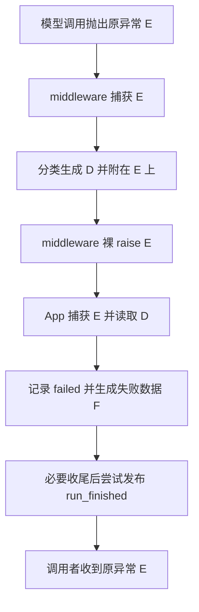

# Lesson 39：用一次模型超时重建异常地图

> 2026-10-11开始。本课只定位原异常、安全描述、事件失败数据及运行状态；分类算法、配置接线和完整收尾留后续小课。理解检查待用户回答，未记录掌握或课程完成。

## 具体数据

教学例子：模型调用最终抛出一个TimeoutError，未被本次运行恢复，必要收尾没有产生新的主失败。合成异常不代表真实网络请求。

| 名称 | 具体形状 | 产生与消费 |
|---|---|---|
| 原异常E | `TimeoutError('synthetic teaching timeout')` | 教学探针手动创建；实际调用由模型客户端/调用代码抛出；middleware捕获后继续抛出，App捕获收尾，调用者仍收到它 |
| 描述D | `FailureDescription(source='model', category='transient', reason='timeout', error_type='TimeoutError')` | 分类路径生成；Runtime附到E；App读取同一run的描述 |
| 失败数据F | `RunFailureData(stage='execute', category='transient', reason='timeout', error_type='TimeoutError')` | `run_failure_data`投影生成；事件消费者读取，不携带异常正文；当前合同没有source字段 |
| 运行状态 | `RunObservation.status = 'failed'` | App的`failed`记录本次结果；收尾之后`run_finished`载荷携带status与F；发布失败可以缺失事件 |

## 主线地图



图只定位普通超时的失败路径；恢复成功、停止、取消、审批和收尾失败不在本次展开。`transient`是分类结果，不能单独证明系统会重试。

## 最小代码地图

| 代码 | 这次只定位什么 |
|---|---|
| `contracts/failures.py`：FailureDescription/RunFailureData | D与F的真实字段 |
| `agent_runtime/errors.py`：describe_failure_in_context | 生成D、标注E、局部return D |
| `agent_runtime/call_observation.py`：awrap_model_call | 捕获后处理并裸raise E |
| `application/run_events.py`：RunObservation.failed/finish | 记录status与F，尝试发布终局 |
| `application/session_service.py`：异常分支/finally | 保留主异常，执行必要收尾 |

## 本次核心区分

- 描述函数的`return description`只结束该函数；外层middleware的裸`raise`继续传播当前异常。
- 给E加`naiyue_failure=(run_id,D)`属性，不会把E替换成D，也不表示应用已经完成收尾。
- D描述来源与类别；F面向事件携带阶段与安全分类；status表达本次运行结果。三者不能互相代替。
- 当前`run_failure_data`也被模型调用事件使用，默认stage为execute；App按本次阶段显式生成F。本节只展示App失败数据，不宣称F仅由App使用。

## 本地边界验证

执行`.venv/bin/python -`的合成探针，调用真实`describe_failure_in_context`、`read_failure_description`与`run_failure_data`，嵌套捕获后裸raise。

```text
description: {'source': 'model', 'category': 'transient', 'reason': 'timeout', 'error_type': 'TimeoutError'}
annotation keeps description: True
run failure data: {'stage': 'execute', 'category': 'transient', 'reason': 'timeout', 'error_type': 'TimeoutError'}
outward exception is original: True
```

退出码0。此探针只证明局部数据形状、标注和原异常身份；未执行完整Agent、App持久收尾或网络请求，不是全量测试证据。

## 理解检查与下一步

用户回答：“描述 D 是在 middleware 捕获模型异常后生成的，运行的 failed 状态是在应用层捕获异常后记录的。”正确区分生成描述与记录运行结果的职责时点；仅确认这一概念，整体追踪、独立实现与追问未评估。

继续讲解最后时序：App记录failed→必要清理/启用持久化时尝试保存与结束占用→尝试发布run_finished→调用者收到原异常。busy是会话占用标志，status是运行结果；刚记录failed不证明会话已结束占用。收尾失败另有分支，本课仅定位，不能宣称必然保存成功。

用户回答：“不能，failed只是记录这次运行的结果，收尾可能还没完成，要等会话的busy解除后才能开始下一次运行。”正确区分结果与占用，确认本例中busy解除是再次准入的必要条件；不扩展为busy是所有场景的唯一准入条件。

本课入门地图的两次检查已正确回答，继续Lesson40；描述/事件字段及完整源码独立追踪仍未单独评估，不记独立实现或整章掌握。
