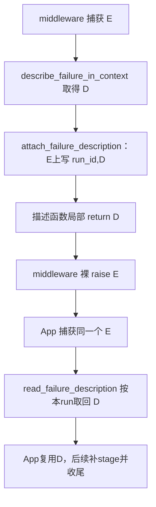
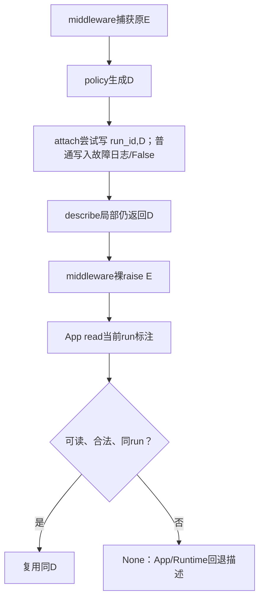

# Lesson 43：描述怎样随原异常回到应用

> 2026-10-11开始。①正常标注/读取已有用户自述理解，②③已讲，当前④foreign run拒读并收束模块。四场景均已讲，继续指令不自动记新增理解；本人独立debug/实现未验收，下一主题Lesson44尚未开始。

## 模块职责与数据形状

分类阶段已经有原异常E与描述D。本模块使D附在E上，middleware继续抛E，App捕获E后按本run读取D；不新增通用包装异常、全局ID回查表或再次分类。

本例选TimeoutError参数案例error0，D手动构造为model/transient/timeout/TimeoutError，教学单元只验证承载不是分类选择：

```python
E.naiyue_failure = ('run', D)
```

属性是二元组：第一项run_id归属，第二项D的同一引用。E仍是TimeoutError，不变成D；D本身不是异常。

## 固定4个场景

| 场景 | 输入/分支结果 | 现有测试入口 |
|---|---|---|
| ① 正常附着与读取，原异常继续传播 | 写入True、读回同D；Fake App保持同E/模型分类一次 | test_failure_annotations.py::test_annotation_preserves_exception_identity_and_cause[error0]；跨层复用test_application_reads_annotation_and_classifies_model_once |
| ② 标注写入失败 | 本例setter拒绝写入，日志/False；E保留，App可回退 | test_failed_setter_keeps_original_exception |
| ③ 无合法标注可读 | 缺少/格式或类型不合法/属性getter抛错→None，不读取cause上的其他错误描述 | test_unknown_is_valid_but_forged_annotation_is_rejected；test_broken_annotation_getter_is_safe_and_does_not_search_cause |
| ④ 标注属于其他run | 拒读、None；单属性共享同异常可覆盖，只保错run拒读，不保证每run永远拿回各自D | 复用test_annotation_preserves_exception_identity_and_cause的foreign读断言 |

这些是教学场景分组，不按每个if拆课。写入失败、读取失效的普通诊断故障和原执行异常区分；必要收尾/事件失效细节留Lesson44。

## 真实普通模型失败主线



describe_failure_in_context先用policy.describe得D，再附着E，最后返回D。返回D的局部函数结束，不会把外层模型调用变成成功。模型wrapper的except在_failed完成后裸raise当前E。App RunObservation._describe_failure首先读标注，读到合法D就直接返回；读不到才走已学的App try/运行层回退。

## 当前①：先用局部单元看两个对象与归属

测试test_annotation_preserves_exception_identity_and_cause有error0/1/2参数，error0是TimeoutError；其他异常案例仅验证标注不改已有属性，不当作这些类型应分类成timeout的证据。VS Code选择error0，15行入口断点。

| 时点 | 输入/返回/副作用 |
|---|---|
| attach之前 | E与D分别存在，run_id='run' |
| attach_failure_description(E,D,run_id='run') | 返回True；写E.naiyue_failure=('run',D) |
| read_failure_description(E,run_id='run') | 验tuple/run/type/字段，返回同一D |
| 单元检查原属性 | args/cause/context/suppress_context与写入前相同 |

在attach帧看type(error).__name__、vars(description)、run_id；赋值67行执行后看error.naiyue_failure[0]和error.naiyue_failure[1] is description。在read帧看value[0]、run_id与value[1]；返回测试后读回is desc。原异常cause只是本测试用于验证未改的既有字段，不在本次展开Python异常链全部机制。

该局部单元没有抛E，不证明middleware裸raise；完整Fake App测试已另验证caught.value is error、模型规则只调用一次及最终分类，当前图的边界由两类证据区分。App增加stage与RunFailureData投影留下一主题。

助手执行collect-only得到error0/1/2三个入口，再运行error0单例：1 passed in0.49s。无模型请求/生产或测试代码变更，本人理解/单步仍待反馈。下一步确认正常标注/读取，再讲写入失败与读取/归属回退；独立规则练习仍待安排。

## 当前②：原异常拒绝写入描述

用户说“这个我理解了，继续”，接正常标注/读回之后进入本分支；仅记自述理解，不升级独立debug或完整传播验收。复用test_failed_setter_keeps_original_exception，测试入口26行。

输入为合成E=Refuses('PRIVATE')与手构D=model/unknown/unclassified/Refuses。Refuses继承RuntimeError并覆写__setattr__：写naiyue_failure时抛另一个ValueError；其他属性交super默认写入。E是原执行异常，fault=ValueError是属性写入故障，D仍描述E。

局部链：test→attach(E,D,run_id='run')→描述/标识校验通过→属性赋值触发Refuses.__setattr__→ValueError→attach except安全日志并False→test→read(E,run_id='run')→缺少属性正常None。read这里不进自己的except，也不另造unknown描述；本例D在写之前就已是unknown。

真实消费者describe_failure_in_context忽略attach布尔值，仍返回已生成D给middleware._failed做日志/事件投影，随后wrapper裸raise E。App捕获E读不到标注则走application.try_describe，未认领时execute委托Runtime、其他阶段补应用unknown；不能保证此时仍取得最初D或相同来源。当前测试只验证局部False/None与安全日志，未执行真实模型或完整App回退，也未通过本例直接验证最终caught身份。

VS Code仅在26行入口设断点并Debug Test。类/对象准备F10；33行attach调用F11，在赋值67行按需F11进入__setattr__，观察name='naiyue_failure'、value=('run',D)；抛错后在attach帧比较type(error).__name__='Refuses'与type(fault).__name__='ValueError'。返回False后继续34行read，看value=None、返回None；最后在测试帧看vars(error)与caplog.text。不要重调用attach来获取返回值；assert调用返回可用(return)观察。

本轮命令`.venv/bin/python -m pytest -q --log-cli-level=ERROR tests/test_failure_annotations.py::test_failed_setter_keeps_original_exception`→1 passed in0.50s，日志failure_annotation_write_failed error_type=ValueError。只运行当前单元及文档结构检查，无生产/测试/配置改动或新全量/构建/网络证据。本分支已讲，用户理解反馈待继续；下一分支③无合法标注可读。

## 当前③：读取不到可用于当前异常的合法描述

用户要求继续，②仅记已讲。read_failure_description职责为读取当前E上的标注、检查二元组/run归属、验证D与E对应及字段格式；返回同D或None，自身不分类、不生成兜底D、不沿cause寻找。④归属不匹配下一单元再展开。

情况地图：缺失/值None→正常None无故障日志；非二元组或长度不对→ValueError/安全日志/None；D不是描述对象或error_type与E不符、字段不合法→校验故障/日志/None；getter读取时抛普通异常→日志/None。合法unknown且与E对应→同D，不因类别unknown而拒绝。read调用validate未指定期望source，只做合法来源值/原类型/格式检查，不额外强制model来源。

复用test_unknown_is_valid_but_forged_annotation_is_rejected，39行入口。E=TimeoutError，先正常附合法unknown D并读回；随后直接改属性为('run',D_wrong)，D_wrong.error_type=ValueError，构造格式合法但不能描述E，消费校验拒绝；再改成字符串PRIVATE_RAW，结构检查拒绝，均日志ValueError/None。直接属性修改用于模拟无效载体，未通过attach写入校验。

复用test_broken_annotation_getter_is_safe_and_does_not_search_cause，67行入口。BadGetter.property定义读取行为，getattr触发getter ValueError；default=None不捕获getter的ValueError，read except才捕获并日志/None。后半cause=TimeoutError附合法D，outer=RuntimeError只设置__cause__，outer本身无标注，因此读取outer正常None，不读取cause的D。此测试不抛outer或执行完整App回退。

VS Code分别仅在39/67行入口Debug Test，准备F10、read调用F11；read帧看type(error).__name__、run_id、value，进入validate看description.error_type与原error类型；getter抛错时赋值未完成，value尚未产生，比较fault/error类型。不要将BadGetter.error.naiyue_failure放WATCH反复触发getter，观察当前帧已有局部变量。后半在测试帧分别看vars(outer)、vars(cause)确认描述只属于cause。

两单例共同ERROR日志运行实际2 passed in0.50s，第一例两条/第二例一条failure_annotation_read_failed error_type=ValueError。正常unknown读取与outer缺失读取没有本次故障日志。仅当前单元/文档结构验证，无生产/测试/IDE改动、新全量/构建/网络证据。当前③已讲未记本人复述/debug；唯一下一步④其他run标注拒读，然后收束标注模块。

## 当前④：标注合法，但属于其他run

复用test_annotation_preserves_exception_identity_and_cause[error0]，15行测试入口；无需新增测试。E=TimeoutError，D=model/transient/timeout/TimeoutError，attach写('run',D)；同run读取返回同D，最后22行请求run_id='other'，value[0]='run'不匹配→ValueError→安全日志/None。拒读发生在校验D之前，不修改或清空已有属性，描述自身仍合法，不能把None解释为执行成功。

App读取时由self.publisher.run_id提供当前归属；读到同run合法D复用，读到None再走App/Runtime回退。该元组检查只防描述误用于其他run，不替代会话/租户授权，也不存多份描述。单属性若因复用同E被后续attach覆盖，只保错run拒读，不保证旧run永远取回旧D；此边界由当前赋值/读取源码说明，未冒充当前单元的并发验证。

VS Code选择error0，仅15行入口断点，准备F10，20行同run read与22行foreign read都F11。在read帧看value[0]、run_id、value[1].error_type：第一次run/run，第二次run/other；第二次不进入validate，fault=ValueError，返回None。回测试可看error.naiyue_failure[0]仍run。原异常字段保持断言在21行、foreign读取在22行，测试不向外抛E；不能据此单元声称完整App传播验收。

助手当前命令`.venv/bin/python -m pytest -q --log-cli-level=ERROR 'tests/test_failure_annotations.py::test_annotation_preserves_exception_identity_and_cause[error0]'`→1 passed in0.50s，一条failure_annotation_read_failed error_type=ValueError。无产品/测试/IDE修改、新全量/构建/网络证据；当前四场景讲解收束，独立debug/规则编写和完整链追踪仍待。

### 四场景合回普通失败主链



图限定未恢复、最终传到App的普通失败。描述生成、标注写读、裸raise分属不同函数；下一主题Lesson44才追加stage、failed记录、必要收尾/busy解除与终局观察。下一步从结果/必要收尾分支继续，不重启分类或标注算法。
