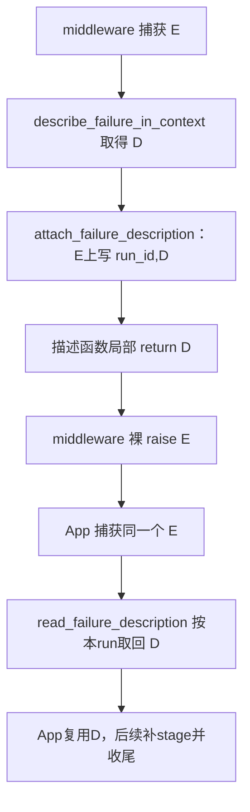

# Lesson 43：描述怎样随原异常回到应用

> 2026-10-11开始。Lesson42普通模型委托/缺省复述正确后，进入标注回传。当前只讲①正常标注/读取，②③④尚未展开；不记本人已理解或独立debug。

## 模块职责与数据形状

分类阶段已经有原异常E与描述D。本模块使D附在E上，middleware继续抛E，App捕获E后按本run读取D；不新增通用包装异常、全局ID回查表或再次分类。

本例选TimeoutError参数案例error0，D手动构造为model/transient/timeout/TimeoutError，教学单元只验证承载不是分类选择：

```python
E.naiyue_failure = ('run', D)
```

属性是二元组：第一项run_id归属，第二项D的同一引用。E仍是TimeoutError，不变成D；D本身不是异常。

## 固定4个场景

| 场景 | 输入/分支结果 | 现有测试入口 |
|---|---|---|
| ① 正常附着与读取，原异常继续传播 | 写入True、读回同D；Fake App保持同E/模型分类一次 | test_failure_annotations.py::test_annotation_preserves_exception_identity_and_cause[error0]；跨层复用test_application_reads_annotation_and_classifies_model_once |
| ② 标注写入失败 | 本例setter拒绝写入，日志/False；E保留，App可回退 | test_failed_setter_keeps_original_exception |
| ③ 无合法标注可读 | 缺少/格式或类型不合法/属性getter抛错→None，不读取cause上的其他错误描述 | test_unknown_is_valid_but_forged_annotation_is_rejected；test_broken_annotation_getter_is_safe_and_does_not_search_cause |
| ④ 标注属于其他run | 拒读、None；单属性共享同异常可覆盖，只保错run拒读，不保证每run永远拿回各自D | 复用test_annotation_preserves_exception_identity_and_cause的foreign读断言 |

这些是教学场景分组，不按每个if拆课。写入失败、读取失效的普通诊断故障和原执行异常区分；必要收尾/事件失效细节留Lesson44。

## 真实普通模型失败主线



describe_failure_in_context先用policy.describe得D，再附着E，最后返回D。返回D的局部函数结束，不会把外层模型调用变成成功。模型wrapper的except在_failed完成后裸raise当前E。App RunObservation._describe_failure首先读标注，读到合法D就直接返回；读不到才走已学的App try/运行层回退。

## 当前①：先用局部单元看两个对象与归属

测试test_annotation_preserves_exception_identity_and_cause有error0/1/2参数，error0是TimeoutError；其他异常案例仅验证标注不改已有属性，不当作这些类型应分类成timeout的证据。VS Code选择error0，15行入口断点。

| 时点 | 输入/返回/副作用 |
|---|---|
| attach之前 | E与D分别存在，run_id='run' |
| attach_failure_description(E,D,run_id='run') | 返回True；写E.naiyue_failure=('run',D) |
| read_failure_description(E,run_id='run') | 验tuple/run/type/字段，返回同一D |
| 单元检查原属性 | args/cause/context/suppress_context与写入前相同 |

在attach帧看type(error).__name__、vars(description)、run_id；赋值67行执行后看error.naiyue_failure[0]和error.naiyue_failure[1] is description。在read帧看value[0]、run_id与value[1]；返回测试后读回is desc。原异常cause只是本测试用于验证未改的既有字段，不在本次展开Python异常链全部机制。

该局部单元没有抛E，不证明middleware裸raise；完整Fake App测试已另验证caught.value is error、模型规则只调用一次及最终分类，当前图的边界由两类证据区分。App增加stage与RunFailureData投影留下一主题。

助手执行collect-only得到error0/1/2三个入口，再运行error0单例：1 passed in0.49s。无模型请求/生产或测试代码变更，本人理解/单步仍待反馈。下一步确认正常标注/读取，再讲写入失败与读取/归属回退；独立规则练习仍待安排。
