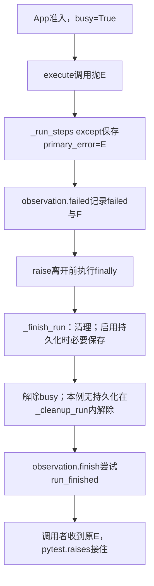
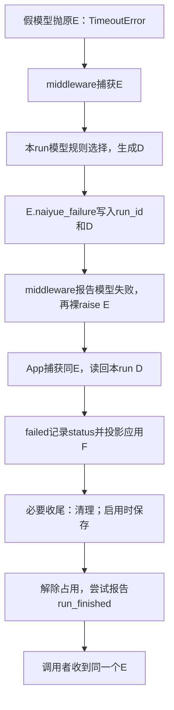

# Lesson 44：应用层怎样记录结果并完成收尾

> 2026-10-11开始，2026-10-12当前④终局投递普通故障。前面清理/保存分支已讲未新增用户理解证据，failed局部观察有自述理解。四组讲解到末尾，完整run/driver仍不展开，本人综合链追踪/规则编写练习待开展。

## 模块职责与分支地图

SessionService负责准入/执行阶段/必要收尾/占用，RunObservation保存本次结果和安全失败数据并尝试观察投递。D.category不直接决定run.status；普通未处理异常到应用则failed，正常返回由pending/run_stopped等事实判定interrupted/stopped/completed。进程/Graph信号和异步取消属于专门控制合同，不能套普通Exception路径；完整算法留相应章节。

本课按4组组织，每组关联已有确定性测试，不以所有if计数：

| 组 | 情况与本课重点 | 当前测试入口 |
|---|---|---|
| ① 结果与正常收尾 | 正常completed、审批interrupted、用户stopped、普通异常failed；阶段prepare/execute/finalize | test_application_run_events.py::test_success_events_follow_cleanup_without_changing_result；test_approval_terminal_is_installed_before_notification_and_resume_is_new_run；test_stop_busy_gate_and_active_subscription_snapshot；test_application_run_event_failures.py::test_stage_failure_keeps_original_exception_and_cleans |
| ② 必要清理失败 | 没有原失败时清理故障成为对外异常；已有主异常时日志并保留主异常 | test_application_run_event_failures.py::test_cleanup_failure_is_reported_without_masking_primary[False/True] |
| ③ 必要保存失败 | 原本正常也不能报告成功；已有主异常时保存故障不替换主异常，未确认状态继续阻止准入 | test_persistent_sessions.py::test_final_save_failure_has_no_completed_and_blocks_uncertain_state；test_primary_model_failure_survives_secondary_store_failure |
| ④ 描述/观察故障 | 安全描述回退、普通终局投递失败不覆盖原执行错误；成功观察故障不改变真实成功 | test_application_run_event_failures.py::test_failure_diagnostic_fault_does_not_replace_primary；test_terminal_publish_fault_does_not_replace_primary；test_observation_isolation.py::test_success_survives_publish_fault |

结果对照只先定位，不要求本章深入停止/审批调度。组②③覆盖primary/secondary合同，组④只隔离普通观察Exception，不把必要保存或进程信号放进可忽略的catch。

## 当前①：执行失败，必要收尾正常

复用test_stage_failure_keeps_original_exception_and_cleans[execute]，16行测试入口。创建本地无持久化App和会话、订阅仅run_started/run_finished，再用monkeypatch把SessionService模块的invoke_agent_run替换为fail；fail抛同一RuntimeError('PRIVATE_ORIGINAL_ERROR')。这是一条应用生命周期单元，直接在Runtime入口边界注入，不调用真实模型，也不验证前几课的middleware分类/标注。选择它便于单步隔离当前模块，真实TimeoutError模型路径仍从同一个App except继续。

本例代码产物：原E=RuntimeError，primary_error引用E；observation.status='failed'；D由App未认领后的Runtime默认规则生成runtime/unknown/unclassified/RuntimeError；F=RunFailureData(stage='execute',category='unknown',reason='unclassified',error_type='RuntimeError')。stage来自抛错时observation.stage，而不是E或D。订阅列表只收开始/终局，助手单元断言证明身份、终局failed/execute/unknown/RuntimeError及结束busyFalse；中间busyTrue为当前源码时序，不冒充该测试已显式断言。



顺序限定收尾正常的普通失败。failed记录时仍占用；无持久化在_cleanup_run清busy，有持久化先清理、尝试保存，再在finally清busy，随后终局。busy解除不保证所有准入条件通过，也不保证调用者已经收到异常；持久化失败可以在busyFalse后继续阻止下一run。

### 函数输入/返回/副作用

| 函数 | 输入/结果 |
|---|---|
| LocalApplication.run / SessionService.run | session与messages，委托run_steps驱动共同_run_steps |
| run_steps | 执行IOCall记录的函数/参数；故障通过steps.throw(E)交回生成器当前yield处 |
| _run_steps except | 记录primary_error=E、调用failed，最后裸raise；finally仍执行_finish_run步骤 |
| RunObservation.failed | E+当前stage→读取/回退D→F；status=failed，不在此解除busy |
| _cleanup_run | 清队列/关闭控制/移除active_runs/清资源标记；本例busyFalse、run_idNone，返回review_required=False |
| _finish_run | primary_error=E；当前无二次故障，清理后尝试finish，正常返回None |
| RunObservation.finish | 使用已有status/F构造RunFinishedData并投递；不是第二次分类 |
| pytest.raises | 收到E，测试caught.value is failure验证同一对象 |

IOCall是函数和实参的执行记录，不是函数返回值；yield后run_steps实际调用，出错steps.throw把E送回_run_steps。因此单步会在driver和生命周期函数之间切换。只解释这条执行桥，不深入框架图调度。同步App用于确定性单步，正式CLI/Web异步通过arun_steps驱动同一个_run_steps，异步必要收尾为_afinish_run；本测试不证明异步取消/部分工具核对。

## VS Code入口与观察

选择参数案例execute，仅16行入口断点，Debug Test；准备F10，app.run从31行F11。进入SessionService时看session字典的busy/run_id；进入_run_steps时看observation.stage/status、primary_error；fail抛错后看except与finally。到了_finish_run，观察primary_error、secondary、self._persistence；当前None持久化走_cleanup_run，随后finish。

当前帧精简表达式：

```python
{'stage': observation.stage, 'status': observation.status}  # _run_steps/_finish_run帧
{'busy': session['busy'], 'run_id': session['run_id']}       # session字典帧
type(primary_error).__name__ if primary_error is not None else None
vars(self.failure) if self.failure is not None else None  # RunObservation帧
```

在RunObservation帧self是观察对象，在SessionService帧self是会话服务，不混用变量。返回测试后看caught.value is failure与vars(terminal.failure)，received仅两个生命周期事件；原模型/tool等事件不由此订阅收集。不要把外层session变量（字符串ID）当内部session字典。

## 实际验证和下一步

`.venv/bin/python -m pytest -q 'tests/test_application_run_event_failures.py::test_stage_failure_keeps_original_exception_and_cleans[execute]'`→1 passed in0.50s。本轮仅当前单元和文档检查，不是新全量/构建/实网证据；未改生产/测试/IDE配置，用户实际debug/理解尚待反馈。

下一步将prepare/finalize参数放回同一阶段图快速对照，进入②必要清理失败的primary/secondary分支；③保存、④观察随后继续。综合TimeoutError完整链追踪与本人分类器练习仍待，不把已讲或助手运行算用户掌握。

## 用户调整调试起点：先停在failed局部

用户明确尚未学run相关逻辑，询问便于理解的断点。当前暂停从测试16行F11追整个app.run/driver的安排；先复用同一execute案例启动，在application/run_events.py第140行（failed第一条执行语句）设唯一断点，F5到该函数后再局部单步。

当前帧self是RunObservation，error为注入的RuntimeError，stage参数None、self.stage='execute'。WATCH用type(error).__name__、self.stage、self.status、vars(self.failure) if self.failure is not None else None。初始status='completed'/failure=None只是对象初始化值，尚未发布成功终局；144执行后status='failed'，146执行后F=execute/unknown/unclassified/RuntimeError。

140普通Exception检查F10；144记录status F10；146按需F11进入已学_describe_failure/read/App未认领/Runtime默认与run_failure_data投影。152/153观察调用F10跳过，Shift+F11退出failed后F5让当前尚未学的run/收尾完成，再看测试断言。只学习error→D→F与状态副作用，暂不深入generator/IOCall/完整run，不把failed返回None当app.run成功。

此方案复用现有应用测试，用业务函数断点跳过准备链；不是新的纯局部单元，未创建额外测试/helper或更改IDE配置。当前测试重新运行通过，实际结果记录handoff第328节。唯一下一步依据用户在failed帧看到的数据讲D→F/stage，run与清理故障暂缓。

## 点名疑问：为什么resolve出现两次、builtin不同

用户自述failed局部逻辑理解，并报告中间两次分类跳转不明：第一次未带分类器/未得到结果，随后describe调用另一个默认分类。核对当前路径：App try_describe的resolve(source=application,builtin=_application_classification,fallback=False)，无自定义规则仍执行应用builtin；该规则只识别会话/审批/保存/项目指令等应用错误，不识别普通RuntimeError，所以返回None表示未认领。不能把未认领归因为classifiers为空。

_describe_failure随后在stage=execute时调用RuntimeErrorPolicy.describe(error)，默认source=runtime；本例没有保护类型，进入resolve(source=runtime,builtin=_runtime_classification,fallback=True)。Runtime builtin识别TimeoutError/ConnectionError，普通RuntimeError仍返回None，resolve此时补runtime/unknown/unclassified/RuntimeError D。第二次同样没有识别具体分类，最终D是fallback产物。

共用resolve选择机制，不同层传入自己的builtin和兜底合同；应用层正常未认领返回None允许后续层接手，若首次给合法unknown D就会被采用并停止。此测试直接替换invoke入口，没有middleware标注；真实普通模型失败若已有本run合法D，read第一步直接返回，不必跑这两轮。App此处调用try_describe，不是ApplicationErrorPolicy.describe。

WATCH在两次resolve帧看source、builtin.__name__、classifiers、fallback，内置调用结束看classified；本例两次classified都None，fallback先False后True。独立进程合成RuntimeError局部探针输出application builtin=None/try_describe=None、runtime builtin=None/describe为runtime unknown D，退出0；只验证策略局部行为，非新增全量/模型/IDE运行。未改产品或测试，run/收尾仍暂缓。

## 本人复述：分层认领与传播方向

用户说分层清晰，所以异常先应用层处理，不能处理往下交。确认本例App未认领→Runtime的选择顺序理解；进一步限定这是描述查找，原异常仍从Runtime/middleware向App/调用者上抛。App先尝试复用已有本run D，读不到且应用未认领、处于execute才委托Runtime；不能概括所有异常都先由App分类，或分类函数负责恢复/吞掉E。此限定已讲，未将纠正后的完整表述记成用户已新复述或独立实现。

## 当前局部：D→F投影及诊断回退

用户继续，保持完整run/收尾暂缓。146行依次求值：self._describe_failure(error)取得D，stage or self.stage取得阶段，run_failure_data(D,stage=选中阶段)构造F，最后写self.failure。等价拆分变量只用于讲解，未改生产。

本例D=runtime/unknown/unclassified/RuntimeError；stage参数None、self.stage=execute，因此F=execute/unknown/unclassified/RuntimeError。run_failure_data复制分类三字段到新RunFailureData，按当前事件合同不携source、添加stage，不再分类、不修改D。显式stage=cleanup覆盖F阶段，不在此改变self.stage。构造时__post_init__检查阶段与字段格式，复用已学机制。

普通故障复用test_failure_diagnostic_fault_does_not_replace_primary[raises/invalid_codes]，135行测试入口。原E为RuntimeError，替换_describe_failure为抛ValueError或返回非法category/reason；故障分别在取得描述、构造F时产生。failed except安全日志，直接构造有效当前stage/unknown/unclassified/原E安全类型的F，不再调用_describe_failure/resolve、不构造中间D。status仍failed，原E由外层传播；本例stage合法，不泛化所有非法stage也必能回退。

保持run_events.py:140唯一断点。146处F11/Shift+F11依次追描述与run_failure_data，该帧看vars(description)、stage，回failed看vars(self.failure)。故障案例看error=RuntimeError/diagnostic_error=ValueError与直接生成F。152/153仅定位为向turn/context观察器投递失败事实，先F10跳过，下一步再讲普通观察故障。

三单例（execute+raises+invalid_codes）共同运行3 passed in0.65s；本地真实RuntimePolicy/run_failure_data探针输出D.source=runtime、F.stage=execute、其余三字段一致、D来源未变True，退出0。无生产/测试/配置修改、新全量/构建/模型/IDE或提交；已讲不新增用户复述/debug证据。唯一下一步局部观察投递边界，再按准备程度回run/收尾。

## 当前局部：两个observe的职责与普通故障隔离

failed已记录status/F，152行observe(self.turns,self.turns.fail,self.failure)将F交给轮次观察器；153行observe(self.context_operations,self.context_operations.finalize,error)将原E交给上下文操作观察器。diagnostic参数由observe消费，指定安全日志名，不作为被调方法实参；实际方法分别fail(F)与finalize(E)，不再次选择错误描述。

TurnObserver.fail只在未disabled且_phase=active时调用_finish('failed',F)，更新轮次阶段并发布turn_finished，载荷含已有轮次身份/status/F；不保证每次应用失败都有轮次事件。ContextOperationObserver.finalize对仍在_records中的普通未确认压缩/溢出恢复记录关闭为unconfirmed，原因分别state_replacement_unconfirmed/retry_response_unconfirmed，再flush投递；本方法收束观察记录，不执行压缩/恢复算法，F与原E在两调用的用途不同。控制信号有更早清空记录的分支，留控制章节。

当前入口替换execute测试没有走模型调用，所以turns._phase=idle、context._records为空：两个方法正常返回，无这些操作事件。不要将正常空返回误判为observe捕获故障。真实假模型超时的test_failed_model_has_failed_turn_without_visible_assistant[timeout]（21入口）会先开始轮次，失败后有turn_finished/failed/timeout；只在run_events.py:140断点F5跳过尚未学的run链，152处F11进入observe与fail即可。

observe的方法体分支：observer缺失/此前_observation_failed则返回fallback；正常执行operation(*args,**kwargs)；普通Exception则标记该observer失效、记录diagnostic/方法名/安全类型、返回fallback。默认fallback=None，当前两调用不使用返回值，self.status/F保持此前记录；一项普通故障不阻止下一项observe。KeyboardInterrupt等BaseException不在该except隔离范围；方法绑定/非callable接口错误也显式失败，不泛化所有编程错误都被吞。

原异常与观察故障保留合同复用test_turn_reporting_secondary_error_does_not_mask_primary（284入口）：假模型抛原TimeoutError，替换TurnObserver.fail为fail_reporting(F)抛ValueError；observe日志turn_failure_publish_failed/operation=fail_reporting/error_type=ValueError，返回None，后续context通知继续，最终run failed/caught为同原TimeoutError。当前测试直接断言原身份/状态/日志，_observation_failed与后续跳过由test_method_body_fault_is_isolated_once_with_safe_diagnostic[ValueError]（55入口）独立验证，不能把源码推断当端到端测试已有全部断言。

上下文记录正常unconfirmed分支复用test_unconfirmed_state_is_diagnostic_not_a_fabricated_applied_result（30入口）：直接构造记录并finalize，无完整App/压缩算法也未传原E，只验证未确认记录不冒充applied。保留run_events.py:140局部主入口；observe帧看operation.__name__、args和getattr(observer,'_observation_failed',False)，turn方法看_phase/failure四字段，context方法看_records数量。当前empty基线可F10，active与观察fault案例按需F11；不用展开整个对象/事件树。

本轮5单例（execute空观察、timeout轮次正常、turn报告普通故障、context未确认、helper故障仅执行一次）共同5 passed in0.80s；文档/test入口检查。无产品/测试/IDE配置改动、新全量/构建/实网或提交。failed局部正常/诊断/观察边界已讲，用户新复述/debug未新增证据；完整run与必要收尾仍暂缓，下一步先收束局部模块，再根据用户准备程度选择阶段时序。

## 当前②：清理过程又抛异常，保留哪一个

用户说观察部分理解并继续，仅记录该局部自述理解；进入_finish_run的异常取舍，完整run/driver不展开。输入primary_error是进入收尾前已有的异常或None，observation已保存本次状态/F；函数本地secondary初始None，用于保存后续需要对外抛出的收尾错误。测试中的secondary变量一直指ValueError对象，与函数本地secondary槽分清。

复用test_cleanup_failure_is_reported_without_masking_primary[True/False]，44行测试入口，当前推荐只在session_service.py:436设函数入口断点、F5跳过前面run。两例都把_record_steering替换成fail_cleanup抛同ValueError，并提前入steering_queue保证清理后半discard记录会被调用；故障点在429–430，队列和本例无持久化的busy已经清除。不把本例busyFalse断言泛化为所有清理位置故障均已验证。

True例在prepare_run_resources抛原RuntimeError，进_finish_run时primary_error=原E、status=failed、F.stage=prepare、secondary=None。清理ValueError进入except后因primary非None只记session_cleanup_failed，不改此前F或secondary；继续后续收尾/终局，本函数正常返回，原E由外层继续传播。保留最初主异常，不把清理故障抛给调用者取代它。

False例业务正常完成，进_finish_run时primary_error=None、status=completed、failure=None。本例清理ValueError赋给本地secondary，并调用已学observation.failed(error,stage='cleanup')，令status=failed、F.stage=cleanup。没有立刻raise，继续剩余收尾/终局后在472–473抛secondary，调用者得到同ValueError。self.stage在本例仍finalize，显式stage只令F.stage=cleanup，连接上节字段来源。

两例当前self._persistence=None，447保存分支跳过；467的observation.finish只定位为用已有status/F报告终局，保存故障后续再讲。WATCH在_finish_run帧看type(primary_error).__name__ if primary_error is not None else None、对应secondary、observation.status、vars(observation.failure) if observation.failure is not None else None；当前self是SessionService，状态对象是observation。439可F10执行清理直接看到except，再逐步比较两分支；不要求深入队列算法或generator。True最终函数返回None不代表整次运行成功；原E仍外层待传播。

两参数测试共同2 passed in0.76s；断言caught同primary/secondary、终局failed、阶段prepare/cleanup及本例busyFalse，安全日志无PRIVATE。当前代码/入口/文档结构验证，无产品/测试/IDE配置改动、新全量/构建/网络或提交。已讲，不新增用户两分支复述/debug证据；唯一下一步确认主/次异常取舍，再接必要保存失败的同一规则。

## 当前③：必要保存失败与会话阻断

用户继续，②只记已讲，当前仍以_finish_run局部为入口。447–448启用持久化后调用SessionPersistence.finish；本课F10执行该调用，暂停于外层except再观察，不深入其run_steps/生成器或完整checkpoint算法。保存合同为记录本次结果/确认可恢复状态；普通保存故障不能作为观察故障直接降级成成功。

复用test_final_save_failure_has_no_completed_and_blocks_uncertain_state（65入口）：业务正常、清理正常、进入保存前primary_error/secondary均None、status=completed。storage.finish_run被替换为抛SessionPersistenceError('safe')；持久化边界将session加入_blocked并抛新的SessionPersistenceError('session_save_unconfirmed')，外层将其记入secondary并failed(stage='finalize')。当前F=finalize/persistence_error/session_save_unconfirmed/SessionPersistenceError。finally解除busy，随后尝试终局并raise secondary，不能报告completed。

复用test_primary_model_failure_survives_secondary_store_failure（156入口）：假模型抛原TimeoutError，保存记录失败结果时storage.finish_run又抛OSError；持久化边界转换为SessionPersistenceError('session_save_unconfirmed')并保留__cause__。外层因primary非None只记session_persistence_secondary_failed，不覆盖原失败描述，对外仍同TimeoutError。该领域存储故障转换是持久化合同，不是FailureDescription包装异常，原模型E未替换。若已有清理secondary，同一条件也不会用保存故障覆盖它；此组合由源码条件定位，本轮两单元不是该组合独立验证。

busy表示当前占用，_blocked表示持久化安全门禁。保存故障后前者在外层finally置False，后者已在持久化except记录session_id；后续SessionPersistence.start检查_blocked并拒绝再次执行。两测试注入finish_run更新前故障，所以数据库state仍running；一般保存故障只保证未确认/阻断，不将所有失败DB状态都断言为running。完整重启恢复合同留存储章节。

继续session_service.py:436唯一断点，从选中测试Debug Test/F5进入函数，439清理F10、448保存F10，观察450的primary_error/secondary条件、452更新状态/F、458解除busy与473最终抛出。WATCH在当前SessionService帧看self._persistence is not None、两异常安全类型、observation.status、vars(observation.failure)、session['busy']、session_id in self._persistence._blocked。下一次start被拒绝为同一局部门禁，不要求追完整run。第一测试第二次app.run会再次命中收尾入口，第一次失败状态观察完成后可F5让断言结束。

两保存测试共同2 passed in0.91s；第一例直接断言DB running/终局failed/busyFalse/再运行拒绝，第二例断言原TimeoutError身份/DB running/次要保存日志安全。本地ApplicationErrorPolicy与run_failure_data探针确认finalize F四字段，退出0。无生产/测试/配置改动、新全量/构建/供应商/IDE或提交；使用pytest临时SQLite，不操作用户真实存储。当前已讲未新增复述/debug证据；唯一下一步终局投递的普通观察故障，再收束应用错误边界。

## 当前④：run_finished投递故障（2026-10-12）

用户继续，保存仅记已讲。RunObservation.finish先flush已有控制/上下文观察，再在普通终局未抑制时调用emit_event(publisher,'run_finished',payload工厂)。工厂立即在emit_event的try内构造RunFinishedData，字段为此前status/stop_mode/manual_review_required/F；它报告已记录结果，不在这里重新分类或把运行设置为成功。

emit_event在publisher存在时同时保护载荷构造和publish，普通Exception记录run_event_publish_failed/event_type/安全异常类型并结束，不修改status/F、不重试或保证最终送达。publisher缺失直接返回，BaseException不归普通投递降级。当前两例注入publish在run_finished处抛ValueError，事件没成功发布，但本次结果和对外异常保持。

正常结果故障用test_success_survives_publish_fault[run_finished]（22入口），本地假模型成功返回，终局publish抛ValueError，结果仍PRIVATE_REPLY且busyFalse，有安全投递日志。原失败故障用test_terminal_publish_fault_does_not_replace_primary（166入口），invoke入口抛原RuntimeError，再终局publish抛ValueError；调用者caught同原E，busyFalse、安全日志保留。后者不调用真实模型，前者不请求网络，两例不验证客户端收到终局。

这两条普通发布故障均在emit_event内处理，observation.finish正常返回，因此不会进入_finish_run的468–471外层except。外层是额外保护：只对实际逃出finish的异常执行；无primary/secondary/已记录failure时重抛，否则日志保留既有失败。本课依据源码定位该额外分支，不把两个publish注入测试称其覆盖证据。

VS Code将主断点换为run_events.py:169，F5到finish内事件调用后F11进emit_event；该帧看event_type、payload是否callable；44行按需F11看工厂构造与publish注入，45–47捕获ValueError。回finish看self.status与vars(self.failure)，对外在测试result或caught断言观察。成功案例self.failure=None、status=completed；失败案例F=execute/unknown/unclassified/RuntimeError、status=failed。未知stop/控制/Graph抑制另留相应章节，不将完整run驱动拉入当前局部。

两测试共同命令`.venv/bin/python -m pytest -q 'tests/test_observation_isolation.py::test_success_survives_publish_fault[run_finished]' tests/test_application_run_event_failures.py::test_terminal_publish_fault_does_not_replace_primary`→2 passed in0.91s。文档/断点位置/diff检查，无生产/测试/IDE配置修改、新全量/构建/实网或提交。当前四组讲解覆盖不代表用户独立掌握；唯一下一步正常TimeoutError链与四组失败边界合图，关联既有综合测试再安排本人规则练习。

## 调试疑问：原始publish里没看到raise（2026-10-12）

用户报告从finish进入publish没见抛错，暂停合图/下一内容，先定位故障注入。此前指引只说进入publish不够具体：本例故意raise在测试替换方法，不在events.py的原始RunEventPublisher.publish。失败终局测试保存original引用，再monkeypatch类方法为fail_terminal；run_finished时在test_application_run_event_failures.py:180抛ValueError，其他事件181回原publish。成功参数测试对应test_observation_isolation.py:28，仅kind匹配所选event_type时抛错。

当前用户实际测试/参数尚未确认，已异步询问，不断言用户选错。若仍旧execute/保存用例，终局publish无此注入；若当前事件为controls.flush等非run_finished，即便正确测试也会回原publish；若成功参数选其他事件，run_finished也走原publish。在emit_event帧用publisher.publish.__func__.__qualname__查看当前方法绑定、event_type查看当前事件，均只读元数据，不重执行函数。

最直接定位方案：只在test_application_run_event_failures.py:180设raise断点，Debug Test test_terminal_publish_fault_does_not_replace_primary；停止时event_type=run_finished，F10抛错后进入observation.py:45–47的emit_event捕获/安全日志。预期普通报告异常被捕获，测试仍通过；终端无红错/未捕获异常暂停不代表没有raise。若用成功参数案例选择[run_finished]并在测试28行同理观察。无需更改debug配置。

两正确终局故障测试重跑ERROR实时日志，均run_event_publish_failed event_type=run_finished error_type=ValueError，2 passed in0.91s。只验证助手运行的两个指定用例，不声称已经看到用户IDE状态。无产品/测试/配置改动；唯一下一步确认用户当前测试/参数与事件/替换函数，观察实际raise和捕获后再收束。

用户随后确认当前test_success_survives_publish_fault[run_finished]，不再猜错测试。对应实际故障点test_observation_isolation.py:28，建议唯一raise断点；fault帧中kind是本次实际事件，event_type是外层测试选定目标，两者同run_finished才raise，否则29行回原publish。若在原publish看到普通步骤，要核对该帧事件类型，不能由当前描述断言用户停在何事件；finish前两flush也可能有其他事件。保持具体参数用例，28处F10后在emit_event捕获观察ValueError，正确预期仍通过；当前用户实际暂停帧/事件未直接观察。

### 用户反馈：参数选择问题已解决

用户随后明确“之前参数选的不对，这次理解了”，确认先前未见终局raise由参数选择导致，报告修正后理解。记录用户本人调试反馈和此分支自述理解；没有直接查看其IDE或输出，不扩展为完整链独立debug/实现验收。kind为实际事件、event_type为选定故障目标，匹配才raise，否则回原publish；emit_event捕获后仍返回正常结果。当前调试疑问收束，下一步合普通TimeoutError主链与结果/清理/保存/观察边界，不重讲参数问题。

## 第二章异常主链合图（2026-10-12）

范围：本次模型调用最终抛普通TimeoutError，未恢复，标注合法，必要收尾和观察正常。复用test_failed_model_has_failed_turn_without_visible_assistant[timeout]，本地假模型_generate抛E，经过真实项目middleware/框架/App，与直接替换invoke入口的RuntimeError用例分清。完整run_steps/框架调度/压缩恢复算法仍不展开。



生成D真实调用链：middleware._failed→describe_failure_in_context→context策略RuntimeErrorPolicy.describe(source=model,model_id=A)→本run ModelCatalog.failure_describer快照端口→describe_model_failure→resolve_failure→classify_model_failure。内置Timeout类型识别transient/timeout，D=model/transient/timeout/TimeoutError。属性是(run_id,D)，局部return D回middleware，裸raise继续传播E；App读到同D即返回，不再走App→Runtime未认领回退。

应用F=execute/transient/timeout/TimeoutError，source不在事件合同内；终局RunFinishedData(status=failed,failure=F)，本例manual_review_required=False、stop_mode=None。模型调用失败事件也由同D单独投影一次F_model（默认execute），与F_app字段相同但不是同一对象；不能把F仅说成App产物或把两份F身份相同当合同。E全程同对象，D在本例写读同对象，F为分别生成的事件数据，status为App记录的结果。

| 分支组 | 正常或故障取舍 | 图中位置 |
|---|---|---|
| ① 结果/描述 | 正常返回按结果事实；本例未恢复E令App failed。规则正常未认领/诊断回退、标注失效按前课描述合同，D类别不直接执行恢复 | B–G |
| ② 清理故障 | 有主E日志保留；无主E则cleanup F和收尾异常，继续剩余收尾后抛 | H |
| ③ 保存故障 | 有更早失败保留；无更早失败则finalize F/保存领域异常；保存未确认会阻断会话，busy解除不等于重新准入 | H–I |
| ④ 普通观察故障 | 日志降级观察、可能缺事件，不改变已发生成功或替换原E；BaseException和额外接口/逃出故障另按控制合同 | E/G/I |

主链定位表：call_observation._failed（模型D/模型事件）→contracts.attach/read（载体与run）→RunObservation.failed（status/F/观察）→SessionService._finish_run（清理保存/主次异常）→RunObservation.finish/emit_event（终局观察）。准备阶段的目录快照与RunServices只沿Lesson42已有地图，不重启讲解。停止/审批/工具恢复/副作用/摘要等深分支留对应章节，图不是全项目所有异常必须经过的统一链。

当前综合单例命令`.venv/bin/python -m pytest -q 'tests/test_turn_failure_boundaries.py::test_failed_model_has_failed_turn_without_visible_assistant[timeout]'`→1 passed in0.77s，直接断言原E身份、turn_started/turn_finished、失败轮次reason=timeout及run failed。额外独立进程复用同假模型/App，在MonkeyPatch作用域内仅包裹真实App描述读取记录返回D，测得same original E=True、D=model/transient/timeout/TimeoutError、App reuses D=True、F=execute/transient/timeout/TimeoutError、status=failed、busy after=False、separate model/app F objects=True。这是助手本机确定性证据，无网络/供应商/真实存储/用户IDE验证。

VS Code继续选明确[timeout]参数，沿用run_events.py:140局部入口。该帧看type(error).__name__、vars(error.naiyue_failure[1])、error.naiyue_failure[0]==self.publisher.run_id；146单步read直接复用D，再投影self.failure，观察status/F。其余已学边界按需进入，未知run/框架驱动F5跨过。回测试看caught.value is failure、events[-1].data.status和vars(events[-1].data.failure)，不再用重执行函数取得返回值。

合图已讲不等于独立综合追踪验收；本轮无生产/测试/IDE配置修改或全量/构建/实网/提交。唯一下一步用固定(error,source)协议做本人同步分类器小练习，完成本范围检查后回第二章stop_reason；不默认异常6主题讲解收束就达到独立实现或面试追问。

## 本人分类器练习：已布置，用户暂缓（2026-10-12）

用户继续，开始一个同步规则函数exercise_classifier(error,source)的本人实现练习。只给需求/异常形状/调用入口，不由助手代写答案或创建未完成的测试文件。两个异常类PracticeQuotaError(Exception)、PracticeUnknownTimeout(TimeoutError)仅为教学合成输入，在练习代码中定义，不新增生产错误协议。

| 输入 | 自定义规则应返回 | describe_model_failure最终结果 |
|---|---|---|
| PracticeQuotaError | D：source使用实参，limit_exceeded/practice_quota，safe_error_type(error) | model/limit_exceeded/practice_quota/PracticeQuotaError |
| 普通TimeoutError | None | model/transient/timeout/TimeoutError，交内置识别 |
| PracticeUnknownTimeout | 合法unknown/unclassified D，source与原类型匹配 | model/unknown/unclassified/PracticeUnknownTimeout，停止内置识别 |

其他类型返回None。固定两个位置参数、同步函数、按类型判断、固定安全码、不复制error正文。用户先只写函数体回复，后续保留其本人实现、接现有pytest文件加三个可运行测试，并保留规则自身None断言/合法unknown与内置timeout差别；不为了练习创建新框架或配置。不默认用户想直接看答案，卡住时按反馈逐级提示。

骨架导入FailureDescription/safe_error_type，调用describe_model_failure(error,classifiers=[exercise_classifier])；返回形状已在上表定义。基线独立进程无自定义规则实测：PracticeQuotaError→unknown/unclassified、普通TimeoutError→transient/timeout、PracticeUnknownTimeout→transient/timeout（它是Timeout子类），均source=model、保留各自安全类型，退出0。练习要求第三类主动认领unknown，因此与该内置基线形成可观察对照。只验证基线，不声称尚未提交的练习已通过，也不虚构TDD红灯。

当前未新增产品/测试/IDE配置或运行全量/构建/网络，不改变既有代码；规则练习仍未实现/未验收。唯一下一步等待用户函数，检查合同后配测试与VS Code入口单步，再回stop_reason。

用户最新指令“这个先不实现了，继续吧”，练习暂缓，不代写实现、不作为后续课堂阻塞，也不记独立实现完成。按用户意愿回第二章stop_reason，当前位置见Lesson45；上段等待代码是此前安排，已被本次指令覆盖。
