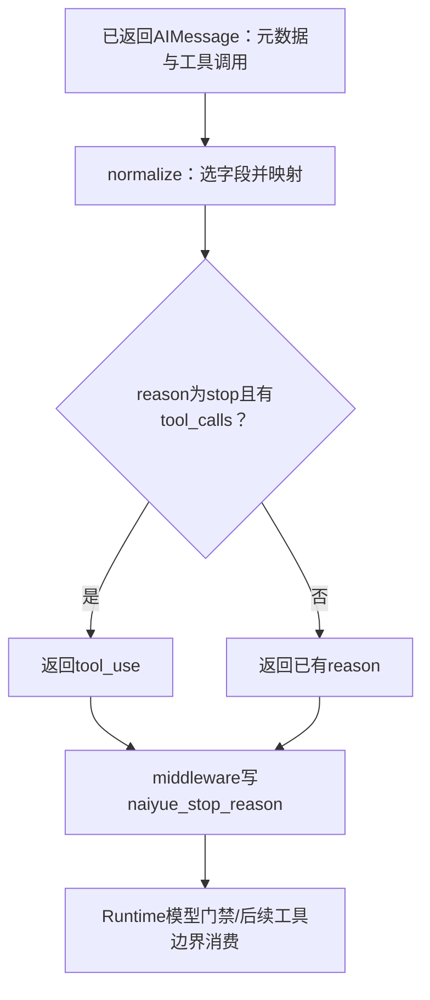

# Lesson 45：模型返回的结束原因怎样归一化

> 2026-10-12讲解收束。正常结束/工具调用与unknown/诊断/优先级有用户自述理解，length/error已讲；第二章主要讲解范围收束，可进入第三章。分类器练习继续暂缓，独立实现未验收。

## 模块职责和输入输出

model_access/stop_reason.py读取已适配AIMessage.response_metadata与tool_calls，返回项目统一的StopReason字符串：stop/tool_use/length/error/unknown。输入是已返回消息，不是抛出的异常；这里unknown与异常描述unknown是不同合同。当前教学数据由测试直接构造AIMessage，未验证真实供应商或适配器全部字段传播。

| 输出 | 当前项目解释 |
|---|---|
| stop | 本次生成结束；后续run/会话行为仍由运行流程决定 |
| tool_use | 响应表示请求工具，执行仍由后续路由/权限/门禁决定 |
| length | 响应结束元数据表示截断/长度限制；工具边界需保护不执行截断调用 |
| error | 已返回响应的元数据映射为错误；Runtime模型门禁会产生项目响应拒绝异常 |
| unknown | 没有已识别的结束原因，当前并不单凭该码阻断所有工具/运行 |

字段选择按存在性优先status→finish_reason→stop_reason→done_reason，选中后不会因值未知继续低优先级字段。字段内映射见当前源码，随后仅reason=stop且实际tool_calls非空时修正为tool_use。unknown_stop_reason_diagnostics是另一个有限诊断函数，使用相同字段来源优先级，后续再讲。

normalize本身不写字段、不修改原生元数据，call_observation._accept第92行才把结果写入response_metadata['naiyue_stop_reason']。纯函数测试只能证明归一化和元数据保持；写回/门禁/工具执行由独立Runtime测试覆盖，不把本轮19例说成整条链验收。

## 当前三分支：stop和tool_use

本机真实AIMessage构造的局部输出：

| response_metadata | message.tool_calls | normalize返回 |
|---|---|---|
| {'finish_reason':'stop'} | [] | stop |
| {'finish_reason':'tool_calls'} | 一条probe调用 | tool_use |
| {'finish_reason':'stop'} | 同一条probe调用 | tool_use |

第三例的工具列表实际形状为[{'name':'probe','args':{},'id':'call-1','type':'tool_call'}]，type字段由AIMessage构造规范化加入；测试传入字典只有前三项。原始finish_reason仍是stop，reason局部先stop，59–60行直接return tool_use；不把WATCH里的reason仍stop误认为最终返回stop。校正只针对stop，不将所有unknown/length/error都因有工具而改tool_use。

## 独立测试与VS Code

复用tests/test_model_stop_reason.py::test_normalization_preserves_provider_metadata三参数案例，collect-only实测ID：

- [metadata0-False-stop]：普通结束。
- [metadata1-True-tool_use]：字段明确工具调用。
- [metadata2-True-tool_use]：stop与实际工具列表校正。

在Test Explorer选具体案例，34行唯一测试入口断点，准备calls/AIMessage用F10，37行调用normalize用F11。函数帧看metadata、reason、message.tool_calls；测试帧tool_calls是布尔参数，生产帧message.tool_calls是列表，两者分清。第三例到59/60观察条件成立及返回表达式，返回值可看(return)；当前测试assert内调用未保存result，不能靠重新执行函数获取返回值。最后38行验证原生metadata保持。

输入message形状：content=''、response_metadata如表、tool_calls=[]或上述列表。本例不读取content正文，也不进入App/框架驱动。当前课只定位真实消费者_accept与_tool rejection读统一key，复杂运行路径留后续分支。

## 本轮证据与下一步

`.venv/bin/python -m pytest --collect-only -q tests/test_model_stop_reason.py`→19 tests collected in0.50s；`.venv/bin/python -m pytest -q tests/test_model_stop_reason.py`→19 passed in0.51s。局部三AIMessage探针三结果如表、原元数据未写新字段，退出0；以上为本机合成消息，未调用供应商/用户IDE或进行新全量/构建。

只新课堂/导航/交接与文档检查，未改生产/测试/IDE配置，未补写用户暂缓的分类器。当前已讲，用户三分支复述/debug未新增证据；唯一下一步length/error分支及它们在模型门禁/工具边界的不同后果，然后unknown有限诊断。分类器练习未验收，按用户最新指令允许继续，不自动补回。

## length/error：两种不同后果

用户明确前三案例已理解，记录该组三分支自述理解；随后继续并询问第二章剩余范围。核对章节地图与Lesson20–25：模型接入五文件中加载/构造/目录、thinking、超时/SDK重试配置、资源所有权均有讲解记录；errors主线按Lesson39–44重建，当前主要剩stop_reason消费/unknown/优先级与章末复盘。估计再2–3轮小课（含本轮），正常讲解单步约1–2小时，依实际疑问调整；这是讲解范围估计，不是独立实现/追问验收承诺。bind_model_output_limit仍按原计划留第7章，不拿它延长当前章；分类器练习继续暂缓。

纯归一化输入length={'finish_reason':'length'}且有工具，返回length，stop校正不适用；error={'finish_reason':'content_filter'}返回error。其他字段的已知截断/错误值按原映射表处理，不因有工具改成tool_use；原生响应字段本身不是Python异常。

length跨层：normalize→_accept写naiyue_stop_reason=length，正常格式响应通过此模型门禁→工具边界_prepare_tool_call→tool_guard_reason先确认latest AI/调用ID匹配，再读length返回model_response_truncated→_prepare返回status=error/匹配tool_call_id的ToolMessage，wrap_tool_call不进入真实handler→错误结果进入后续模型输入。test_truncated_call_gets_error_result_then_model_can_reissue预设三响应：cut/length、good/tool_calls、最终stop，实际executed仅complete，工具结果cut error/good success，下一模型输入确实含cut错误结果。只证明本地框架链允许后续重新发完整调用，不证明真实模型会智能纠正或SDK重试；工具started日志表示边界处理，不能据此说实际工具已执行。

error跨层：normalize→_accept写error→121–122模型门禁raise ModelResponseRejected('stop_reason_error')→同wrapper的_failed生成/标注D并裸raise→App失败与收尾。此E为项目因不可用响应主动产生的异常，不是供应商原API抛错；后续沿已学E/D/F主链。test_rejected_model_message_fails_run_without_executing_any_tool[first0-stop_reason_error]的响应有有效工具，但content_filter使整响应拒绝，executed=[]、没有工具边界事件，run_failed。

| 本次案例 | 精确测试/输入 | 结果 |
|---|---|---|
| 纯length | test_model_stop_reason.py::test_normalization_preserves_provider_metadata[metadata3-True-length] | length，保留元数据 |
| 纯error | 同函数[metadata4-False-error] | error，保留元数据 |
| 截断调用消费 | test_agent_runtime_stop_reason.py::test_truncated_call_gets_error_result_then_model_can_reissue | cut未执行、错误反馈后good执行 |
| 错误响应拒绝 | test_agent_runtime_response_gate.py::test_rejected_model_message_fails_run_without_executing_any_tool[first0-stop_reason_error] | ModelResponseRejected、工具无执行、run failed |

VS Code先选两个纯案例，仍测试34入口F11进入normalize；消费链可按需选一个局部断点：length在call_observation.py:286，error在121/122。F5跨过未学框架驱动，length帧看request.tool_call['id']、last_ai.response_metadata、返回guard理由；下一_prepare看到ToolMessage，wrap在denied非None直接返回。error帧看统一key、有效/无效调用数量与raise，原生message→新项目E分清。无需同时设多个断点或重新运行函数取结果，函数入口可按用户需要使用。

收集实际response_gate参数ID共9例，first0-stop_reason_error已核对。上述四例共同4 passed in0.80s；只本机纯消息/假模型图与假工具列表副作用，无供应商/真实文件写入/全量/构建或IDE配置改动。当前length/error已讲，未新增本组用户复述/debug证据；下一步unknown与有限诊断、字段优先级，然后一次章末复盘。

## unknown、字段优先级与有限诊断

用户继续，length/error仅已讲。当前unknown表示已有AIMessage但结束字段缺失/选中字段值不认识；与原异常E已经抛出后D.category=unknown分清。响应unknown先记录model_stop_reason_unknown，当前没有以unknown本身为条件的拒绝；仍执行原模型门禁。其他条件通过时文本可正常完成、有效工具可路由；invalid_tool_calls非空仍抛项目拒绝异常，不能将unknown说成所有情况必放行或本身保证成功。

四个metadata输入都归unknown：finish_reason=future_reason；{}；status=future_status且finish_reason=stop；finish_reason包含不允许输出的原生值。第三例说明按字段存在性选择status→finish_reason→stop_reason→done_reason，选中status后即使不认识也不继续低优先级finish_reason。末尾stop+tools校正不适用于unknown，存在有效工具时仍返回unknown。

unknown_stop_reason_diagnostics与normalize选同一来源，返回reason_source/native_reason_code/native_reason_redacted三字段；没有字段为missing/None/False，未来短码future_reason为finish_reason/future_reason/False，不允许记录的值为原字段/None/True。允许原生码的形状是1–32位小写字母/下划线且首位字母，再拒绝列举敏感前缀/词；长值、非字符串等也不复制。这里只限制诊断字段，不删除AIMessage原生元数据或宣传整个响应已脱敏。调用方另外补model_id/run_id/normalized_reason与有效/无效工具数量，不复制文本或工具参数。

当前三运行分支：

- 无工具：test_unknown_stop_reason_records_safe_source_without_changing_result的7参数案例，返回文本不变、run_completed，有一条unknown观测及预期有限字段。
- 有效工具：test_unknown_stop_reason_with_valid_tool_still_routes_tool，预设unknown带一调用、随后stop文本；calls一次、run_completed，观测有效数1/无效0。
- 混合有效/无效调用：test_unknown_stop_reason_is_observed_before_invalid_call_rejection，先记unknown观测数量1/1，再抛invalid_tool_calls，calls空、run_failed。日志先发生不代表后续门禁通过。

## 当前精确测试选择

test_agent_runtime_unknown_observation.py中test_unknown_stop_reason_records_safe_source_without_changing_result优先选4参数：metadata0-finish_reason-future_reason-False、metadata1-missing-None-False、metadata2-status-future_status-False、metadata3-finish_reason-None-True。分别观察陌生短码、缺失、字段优先级、原生码遮蔽；metadata4–6是其他拒绝形状，可按需复访，不把每条输入拆一课。

VS Code可在测试92行入口、或当前业务局部call_observation.py:93任选一个起点，F5跳过未学运行驱动；进入unknown_stop_reason_diagnostics后看field/native/safe与返回字典。使用metadata3时避免将原生值放进额外打印/日志，沿代码看遮蔽返回。工具两个分支用明确测试名，按需在_accept123观察invalid列表或在测试末看calls/result/run_events；当前不给强制重复检查题或创建新配置。

collect-only13例，当前`.venv/bin/python -m pytest -q tests/test_agent_runtime_unknown_observation.py -k unknown_stop_reason`→9 passed,4 deselected in0.59s。独立局部四metadata探针返回unknown及三个诊断字段如上，退出0；只确认现有合同，未请求供应商/验证多用户安全或真实模型行为，也未实现更严格unknown拒绝策略。原生码过滤的整个安全性不扩成任意文本无泄漏保证。

当前stop_reason正常/工具/length/error/unknown/诊断/优先级核心都已讲，理解证据按分支保留；下一步一次第二章配置到响应/异常的章末复盘，完整run/middleware调度留第3/5章。本人规则练习继续按用户指令暂缓，不阻塞课堂、不自动补答案。无生产/测试/IDE配置修改、新全量/构建/网络或提交。
