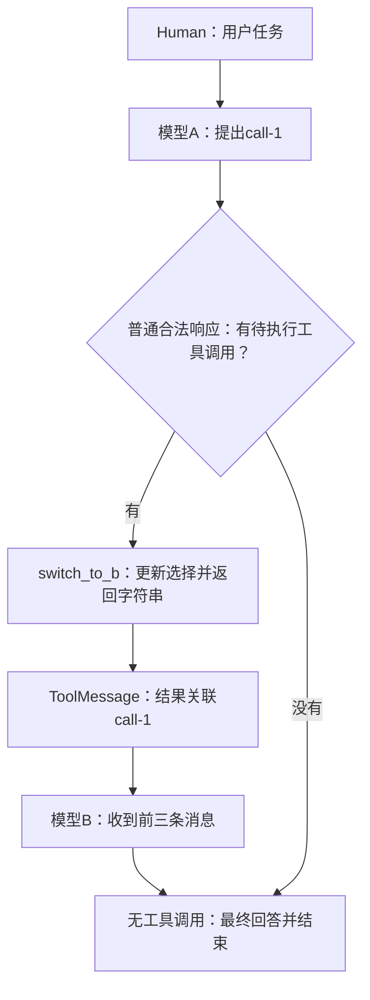

# Lesson 46：消息形状与一轮模型—工具—模型循环

> 第三章第一小节，2026-10-12开始。已核验确定性测试与模型输入轨迹；本课提供讲解与走读材料，用户复述、本人调试和独立实现待验证。

## 职责与范围

通用Agent把用户输入、模型提出的工具调用、工具结果和模型回答放入消息状态，依照当前响应继续调用工具或结束。本课只走一个合法工具调用的正常循环；装配、状态reducer、hook顺序、批次、审批与停止分别在后续主题展开。

本节复用[测试](../../../tests/test_agent_runtime.py)：`test_switches_model_after_tool_result_in_same_run`，无参数化ID。它直接创建LangChain Agent，只注册项目的选模middleware，不经过应用session/run管理。工具改变选择A→B作为可见副作用，不在本节重新展开模型目录配置。

## 数据形状与实际轨迹

以下为本机同一测试的关键字段投影，不是供应商请求或真实模型决策。框架生成的其他字段省略。

```python
HumanMessage(content='switch model, then answer')
AIMessage(content='', tool_calls=[{
    'name': 'switch_to_b', 'args': {}, 'id': 'call-1', 'type': 'tool_call',
}])
ToolMessage(content='selected B', tool_call_id='call-1')
AIMessage(content='answer-from-B')
```

- 测试输入`('user', text)`经消息转换成为HumanMessage，`type='human'`。
- 模型A的固定响应提出工具调用；content为空仍有有效动作，args为空表示没有模型提供的参数。
- 工具`switch_to_b`改变`selected['s1']='B'`并返回字符串`selected B`，不自行创建ToolMessage。工具包装在原调用ID下形成结果消息。
- 第二次选模返回B；B实际收到前三条消息，再返回固定最终回答。
- 工具调用的id与工具结果的tool_call_id配对；它们不同于消息自身的id。

| 时点 | 模型／消息状态的关键内容 |
|---|---|
| A输入 | `[human]` |
| A响应合入 | `[human, ai(tool_calls)]` |
| 工具结果合入，B输入 | `[human, ai(tool_calls), tool]` |
| B响应合入，最终返回 | `[human, ai(tool_calls), tool, ai(answer)]` |



## 分支位置

普通、无结构化输出、无跳转的循环：AI响应没有tool_calls则结束；有尚未返回结果的注册工具调用则调度工具，普通工具结束后回模型；模型再次提出工具调用则继续下一轮。模型门禁、不可配对协议、审批、停止、return_direct与异常是独立分支，不能把本图当完整框架状态机。

结束原因字符串描述单次模型响应；当前版本普通图路由检查最新AIMessage的tool_calls和已返回结果的调用ID。本测试假响应未带供应商结束元数据，出现unknown日志，仍按合法工具调用走正常循环，复用第二章已学合同。

## 关键函数与责任

| 函数 | 本例输入／输出与责任 |
|---|---|
| 测试内`resolve_model(session_id)` | 输入s1；先返回(A, 模型A)，工具后返回(B, 模型B) |
| 测试内`switch_to_b()` | 输入无参数；返回selected B；副作用是更新selected |
| `FakeMessagesListChatModel._generate` | 收到实际消息列表，从预设responses取AIMessage并包装为ChatResult；不推理或联网 |
| 框架`model_to_tools` | 从状态找最新AI与其后的ToolMessage，筛出待执行调用并返回Send(tools)；无工具调用则结束 |
| 框架`tools_to_model` | 本例普通工具没有return_direct，返回模型节点继续处理 |

输入/输出观察须区分：工具主体返回str，工具包装得到ToolMessage，模型内部_generate返回ChatResult，图最终invoke返回含messages的状态字典。

## 测试走读入口

```bash
.venv/bin/python -m pytest -q tests/test_agent_runtime.py::test_switches_model_after_tool_result_in_same_run
```

本轮实际：`1 passed in 0.77s`。额外临时观察复用同一测试，记录两次模型输入及最终消息投影，断言继续通过；没有修改生产或测试实现。

这是实际LangChain图＋项目选模middleware＋假模型＋本地工具的确定性集成范围。它证明消息顺序、结果配对与A→B选择；额外输入观察证明第二次模型收到工具结果。不证明真实模型会自主选择该工具或理解其结果。

入口断点：测试首行`selected = {'s1': 'A'}`。装配用步过，执行阶段跟踪resolve_model、switch_to_b与模型输出；未学习的调度细节暂按合同返回。

| 当前帧／时点 | 精简观察表达式 |
|---|---|
| 测试帧，selected创建后／工具执行后 | `selected`、`selections` |
| resolve_model帧 | `session_id`、`model_id`（赋值后） |
| switch_to_b帧，赋值后 | `selected['s1']` |
| 假模型_generate帧 | `[(m.type, m.content) for m in messages]` |
| 测试帧，invoke返回后 | `[(m.type, m.content) for m in result['messages']]` |
| 同上，配对 | `result['messages'][1].tool_calls`、`result['messages'][2].tool_call_id` |

断点按需添加；查看输出不重新调用工具或agent.invoke。测试末顺序、配对、最终回答与选模断言各证明对应事实，不把工具完成当成整个任务完成。

## 框架核验与待理解

本机版本：langchain1.4.2、langchain-core1.6.6、langgraph1.2.12。核对安装源码：agents/factory.py的model_to_tools、tools_to_model；prebuilt/tool_node.py的_run_one；core/tools/base.py的_format_output；graph/message.py的add_messages与core/messages/utils.py的消息转换。本课只定位职责，内部调度与reducer在后续课堂展开。

### 后续两次讲解的要点收束

- create_agent登记组件和图结构，返回CompiledStateGraph；同一原测试临时观察创建后模型调用0次，invoke阶段2次。保存resolve_model回调不同于执行它；运行时选择模型后才bind_tools。本例无checkpointer，复用图对象不自动跨调用保留历史。
- AgentState的messages声明Annotated[..., add_messages]；框架据此建立状态通道，在节点写入时调用合并函数。模型通过Command提交本次AI消息，工具节点提交本次Tool消息；观察updates/values确认逐步累积为human→human,ai→human,ai,tool→human,ai,tool,ai。
- add_messages按消息id追加或同位置替换，不按正文去重；缺ID先补ID。RemoveMessage已有ID删除、不存在ID抛ValueError，特殊清空标记保留标记后新消息。临时确定性断言覆盖这5项；副作用/工具配对正确性不由reducer证明。
- 消息id服务消息身份/更新，tool_call_id关联模型工具调用；两个合同分别理解。消息更新与模型输入的内部时点已讲，不把继续课堂或助手探针当本人理解证据。

用户理解尚未评估。hook注册与顺序见[Lesson47](lesson-47.md)，按本人走读中的具体疑问回访。
