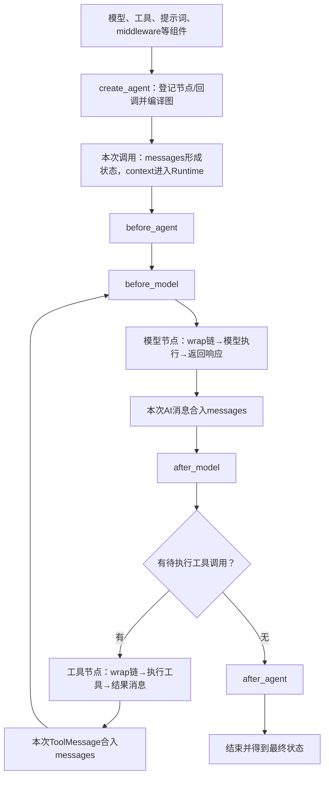

# Lesson 51：第三章总图与收尾

> 2026-10-12，用户选择先收束第三章，delta应用集成测试留第四章。四调用接口区别有用户自述理解；其他主题及本人独立走读/实现不因“继续”自动升级。

## 正常路径总图

这是已核验机制的关系图，非某一条测试的逐项日志。不同实例的实际路径取决于注册的middleware；限定普通合法工具调用、无审批/停止/特殊跳转。wrap与hook的独立证据见Lesson47/48，context与选模见Lesson49。

流式接口可以在执行中输出更新/状态/模型分片，图末E仅表示最终结束，不能把流输出都推迟到E。上下文只在实际消费者处读取，动态选模可在模型wrapper读取context并override请求。

## 责任索引

| 机制 | 输入→输出/责任 | 已有笔记 |
|---|---|---|
| 创建与执行 | 组件→可执行图；本次消息/上下文→运行结果 | Lesson46 |
| hook | 按实现收集/建节点，普通before正序、after逆序；工具后回before_model | Lesson47 |
| wrapper | request与下一层handler→结果/异常；普通进入正序返回逆序，可短路但须合法结果 | Lesson48 |
| context/选模 | 会话ID→解析当前模型→新ModelRequest，原请求/选择不由override自动改写 | Lesson49 |
| 状态合并 | 节点增量→add_messages按消息id合并；tool_call_id另管调用配对 | Lesson46 |
| 输出接口 | 同步/异步×最终结果/流输出；updates/values/messages分开 | Lesson50 |

没有工具调用的合法AI、工具可恢复错误消息、未处理异常、短路是已讲分支入口；审批/停止/结构化输出/return_direct和必要保存改变部分路径，后续按职责展开。after_agent不是finally，图中的一次invoke不等同于应用完整run生命周期。

## 综合阅读入口

- 消息/动态选模：tests/test_agent_runtime.py::test_switches_model_after_tool_result_in_same_run。
- hook：tests/test_agent_middleware_order.py::test_hooks_are_registered_and_ordered_across_two_model_calls。
- wrapper：同文件test_wrap_handlers_enter_return_and_preserve_boundaries[pass]。
- 输出：同文件test_call_modes_share_loop_but_differ_in_output[stream]。

以上不强制一次走完，只在相应概念混淆时回访；没有新增综合测试或重跑已验证用例。独立模块契约不冒充单条生产全链证据。

## 转入第四章

下一主题：模型/工具执行怎样形成可消费的事件，以及消息状态与观察事件的区别。先建立生产→发布→订阅/投影主线；delta可用性测试在讲清message_delta、完整校准与草稿后再本人走读，不作为第三章门槛。

第三章主要讲解范围收束，用户四接口概念有自述理解；独立调试、实现与追问能力未验收。当前下一步第四章第一主题，尚未开课/建Lesson52。本轮仅整合笔记与当前摘要，旧测试结果引用Lesson47–50，不算本轮新测试/构建证据。
