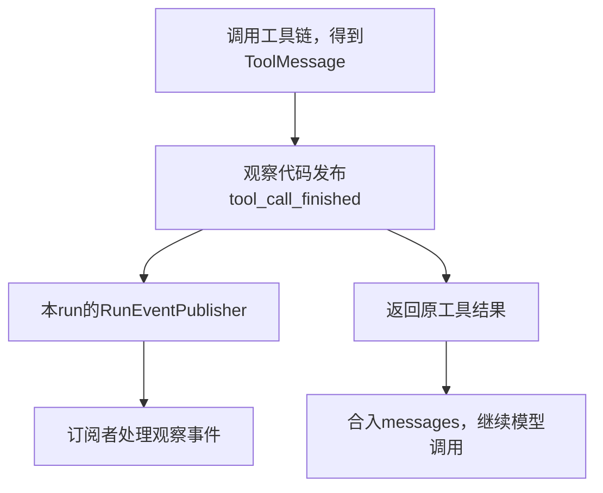

# Lesson 52：会话消息与观察事件的两条路径

> 第四章第1主题，2026-10-12。正常循环测试已核验；用户后续自述理解publish组装/安排交付与_deliver调用订阅者的分工，其余本人走读/复述未评估。同步应用确定性集成用例，不是正式CLI异步入口或真实供应商证据。

## 职责与真实数据

工具probe(value=PRIVATE_ARGUMENT)返回合成字符串PRIVATE_OUTPUT。框架形成ToolMessage(content=PRIVATE_OUTPUT, tool_call_id=probe-1)，合入消息后成为下一次模型输入的一部分。工具调度观察另发布tool_call_started与tool_call_finished；后者data为ToolCallFinishedData(tool_call_id=probe-1, tool_name=probe, boundary=dispatch, outcome=success, reason=None, failure=None)。RuntimeEvent外层补session_id/run_id/sequence/timestamp。



图表示两类消费者与数据职责，非两条独立线程。当前Publisher同步投递，普通观察故障隔离复用第二章合同，慢消费者限制留第3主题。finished发布后原结果才返回图，事件不证明消息已保存/持久确认。

## 最小代码地图

| 入口 | 责任 |
|---|---|
| application.run_events.ApplicationEventSubscriptions.subscribe | 登记同步订阅者；返回取消订阅函数 |
| 同类publisher(session_id,run_id) | 冻结当前监听者，为该run创建发布器，默认包括安全日志消费者 |
| agent_runtime.tool_batch.ToolBatchMiddleware.wrap_tool_call | 进入工具调度观察边界 |
| call_observation.observe_tool_dispatch | 发布started，执行dispatch，按结果/异常发布finished并返回原结果/抛原异常 |
| call_observation._emit→observation.emit_event | 使用context匹配的发布器，保护可选payload构造与投递 |
| events.RunEventPublisher.publish/_deliver | 构造统一RuntimeEvent并交给监听者 |

消费者本例为events.append的过滤包装；CLI/Web可注册各自消费者，当前测试没有运行它们。

## 分支导航

正常结果→success与原ToolMessage；安全错误ToolMessage→error_result且模型可继续；未执行结果→not_executed而非工具主体执行成功；未处理异常→exception或副作用outcome_unknown并保留原异常。status/error_result/finished都不自动决定整个run结果。

这些分支已存在：tests/test_tool_subscription_boundaries.py的test_parameter_validation_is_error_result_not_executor_success、test_truncated_response_returns_original_error_result_without_tool_io、test_fatal_sequential_tool_reports_later_batch_skip；监听故障不改变结果见tests/test_model_tool_subscriptions.py::test_midrun_observer_failure_does_not_change_model_or_tool_result。当前只完整走正常分支，不要求一次学完批次/审批。

## 测试与走读入口

[tests/test_model_tool_subscriptions.py](../../../tests/test_model_tool_subscriptions.py)::test_one_tool_loop_has_correlated_immutable_safe_events，无参数化。make_app将模型目录加载替换成合成ModelCatalog，不读取synthetic.json或真实凭据。

```bash
.venv/bin/python -m pytest -q tests/test_model_tool_subscriptions.py::test_one_tool_loop_has_correlated_immutable_safe_events
```

本轮1 passed in0.81s。主要断言：原工具正文与最终回答、8项调用元数据顺序、模型调用配对/用量、工具probe-1配对、相同session/run及不可变payload、元数据/默认日志不含合成PRIVATE正文。

过滤后的事件：run_started→model_call_started/finished→tool_call_started/finished→model_call_started/finished→run_finished；sequence为1,4,5,7,8,12,13,16。call_metadata_only只保存6种调用元数据事件，其他消息/turn事件仍产生，间隔不代表本例丢失。

重要边界：调用元数据不含结果正文；可信完整消息订阅者仍可收到message_completed等内容快照（第4主题），不能说全部事件都无正文。运行事件与ToolMessage不是同一个对象，也不互相替代。

入口断点测试第一行；make_app先步过，订阅后看events；若应用run管理尚未学，可按需在observe_tool_dispatch临时定点跳过启动。本函数看request.tool_call，handler返回后看result.content/tool_call_id/status；publish帧看event_type/data，_deliver看event的event_type/data/sequence；测试帧末看result.messages的工具消息及[(e.event_type,e.sequence) for e in events]。最后FrozenInstanceError是测试故意验证不可变的预期异常，不是run异常。

本轮未改生产/测试实现，不称新功能完成。下一主题关联ID、sequence与事件数据合同；用户理解待本人表现。
