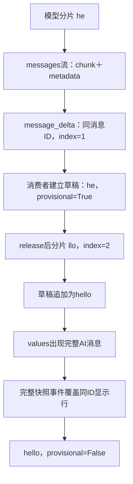

# Lesson 56：delta分片、草稿与完整消息校准

> 第四章第5主题，2026-10-12。正常校准与中途失败用例经助手验证，用户本人走读/复述未评估。类型集合问题的源码对照见Lesson55补充；不修改生产实现。

## 一条完整链路

StreamingToolModel._astream生成同ID的AIMessageChunk：he→等待release→llo→空元数据块。LangGraph的messages流为chunk+metadata；_StreamState.delta筛选主model、非摘要、支持AI类型、非空文本及有效ID，产生MessageDeltaData(message_id,text,index)。index按单条消息从1累积，区别于RuntimeEvent.sequence。

publish→AsyncEventStream同步入队/异步读取→app.astream_run→测试consume→StreamingMessageProjection。框架part字典与应用RuntimeEvent对象是两种数据，不混用type/event_type。



## 输入输出与分支

| 情况 | 生产/消费行为 |
|---|---|
| 主model合法非空文本分片 | 发布delta；投影按(session_id,message_id)建立/追加草稿 |
| 空块、非主model、摘要块 | 不产生正文delta |
| 完整graph_values消息 | 完整快照确认同ID草稿，覆盖而非追加完整正文 |
| 相同已缓存快照仍有本run草稿 | _StreamState.state在graph_values下补完整确认，不让去重使草稿悬挂 |
| 部分输出后模型失败且无完整确认 | 原异常传播，终局将本run仍provisional行标unconfirmed，不伪造最终消息 |
| 分片index缺口/重复等 | 投影标incomplete并拒绝错误拼接；网络重同步留Web章节 |

显示投影不写回模型messages，已见草稿不等于完整模型结果或保存确认。最终快照替换行，避免hello＋hello。主测试正常分片与校准，故障测试部分可见且原异常保留；其他过滤/缓存边界已有代码和专项测试，不把本轮2例扩成全部分支验证。

## 核心代码地图

| 函数 | 责任 |
|---|---|
| tests/test_async_application.py StreamingToolModel._astream | 受控分两片，Event暂停中间，非实网 |
| async_message_observation._StreamState.part/delta | 框架messages/values分路；delta只投影文本，完整消息另观察 |
| application.async_event_stream.AsyncEventStream | 线程安全有界入队与异步消费，不改变发布核心 |
| application.stream_projection.StreamingMessageProjection.__call__ | 按ID拼草稿、完整快照校准、未确认状态 |

## 走读入口与证据

[tests/test_async_application.py](../../../tests/test_async_application.py)::test_delta_is_available_before_response_and_final_snapshot_calibrates，无参数化；这是确定性应用集成范围。

```bash
.venv/bin/python -m pytest -q tests/test_async_application.py::test_delta_is_available_before_response_and_final_snapshot_calibrates
```

入口断点测试第一行；scenario中的entered是模型两片之间等待信号，release控制继续，saw_delta是消费者收到delta的信号。先初始化app等基础设施步过；consume进入后看event.event_type/data、projection.messages。必要时在_StreamState.delta临时断点看message.id/content、metadata.langgraph_node，最终快照到来时看同一ID行被替换。

重点：await entered/saw_delta后task.done()==False，草稿he/True；release.set后await task，最终只有一个AI行hello/False。异步等待的task关系不是任意重新运行handler观察值。

故障入口：[tests/test_async_stream_delivery.py](../../../tests/test_async_stream_delivery.py)::test_failed_partial_output_remains_unconfirmed，partial visible后RuntimeError原样传播，草稿provisional且state=unconfirmed。

本轮上述两例2 passed in0.78s，无生产/测试实现更改或真实模型/浏览器证据。下一主题turn/控制/上下文过程事件总图，复用已学观察与异常合同。
