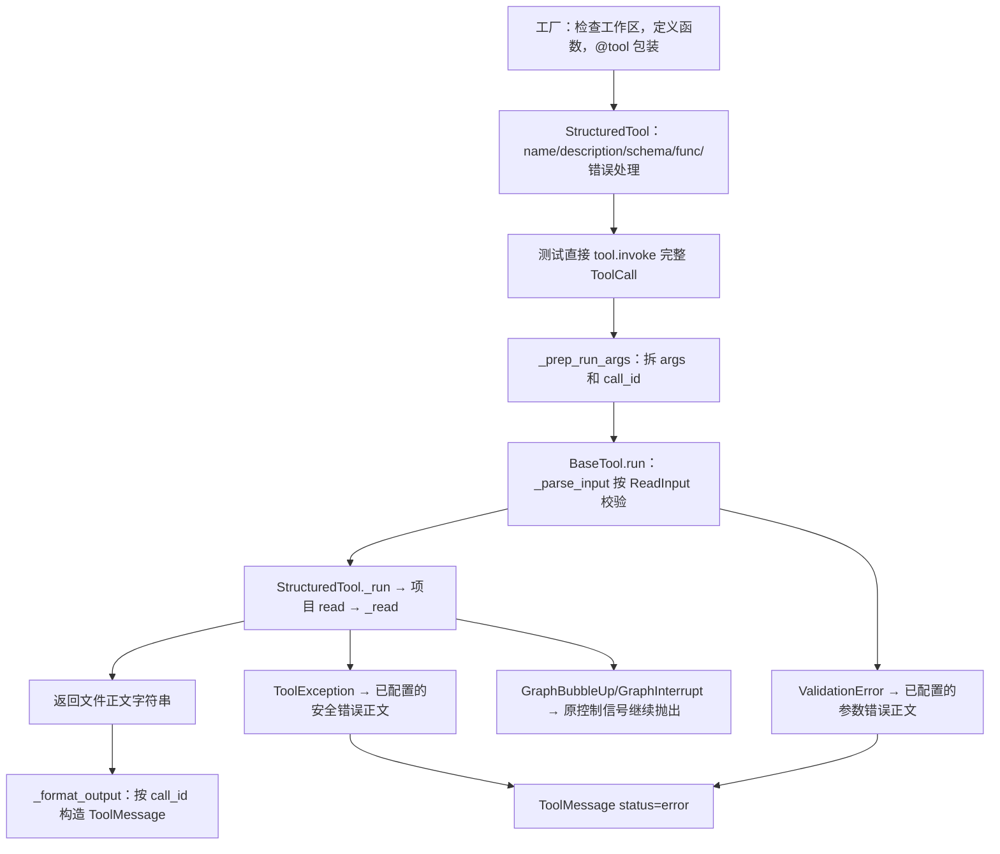

# Lesson 66：工具注册、参数 schema 与结果回填

> 2026-10-16目录更新：[085-02](../../specs/085-02-tool-package-boundaries.md)已将工具移到tools，权限声明合入tools/permissions，批次/工具观察/HITL移到agent_runtime/tool_execution。下文旧路径/行号保留课堂版本；当前入口见[源码表](../learning-roadmap.md#第6章)，审批与IO机制保持。

> 版本边界：本课记录改造前实现。2026-10-16起错误消息转换按[Spec085-01](../../specs/085-01-unified-tool-errors.md)归运行层；直接工具调用的执行错误raise ToolException，消息验证经真实Agent。参数/IO主线仍可参照，不据此新增用户掌握记录。

> 第六章第1节，2026-10-14。理解普通函数、工具对象、模型可见参数和执行结果的边界；本课用固定工作区Read的确定性工具测试，正式会话工厂仅说明runtime注入合同。已讲解，用户本人调试/理解与独立实现未评估。

## 具体数据与范围

测试创建临时api/contract.md，正文为“折扣接口契约\n”；这是测试数据，不是真实业务请求证据。create_read_tool(tmp_path)得到StructuredTool，固定root被内层read函数闭包保存。正式应用用create_session_read_tool，从框架注入的ToolRuntime.context取工作区/授权/资源，模型不提供runtime。

调用输入：

```python
{'name': 'read', 'args': {'path': 'api/contract.md'},
 'id': 'call-1', 'type': 'tool_call'}
```

本次实际输出的有限字段：

```python
{'type': 'tool', 'name': 'read', 'tool_call_id': 'call-1',
 'status': 'success', 'content': '折扣接口契约\n'}
```

## 调用图



真正Agent另有ToolNode按name找工具、批次/观察/审批wrapper和结果合入图；本课直接持有工具对象invoke，没有验证名字路由或整图。不能把直接调用对象的name字段当BaseTool会自行查找注册表。

## 代码地图

| 入口 | 职责与阅读重点 |
|---|---|
| [create_read_tool](../../../naiyue_test_agent/agent_runtime/tools/read.py) | 先准备root，后包装read；创建阶段不执行文件正文读取 |
| ReadInput/SessionReadInput | strict=True、extra=forbid；path非空字符串，offset/limit可选且有范围；完整内部schema可含runtime |
| _set_safe_tool_errors/_safe_read_error | 参数错误用固定正文；ToolException只暴露已知安全正文，其他用安全兜底 |
| 框架BaseTool.invoke/run/_parse_input/_format_output | 拆调用、校验、执行、处理已配置错误和包装返回；少数关键分支可以F11，callback/config内部步过 |
| 正式ToolNode | 构造ToolRuntime并注入；tool_call_schema排除注入字段。当前安装源码已核对，不靠名称推断 |

框架源码：.venv/lib/python3.12/site-packages/langchain_core/tools/base.py（invoke、tool_call_schema、run、_prep_run_args、_format_output），tools/structured.py（from_function、_run），langgraph/prebuilt/tool_node.py（ToolRuntime、_inject_tool_args）。

## 注册与执行分开

装饰器等价展开（保留原函数docstring）：

```python
def read(path, offset=None, limit=None):
    """原函数的工具说明。"""
    return _read(root, path, offset, limit)

read = tool('read', args_schema=ReadInput)(read)
```

装饰后read变量是工具对象，原函数保存在tool.func。模型获得名称/说明/参数schema，运行时保留可执行函数。默认值由函数签名使用，模型可以只传path。offset/limit具体分页算法留第2节。

本次schema观测：固定工具模型字段为limit/offset/path；会话工具完整字段多runtime，但模型schema仍只有limit/offset/path。ToolNode从图context/state/config/call ID构造ToolRuntime，再在执行前注入，项目函数从runtime.context读取可信工作区。隐藏runtime字段不自动构成文件权限保证，执行校验留后续小节。

## 完整结果分支与测试入口

| 分支 | 触发点与结果 | tests/test_read_tool.py 用例 |
|---|---|---|
| 正常 | schema通过，read正文返回str；框架包装success消息 | test_read_accepts_relative_and_absolute_paths_within_workspace |
| 参数非法 | _parse_input抛ValidationError；固定参数反馈，不进入read主体 | test_bad_schema_returns_safe_error_without_echoing_args[args0] |
| 已知Read失败 | _read把缺失/编码等情况变为ToolException；框架包装error消息 | test_read_rejects_missing_and_binary_files |
| Read内部普通意外 | 本工具只读故障合同：记录安全类型→ToolException兜底→error消息 | test_unexpected_read_only_failure_returns_safe_tool_message |
| 控制中断 | _read对GraphBubbleUp显式raise，不变为普通工具反馈 | test_read_does_not_turn_graph_interrupt_into_tool_error |

本次args0是空path。普通工具错误消息不自动等于整个run失败；控制中断和必要副作用未知也不能统一转换。框架一般Exception若未被工具自身处理会继续抛，本课不推广Read故障合同到全部工具。

## 测试与调试

主入口：[test_read_tool.py](../../../tests/test_read_tool.py)::test_read_accepts_relative_and_absolute_paths_within_workspace。无等待窗口，从测试入口单步：创建临时文件→create_read_tool→call_read→invoke→run→read→返回→断言。测试同一文件分别传相对与绝对路径，不是两个模型轮次。

必须看：装饰器替换read变量、tool字段、调用args/id拆分、schema校验和_format_output。_read文件打开/分页/权限内部先F10，看返回正文，第2节再展开；框架callback/config/reducer之外的常规装配步过。

WATCH按当前帧：测试tool.name/type(tool).__name__/sorted(tool.tool_call_schema.model_fields)；call_read帧args与返回后(result.type,result.name,result.tool_call_id,result.status,result.content)；项目read帧root/path/offset/limit；框架run帧tool_input/tool_call_id/tool_kwargs/content/status。不在WATCH重跑invoke/read或制造异常。

args0调试时_parse_input抛错是预期；继续后框架按已配置handle_validation_error生成反馈。GraphInterrupt测试也预期抛出，由pytest.raises捕获，绿色不代表没有异常。

## 本次验证与边界

```bash
.venv/bin/python -m pytest -q \
  tests/test_read_tool.py::test_read_accepts_relative_and_absolute_paths_within_workspace \
  'tests/test_read_tool.py::test_bad_schema_returns_safe_error_without_echoing_args[args0]' \
  tests/test_read_tool.py::test_read_rejects_missing_and_binary_files \
  tests/test_read_tool.py::test_unexpected_read_only_failure_returns_safe_tool_message \
  tests/test_read_tool.py::test_read_does_not_turn_graph_interrupt_into_tool_error
```

实际5 passed in0.80s；另有只读临时目录观测确认StructuredTool类型、有限结果、schema字段与普通参数调用返回str。_format_output在没有call_id时可直接返回content，因此tool.invoke({'path':...})不一定得到ToolMessage。完整ToolCall的id/type不能在本测试里省略。

无生产/测试实现、环境或IDE修改；无模型网络请求。功能合同验证与本人掌握分开。下一节Read完整分支：路径、分页、内容限制、编码和错误，权限/审批保留其章节边界。
