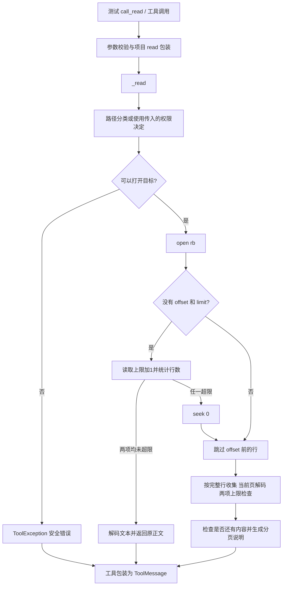

# Lesson 67：Read 的路径、分页与失败分支

> 2026-10-16目录更新：[085-02](../../specs/085-02-tool-package-boundaries.md)已将工具移到tools，权限声明合入tools/permissions，批次/工具观察/HITL移到agent_runtime/tool_execution。下文旧路径/行号保留课堂版本；当前入口见[源码表](../learning-roadmap.md#第6章)，审批与IO机制保持。

日期：2026-10-14。第六章第2节。本课讲解与助手验证不作为用户本人调试或独立实现证据。

## 模块合同与分支地图

输入是 `path` 与可选 `offset`（从1开始的行号）、`limit`（最多2000行）。内部 `_read` 返回正文字符串或抛出安全的 `ToolException`；工具包装层转为 `ToolMessage` 的机制见 [Lesson66](lesson-66.md)。正式会话还提供工作区、权限决定及一次性授权，本课只标入口，审批后讲。

| 情况 | 项目处理 | 既有测试（tests/test_read_tool.py） |
|---|---|---|
| 路径可读/需审批/拒绝 | 先解析真实目标，再选择 allow/ask/deny；ask 无有效授权不打开文件 | test_read_rejects_absolute_outside_and_alias_to_sensitive_file |
| 未指定分页且文件小 | 最多读取65537字节探测，正文≤65536字节且≤2000行就直接解码返回，无分页标记 | 上节正常读取测试；本课 empty 测试 |
| 显式分页、或默认读取超出任一上限 | 超限探测后 seek(0)，从所需行开始收集完整行 | test_read_pages_large_text_without_rejecting_the_whole_file / test_read_enforces_line_limit_even_below_byte_budget |
| 页尾、空文件、offset 超过末尾 | 探测是否还有字节，生成 next_offset；越过末尾是成功的空页 | test_read_pages_utf8_crlf_and_reports_end_of_file / test_read_empty_and_overlong_line_are_bounded |
| 整页累计字节将超限 | 当前行不加入结果，next_offset 指向该行 | test_read_page_budget_and_file_change_between_calls |
| 所请求的单行本身超限 | 整次调用返回错误，不返回已读的部分正文 | test_read_reports_overlong_line_without_returning_partial_content |
| UTF-8 无效或不允许的控制字节 | 解码/文本检查失败，固定错误反馈，不回显文件正文 | test_read_reports_invalid_encoding_and_nontext_without_leaking_content |
| 当前页合法、后面存在非文本 | 只验证实际返回页，读后面那页才失败 | test_read_validates_the_selected_page_as_text |
| 正文恰好达到字节上限 | 正文完整保留，分页说明另算 | test_read_uses_full_body_budget_even_with_continuation_note |
| 两次读取之间文件变化 | 每次重新打开；读取当前文件，没有跨调用快照 | test_read_page_budget_and_file_change_between_calls |
| 打开/读取 IO 失败、未预期故障或框架控制异常 | IO/普通故障记录安全类型并返回固定错误；GraphBubbleUp 原样传播 | test_read_io_failure_logs_only_error_type；控制/意外故障见上节 |

## 调用地图



生产入口：[read.py](../../../naiyue_test_agent/agent_runtime/tools/read.py) 的 `classify_read_target`、`_decode_read_text`、`_read`。参数/schema/消息包装已讲，不在本课重新展开。

## 两行例子：三次调用

测试入口 `test_read_pages_utf8_crlf_and_reports_end_of_file`，写入合成文件 `折扣\r\n第二行\r\n`。

| 调用 | 跳过的行 | 收集后的关键值 | 返回字符串 repr |
|---|---|---|---|
| offset=1, limit=1 | 0 | line_number=1, page_bytes=8, has_more=True | `'折扣\r\n[read: lines 1-1; next_offset=2]'` |
| offset=2, limit=1 | 1 | line_number=2, page_bytes=11, has_more=False | `'第二行\r\n[read: lines 2-2; next_offset=none]'` |
| offset=3 | 2 | lines=[], line_number=2 | `'[read: no lines from offset=3; next_offset=none]'` |

临时目录的本机只读观测核对了以上字符串与三次 success 状态。CRLF 保留，因为先二进制读取、再 UTF-8 解码。

关键变量：`first_line` 是所需起始行；`page_limit` 是最多返回几行；`line_number` 是已跳过/已加入正文的行数；`lines` 是当前页文本；`page_bytes` 是正文原始字节累计；`has_more` 决定下一页标记。

## 必须理解的关键阶段

1. `offset`/`limit` 都未给才尝试整个小文件快路径。任一上限超出就回到开头分页，不拒绝整个大文件。
2. 跳过 offset 前的行时不解码。内层 while 把一条可能过长的逻辑行分块读完，外层只加一次行号；读取到换行或 EOF 才算跳过一行。
3. 收集页时先检查单行上限，再检查累计上限，之后才解码、加入 lines、增加 page_bytes/line_number。不拆半行、不截半个 UTF-8 字符。
4. 如果累计上限不容纳当前行，虽然已经从文件读出它，但没有加入正文、没有增加行号。下次从头打开并跳过前面的行，因此它没有丢失。
5. 达到行数限制时 `source.read(1)` 只查看是否还存在内容，探测字节不加入正文，也不证明后续内容合法。
6. `_decode_read_text` 严格 UTF-8 解码，再拒绝除 tab/LF/CR 之外的低位控制字节及 DEL。只检查实际返回正文；后续非法内容可能在下一页才报错。
7. 单行过长/当前页解码失败时，最终抛出异常，没有成功返回先前收集的正文。日志记录安全异常类型，工具反馈使用固定文案。

字节上限例：每行 `é * 180 + '\n'` 共361字节。181行=65341字节，182行=65702字节超过65536。临时观测实际返回181行，`next_offset=182`。上限计入原始换行字节；分页说明和必要分隔换行在正文预算之外。

路径分类会解析符号链接；别名指向敏感目标仍拒绝。工作区外普通文件是 ask，当前固定工作区测试工具没有授权就返回错误。详细隐藏目录例外、已注册资源、权限扩展和审批复核留给第7/8节。本课不声明 OS 沙箱或跨调用稳定快照。

## 本人单步走读入口

VS Code 找到 `test_read_pages_utf8_crlf_and_reports_end_of_file`，在测试第一行断点，选择 Debug Test。没有异步协调超时，可以逐次走三个调用。

- F10 走文件准备/工具创建；在 `call_read` 用 F11 进入，之前已讲的框架校验/消息封装可以 F10 或 Shift+F11；进入 `_read` 后重点看跳行、收集、探测和组装返回。
- 在 `_read` 当前帧按变量产生时点观察 `(decision, target)`、`(first_line, page_limit, line_number)`、`(len(lines), page_bytes, has_more)`、`repr(chunk[:80])`。变量未创建时不展开。
- 回测试帧看 `(first.status, first.content)`、`(second.status, second.content)`、`(past_end.status, past_end.content)`，不要在 WATCH 重新调用读取函数。
- 后续可选 `test_read_validates_the_selected_page_as_text` 对照“第一页成功、第二页错误”；`test_read_page_budget_and_file_change_between_calls` 对照累计预算与文件变化。
- 日志内部、框架回调、完整审批对象可步过。本课必须看懂 `_read` 的阶段与上述关键变量，不需要通读 LangChain。

主入口验证命令：

```bash
.venv/bin/python -m pytest -q tests/test_read_tool.py::test_read_pages_utf8_crlf_and_reports_end_of_file
```

本轮助手验证命令（十个既有测试）：

```bash
.venv/bin/python -m pytest -q \
 tests/test_read_tool.py::test_read_pages_utf8_crlf_and_reports_end_of_file \
 tests/test_read_tool.py::test_read_pages_large_text_without_rejecting_the_whole_file \
 tests/test_read_tool.py::test_read_enforces_line_limit_even_below_byte_budget \
 tests/test_read_tool.py::test_read_page_budget_and_file_change_between_calls \
 tests/test_read_tool.py::test_read_uses_full_body_budget_even_with_continuation_note \
 tests/test_read_tool.py::test_read_reports_overlong_line_without_returning_partial_content \
 tests/test_read_tool.py::test_read_reports_invalid_encoding_and_nontext_without_leaking_content \
 tests/test_read_tool.py::test_read_rejects_absolute_outside_and_alias_to_sensitive_file \
 tests/test_read_tool.py::test_read_validates_the_selected_page_as_text \
 tests/test_read_tool.py::test_read_empty_and_overlong_line_are_bounded
```

实际结果 `10 passed in 0.71s`、退出码0；临时观测退出码0。未修改生产/测试代码、配置，无真实模型或网络请求。纯教学文档做链接、代码围栏与 `git diff --check` 检查，不声称应用构建或全量测试已执行。

下一节：ls/find/grep 的文件发现、正文搜索、忽略规则与输出限制。
