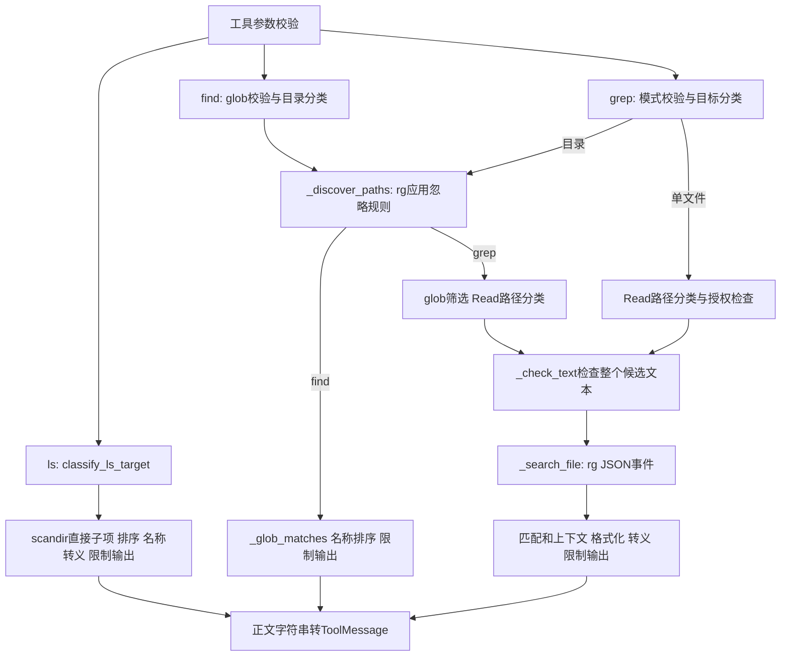

# Lesson 68：ls、find、grep 的发现与搜索分支

> 2026-10-16目录更新：[085-02](../../specs/085-02-tool-package-boundaries.md)已将工具移到tools，权限声明合入tools/permissions，批次/工具观察/HITL移到agent_runtime/tool_execution。下文旧路径/行号保留课堂版本；当前入口见[源码表](../learning-roadmap.md#第6章)，审批与IO机制保持。

> 版本边界：具体搜索/目录分支保持；错误转换、白名单及测试入口已由[Spec085-01](../../specs/085-01-unified-tool-errors.md)迁移到公共ToolError。本课保留当时实现，当前消息验证经真实Agent，不需重新系统学习原IO算法。

日期：2026-10-14。第六章第3节。已讲解与助手验证；本人调试、独立实现未评估。

## 职责与具体结果

| 工具 | 输入重点 | 输出与边界 |
|---|---|---|
| ls | path='.', limit=500 | 当前目录的直接子项名字，目录带 `/`，不递归读正文；包含隐藏名称 |
| find | pattern（glob）, path='.', limit=1000 | 递归发现后匹配文件名；遵守忽略规则，含隐藏名称，不读正文 |
| grep | pattern（默认正则）, path='.', glob=None, ignoreCase=False, literal=False, context=0, limit=100 | 可读文件的匹配行/上下文；文件路径与行号，正文读取另受 Read 的分类规则约束 |

临时文件 `api.md='before\nError 42\nafter\n'`、`other.py='Error 43\n'` 的本轮实际结果：

```text
ls({})                         -> api.md\nother.py
find({'pattern': '*.md'})       -> api.md
grep({'pattern': r'Error \d+', 'glob': '*.md'}) -> api.md:2: Error 42
grep({'pattern': 'Error 42', 'path': 'api.md', 'context': 1})
  -> api.md-1- before\napi.md:2: Error 42\napi.md-3- after
```

这里 `\n` 表示字符串中的换行。四次都得到 success ToolMessage。模型不需要按固定顺序调用三个工具；这是分工示例。

## 调用与数据地图



关键入口：[ls.py](../../../naiyue_test_agent/agent_runtime/tools/ls.py) `_list_directory`；[find.py](../../../naiyue_test_agent/agent_runtime/tools/find.py) `_discover_paths`、`_glob_matches`、`_find_files`；[grep.py](../../../naiyue_test_agent/agent_runtime/tools/grep.py) `_grep_files`、`_check_text`、`_search_file`。

## 完整主要分支与测试入口

测试名称分别位于 `tests/test_ls_tool.py`、`tests/test_find_tool.py`、`tests/test_grep_tool.py`。

| 分支 | 当前行为 | 既有测试 |
|---|---|---|
| ls正常/指定目录 | 直接子项排序，目录尾部 `/` | test_ls_default_and_selected_directory_are_sorted_and_mark_directories |
| ls隐藏名称/符号链接/消失条目 | 名称可见；无法 stat 的项记录类型并跳过 | test_ls_shows_hidden_sensitive_and_external_symlink_names |
| find文件名glob/嵌套目录/忽略 | rg先发现，再Python匹配；被忽略项不会因glob重新出现 | test_find_glob_paths_hidden_names_and_gitignore |
| grep正则/字面量/大小写/上下文/glob | rg正则引擎；literal=True按固定字符串；匹配用冒号、上下文用短横线 | test_grep_regex_literal_case_context_and_glob |
| grep目录权限过滤 | 发现名字后逐文件筛选可读目标，禁止目标不读正文 | test_grep_respects_gitignore_and_read_policy |
| 目录空/无匹配 | success：空目录说明/No files found matching pattern/No matches found | test_ls_empty_and_bounded_results / test_find_empty_and_result_limit / test_grep_match_limit_empty_and_invalid_regex |
| 参数/模式无效 | 安全错误；无候选也先校验正则，不伪装成无匹配 | 三组schema测试；test_find_invalid_glob_and_output_budget / test_grep_invalid_regex_is_reported_even_without_candidate_files / test_grep_invalid_glob_has_an_actionable_error |
| 缺少rg | find/grep错误并提示安装；不做自动安装/替代 | test_find_missing_rg_is_actionable_tool_error / test_grep_missing_rg_is_actionable_tool_error |
| 外部目标/路径无效 | ls/find外部目录需授权；grep外部单文件可审批，外部目录整体搜索拒绝 | test_ls_rejects_hidden_traversal_missing_file_and_outside_without_approval / test_find_rejects_traversal_non_directory_and_outside_without_grant / test_grep_external_directory_is_not_bulk_approved |
| 不可读/非文本 | 候选数为1时错误；多候选逐项安全诊断并附skipped数量 | test_grep_rejects_invalid_utf8_and_nontext_controls |
| 数量/输出字节限制 | success加truncated提示，正文显示上限50KiB，说明另算 | 三组limit/budget测试；test_ls_byte_budget_truncates_before_large_name / test_grep_escapes_control_characters_and_bounds_output |
| 长匹配行 | grep展示截到2000字符并提示，后续匹配仍可返回；Read单行限额仍独立存在 | test_grep_long_line_is_clipped_without_losing_later_matches |
| 名称/正文控制字符 | 转义避免一条结果伪装成多条 | test_ls_escapes_control_characters_in_names / test_grep_escapes_control_characters_and_bounds_output |
| 模式以短横线开头 | argv中使用 `-e pattern`，作为数据而非选项 | test_grep_leading_dash_pattern_is_data_not_an_rg_option |
| 搜索预算/IO/意外故障 | 安全ToolException；控制异常继续抛出 | test_grep_oversized_explicit_file_is_rejected_before_open / test_ls_io_and_unexpected_failures_are_safe_tool_results；超时/其他总预算映射本课按源码说明，未逐项注入 |

普通异常转消息的共通链路引用 Lesson66/67；第6节“工具批次、异常与执行反馈”再统一收束，审批在第7/8节展开。

## 少数关键机制

### 发现名称和读取正文是不同权限

ls直接列目录，没有Read的隐藏正文过滤；find加 `rg --hidden`，仍遵守忽略规则。grep目录发现后调用 `classify_read_target` 过滤，所以看到 `.env` 名字不代表允许读到里面的秘密。grep目录不搜被忽略文件，但显式指定合法单文件不会走目录发现，不能把 `.gitignore` 当权限禁止规则。

### 为什么先rg发现、后Python glob匹配

`_discover_paths` 用argv调用 `rg --files --hidden --null`，必要时加 `--no-require-git`，以NUL拆分文件名，避免名字中的换行被当分隔符。再 `_glob_matches` 筛选，保留发现阶段已经应用的忽略规则。

不含 `/` 的 `*.md` 对最后一段文件名匹配，因此各层目录的 `.md` 都可命中。包含 `/` 时按路径组件走；`**` 可以跨0个或多个组件。例 `src/nested/deep/more.py`：`positions={0}` → `src` 后 `{1}` → `**` 后 `{1,2,3,4}` → `*.py` 后 `{4}`，4等于总组件数则命中。`src/code.py` 也命中，因为 `**` 可以跨0段。positions表示下一次可以匹配的组件下标；无需本节独立复写整套glob算法。

### grep候选到正文

`_grep_files` 形成 `(Path, 相对路径字符串)` 列表，glob/权限过滤后排序。`_check_text` 分块检查整个候选文件，而Read分页只检查返回页；UTF-8增量解码器保存跨块字符状态。候选合法后 `_search_file` 运行rg，Python解析每条JSON。

本轮临时观测的真实事件投影（其他字段省略）：

```python
{'type': 'match', 'data': {'line_number': 2,
                         'lines': {'text': 'Error 42\n'}}}
```

`_grep_files` 去掉末尾换行、转义路径/正文，再组成 `api.md:2: Error 42`；context事件组成 `api.md-1- before`。只有match增加匹配计数，上下文同样占输出字节。

候选数为1时文本/IO故障直接报错，即使入口原来是目录；多候选时可跳过坏文件并提示数量。权限过滤掉的目标不等于这里的skipped计数。

### 限制与真实性

ls默认500项/最多2000项；find默认1000项/最多2000项；grep默认100条匹配/最多1000条匹配、context最多10、行展示最多2000字符。三者输出正文均限50KiB；grep达到数量上限就可能加保守的truncated提示，不保证还存在额外命中。

find发现输出收到后检查8MiB，rg发现有15秒超时；grep最多2000候选，单文件8MiB、成功检查累计32MiB，扫描循环约20秒、单文件rg最多5秒。扫描整体deadline不包括所有前期发现/正则校验，不声明严格总请求20秒。输出限制不代表严格进程内存上限：ls先收集排序、find先capture发现输出，grep先检查文本再由rg再次读取，均无跨调用文件快照。

## 本人测试走读

三个主入口：ls正常排序测试、find glob/ignore测试、grep模式/上下文测试。测试第一行断点→Debug Test；F10准备文件/创建工具，F11进call_*与对应核心函数。框架包装、日志内部、审批对象可步过。

- ls必须看：`entries`排序、`line`目录后缀、`lines/byte_count/truncated_by`。
- find必须看：候选`relative`、`_glob_matches`输入输出、`names`排序、`lines/size/truncated`。`subprocess.run`用F10，不进入外部进程；glob算法可只看一个具体匹配。
- grep必须看：候选`files`、`_check_text`返回字节数、`event/kind/data`、`match_count`和最终`output`。增量decoder内部、rg外部实现、框架封装可步过。
- grep建立deadline以后有真实墙钟预算，长时间暂停会影响下一次预算检查；先连续运行到 `_search_file` 返回处，再逐行看JSON格式化。本课主测试第一个glob只剩api.md一个候选，可在其搜索返回后细看格式化，再回测试检查结果；继续下一调用前不要在下一轮deadline检查前长时间暂停。

当前栈帧、变量产生后有限WATCH：

```python
# ls
[entry.name for entry in entries[:5]]
(lines[:5], byte_count, truncated_by)
# find
(relative, pattern)
names[:5]
(lines[:5], size, truncated)
# grep
[(str(p), relative) for p, relative in files[:5]]
(kind, data.get('line_number'), data.get('lines'))
(match_count, output_bytes, skipped_files, truncated)
output[:5]
```

不在WATCH重新执行搜索、读取或解码函数。测试帧看保存的 `result`/`regex`/`context` 的 `.status/.content`；部分测试直接调用并断言，没有保存变量，可观察单步返回项，不能重新调用获取。

## 验证与下一步

```bash
.venv/bin/python -m pytest -q tests/test_ls_tool.py tests/test_find_tool.py tests/test_grep_tool.py
```

本轮实际结果：`49 passed in 1.17s`，退出码0。临时示例与rg JSON投影观测退出码0，无生产/测试实现、配置变动，无模型或网络请求；纯教学文档检查链接/围栏/测试入口及git diff --check，不声称构建或全量产品测试已执行。

下一节：write/edit的快照、目标互斥、临时文件、原子替换和结果未知。
