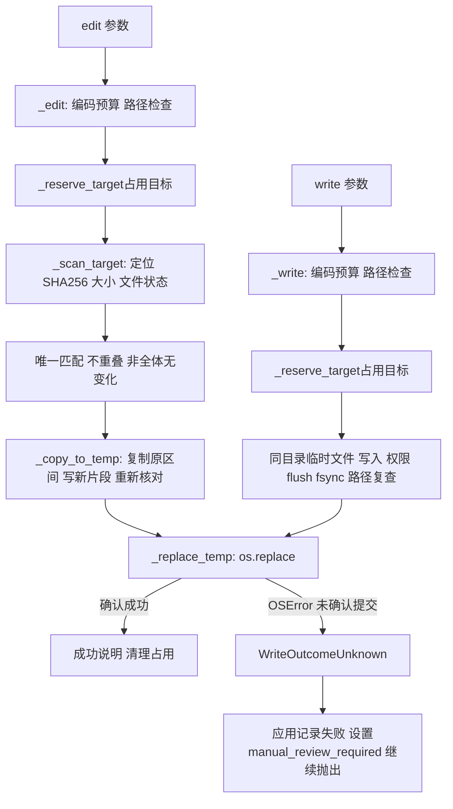

# Lesson 69：write/edit 的准备、核对与提交边界

> 2026-10-16目录更新：[085-02](../../specs/085-02-tool-package-boundaries.md)已将工具移到tools，权限声明合入tools/permissions，批次/工具观察/HITL移到agent_runtime/tool_execution。下文旧路径/行号保留课堂版本；当前入口见[源码表](../learning-roadmap.md#第6章)，审批与IO机制保持。

> 版本边界：[Spec085-01](../../specs/085-01-unified-tool-errors.md)已将WriteOutcomeUnknown替换为具体ToolException→公共error反馈，单凭提交未确认不再锁会话。原锁、冲突、替换/清理保持；没有自动重试/回滚保证。本课其余内容保留历史版本。

日期：2026-10-14。第六章第4节；已讲解、助手验证，本人调试和独立实现未评估。

前置问答：rg是ripgrep命令行程序。find用rg发现候选文件，grep用rg搜索正文；Python通过subprocess运行，工作区规则和ToolMessage由项目/框架处理。[官方说明](https://github.com/BurntSushi/ripgrep)。

## 当前职责与输入形状

```python
# write：创建或整个覆盖，空字符串可以清空
{'path': 'case.md', 'content': 'alpha\nbeta\ngamma\n'}
# edit：修改现有文件，所有oldText针对本次扫描的原文件
{'path': 'case.md', 'edits': [
    {'oldText': 'alpha', 'newText': 'ALPHA'},
    {'oldText': 'gamma', 'newText': 'GAMMA'},
]}
```

工作区来自可信 `ToolRuntime.context`，模型schema不提供runtime。路径必须在工作区内，拒绝 `..`、敏感目标和路径中的符号链接，父目录必须已存在；edit文件也必须已存在。write/edit目前不提供工作区外写入审批。

write默认1MiB内容预算；edit把同一配置用于oldText+newText的累计UTF-8输入预算，不限制原文件/结果文件为1MiB。配置在工具创建时读取，本课不改环境。

## 调用与提交地图



核心入口：[write.py](../../../naiyue_test_agent/agent_runtime/tools/write.py) `_write`、`_target_in_workspace`、`_reserve_target`、`_replace_temp`；[edit.py](../../../naiyue_test_agent/agent_runtime/tools/edit.py) `_edit`、`_scan_target`、`_copy_to_temp`。当前edit使用Spec040的两遍分块算法；历史Spec039的整文件读取→调用 `_write(expected_content=...)` 不是当前edit主链。

## 主要分支与既有测试

| 分支 | 结果与边界 | 测试入口 |
|---|---|---|
| write新文件/覆盖/清空 | 成功提交，反馈created/replaced和字节数，不回显正文 | test_write_creates_and_replaces_whole_file_and_accepts_empty_content |
| edit唯一精确多片段 | 全部定位在原文，按原文字节坐标一次构造 | test_edit_replaces_multiple_original_regions_and_returns_same_call_id |
| 不存在/重复/重叠/空旧片段/全部无变化 | error ToolMessage，未提交 | test_edit_invalid_replacement_does_not_change_file 的5个参数 |
| 删除片段/原BOM和CRLF | newText可为空，未触及字节保留 | test_edit_preserves_bom_crlf_and_allows_deletion |
| 大文件与跨块命中 | 分块搜索保留末尾重叠区，短片段可修改大文件 | test_edit_large_file_with_match_crossing_chunk_keeps_untouched_bytes |
| 跨块重复/无效UTF8 | 不误判唯一，不提交非法原文件 | test_edit_rejects_duplicate_in_different_chunks / test_edit_rejects_invalid_utf8_split_across_chunks |
| 路径/参数/编码/输入预算 | 说明性工具错误，无目标提交 | test_write_rejects_unsafe_targets_without_changing_existing_files / test_write_budget_counts_utf8_bytes_and_rejects_surrogates / test_edit_rejects_replacement_input_past_configured_byte_limit；相关schema测试 |
| 同目标占用 | 同进程立即返回busy，不排队；大小写/Unicode规范化键 | test_same_target_conflict_does_not_silently_overwrite_first_write / test_case_variant_target_cannot_bypass_process_conflict |
| 不同目标 | 不因全局占用集合锁把整段IO串行化 | test_different_targets_can_write_while_one_target_is_busy |
| edit扫描前占用 | 同进程write/edit不能在扫描和复制期间改同一目标 | test_edit_reserves_target_before_scan_against_concurrent_write |
| edit扫描后/复制中原文变化 | 不用旧扫描覆盖外部新版本；清理临时文件 | test_edit_rejects_file_changed_after_initial_read / test_edit_detects_external_change_while_copying |
| 临时文件准备失败 | ToolException→error消息；本次未替换原目标 | test_temp_write_failure_keeps_original_and_returns_tool_error / test_edit_temp_write_failure_keeps_original |
| replace提交异常 | WriteOutcomeUnknown原样向外，应用阻断自动继续 | test_uncertain_commit_stops_run_and_emits_correlated_event / test_edit_commit_unknown_quarantines_session_and_redacts_details |
| 同批read→write/edit→read | 顺序运行，后一次read看到提交后内容 | test_real_read_write_read_batch_sees_new_content / test_read_edit_read_batch_observes_order |

测试分别在tests/test_write_tool.py、tests/test_edit_tool.py。唯一/重叠检查都在提交前，失败不会先应用部分编辑。某一项old==new可以与其他真实修改共存；只有全部项都不改变内容才报no change。

## 两遍edit的具体例子

原始字节：`b'alpha\nbeta\ngamma\n'`，17字节。

第一遍 `_scan_target` 返回：

```python
locations = [0, 11]
size = 17
# digest是32字节SHA256结果；stamp是5字段状态元组
# (设备号, inode, 大小, mtime_ns, ctime_ns)
```

`_edit`构造并排序半开区间：

```python
matches = [(0, 5, b'ALPHA'), (11, 16, b'GAMMA')]
```

这些是字节坐标，不是字符下标：中文片段的字符数与字节长度不同。

第二遍 `_copy_to_temp`：

1. 复制 `[0,0)`（为空）；读取并跳过原 `[0,5)` 的alpha；写ALPHA。
2. 复制 `[5,11)` 的 `\nbeta\n`；读取并跳过 `[11,16)` 的gamma；写GAMMA。
3. 复制剩余 `[16,17)` 的换行。
4. 对第二遍读到的全部原字节重算摘要，包含被跳过的旧片段；检查总大小和文件状态，再flush/fsync、路径/状态复核。
5. `_replace_temp`用临时文件替换正式目标。

本轮临时观测：`write created 17 bytes`；扫描locations=[0,11]；编辑返回 `edit replaced 2 block(s); 17 bytes`，实际文件为 `b'ALPHA\nbeta\nGAMMA\n'`，目录仅剩case.md。

`transfer(stop, copy=True)`读取旧字节、更新digest/position并复制；`copy=False`仍读取并更新digest/position，只不把旧片段写入新文件。新片段由外层output.write写入，增加output_size。position表示原文件读取位置，output_size表示新文件输出大小，两者可能不同。

## 必须分清的保护与失败

- `_reserve_target`用短Lock保护进程内active集合，整个操作占用目标但不一直持有集合锁。其他同目标调用被拒绝，不等待；finally释放。不阻止外部进程编辑文件。
- write的正常工具入口提供完整新内容，不带模型前一次Read的版本快照；它不是“先Read后write就保证不覆盖并发改动”。edit的摘要/状态快照建立在本次edit扫描时，也不是前一次Read的版本号。
- 临时文件位于目标同目录，先完成内容/权限/flush/fsync，再os.replace。替换成功是可见文件名的提交边界；不是跨进程事务、跨检查与替换的CAS，也未验证断电恢复。
- 准备失败可以确认本次尚未replace，因此返回错误消息。外部写者可能已经改变目标，不能把“本工具未提交”说成“文件必定维持工具开始时内容”。
- `_replace_temp`遇到OSError统一保守转WriteOutcomeUnknown。当前故障注入是在replace前直接抛错，测试能证明这次旧文件保留；真实环境收到该类异常时仍按未确认结果处理，不能自动推断未写入。
- 未知异常由工具包装记录并继续raise，观察middleware不会把它降成普通反馈；应用记录failed、标manual_review_required并继续抛出，清理后也阻止该会话普通再次运行。不是自动回滚、自动重试或永久锁住所有会话。
- finally尽力移除未提交临时文件，失败记安全日志；成功提交后temporary=None。成功不回显写入正文。每个tool_call_id的消息/失败事件仍分别配对。

## 测试走读入口与观察

优先测试第一行断点→Debug Test：

1. write正常测试：三次run分别创建/替换/清空，框架与应用准备可步过， `_write`从临时准备到_replace_temp必须看。
2. edit正常测试：fake模型固定输出工具调用；F11进 `_edit`，先看scan返回值，再matches，再_copy_to_temp的transfer与提交。不需要重讲模型循环。
3. 变化检测 `test_edit_rejects_file_changed_after_initial_read`：monkeypatch在真实scan返回后写入another writer；看两遍之间的状态校验怎样拒绝提交。
4. 未知提交 `test_edit_commit_unknown_quarantines_session_and_redacts_details`：monkeypatch替换os.replace并抛OSError；看转换、外层raise、模型只调用一次、再次run被拒绝。

参数化拒绝测试精确ID：`[edits0-not found]`、`[edits1-unique]`、`[edits2-overlap]`、`[edits3-empty]`、`[edits4-no change]`（collect-only已核对）。终端节点含空格和括号要加引号。

当前栈帧按产生时点有限WATCH：

```python
# _edit
[(e.oldText, e.newText) for e in edits[:3]]
(locations, size)
[(start, end, new[:40]) for start, end, new in matches[:3]]
# _copy_to_temp / transfer；变量归属由当前帧决定
(position, output_size)
(stop, copy)
str(temporary) if temporary is not None else None
# _write
(len(encoded), existed, existing_mode)
```

不要在WATCH重新read/replace/fsync或digest.digest获取状态。最终文件由测试现有断言读取；返回测试帧看已有message.status/content。摘要和stat内部可以步过；跨块搜索先抓tail/window的职责，用户点名后再展开全部下标。

线程竞争测试含Event.wait(5)/future timeout=5：submit到release.set协调区连续运行，不在等待区长暂停；主正常测试不含这类测试协调窗口。

## 验证与下一步

```bash
.venv/bin/python -m pytest -q tests/test_write_tool.py tests/test_edit_tool.py
```

本轮实际结果 `61 passed in 1.19s`、退出码0。临时示例首次直接传未规范化的macOS临时根，被路径检查拒绝；按正式入口合同resolve根后观测成功、退出码0。五种参数节点收集 `5 tests collected in 0.51s`。未改生产/测试代码或环境配置，未请求模型服务；纯教学文档检查链接/围栏/测试入口与git diff --check，不称全量测试或构建通过。

下一节：Bash进程、输出、超时/停止与副作用未知。
