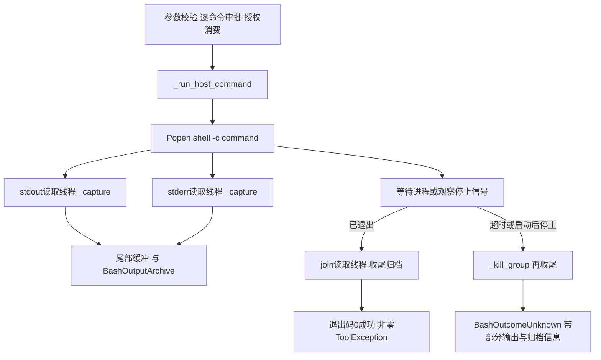

# Lesson 70：Bash 进程、输出与停止分支

> 2026-10-16目录更新：[085-02](../../specs/085-02-tool-package-boundaries.md)已将工具移到tools，权限声明合入tools/permissions，批次/工具观察/HITL移到agent_runtime/tool_execution。下文旧路径/行号保留课堂版本；当前入口见[源码表](../learning-roadmap.md#第6章)，审批与IO机制保持。

日期：2026-10-14。第六章第5节。已讲解、助手验证；本人调试与独立实现未评估。

## 职责与真实数据形状

模型参数是 `{'command': '...', 'timeout': 60}`，timeout可不传，默认60秒、最大300秒；command最多8192字符。宿主Bash显式启用，逐命令审批，可信工作区仅为cwd，不是文件/网络沙箱。授权消费绑定工具调用ID、命令全文与工作区，一次有效。

当前执行是同步 `Popen` 加两个输出读取线程；异步Agent可通过框架线程执行它，并从RunServices取得同一个RunControl。没有迁移成原生async子进程，本课不实施未来改造。

本轮在临时目录直接调用执行助手、没有走模型或审批的观测：

```python
# printf 'OK\n'; printf 'NOTICE\n' >&2
exit_code = 0
stdout = 'OK\n'
stderr = 'NOTICE\n'
truncated = False
archived = {'paths': {}, 'complete': False, 'reason': None}
# printf 'failure detail\n' >&2; exit 7
exit_code = 7
stdout = ''
stderr = 'failure detail\n'
```

`_run_host_command`返回 `(exit_code, stdout, stderr, truncated, ArchiveResult)`。外层bash函数格式化为 `exit_code=...; truncated=...` 加stdout/stderr，再按退出码正常返回或抛ToolException。stderr有正文不自动代表工具错误；成功由退出码判断。短输出没有归档，complete=False/reason=None不是归档故障，反馈不附归档字段。

## 调用与并发地图



核心：[bash.py](../../../naiyue_test_agent/agent_runtime/tools/bash.py) `bash`工具函数、`_run_host_command`、`_capture`、`_kill_group`、`_unknown_with_output`；[bash_output.py](../../../naiyue_test_agent/agent_runtime/tools/bash_output.py) `BashOutputArchive.record/finish`。授权细节第8节讲；跨工具异常消息总图第6节讲。

## 主要分支与测试

测试在tests/test_host_bash.py、tests/test_bash_output.py、tests/test_active_stop_bash.py。

| 分支 | 结果 | 既有测试 |
|---|---|---|
| 未批准/拒绝 | 不启动命令；批准恢复后才运行 | test_host_bash_approval_then_runs_in_trusted_workspace / test_host_bash_reject_has_no_side_effect |
| 无效参数 | 跳过审批，让schema产生原ID错误消息 | test_invalid_bash_args_return_tool_error_without_approval / test_invalid_and_valid_bash_in_one_batch_only_valid_needs_approval |
| 正常/非零退出 | 正常返回/ToolException→error ToolMessage，均含退出码与输出 | test_host_bash_nonzero_and_scrubbed_environment / test_actual_pytest_result_reaches_model_tool_message |
| 授权不匹配或重复 | 不消费放行，只有精确的一次授权可用 | test_bash_grant_is_one_use_and_exact |
| 环境与访问范围 | 最小环境不自动继承模型密钥；批准后仍能操作用户可访问的外部文件 | test_host_bash_nonzero_and_scrubbed_environment / test_host_bash_can_access_outside_workspace_after_approval |
| 长输出 | 每流保留末尾4096原始字节，持续排空；UTF8窗口边界修正 | test_long_bash_output_keeps_failure_summary_at_tail / test_bash_tail_does_not_split_utf8_character |
| 长输出归档/短输出无产物 | 溢出才开启归档，保存原始字节、返回相对路径 | test_long_bash_output_is_saved_and_readable_inside_workspace / test_short_bash_output_creates_no_artifacts |
| 两流归档 | stdout/stderr各自保留，不保证合并时间顺序 | test_archive_preserves_both_streams_without_claiming_order |
| 非零退出也归档 | error消息仍含输出产物路径 | test_nonzero_bash_still_returns_saved_output_path |
| 归档容量或目录冲突 | 命令继续、尾部继续采集，明确archive_complete=false及原因 | test_archive_quota_is_explicit_and_command_still_finishes / test_existing_unowned_output_directory_is_not_modified / test_workspace_archive_limit_applies_across_commands |
| 进程超时 | 终止进程组、收尾、BashOutcomeUnknown、会话待核对 | test_host_bash_timeout_requires_manual_review / test_timeout_keeps_bounded_partial_output_for_manual_review |
| 超时保留两流/归档 | 诊断属性有界，日志/str(error)不混入正文；完整归档也不代表命令成功 | test_timeout_partial_output_respects_each_stream_budget / test_timeout_keeps_archive_path_for_human_review |
| 启动后用户停止 | 同RunControl信号→杀同进程组→收尾→unknown；已发生副作用不回滚 | test_user_stop_terminates_bash_and_preserves_partial_output |
| 输出读取故障/流未关闭 | 不把不完整捕获当作普通成功，unknown；归档标不完整 | 主分支按源码核对；test_capture_error_cannot_mark_partial_artifact_complete验证归档状态，不声称已注入整段_capture故障 |
| 配置无效/启动失败/启动前停止 | 尚未启动，ToolException；更外层调度也可能直接生成未执行消息 | 源码核对，本课未逐项新增或单独注入 |
| 输出清理 | CLI先预览再明确确认，只清理未变化的本功能产物 | test_clear_only_after_preview_and_preserves_other_files / test_clear_refuses_changed_plan_and_unexpected_file / test_clear_rejects_symlink_in_output_directory / test_cli_clear_needs_confirmation |

## 必须理解的阶段

### 进程启动

`Popen([shell, '-c', command], cwd=root, env=env, stdin=DEVNULL, stdout=PIPE, stderr=PIPE, start_new_session=True)`。

command是交给Bash解释的命令字符串，可以有重定向、管道、多个子命令。cwd决定初始目录，env只传必要值；不自动继承模型API凭证，但不阻止批准后的命令主动读取宿主文件/访问网络。`start_new_session=True`为后续按独立进程组终止提供条件，不是沙箱。

### 两个读取线程与尾部

stdout/stderr独立管道，分别由一个 `_capture`线程持续读取，避免等待进程退出时管道塞满。每块先交归档器，再加入各自bytearray；超4096删掉前面的部分，truncated[0]=True。单元素列表用于线程共享可修改标志。线程和子进程分别执行不同工作，不应把两个读取线程理解成在Python线程里并行运行两份命令。

进程退出后join读取线程，等待尾部与归档收齐；如果流迟迟不关闭，可能有同组子进程仍持有管道，代码再终止组并给有限等待，仍按unknown处理。

stdout/stderr各自保持流内字节顺序，不合并成可靠全局时间线。尾部解码时跳过截断窗口开头的UTF8续字节；原输出本身非法编码则replace，不能宣称原日志必定合法UTF8。

### 尾部与归档两个独立结果

`BashOutputArchive`先暂存每流前缀，任一流超过4096才创建受管理目录并写入已收集前缀、后续原始字节。默认单命令归档16MiB、工作区已存归档128MiB；配置在既有环境变量读取，本课不改环境。

路径形状：`naiyue-agent-output/<随机ID>-stdout.log`，stderr单独文件。目录0700、文件0600，带归属标记和目录内gitignore；陌生同名目录不覆盖。输出产物不是不可篡改审计记录，也不是会话授权凭据。

`truncated=true`描述模型反馈尾部；`archive_complete=true/false`描述归档完整性；`exit_code`描述命令退出。三者不能互相代替。归档失败/配额耗尽不改变已确认退出码，继续排空管道并明确原因。捕获管道失败则不能确认完整结果，会走unknown。归档原始字节不一定能被Read消费：Read仍有UTF8、控制字节和单行长度限制。

### 超时与停止时序

没有RunControl时process.wait(timeout)；有时循环检查poll/requested/deadline，并通过 `control.signal.wait(min(0.1, remaining))` 等待。request_stop设Event会唤醒等待，Bash在下一次检查时处理，不是调用request_stop瞬间整个链路已完成。

启动后检测到用户停止：`_kill_group`调用 `os.killpg(pid, SIGKILL)`，等待回收，join输出线程，finish归档，抛unknown，再由运行/应用失败收尾并标manual_review_required。它不等待命令自然跑完；也不杀Python工具线程。已脱离该进程组的进程不在这次killpg的直接目标范围。

超时走相似清理，但消息原因是timed out。超时限制进程等待，输出join/回收等收尾可能额外耗时，不能承诺整次调用在timeout秒内结束。若进程已经退出，当前while可能不再消费新到的停止信号，该命令可正常返回，后续图边界仍检查停止；停止与已完成命令不存在单一固定先后。

`BashOutcomeUnknown`附带partial_stdout、partial_stderr、output_truncated、output_paths、archive_complete、archive_reason。str(error)与普通日志只用固定原因，正文供用户核对。应用标待核对，不自动继续下一模型turn或重试；终止命令不撤销已经写入的文件或外部请求。

## 测试走读与输入输出

优先入口：

1. `test_host_bash_approval_then_runs_in_trusted_workspace`：pending时created.txt不存在；批准后 `printf approved > created.txt; pwd` 产生文件并回填同ID。审批内部可步过，只看批准前后边界，再进入_run_host_command。
2. `test_host_bash_nonzero_and_scrubbed_environment`：正常结束且退出7，ToolException变error消息，fake模型可收到它；测试中假密钥仅用于检查环境清理。
3. `test_long_bash_output_is_saved_and_readable_inside_workspace`：看尾部、归档路径、归档正文与Read入口。
4. `test_timeout_keeps_bounded_partial_output_for_manual_review`：printf后sleep，timeout=1，已有输出进入异常属性；再次run被拒绝。
5. `test_user_stop_terminates_bash_and_preserves_partial_output`：批准恢复Task启动命令→PID标记确认已运行→request_stop→等待unknown→进程不存在、部分stdout保留、会话待核对。

从测试第一行断点，F10准备/应用装配，F11进入工具；Popen、reader.start、等待/kill/join协调段连续运行，收集完成后再观察。不要在线程持有archive锁时断点停住再等待它；超时测试1秒和停止测试5秒保护窗口不会因调试暂停自动延长，不在这些区间逐行慢读。可以把协调段运行到 `pytest.raises`上下文结束/结果保存之后，再看状态，必要时回看源码。

WATCH按当前帧和变量产生时点选择：

```python
# _run_host_command：收集完成后；只看有限字节
(process.pid, process.returncode)
(len(stdout), len(stderr), out_truncated[0], err_truncated[0])
bytes(stdout[-80:])
bytes(stderr[-80:])
capture_errors
# 外层bash已返回助手结果后
(exit_code, truncated)
(archived.paths, archived.complete, archived.reason)
# timeout测试退出pytest.raises上下文后
(failure.value.partial_stdout[-80:], failure.value.partial_stderr[-80:])
failure.value.output_paths
# stop测试退出pytest.raises上下文后，异常变量名是caught
(caught.value.partial_stdout[-80:], caught.value.archive_complete)
```

不在WATCH重新执行命令、wait、kill、archive.finish或读取日志。`Popen`、Event、Thread、锁的标准库内部可步过；关键是启动前、运行中、进程已退出/已终止、捕获收尾、工具返回/raise五个阶段。

## 本轮验证与下一步

```bash
.venv/bin/python -m pytest -q tests/test_host_bash.py tests/test_bash_output.py tests/test_active_stop_bash.py
```

结果 `37 passed in 10.32s`、退出码0，包含临时真实Bash/Python/pytest子进程、归档及活动停止，模型使用fake，无供应商请求。两条短输出助手探针退出码0，数据见开头。无生产/测试实现或环境配置修改；文档做链接/围栏/测试入口与git diff --check检查，不声称全量测试或应用构建。

当前Spec042的after-turn、Spec043/044的未归档描述属于历史时点；本节以当前代码、Spec045归档、Spec076活动停止为准。下一节：工具批次、异常与执行反馈，统一哪些转消息、哪些继续传播及对循环的影响。
