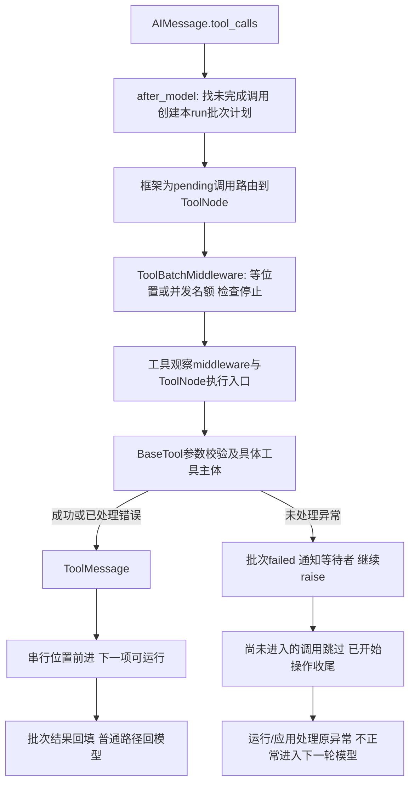

# Lesson 71：工具批次、异常消息与循环去向

> 2026-10-16目录更新：[085-02](../../specs/085-02-tool-package-boundaries.md)已将工具移到tools，权限声明合入tools/permissions，批次/工具观察/HITL移到agent_runtime/tool_execution。下文旧路径/行号保留课堂版本；当前入口见[源码表](../learning-roadmap.md#第6章)，审批与IO机制保持。

> 版本边界：本课为改造前机制。[Spec085-01](../../specs/085-01-unified-tool-errors.md)现于调度内侧装官方ToolError，具体ToolException及普通工具异常变同ID error，串行后项/模型可继续；控制、真实机制故障及旧Bash收尾保护保持。无需重学全部批次算法，增量调用链见该小Spec。

日期：2026-10-14。第六章第6节。用户要求完整说明工具异常如何转消息、哪些继续抛出；本课已讲解并由助手验证，本人调试/独立实现未评估。

## 一、具体数据与总合同

一次模型回复可以产生一个批次：

```python
AIMessage(content='', tool_calls=[
    {'name': 'probe', 'args': {'label': 'A'}, 'id': '0'},
    {'name': 'probe', 'args': {'label': 'B'}, 'id': '1'},
    {'name': 'probe', 'args': {'label': 'C'}, 'id': '2'},
])
```

可反馈错误的本轮临时观测：工具为sequential，B抛ToolException并配置handle_tool_error，得到A/B/C全部进入，消息为`('0','success','A')`、`('1','error','safe feedback')`、`('2','success','C')`，末轮fake模型回复done。

同一探针关闭ToolException处理后，只执行A/B并向调用方抛同一个异常；改成RuntimeError即使handle_tool_error已开启，仍只执行A/B并原样抛出。未知工具名临时观测得到原ID的error ToolMessage，已注册probe没有执行，fake模型继续回复corrected。这些是本机假模型观测，不是模型自主恢复质量证据。

核心区分：返回的error ToolMessage仍是一次正常的Python返回；逃出下游的异常才使批次进入failed。status='error'不自动使整个run失败，观察事件也不替代控制分支。

### 补充：用户提出的独立工具失败隔离与参考项目对照

2026-10-14按本地源码核对，只有源码证据，未运行Pi/AgentX整体集成，也未改本项目执行策略：

- Pi本地HEAD `a69bef789`：`packages/agent/src/agent-loop.ts` 的 `executeToolCallsSequential → prepareToolCall → executePreparedToolCall → finalizeExecutedToolCall → createToolResultMessage`。普通tool.execute异常在executePreparedToolCall的catch中转为错误结果/isError=true；串行循环没有因isError而break，正常会继续下一项；并行入口也复用这一执行包装。显式signal.aborted会停止/减少后续处理，事件投递等故障仍可能逃出，不能概括成“Pi任何故障都不停”。这与本项目“未处理RuntimeError也直接终止”的默认边界不同。
- AgentX本地HEAD `3fcfa0e`：`AbstractMessageHandler.buildStreamingAgent → BuiltInToolRegistry.createToolsForAgent → provider.createTools → ToolExecutor → AbstractBuiltInToolProvider.executeTools → doExecute`。该内置提供者基类捕获IllegalArgumentException和Exception，返回formatError字符串。因此普通内置执行异常通常在工具适配层成为结果，不直接向外抛。这个结论限定该基类路径，未核验其LangChain4j fork全部批次/MCP/底层故障行为。
- LangChain本机默认ToolNode对未处理普通执行异常继续抛出；官方v1迁移说明也区分可反馈的运行时输入问题与应上抛的工具实现错误。本机另有ToolErrorMiddleware，可以选择把某些执行异常转消息，未选择的继续传播。若以后调整，先复用框架能力，不新增通用错误平台。
- 原设计的理由是：未处理异常被当作调用链无法按合同完成的信号，避免未开始的副作用继续扩大；它是本项目保守策略，不是“未捕获异常一定影响所有独立工具”的证明。项目没有工具依赖图，sequential只保证顺序，不表示已声明依赖，不能用假定的依赖关系合理化所有批次停止。
- 对独立工具的普通局部失败应隔离并反馈；当前Read/ls/find/grep已在工具内转换许多普通异常。明确的用户停止、图中断、调度损坏、写入/命令结果未知仍需各自终止/暂停合同。普通意外局部异常是否扩大转换范围是待确认设计项，不能仅凭Python异常类型或“没有被catch”认定全局致命。
- 若决定扩大隔离，应在明确的工具执行边界把可反馈异常收敛为错误结果，并验证后项/模型继续及安全诊断；只删除批次failed标记并不能解决，因为原异常仍会让框架图失败。不要顺便加入依赖图或按工具组合猜测业务流程。

官方参考：[LangChain v1 工具错误处理](https://docs.langchain.com/oss/python/migrate/langchain-v1#handling-tool-errors)。参考仓库路径分别为 `/Users/zmw/naiyue-personal-workspace/pi`、`/Users/zmw/AgentX`。用户确认将改进及ToolErrorMiddleware复用候选记录到[后续清单TE9](../../future-work.md)，与权限/审批后续复审一起评估；当前继续学习实际代码，具体策略调整未实施。用户依据已讲实现提出独立工具失败隔离问题，属于该局部设计问题的提问证据，不扩展为独立实现或整套权限掌握证明。

## 二、完整主链与异常去向



实际调用不是每层独立调用下一层一次的直线：ToolNode先进入项目工具wrapper；batch取得下游handler，按计划放行完整链；链内再调用ToolNode的execute函数，注入runtime并调用BaseTool。assembly把ToolBatchMiddleware放在_record_tool_call之前，批次位置保护下游整段执行。

关键入口：[tool_batch.py](../../../naiyue_test_agent/agent_runtime/tool_batch.py) `aafter_model/_adispatch_tool_call`；[async_tool_batch.py](../../../naiyue_test_agent/agent_runtime/async_tool_batch.py) `AsyncBatchPlan.execute`；[call_observation.py](../../../naiyue_test_agent/agent_runtime/call_observation.py) `_ToolCallObservationMiddleware`、`aobserve_tool_dispatch`。同步入口有对应_SequentialPlan，正式异步链使用AsyncBatchPlan；不把所有同步算法或框架注册hook当作无消费者删除。

### 谁决定转换

| 情况 | 谁处理 | 去向与边界 |
|---|---|---|
| 项目工具的schema校验失败 | BaseTool按工具handle_validation_error | 原ID、status=error的ToolMessage，具体工具体没执行 |
| ToolException且配置handle_tool_error | BaseTool按True/固定文本/callable产生内容 | error ToolMessage；没有配置或为False则继续抛出 |
| Read等工具内部普通IO/未知异常 | 具体工具先按自己的合同转ToolException，再交BaseTool | 不是所有工具的普通异常都由BaseTool兜底转换；复用Lesson67/68 |
| 普通异常逃出具体工具 | BaseTool/ToolNode默认处理链与项目wrapper继续抛出 | 原异常向运行层传播，批次失败；启用handle_tool_error不处理任意RuntimeError |
| 未注册工具名 | ToolNode验证工具名 | error ToolMessage，不调用已注册工具体 |
| 没被BaseTool处理的框架调用校验错误 | ToolNode包装ToolInvocationError，默认处理器识别它 | 框架错误工具消息；不是通用执行异常转换器，第三方工具反馈配置需核对 |
| GraphBubbleUp/GraphInterrupt | 显式越过普通工具错误处理，交给图控制机制 | 不是普通失败ToolMessage；图可能把它变成中断结果/审批请求，不能声称最外层必定收到raise |
| asyncio.CancelledError | 工具wrapper/批次标记并继续传播；已开始IO依约settle | 不自动变成普通反馈；与用户停止模型的UserStop转换分开，复用第五章 |
| WriteOutcomeUnknown/BashOutcomeUnknown | 工具和观察层记录后raise；应用标待核对 | 不转普通工具消息、不自动重试；本轮unknown测试验证原异常身份 |
| 缺计划/等待超时/重复或越界执行 | 批次调度器抛ToolBatchSchedulingError | 不能绕过计划执行工具；运行失败 |
| 模型调用ID缺失或重复 | 规划前验证 | 拒绝该批次，不先执行部分副作用 |
| 模型工具调用截断/调用不匹配/用户停止且尚未开始 | 项目guard直接构造错误ToolMessage | 不一定发生过异常，也不一定进入工具体 |

本机源码核对：create_agent默认构造ToolNode时没有把handle_tool_errors改成全捕获；tool_node._default_handle_tool_errors只转换ToolInvocationError，其余raise e。BaseTool.handle_tool_error只针对ToolException；不要因ToolNode外围有except Exception就推断它一定吞错。

### 原异常与描述/观察的关系

普通异常传播时，aobserve_tool_dispatch计算失败描述、发tool_call_finished，再raise；描述用于说明事实，转换规则由上述实际捕获层决定。error ToolMessage可记录tool_failed/error_result，但run仍可completed；未处理异常记录exception或outcome_unknown后仍raise。观察投递失败隔离复用第二章，不让观察失败覆盖原异常。

## 三、批次如何决定继续

### 选择模式与计划形状

metadata缺省parallel；write/edit/bash声明 `{'naiyue_execution_mode':'sequential'}`。只要这批已注册待执行工具中有一个sequential，就按模型调用顺序执行整批。并行批次使用Semaphore，异步默认并发4或调用config中的max_concurrency。

after_model从最近AI消息取调用，排除后面已有同ID ToolMessage的项，再建run私有计划；审批拒绝项已有结果，不能还占等待位置。HITL after_model准备/恢复先于规划消费，审批细节第8节讲。未知名字不进入已注册计划，由ToolNode反馈，因此“整批原顺序”指已注册待执行调用，不能声称未知名字也被同一计划控制。

```python
call_ids = ('0', '1', '2')
sequential = True
position = 0
failed = False
```

position表示下一项应该执行的下标，failed是批次是否遇到逃出的异常。它不是工具消息status的汇总。

### B返回错误消息：继续C

```text
A返回成功消息 -> position 0→1
B抛ToolException -> BaseTool转换为error消息 -> handler正常返回
                -> position 1→2，failed仍False
C执行并返回 -> position 2→3
```

关键代码在AsyncBatchPlan.execute：`result = await handler()`只有raise才进入except BaseException设置failed；正常返回后position+=1/notify_all，不读取result.status判断终止。

### B抛出未处理异常：C不得进入工具体

```text
A返回成功消息 -> position=1
B的RuntimeError逃出handler
  -> failed=True，通知等待者，继续raise
C取得执行机会时看到failed
  -> 直接返回“前项失败、未执行”的错误消息，不调用自己的handler
整次图调用向外抛异常，不正常进入下一轮模型
```

C的skip消息不等于B已获得匹配的工具结果，也不保证失败图把所有局部结果完整提交。异步应用检查未配对工具状态，必要时要求人工核对。普通fatal与副作用unknown也不一概使用同一会话恢复规则。

### 并行批次的边界

Semaphore控制同时进入的数量，不承诺完成时间顺序。结果消息顺序由框架状态归并保持与调用配对，不能拿最终列表顺序证明执行先后。

一项fatal后，尚未进入handler的等待项可看到failed并跳过；已经开始的兄弟工具不能撤销。测试用Event固定住另一个同步IO工具，验证错误工具事件已经发生时run仍busy、没有run_finished；释放兄弟工具并settle后，应用才抛原异常和记录终局。这是必要收尾，不是无视已发生错误继续开展新工作。

## 四、为什么会再调用模型

正常工具节点返回ToolMessage后，框架tools_to_model路由默认回到模型。它不把status='error'视为退出条件。当前项目工具没有return_direct=True；结构化输出、显式跳转、用户停止等另有退出路径。

```text
HumanMessage
AIMessage(tool_calls=[A,B,C])
ToolMessage(A, success)
ToolMessage(B, error)
ToolMessage(C, success)
AIMessage(模型根据工具结果回答或再调用工具)
```

这不是事件/observer通知模型继续，也不是批次层递归调用模型。框架图边决定下一阶段。能够继续只证明协议/运行链路允许，不能证明模型会正确修复错误或最终任务成功。

## 五、测试地图与本人走读

| 场景 | 测试入口 |
|---|---|
| 同一测试对照error消息完成run与RuntimeError失败run | tests/test_application_run_events.py::test_error_tool_result_can_complete_and_unhandled_error_fails |
| 串行B正常/错误消息都继续C | tests/test_async_tool_batch.py::test_sequential_batch_preserves_full_chain_order[False] / [True] |
| fatal原对象传播，后续工具体不进入 | tests/test_async_tool_batch.py::test_fatal_batch_does_not_enter_later_tools |
| 纯并行且最大并发2、结果ID原顺序 | tests/test_async_tool_batch.py::test_parallel_batch_respects_config_and_preserves_result_order |
| 只有一个sequential就整批排队 | tests/test_tool_batch_scheduling.py::test_one_sequential_tool_makes_mixed_batch_execute_in_model_order |
| 软错误继续/拒绝项不占位置/批准后按顺序 | test_recoverable_error_result_allows_next_sequential_call / test_rejected_first_tool_does_not_block_later_sequential_tool / test_approved_first_tool_completes_before_later_sequential_tool |
| 丢计划/重复ID/重复执行/跨会话隔离 | test_missing_plan_fails_closed_for_every_call_in_mixed_batch / test_duplicate_call_ids_reject_whole_batch_before_any_tool_executes / test_completed_batch_cannot_execute_same_call_twice / test_two_sessions_share_agent_without_sharing_batch_plan |
| 截断调用直接反馈未执行 | tests/test_async_tool_batch.py::test_truncated_calls_are_error_results_without_execution |
| 原异常日志/消息错误日志与run结果分离 | tests/test_agent_runtime_tool_events.py的原异常/错误结果两条测试 |
| 并行fatal等待已开始IO收尾 | tests/test_async_failures.py::test_parallel_fatal_waits_for_other_started_tool_before_terminal |
| 控制中断不变普通工具错误 | tests/test_read_tool.py::test_read_does_not_turn_graph_interrupt_into_tool_error |
| unknown原对象/会话阻断 | tests/test_application_run_events.py::test_unknown_outcome_preserves_block_and_original_exception |
| 安全自定义工具反馈 | tests/test_layered_failure_contract.py::test_custom_recoverable_tool_uses_existing_framework_feedback |

未写完整路径的同步批次测试均在tests/test_tool_batch_scheduling.py。取消源分离复用第五章，本轮未重跑外部取消测试。

推荐主入口第一行断点→Debug Test：`test_error_tool_result_can_complete_and_unhandled_error_fails`。它是两段独立单调用，先handled.handle_tool_error=True，再RuntimeError；无多调用等待竞争，适合慢速单步。F10装配fake模型/会话，F11进工具调用；必须看具体raise、BaseTool配置分支、返回error消息或重新raise、测试最终断言。框架调度/事件构建可步过，需要核对转换时才进入BaseTool/ToolNode对应函数。

再走异步 `[True]` 用例，比对position/failed和三条结果；参数节点已collect-only核对。条件等待、Semaphore、Event/barrier、wait_for、shield等协调区连续运行，再看trace/seen/results。等待上限默认60秒，部分测试有2秒/5秒保护，调试暂停会改变分支，不进入这些标准库协调内部慢读。

当前帧按时点有限WATCH：

```python
# AsyncBatchPlan.execute
(self.call_ids, self.sequential, self.position, self.failed)
(call_id, name)
# 下游handler已返回result后
(type(result).__name__, getattr(result, 'status', None), getattr(result, 'tool_call_id', None))
# BaseTool当前self是具体工具，不是plan
(self.name, self.handle_tool_error, self.handle_validation_error)
# 测试帧
[(m.tool_call_id, m.status, m.content[:80]) for m in results]
caught.value is error  # async fatal测试
# 应用对照测试
received[-1].data.status
```

应用对照测试中原异常变量叫failure，身份表达式改 `caught.value is failure`；result/results变量在各测试的形状不同，按生产时点选择。不要在WATCH重新调用工具、模型或handler。

## 六、本轮验证与下一步

```bash
.venv/bin/python -m pytest -q \
 tests/test_async_tool_batch.py \
 tests/test_tool_batch_scheduling.py \
 tests/test_agent_runtime_tool_events.py \
 tests/test_async_failures.py \
 tests/test_read_tool.py::test_read_does_not_turn_graph_interrupt_into_tool_error \
 tests/test_application_run_events.py::test_error_tool_result_can_complete_and_unhandled_error_fails \
 tests/test_application_run_events.py::test_unknown_outcome_preserves_block_and_original_exception \
 tests/test_layered_failure_contract.py::test_custom_recoverable_tool_uses_existing_framework_feedback
```

实际 `28 passed in 4.05s`，退出码0；两种串行参数节点 `2 tests collected in 0.80s`。四个临时探针核对消息、原异常与未知名字，退出码0，fake末轮未声明停止原因会有unknown观察诊断，不据此声称无诊断的模型正常路径。没有新增生产/测试代码、环境配置或真实模型请求；文档检查链接/围栏/测试入口与git diff --check，不称应用构建或全量测试。

本课以当前异步实现、安装框架源码为准；Spec037的同步初版与Spec075的旧停止说明是历史时点，不覆盖Spec076当前活动停止。下一节：权限与工具授权，区分可发现、可读写、审批与OS隔离。
