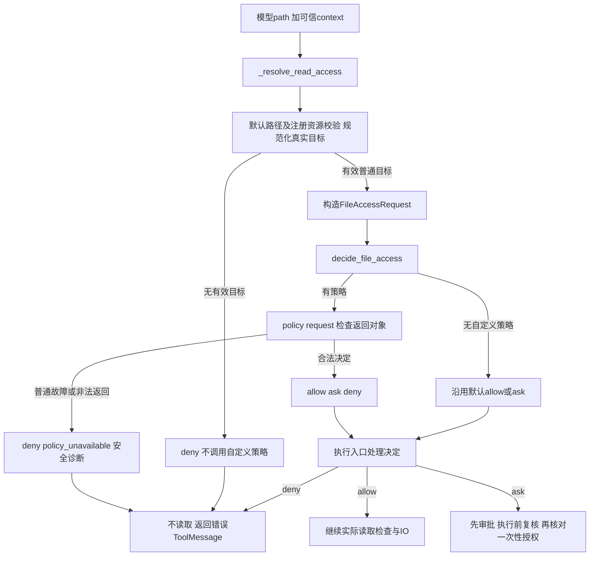

# Lesson 72：现有权限决定、工具授权与审批边界

> 2026-10-16目录更新：[085-02](../../specs/085-02-tool-package-boundaries.md)已将工具移到tools，权限声明合入tools/permissions，批次/工具观察/HITL移到agent_runtime/tool_execution。下文旧路径/行号保留课堂版本；当前入口见[源码表](../learning-roadmap.md#第6章)，审批与IO机制保持。

日期：2026-10-14。第六章第7节。以当前代码讲解，TE9的失败隔离/权限审批复审仍为后续设计项；本人调试与独立实现未评估。

## 职责与具体数据

权限决定回答当前工具对这个目标是allow、ask还是deny；审批负责取得用户对ask动作的决定；OS隔离限制进程实际能接触的文件/网络/资源。当前Read规则与逐动作审批不构成宿主Bash沙箱，也不是完整多用户权限产品。

以说明形状的路径与ID为例，模型只给 `{'path': 'note.txt'}`，可信应用给workspace/session，工具规范化后构造：

```python
FileAccessRequest(
    tool_name='read', operation='read',
    workspace_root=Path('/workspace/project'),
    target=Path('/workspace/project/note.txt'),
    session_id='session-A',
)
```

回调返回 `FileAccessDecision('allow')`、`FileAccessDecision('ask')` 或 `FileAccessDecision('deny')`。request与decision为frozen dataclass，不是模型参数。reason只允许None/policy_denied/policy_unavailable，非None只可用于deny。

可信应用配置示意：`reader=create_session_read_tool()`，再 `attach_file_permission_policy(reader, decide)`，把reader交给应用。attach只在metadata保存函数引用；真正决策发生于后续 `policy(request)`。模型不能把callback、sessionID或workspace根作为Read参数注入；只看到path/offset/limit。

## 分支地图



代码入口：[file_permissions.py](../../../naiyue_test_agent/agent_runtime/file_permissions.py) `FileAccessRequest/FileAccessDecision`、`attach_file_permission_policy`、`decide_file_access`；[read.py](../../../naiyue_test_agent/agent_runtime/tools/read.py) `_resolve_read_access`、`_read_policy_requires_approval`、`_review_read_policy`、会话read执行入口。

| 分支 | 当前行为 | 既有测试入口 |
|---|---|---|
| 默认路径分类 | 工作区内普通文件allow；工作区外普通文件ask；敏感/非法/无效目标deny | tests/test_read_tool.py::test_read_rejects_absolute_outside_and_alias_to_sensitive_file |
| 默认隐藏例外 | 普通.gitignore、.github源文件允许；已注册Skill资源根走专门校验 | test_read_allows_normal_hidden_source_files_without_opening_sensitive_paths；资源上下文测试见下 |
| 自定义deny工作区内文件 | 无审批、不读取，错误消息可交给下一轮模型 | test_deny_inside_file_returns_actionable_error_and_loop_continues |
| 自定义allow工作区外普通文件 | 覆盖默认ask，不中断，仍受文件读取/编码等检查 | test_allow_outside_file_uses_tool_without_interrupt |
| 自定义ask工作区内文件 | 覆盖默认allow，必须审批 | test_ask_inside_file_reviews_same_session_and_can_be_approved |
| 敏感目标试图force allow | 前置检查失败，policy根本不调用 | test_sensitive_path_is_not_force_allowed |
| 回调抛普通异常 | 记安全类型，deny/policy_unavailable，不当作allow | test_policy_error_returns_safe_tool_feedback |
| 返回'allow'字符串等非法结果 | 不能替代FileAccessDecision，按策略不可用拒绝 | test_invalid_policy_result_is_not_treated_as_allow |
| 返回coroutine | 关闭误返回协程并拒绝，避免never awaited告警 | test_accidental_coroutine_result_is_closed_and_denied |
| 注册async/非callable/不支持工具 | 注册时ValueError，不能假装已接线 | test_declared_async_and_non_callable_policies_are_rejected / test_only_declared_tool_can_attach_policy |
| 不同会话共用工具 | 每次request带可信session_id，回调按它作决定 | test_sessions_sharing_one_tool_do_not_share_permission_decision |
| Skill资源与审批上下文 | 同session/同canonical target进入review和执行决定 | test_skill_resource_approval_uses_same_context_as_execution |
| 审批期间策略撤销 | 批准不能盖过当前deny，返回错误，不读正文 | test_policy_revocation_after_approval_prevents_file_read |
| 用户拒绝ask | 不读正文，拒绝消息可交给模型 | test_rejecting_inside_approval_does_not_read_file |
| 控制异常 | GraphBubbleUp继续传播，不变成权限deny | test_control_exception_is_not_converted_to_permission_denial |
| schema与审批注册边界 | 模型看不到回调；contextual review必须有效 | test_permission_callback_is_not_in_model_schema / test_contextual_review_registration_is_validated / test_approval_description_does_not_mislabel_inside_file_as_outside |

未写完整路径的测试在tests/test_read_permission_extension.py；默认隐藏例外测试在tests/test_read_tool.py。返回allow只通过权限决定，文件此后缺失/编码非法/IO故障仍可失败；权限不是执行成功的保证。

## 关键链路一：工作区内deny

主测试 `test_deny_inside_file_returns_actionable_error_and_loop_continues` 创建note.txt，正文是合成PRIVATE_CONTENT；回调固定返回deny。

1. 普通路径校验得到默认allow与真实target。
2. `_resolve_read_access` 构造含session的request，调用 `decide_file_access`。
3. 回调返回 `FileAccessDecision('deny')`，resolver补安全reason=policy_denied。
4. 审批判断只对ask为真；deny不会转成人工审批请求。
5. 实际执行再次经同一resolve接口， `_read` 看到policy_denied，抛安全ToolException，不打开正文。
6. BaseTool转error ToolMessage；fake模型收到反馈并返回next turn。不是权限拒绝就必定run_failed。

`_resolve_read_access`对无有效target提前返回，策略不能把.env等敏感目标强行allow。合法普通外部文件则不同：有有效target，默认ask可被可信策略改为allow。

## 关键链路二：策略本身故障

`decide_file_access`中的policy抛RuntimeError时，函数自己捕获普通Exception，记录type，返回 `FileAccessDecision('deny','policy_unavailable')`。执行处把该原因转换成固定工具错误说明。原始错误正文不进入日志/反馈。

这是第6节的具体例子：同样RuntimeError，在明确负责权限故障回退的层被处理，就不会逃到批次标failed。它依然拒绝读取，不会因为想让循环继续就放行。GraphBubbleUp单独raise；不能用一个空catch掩盖控制信号。

## 为什么同一决定入口会在多个阶段出现

| 使用阶段 | 调用入口 | 消费结果 |
|---|---|---|
| 是否需要审批 | `_read_policy_requires_approval → _resolve_read_access` | kind==ask才触发HITL |
| 构造待审目标 | `_review_read_policy → _resolve_read_access` | ask时返回ApprovalReview，应用带可信context消费 |
| 实际执行前 | 会话read函数 `access=_resolve_read_access(...)` | `_read`收到本次decision/target；ask再核对grant |

这是共享一套决策规则在不同阶段复核，不是固定只调用三次，也不是注册时冻结的授权快照。回调应是快速、本地、同步的决策，不依赖调用次数产生业务副作用；仅禁止声明async不等于运行时证明回调没有阻塞/网络。

批准后仍重新检查当前规则，若改成deny就不能读。ask的授权还需工具调用ID与目标精确匹配且一次性消费；grant对象、interrupt/resume和应用pending状态下一节展开。

## 各工具当前实际边界

| 工具 | 当前相关限制 |
|---|---|
| 会话Read | 普通路径/敏感目标分类＋可选本地allow/ask/deny回调＋ask审批＋执行复核 |
| ls/find | 各自目录列名/发现规则与外部目录审批；没有接入这套FileAccessRequest回调 |
| grep | 使用默认Read路径分类筛选正文，不自动消费会话Read的自定义策略；外部目录整体搜索拒绝，外部单文件可审批 |
| write/edit | 工作区内目标、敏感路径/符号链接等写入检查，未支持上述回调，也未提供外部写审批 |
| Bash | 显式启用、逐命令审批；cwd与最小环境不构成文件/网络隔离 |

因此“给Read配置deny”不等于“所有工具都禁止接触该文件”。当前是最小Read扩展样板，没有统一覆盖所有工具的权限服务。该事实作为后续TE9权限/审批复审的输入，不在本课实施新的统一策略。

## 本人测试走读

主入口第一行断点→Debug Test：`test_deny_inside_file_returns_actionable_error_and_loop_continues`。准备fake模型、会话和工具时F10；进入 `_resolve_read_access` 后看默认kind/target、request，再F11进 `decide_file_access` 和回调，观察返回decision；最后回测试看error消息和next turn。

可以步过框架调度、日志内部、分页读取；本分支不打开正文，无需重新讲Read分页。when阶段可能在具体read工具体之前先调用resolver，看到它先进入是正常的。

然后选敏感目标测试对照“不调用回调”、allow外部测试对照“覆盖默认ask”、policy_error测试对照“拒绝且安全反馈”。ask/撤销测试先看输入与结果，不深入interrupt/resume实现，以免提前混入第8节。

当前帧、变量产生后的有限WATCH：

```python
# _resolve_read_access
(path, kind, str(target) if target is not None else None)
(request.tool_name, request.operation, str(request.target), request.session_id)
# decide_file_access（default_kind不是上面帧的kind）
default_kind
(decision.kind, decision.reason)
# _read收到access后
(choice.kind, choice.reason, str(target) if target is not None else None)
# 主测试返回后
[(m.tool_call_id, m.status, m.content[:100]) for m in tool_results(result)]
result['messages'][-1].content
```

不要在WATCH重跑回调/resolve/IO；前置无效路径分支不会产生request，变量不存在不要展开。这里没有测试Event等待保护窗口，但仍跳过无关框架细节。

## 验证与下一步

```bash
.venv/bin/python -m pytest -q tests/test_read_permission_extension.py \
 tests/test_read_tool.py::test_read_rejects_absolute_outside_and_alias_to_sensitive_file \
 tests/test_read_tool.py::test_read_allows_normal_hidden_source_files_without_opening_sensitive_paths
```

本轮实际 `19 passed in 0.95s`，退出码0。证据是本机临时文件、fake模型与实际create_agent/HITL路径，不是实网模型行为、多租户授权或OS隔离验证。无生产/测试实现、配置、依赖修改；文档检查链接/围栏/测试入口与git diff --check，不声称构建或全量测试。

下一节也是第六章最后一节：审批中断、pending、批准/拒绝、一次性授权、执行复核与恢复。
