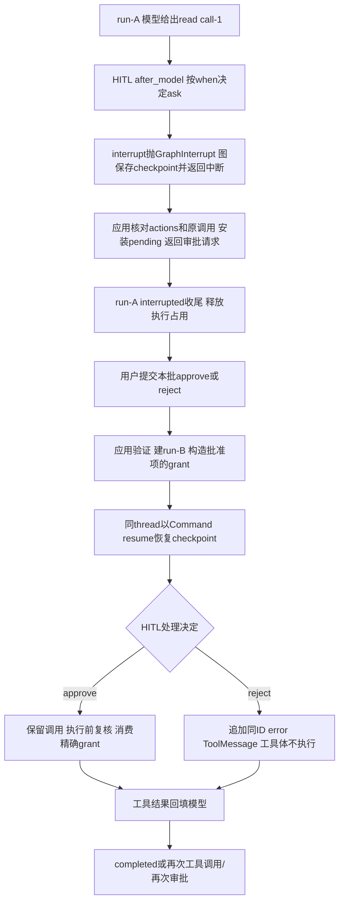

# Lesson 73：审批中断、一次性授权与恢复

> 2026-10-16目录更新：[085-02](../../specs/085-02-tool-package-boundaries.md)已将工具移到tools，权限声明合入tools/permissions，批次/工具观察/HITL移到agent_runtime/tool_execution。下文旧路径/行号保留课堂版本；当前入口见[源码表](../learning-roadmap.md#第6章)，审批与IO机制保持。

日期：2026-10-14。第六章第8节，当前章讲解收束。助手完成源码核对与本机测试；本人调试、独立实现与整章掌握未评估。未来TE9权限/异常复审不改变本节当前事实。

## 具体例子与主链

主测试 `tests/test_application_read_approval.py::test_external_read_pauses_then_approve_reads_once`：工作区workspace/，同级outside.md正文为合成APPROVED_CONTENT；fake模型先请求read，ID为call-1，再回复approved answer。

公开待审结果形状（路径和ID为说明值）：

```python
pending['approval_requests'] == [
    {'tool_call_id': 'call-1', 'tool_name': 'read', 'target': '/example/outside.md'},
]
```

内部pending还保存原args、规范化target、grant_value、message_count、requested_run_id；公开展示不提供grant对象。



## 注册与中断入口

工具通过metadata附加ApprovalPolicy：when决定是否要问，description用于审查描述，review生成可信审查目标/授权subject，grant_factory构造本工具授权对象；Read扩展ContextualApprovalPolicy用于传可信session/资源上下文。模型schema不包含这些对象。

runtime `approval_policies_for_tools → approval_rules → ObservedHumanInTheLoopMiddleware(interrupt_on=...)`，只允许approve/reject。存在规则但没有checkpointer时拒绝装配；当前应用组合器已提供checkpointer。运行层按工具声明注册，不靠具体工具名字分支。

框架HITL after_model扫描最近AI工具调用，对when为真的项生成action_requests/review_configs，一次interrupt合并所有待审项；当前工具路由发生在这个hook之后，所以此时不会先执行同轮其他工具。`interrupt(hitl_request)`首次抛GraphInterrupt，图框架接管并返回含__interrupt__的结果，不生成普通工具错误。

这是图状态上的暂停。Python执行栈已经退出，应用run会interrupted收尾；没有一个函数一直阻塞等待用户输入。恢复时框架重跑包含interrupt的节点/hook，interrupt从resume值取回decisions；不是恢复一份Python栈，也不是让模型先重新生成同一个调用。

## 应用保存什么、拦截什么

`SessionService._pending_tool_approval`从最近AI调用取得ID，用工具review生成target/grant_value，再与中断actions核对名字、原参数、数量和顺序；框架actions不是应用任意信任的路径列表。安装pending并记录requested_run_id后，才发可观察终局；测试在run_finished回调内已经能读取审批列表。

应用状态顺序：

| 阶段 | 执行占用 | 待审状态 | 允许的入口 |
|---|---|---|---|
| run-A执行中 | busy | 尚在构造 | 不允许同会话重入 |
| interrupted收尾后 | 已释放busy | pending存在 | 普通新消息仍被pending gate拒绝，需处理当前审批 |
| run-B恢复中 | busy | 当前pending受执行门禁保护 | 不允许另一次恢复/新run重叠 |
| 恢复完成 | 已收尾释放 | None或新pending | 无pending才能普通继续；有新pending需再次审查 |

同会话resume入口先检查manual_review_required、pending存在、busy、decisions必须是list且数量严格相等、每项只能approve/reject。失败发生在创建新run之前，不丢掉原pending，也不发伪造run_started。

## approve如何成为一次性授权

`SessionService._resume_steps`按pending原顺序与decisions配对，仅approve项进入映射。例如：

```python
approved_by_tool = {'read': {'call-1': Path('/example/outside.md')}}
grants = {'read': read_policy.grant_factory(approved_by_tool['read'])}
```

应用生成新的run_id，沿用同session_id/thread_id；工具调用仍是call-1。resume_start_index只提供消息展示边界，恢复执行位置由thread/checkpoint与Command控制。

| ID | run-A到run-B |
|---|---|
| session_id | 相同逻辑会话 |
| thread_id | 相同checkpoint历史与暂停位置 |
| run_id | 新的一次执行，新的观察序列/控制对象 |
| tool_call_id | 相同原调用，用于结果与授权配对 |

恢复入口 `resume_agent_run_with_resources` / async对应函数构造：

```python
Command(resume={'decisions': [{'type': 'approve'}]})
```

然后用相同thread的checkpoint进入图。批准决定供HITL恢复控制流程；grant经可信context供工具执行处授权，两者职责不同。

会话read重新解析目标/决定；若仍ask，取 `context['approval_grants']['read']` 并调用 `consume(runtime.tool_call_id, target)`。OneUseApprovalGrants用锁检查ID与subject相等，匹配则删掉记录并返回True；缺ID、subject不符或已消费都False。

Read的subject是规范化Path；Bash的subject是命令全文与工作区元组；不同工具由自己的review/grant_factory解释，不存在通用“批准一切”的bool。该批准不冻结文件正文版本，也不消除resolve到open的路径替换窗口。

## reject如何让循环继续

框架 `_process_decision`为拒绝项构造 `ToolMessage(name=原工具名, tool_call_id=原ID, status='error', content=拒绝原因)`，并保留原AI工具调用用于协议配对。

后续框架路由/批次规划按已有ToolMessage ID排除已完成调用；拒绝项不会再进工具体，也不能占用串行等待位置。错误消息可交给下一轮模型，模型看到用户拒绝，而不是只见一个凭空消失的调用。项目观察层为它记录approval_resolution/not_executed/approval_rejected。

多项审批一次提交完整列表，例如 `['approve','reject']`；批准项执行、拒绝项直接获得消息，原ID不串。整个列表按当前pending顺序匹配，不支持库接口中的edit/respond/allow_session。

## 主要分支与测试入口

| 分支 | 测试 |
|---|---|
| 默认外部Read暂停→批准→一次工具结果→模型继续 | test_application_read_approval.py::test_external_read_pauses_then_approve_reads_once |
| 拒绝无正文、敏感目标直接deny | test_application_read_approval.py::test_reject_skips_read_and_sensitive_external_path_is_denied |
| 等待期间符号链接从first改为second | test_application_read_approval.py::test_changed_symlink_target_cannot_use_old_approval |
| 同批多个目标分别决定 | test_application_read_approval.py::test_two_external_calls_have_independent_decisions |
| 其他会话不能恢复本会话pending | test_application_read_approval.py::test_other_session_cannot_resume_pending_read_but_can_run |
| 自定义工具声明即可接入/错误注册/重复工具名 | test_tool_approval_registration.py四个测试 |
| pending先安装、错误输入无新run、resume新run | test_application_run_events.py::test_approval_terminal_is_installed_before_notification_and_resume_is_new_run |
| 恢复后模型又提出ask，再暂停 | test_application_run_events.py::test_resume_can_interrupt_again_before_final_completion |
| 正式async批准/拒绝结果配对 | test_async_application.py::test_async_approval_resume_preserves_tool_result[approve] / [reject] |
| 批次首项批准/拒绝不使后项错位 | test_tool_batch_scheduling.py::test_rejected_first_tool_does_not_block_later_sequential_tool / test_approved_first_tool_completes_before_later_sequential_tool |
| 批准期间策略改deny | test_read_permission_extension.py::test_policy_revocation_after_approval_prevents_file_read |
| 审批hook准备中用户停止 | test_active_stop_approval.py::test_stop_during_approval_hook_finishes_without_executing_tool |
| 恢复执行出现写入结果未知 | test_write_tool.py::test_unknown_write_during_approval_resume_cannot_be_replayed |

路径均在tests/。目标变化测试里原grant授权first，执行重新resolve到second，consume不匹配，返回错误工具消息，两份正文都不返回。策略撤销则按当前deny拒绝，不因用户已approve而越过。

恢复又中断时，当前run-B以interrupted收尾，保存新pending；下一次恢复是run-C。测试终局是interrupted/interrupted/completed，三个run不同。

未知副作用仍继续抛出、标manual_review_required，不能普通run或原样resume自动重放。一次性grant不是端到端exactly-once执行保证。当前核心库接口处理当前pending；Web额外origin_run_id/request_id/调用ID校验和幂等另在第9章。持久模式仅restore ready记录，重启后interrupted会话恢复当前受限；本课同进程测试不能声称跨重启审批可继续。

## 主测试走读

首选外部Read主测试：测试第一行断点→Debug Test，F10准备文件/应用。第一段app.run跟到HITL调用interrupt：首次会抛GraphInterrupt，工具体还未进入；框架接住后回到测试，观察pending。F10走无效新run/空decisions的预期拒绝，再进入resume。

恢复时重点看 `_resume_steps` 的输入验证、approved_by_tool/grants、原thread/新run；`resource_invocation`的Command形状；再次进入HITL后interrupt取回决定，最后工具consume与结果。框架checkpoint调度和IOCall生成器桥可步过，只需知道它们承载状态恢复和实际调用。

主测试没有Event协调窗口，适合按阶段慢读；async停止测试含5秒保护与review线程，create_task到release/set及最终await协调区连续运行。不要在WATCH重跑consume，因为它会消耗授权；也不要重调resume或工具。

有限观察按当前帧/产生时点：

```python
# 主测试：第一次run返回后
pending['approval_requests']
[type(m).__name__ for m in pending['messages']]
# _resume_steps
decisions
[(i['tool_call_id'], i['tool_name'], str(i['target'])) for i in pending['items']]
approved_by_tool
(session_id, thread_id, run_id)
# OneUseApprovalGrants.consume内，执行前后对照，不再次调用
(tool_call_id, subject)
self._approved
# 主测试恢复返回后
[(m.tool_call_id, m.status, m.content[:80]) for m in tool_messages(result)]
result['resume_start_index']
```

公开pending与_resume_steps内部pending结构不同，不跨帧混用。控制异常被框架接住是正常审批流程，不要求测试失败才能看见它；需要时用工具入口前后的断点定位，不打开所有异常断点制造框架噪声。

## 本轮验证与整章收束

```bash
.venv/bin/python -m pytest -q \
 tests/test_application_read_approval.py \
 tests/test_tool_approval_registration.py \
 tests/test_application_run_events.py::test_approval_terminal_is_installed_before_notification_and_resume_is_new_run \
 tests/test_application_run_events.py::test_resume_can_interrupt_again_before_final_completion \
 tests/test_async_application.py::test_async_approval_resume_preserves_tool_result \
 tests/test_active_stop_approval.py \
 tests/test_tool_batch_scheduling.py::test_rejected_first_tool_does_not_block_later_sequential_tool \
 tests/test_tool_batch_scheduling.py::test_approved_first_tool_completes_before_later_sequential_tool \
 tests/test_read_permission_extension.py::test_policy_revocation_after_approval_prevents_file_read \
 tests/test_write_tool.py::test_unknown_write_during_approval_resume_cannot_be_replayed
```

本轮 `20 passed in 1.40s`，退出码0。临时文件、fake模型、实际create_agent/HITL和sync/async应用合同，无真实模型请求；无生产/测试实现或配置更改。文档检查链接/围栏/测试入口与git diff --check，不称全量测试或构建。

第六章8节已讲：注册/schema/结果→Read→发现与搜索→文件修改→Bash→批次/异常→权限→审批。贯穿主线是模型提出动作，可信上下文和执行边界检查，必要时暂停审查，真实执行后按ID返回结果，未确认副作用向外传播。讲解收束不等于用户已独立debug全部分支或具备独立实现能力。

唯一下一步：第七章上下文工程，先建立一次模型调用的上下文组成与来源地图。TE9权限/审批与失败隔离改进保持后续设计状态。
