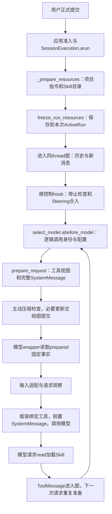

# 第75课：一次模型请求的上下文组成与装配

日期：2026-10-20。第七章第一个完整主题，接续十二组复盘，不重开前六章。本机源码已接入Spec118-02统一请求准备，03及119的验收/开发归各自会话；本课只读生产代码、已安装LangChain源码和现有测试，未重跑测试、未请求供应商、未修改产品。示意路径、输入、短ID和内容均不是实际业务运行记录。

## 1. 问题和边界

解释一次模型调用究竟能看见什么，以及这些内容怎样从应用、工作区文件、图消息和工具注册表进入模型输入。预算计算及安全切点算法留给后续主题，停止/审批/必要保存引用已讲场景。

务必区分：LangGraph的messages是对话事实；runtime.context是Python运行能力和关联信息；model request是组装后的本次调用输入。runtime.context中的RunControl、publisher和工作区对象不会因出现在context中就自动成为模型可见内容。

## 2. 贯穿例子与对象形状

示意工作区有AGENTS.md、.agents/skills/api-test/SKILL.md及docs/api.md。用户提交“使用api-test Skill，读取docs/api.md，检查创建订单接口对缺少product_id的处理”。当前活动工具是read/bash。

```python
# 示例：进入图的新消息，内部关联字段略去
HumanMessage(content='使用api-test Skill，读取docs/api.md，检查创建订单接口对缺少product_id的处理', id='H1')

# 每次请求准备得到的Python数据；短ID和变量均为示意
prepared = {
    'model_id': 'A', 'model_call_id': 'C1', 'model': model_A,
    'active_tool_names': ('read', 'bash'),
    'tools': [read_spec.tool, bash_spec.tool],
    'system_message': SystemMessage(content='基础提示+项目指令+Skill索引+工具说明'),
}

# ModelRequest在框架执行前的关键部分
request.messages = [HumanMessage(...)]    # 新输入及同thread已有历史，必要时已压缩
request.system_message = prepared['system_message']
request.tools = prepared['tools']
# 框架最终将system_message置于消息开头，绑定工具定义，再model.ainvoke
```

上面tools是普通工具的BaseTool对象；原始JSON schema工具也可使用function字典。框架/供应商适配会转换成对应API结构，本课对象形状不是HTTP抓包。

## 3. 来源地图

| 内容 | 生产者 | 模型怎样看见 | 时点/状态归属 |
|---|---|---|---|
| 基础行为提示 | application/project_instructions.py:BASE_SYSTEM_PROMPT；CLI/Web装配传入 | SystemMessage的base部分 | 应用装配配置 |
| 项目规则正文 | load_workspace_instruction_part | project部分，包在project_instructions标签内 | run准备读取并存ActiveRun，当前run固定 |
| Skill目录及加载规则 | discover_project_skills → format_skill_catalog | skills部分，含名称、描述、命令、绝对位置 | run目录快照，不自动注入全文 |
| 工具文字说明/操作指南 | ToolSpec.prompt_snippet/description/prompt_guidelines | tool_guidance部分 | 当前请求的有效工具视图 |
| 工具可调用结构 | ToolSpec/BaseTool或原始JSON schema | request.tools；框架bind_tools | 当前请求固定；不是执行授权 |
| 子角色目录 | 当前subagent角色名称/描述 | subagent_roles部分 | 只有当前提供subagent工具才加入 |
| 用户、模型、工具消息 | 新输入、同thread图状态及其提交 | request.messages | 图拥有；包括后续read返回的Skill正文 |
| 模型/思考/输出等设置 | AgentSession与ModelCatalog | 模型对象及调用参数，不全是提示词文字 | 请求准备时读取/固定 |

没有提交的输入框文字不在这次messages里；文件未被注入/读取，也不会因位于工作区自动进入模型。正式聊天归档是展示/保存事实，不应直接等同于当前模型messages；压缩后两者可不同。

## 4. 当前真实调用链



### run准备：不是每次请求都重读文件

SessionExecution.arun先observation.start及必要持久化start，然后_prepare_resources通过run_blocking执行同步文件准备；等待完成后freeze_run_resources检查当前run对象身份，将prompt_parts深拷贝到ActiveRun，并单独保存project_instructions供权限审查使用。

prepare_run_resources返回prompt_parts/project_instructions/read_resource_roots。prompt_parts形状例如[{id:project, source:AGENTS.md, text:规则正文包装}, {id:skills, text:目录和加载规则, count:1}]；资源根供read的正式路径授权，不是凭提示词授权。run结束时相关快照清理。

### 请求准备：每次模型调用都重做

根inject_before_model先检查停止并把选中的Steering消息提交。select_model._prepare生成逻辑model_call_id，通知turn/context观察对象，随后调用resolve_request_configuration。AgentSession短锁内一起读取model_id/thinking_level/active_tool_names，解锁后由catalog得到对应模型。

prepare_request先调用ToolSetMiddleware.prepare_tool_view固定有效ToolSpec，再由_inputs创建模型工具输入和完整SystemMessage。prepared存到runtime.context['_naiyue_prepared_request']，不写checkpoint/SQL；tool_execution只先提交可序列化工具名。

需要压缩时，_acompact_messages使用同一model/prompt/tools；结果作为hook更新交给图提交。之后模型wrapper通过request.override使用prepared中的固定对象，不因摘要期间设置变化而重新拼一份不同请求。压缩算法本课只保留这个输入/输出合同。

### 系统消息：compose_model_prompt

顺序是base → project → skills → tool_guidance → subagent_roles。project/skills缺失时跳过，有活动工具才有其说明，有subagent工具才有角色索引。

函数返回一个SystemMessage，content为各段拼接；response_metadata['naiyue_prompt_parts']只保留每段id/source/count/chars，给统计观察分组。它不是又给模型加入一份完整提示词。

### 实际发送边界

select_model.awrap_model_call消费prepared；ModelInputMiddleware把规范消息转换为当前模型需要的副本，例如图片能力/协议适配，不改正式历史。observe_model_request观察这一版输入。

本机LangChain1.4.2的factory.py中，amodel_node先从state.messages创建ModelRequest，middleware处理后_execute_model_async才将system_message放在messages开头，并使用_get_bound_model绑定工具，然后await model_.ainvoke。SystemMessage不是每轮自动追加进历史一份。

## 5. Skill正文什么时候进入上下文

第一次系统消息含api-test的名称、描述和SKILL.md位置，以及“先用read读取再遵循”的加载策略；不含正文。应用为校验元数据确实会读取文件，但不把所读全文自动交给模型。

模型随后输出AIMessage(id=A1, tool_calls=[{id:T1,name:read,args:{path:Skill绝对路径}}])。工具分发/权限检查/实际read返回ToolMessage(tool_call_id=T1, content=完整Skill文本)。图提交后，下一次模型输入含H1、A1及该ToolMessage，模型此时才看到正文。

读取Skill引用文件也走read。Skill是任务方法说明，不是新执行器；模型决定是否按加载策略请求工具，没有一个后台Python函数把“匹配Skill”自动变成“Skill已执行”。

同run的目录快照固定，但后续read正文是当时文件内容；因此目录描述与正文可能因途中修改来自不同版本。下个run重新发现目录。根审批恢复为新run，也重新准备快照。

## 6. 主要分支和失败

| 条件 | 当前结果 |
|---|---|
| AGENTS.md存在且有效 | 使用它；不合并CLAUDE.md |
| AGENTS.md不存在 | 尝试CLAUDE.md；两者都无则仅基础提示等其他段 |
| 首选指令为空 | 不注入项目段；不继续改用CLAUDE.md |
| 首选指令非法/超64KiB/越界链接/读取失败 | ProjectInstructionsError，不静默换另一套规则；模型尚未调用，进入应用必要收尾 |
| 个别Skill元数据损坏/越界/不可用 | 记录diagnostic，排除该Skill，其他有效项继续；与项目规则必需失败不同 |
| 未注册read | 当前准备不广播不可加载的Skill目录；活动工具未提供read时加载策略也明确不能加载 |
| Skill发现后消失/读取失败 | 普通read错误按工具结果反馈，模型可据此继续；不把工具名存在说成已成功加载 |
| 请求配置/工具准备失败 | 原异常继续抛出，turn失败并做应用必要收尾，不伪造未发生的主模型callback |
| 准备前/准备中停止 | 准备前可直接跳end；准备中按UserStop等原控制合同结算，未开始调用不虚构started |

坏AGENTS失败发生在run资源准备阶段，通常连逻辑模型turn都尚未开始；请求准备失败则可能已经开始turn。二者不要合成同一种事件轨迹。必要保存和busy释放仍引用场景11，不因“没有模型输出”就跳过收尾。

## 7. 相关身份与事件

S1/R1分别表示会话/本段运行；逻辑准备生成C1，turn和context snapshot中的model_call_id关联C1；实际callback另生成invocation_id=I1。一次准备期间若调用摘要，摘要有自己的实际invocation_id，不能把它和主模型混成一笔。

run_started之后准备run资源；turn_started在请求准备前部；请求观察发布model_context_snapshot，其中model_call_id=C1；真正进入模型callback时model_call_started带invocation_id=I1及purpose。snapshot描述输入组成，不触发压缩；callback描述调用，不替应用做前置检查。完整事件消费者引用2.0总结，不在本课重讲。

## 8. 两个代表性确定性测试

正常：tests/test_application_skills.py::test_both_indexes_are_visible_and_body_enters_next_model_call[agents]。临时目录建立两来源Skill及引用；monkeypatch模型目录为RecordingModel，预置read Skill、read引用、回答三次响应。断言第一次system含两目录而无正文，真实read的ToolMessage正文正确，并分别进入第二/第三次模型输入。证明接线和输入，不证明真实模型自行正确选Skill。

失败：tests/test_session_system_prompt.py::test_invalid_preferred_file_fails_before_model_and_releases_session[invalid_utf8]。构造坏AGENTS和有效CLAUDE，替换为记录输入的fake模型。断言抛ProjectInstructionsError、model.inputs为空、日志无正文；删除坏文件后下一次可运行并使用CLAUDE，验证准入释放而非只测抛错。测试只操作临时目录。本轮未执行。

## 9. 当前设计理解与后续

保留run级规则/目录快照，能让同run规则一致；请求级模型/工具/完整提示固定，能使检查和发送对应；Skill按需进入工具消息减少默认提示体积，但增加read往返且不保证模型遵循。系统提示中的工具说明帮助选择，结构化工具定义约束调用形状，执行授权另查权限，不能互代。

本课记已讲解；用户自述理解、独立调试/实现、真实供应商/业务效果均未新增证据。下一主题是输入估算、窗口/输出预留与发送/压缩预算，沿当前代码和Spec118实际状态接续。
