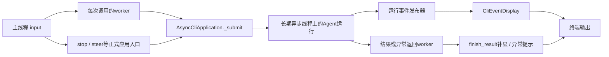

# 第79课：终端输入、异步运行与事件显示

日期：2026-10-21。原第八章CLI主题，接续第78课数据库/归档。沿当前cli.py、cli_async.py、cli_display.py和事件发布源码走读，复用已讲控制与保存合同。本课未执行测试、模型或真实会话库操作，不修改产品/测试/配置。示例文本、短ID、事件序号和输出为教学示意；函数调用及分支来自当前源码。

## 1. 本节问题与职责地图

用户提交“读取note并解释”，模型先说明、调用read、再回答。运行中还要能输入停止/补充要求，已经生成的回答不能等整个run结束才出现。CLI负责输入分类、调用应用、显示事实与退出接线；AgentSession/运行时负责真正执行和控制，SessionPersistence负责必要保存。

| 对象 | 拥有/修改的数据 | 职责边界 |
|---|---|---|
| application/cli.py的main | worker引用、pending_input、stopped_input、piped_input | 输入循环与终端交互策略 |
| 每次创建的worker | 本次同步调用栈 | 等待结果，让主线程继续读input |
| AsyncCliApplication | 长期线程、事件循环、原生异步应用及资源栈 | 把同步调用提交给同一个loop |
| AsyncApplication/SessionService/AgentSession | 正式run、会话busy、控制与图状态 | 真正准入、运行、收尾 |
| CliEventDisplay | run/序号、消息ID与哈希、工具进度、终局、控制回执数 | 展示账本，不是图状态或聊天归档 |



这是三个主要执行位置，不代表进程仅有三个线程；同步工具和存储还可能使用线程。事件处理器同步执行，也不承诺总在某个固定线程回调。

## 2. 代表数据

输入转成HumanMessage(content='读取note并解释',id='H1')；S1为已创建的session，不由本次CLI输入重新创建。模型A1带正文和read调用c1，工具T1.tool_call_id=c1，最终AI为A2。结果messages可能还带旧历史，不能直接全部重印。

```python
# 消息事件的关键投影；snapshot_json实际是下面row的JSON字符串。
row = {'id': 'A1', 'type': 'ai', 'content': '我先读取文件。',
       'is_context_summary': False,
       'tool_calls': [{'id': 'c1', 'name': 'read', 'args': {'path': 'note'}}]}
# RuntimeEvent的相关字段
{'event_type': 'message_completed', 'session_id': 'S1', 'run_id': 'R1',
 'sequence': 7, 'source': None,
 'data': {'message_id': 'A1', 'snapshot_json': '上述row序列化后的字符串',
          'snapshot_sha256': '该快照的SHA256', 'is_context_summary': False,
          'visibility': 'graph_values'}}
```

只投影讲解所需字段，不是声明整个事件构造签名。sequence由run发布器递增；这里的7是示意，不能当固定时点。root事件source=None，子Agent事件另带source归属。

## 3. 启动与线程桥

nyt chat → 顶层cli.main选择application.cli.main → 读取设置/工作区/存储 → build_local_application或build_persistent_application → AsyncCliApplication。

构造器建立_ready=threading.Event，启动名为naiyue-cli-async的线程。_serve用asyncio.Runner创建loop并set ready，再run_forever。主线程等ready后通过_submit提交_open。ready仅说明loop对象已建好，不说明应用已经打开；_submit返回后_open才已完成。

_open在该loop上构建原生异步应用或进入持久应用上下文，资源交给AsyncExitStack。持久入口会关闭用于预检的SessionStorage，再由异步应用按同一路径/工作区身份重新取得正式拥有权；不同时让两个应用拥有数据库。

main创建/恢复S1，构造CliEventDisplay(S1)，首次运行前app.subscribe_events(display)。桥把注册提交到loop，原应用订阅表返回unsubscribe闭包。

## 4. 一条普通输入的时间顺序

1. 主线程input得到普通文本；无在途worker、无待审批、无停止后保留策略时，start_run(text)。
2. start_run创建execute闭包，启动一次性worker。闭包创建时尚未运行；worker启动后执行_run_and_print。主线程回到下一次input。
3. _run_and_print先display.begin_call重置本次展示账本，再为输入生成uuid4消息ID。调用app.run(S1,[H1])。
4. 这里app是AsyncCliApplication。run通过_submit(lambda: self._app.arun(S1,[H1]))提交任务。
5. _submit定义execute协程，在loop里调用call；返回可等待对象则await，否则直接返回。run_coroutine_threadsafe把协程交给长期loop，future.result阻塞的是当前调用worker，不是loop。lambda在loop执行时才调用原生arun。
6. 原生AsyncApplication.arun → _execute → SessionService.arun/_admit → AgentSession.arun（实现SessionExecution）→ runtime/图。run准入、busy和必要收尾仍走原入口，没有重建一套同步Agent执行器。
7. 图执行中的事件直接进入display；可先显示A1，再显示工具过程和A2。当前CLI消费完整消息事件，不是逐token输出message_delta。
8. 正式执行完成必要收尾后发布run_finished。原生arun返回结果，经future.result回到worker；_run_and_print调用finish_result(result,input_message_id=H1.id)补缺。

### 为什么需要worker和长期loop两层

若主线程直接app.run，future.result会阻塞主线程，本轮期间无法继续input。只把整个同步Agent塞入worker，又不能代替当前已经采用的原生异步应用及资源拥有合同。当前实现让主线程读输入、worker等返回、一个长期loop执行正式异步应用。同一个loop能在异步等待期间处理停止等其他提交；_submit本身不等于串行排队执行所有任务，真正的同会话准入由AgentSession负责。

## 5. 展示时点与身份

begin_call重置_run_id=None、_last_sequence=0、消息/正文哈希、工具进度和终局等；_receipts跨调用保留。run_started到达时绑定R1。后续检查session_id=S1、run_id=R1、sequence大于上次已处理序号；不要求连续，因此缺事件不自动补放。下一调用begin_call后重新绑定新run，不是消息传来就随意改run。

message_completed/revised使用message_id及snapshot_sha256过滤同一快照；_message又用正文哈希防止元数据变化或结果补显重印正文。相同正文但不同消息ID可以分别显示；同ID正文变化显示修订提示。账本不保存一整份聊天正文历史，不修改图messages/checkpoint或聊天归档。

| 事件 | 显示前已经发生 | CLI作用/不能证明的事 |
|---|---|---|
| model_call_started，purpose=agent | 模型实际调用边界的开始事实已发布 | 显示模型正在处理；不驱动前置检查 |
| message_completed / revised | 状态观察器产生完整消息快照 | 显示AI正文/工具请求；不能证明最终保存完成 |
| tool_call_started / progress / finished | 工具分发/进度/结算事实到达 | 工具状态和安全错误说明；不调度工具，started仍可能早于等待位置 |
| approval_requested | 应用已有待审批问题 | 显示待审批项；不替用户批准 |
| control_accepted | 正式控制入口已接受请求 | 回执、停止中展示和计数；真正停止仍由RunControl/安全点执行 |
| compaction/context_recovery事件 | 对应上下文操作报告阶段 | 显示过程/结论，不实施摘要替换 |
| run_finished | 正式应用收尾已走到终局通知 | 显示完成/停止/暂停/失败一次；turn_finished不作为run终局 |

展示器使用RLock保护共享账本和输出块；渲染中调用write可重入。write转义不可打印终端控制字符。锁不包input、app.run或worker.join，不负责命令行编辑光标重绘。回调是同步的，慢输出可以延长事件投递时间；不把观察隔离说成输出永不影响耗时。

## 6. 为什么返回结果后仍需finish_result

正常事件已显示A1/A2时，finish_result先找H1的位置，只检查其后的AI消息，按ID/正文哈希去重，不重复打印。审批恢复使用结果resume_start_index。找不到可靠起点时不盲目打印旧历史，而是报告观察不完整。

若缺A2事件但结果含A2，补显A2并提示观察不完整。若缺run_finished，即使结果返回，也只显示“运行已返回，但未观察到终局事件”，不制造completed。

若某次writer抛普通异常，RunEventPublisher._deliver捕获、记录安全错误类型并停用该run内该订阅者，不因此改写Agent结果；其他必要执行继续。返回时直接finish_result有机会补显，持续输出故障不保证终端可用。这个隔离仅限普通观察回调异常，不能把直接终端输入/输出异常、必要保存错误都当成可忽略观察故障。

## 7. 输入与失败分支地图

| 触发 | CLI调用/处理 | 结果 |
|---|---|---|
| 空闲普通输入 | start_run | 新运行，沿正式准入 |
| 交互运行中普通输入 | app.steer | 进入现有Steering入口；若窗口竞争被拒，等旧worker后走新运行 |
| 运行中:follow | app.follow_up | 现有Follow-up入口；窗口竞争被拒后等旧worker再新运行 |
| 有待审批 | 普通新输入提示先处理；审批命令走cli_approval | 根恢复新worker、子审批正式提交；不把正在等审批当普通空闲 |
| :stop | 待审批作用域先走专门入口；否则app.request_stop | 保留取回的未发送文本，进入stopped_input策略；接受不等于停止完成 |
| 已停止后输入 | 本地pending_input追加 | 不自动运行；:send显式提交，:pending查看 |
| 管道多行 | piped_input、drain_pipe | 按输入顺序等待worker再执行；不把下一行自动当交互Steering |
| 后续模型失败 | 异常从loop经future回到worker | 先前已显示内容保留，run_failed终局/安全异常提示避免重复 |
| :quit/EOF/输入异常 | settle_cli_worker、finally退订/关闭 | 等必要收尾，关闭资源后停loop/join长期线程；异常不一律转退出0 |

pending_input为CLI停止后待发送文本，piped_input为管道顺序控制，都不是替代Agent内存Steering/Follow-up队列的新执行Inbox。_run_and_print返回bool用于CLI是否消费待发送文本；True包括普通运行失败，不等于业务成功。忙/待审批/人工核对拒绝等返回False时保留待发送文本。

主线程收到:stop时通过同一_submit短调用提交request_stop，worker仍等原run。native async模型等待可被原控制机制取消/结算；CLI不杀worker线程。control_accepted令_stopping=True并增加回执数；主线程比较调用前后计数，避免重复打印“已请求停止”。

交互退出/EOF会请求活动停止并等worker；管道EOF通常等已提交工作完成，子审批等无人可继续提供输入时走原停止路径。finally按worker结算→unsubscribe→app.close→外层storage关闭执行。桥close先在loop上await资源栈关闭，才stop loop并join，不直接杀后台线程。

## 8. 代表测试与调试入口

本轮只走读，不执行以下命令。VS Code Test Explorer可按名字Debug Test，先在测试函数入口停，再F10/F11沿生产入口。

```bash
.venv/bin/python -m pytest -q tests/test_cli_event_display.py::test_messages_are_immediate_and_result_is_not_reprinted tests/test_cli_event_integration.py::test_cli_displays_first_reply_before_later_failure
```

- 正常显示单测：手工事件、lines.append替代终端输出，先发完整回答事件，再给包含同消息及遗漏消息的结果。断言立即显示、重复事件/结果不重印、遗漏消息补出。仅证明展示器算法，不覆盖线程或模型。
- 后续失败集成：预置fake首条AI含FIRST_VERIFIED_REPLY和probe调用，probe返回ok，第二次模型请求记录当时输出后抛RuntimeError。替换catalog/input，不替代真实CLI桥与图。断言第二请求抛错前首条回答已经可见、回答/失败各一次、不泄露异常正文、无虚假完成。使用--no-session，不证明SQLite保存或真实供应商。
- 原生停止入口：tests/test_cli_async_stop.py::test_cli_native_model_stop_keeps_new_input_for_explicit_resubmit。Event确认模型已进入异步等待，再输入:stop/new request/:quit；断言已停止、文本保留、模型只调用一次。证明接线，不保证所有外部工具可即时取消。
- 观察失败入口：tests/test_cli_event_integration.py::test_observer_output_failure_does_not_change_run_and_result_can_fill_gap。writer首次回答抛OSError，真实app仍返回回答，finish_result补显并提示缺终局。

关键函数地图：cli.start_run/_run_and_print → cli_async.run/_submit → AsyncApplication.arun → SessionService.arun → AgentSession.arun；反向事件到CliEventDisplay.__call__/_render，返回补显到finish_result。异步loop和worker是不同线程栈，不能把调试器F11跨线程切换当作普通同栈调用。

精简观察：cli帧line/interactive/worker.is_alive()/stopped_input；_run_and_print帧request.id/text；_submit.execute帧result的类型；展示帧(event.session_id,event.run_id,event.sequence,event.event_type)、self._run_id/self._last_sequence/self._terminal。只观察已产生变量，不在Debug Console重新调用run/stop等副作用方法。

## 9. 收束与证据

当前三层接线保留终端同步输入、原生异步执行和消息级过程反馈；代价是线程桥及展示去重需要明确。不是逐token TUI，不承诺光标重绘、事件可靠重放或输出故障永不影响耗时。无需因此自动新增机制。

本课为源码/既有测试走读；没有本轮pytest、真实终端/供应商或业务效果证据。已讲解不代表用户已独立调试/实现或完全掌握。下一主题原第九章Web入口、请求身份与运行交付接线；局部追问优先，已讲控制/保存语义引用原记录。
