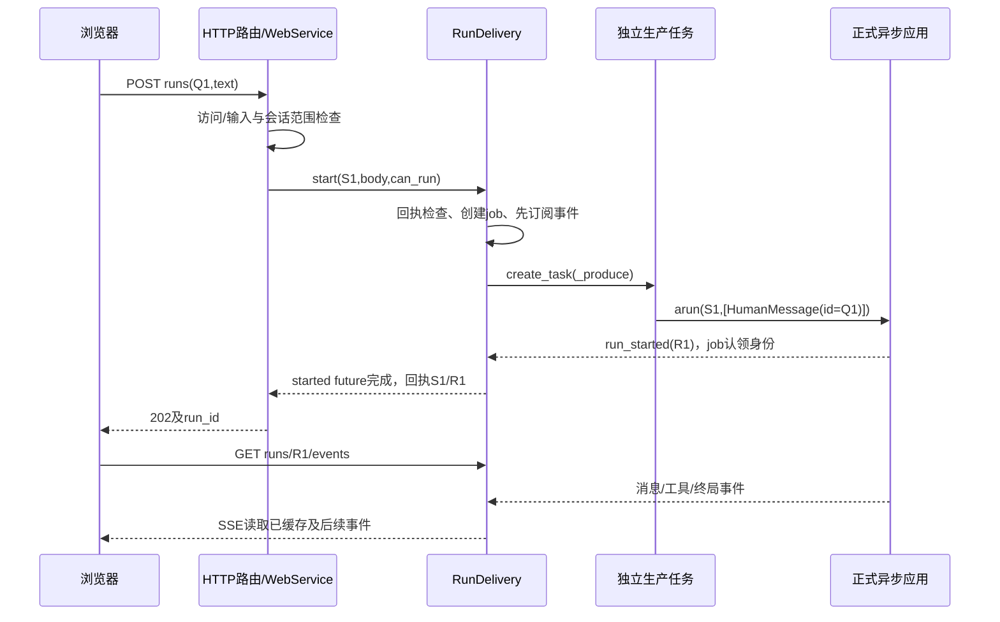

# 第80课：网页请求准入与运行任务归属

日期：2026-10-21。第九章第1个完整主题，接续CLI第79课。按当前web/app.py、auth.py、schemas.py、service.py、run_delivery.py、delivered_run.py和frontend/src/api.ts走读。本课只读产品源码/既有测试，不执行pytest、构建、模型请求、服务器或真实会话库，不改并行开发内容；只维护学习文档。端口、UUID、消息、序号与状态表为示意，不是实际HTTP探针结果。

## 1. 学习安排与本课边界

原第九章预算8—12节，本轮先按8个完整主题组织，不按聊天轮数计节。前面十二场景已讲的控制/保存语义只引用。第十章原预算4—5节仍保留；历史4—6/2—3等取舍建议没有自动变成删章授权。

1. 网页请求准入与后台运行任务归属（本课）。
2. SSE缓存、序号、断线续接与重同步。
3. 浏览器启动、API客户端及必要TypeScript/React状态基础。
4. 会话切换、聊天历史分页与长消息读取。
5. 消息增量/完整快照、React状态更新与聊天渲染。
6. 输入草稿、发送、Steering/Follow-up/停止与审批交互。
7. 工具/子Agent、上下文与用量/诊断等面板的数据接线。
8. 模型/工具/权限等配置操作、异步竞态与前端专项收束。

当前要解决：点击发送后，HTTP请求、后台Agent任务、SSE连接谁拥有谁；怎样校验访问/数据/会话归属，重复提交怎样识别。SSE缓存细节和React状态内部留下一主题，不重讲Agent循环。

## 2. 代表数据与责任对象

已有会话S1，workspace=/work/demo，conversation_revision=0。浏览器WebApi.start生成UUID Q1，提交文本“读取note并解释”。Q1在实际HTTP里必须是UUID格式，这里可用11111111-1111-4111-8111-111111111111作为示意，不是字面Q1。

```http
POST /api/sessions/S1/runs
Host: 127.0.0.1:43127
Authorization: Bearer <本地访问令牌>
Origin: http://127.0.0.1:43127
Content-Type: application/json

{"request_id":"11111111-1111-4111-8111-111111111111","text":"读取note并解释","expected_conversation_revision":0}
```

43127是示意端口，启动时默认绑定port=0后取得实际端口。Host/Origin是浏览器HTTP请求的头形状，不是让前端脚本任意设置受限制的Host头。服务正常响应202及{session_id:S1,run_id:R1}，R1由正式应用生成，不由浏览器request_id充当。

| 对象 | 拥有/修改 | 不负责 |
|---|---|---|
| WebApi | token、HTTP编码/解码、request_id | Agent执行 |
| FastAPI路由、authorize、MessageInput | HTTP访问/输入边界 | 工具权限判断 |
| WebService | 应用操作适配、当前工作区检查、状态读取 | 自己执行模型工具循环 |
| RunDelivery | 生产任务、活动会话映射、重复请求回执、run查找 | 正式图状态/必要保存 |
| DeliveredRun | run身份、显示投影、有限事件缓存、started future、task引用 | SQL归档和执行调度 |
| AsyncApplication/AgentSession | 真正run、busy、控制、图状态与收尾 | 浏览器连接存活 |



时序图为正常路径；快速任务可在202抵达浏览器前已结束。HTTP调用等待者、_produce任务和SSE读取者是三个独立对象。

## 3. 服务启动时谁创建什么

nyt默认选择web.__main__.main；准备工作区、设置、构建前端路径和监听socket。WebSettings仅允许回环地址，默认access_token由secrets.token_urlsafe(32)生成，可由既有环境选项提供。实际绑定后把所选端口写回settings，再create_web_app。

create_web_app定义lifespan闭包和路由；定义闭包本身没有打开数据库。服务启动进入lifespan后，在AsyncExitStack内打开一份原生持久应用，创建RunDelivery与WebService并放入app.state。每次HTTP请求复用这份应用，不每次重新创建模型/Agent图。Web直接使用异步服务loop，没有CLI主线程input与run_coroutine_threadsafe桥。

启动链接fragment携带本地访问令牌。browserToken读取hash、保存到该页sessionStorage，再replaceState移除地址栏fragment；WebApi.response用Authorization头发送令牌。这里的凭据代表对本地服务的访问，不是模型API key。仅构建后的静态前端被挂载公开，工作区/模型配置没有被静态目录暴露。

## 4. HTTP访问和输入校验

FastAPI通过dependencies=[Depends(access)]连接各API路由的访问检查，access明确调用authorize。有效请求代入settings.authority=127.0.0.1:43127、settings.origin=http://127.0.0.1:43127：

1. Host必须等于authority，否则invalid_host/403。
2. Authorization必须等于Bearer加服务令牌，以compare_digest比较，否则unauthorized/401。
3. Origin若提供必须匹配；GET/HEAD可不提供，其他方法必须提供且匹配，否则invalid_origin/403。

通过本地访问检查不等于工具获批；Bash等仍走原权限/审批。没有单独的浏览器用户账号/多租户行权限机制，不把当前工作区范围说成多租户授权。

MessageInput采用strict=True、extra=forbid。request_id匹配UUID格式，text为1—32768字符且不能全空白，expected_conversation_revision为可选非负整数。额外字段/非法类型等返回422和有限invalid_request，不回传Pydantic原始输入或私有正文。两个校验都在业务执行前起约束，不据此承诺所有畸形HTTP的底层解析顺序。

## 5. 正式启动链与关键时点

POST路由只调用await service.start(S1,body)。WebService._session_status先取正式应用状态，并比较session.workspace_root与服务settings.workspace_root，不匹配按session_not_found/404处理；提取can_run与conversation_revision。此层不是最终准入锁，后面的AgentSession仍检查busy/名额/审批和提供的conversation_revision。

RunDelivery._launch在start_lock内检查关闭状态、请求回执及pending请求，然后检查本session是否有未结束的生产task、can_run是否允许。锁覆盖登记/防重复，不覆盖整轮模型等待。

正常新请求创建DeliveredRun：run_id=None、started为loop Future、changed为异步Event、status=running（交付对象初值）、task=None。这不等于正式Agent已经准入；先application.subscribe_events(job.observe,session_id=S1)，登记pending_receipts及active_by_session，再asyncio.create_task(_produce(...))。

_produce普通分支调用application.arun(S1,[HumanMessage(content=body.text,id=body.request_id)])，提供的expected_conversation_revision继续传给正式准入。Q1同时成为这条用户消息ID，作用仍不同于应用run ID。SessionService._admit在需要时生成uuid4().hex作为R1；AgentSession将expected revision与自身当前值比较（如0比0通过，0比1拒绝），不是只相信Web预检。

正常run_started到job.observe后，job.run_id绑定R1，用loop.call_soon_threadsafe安排_ready。_ready先执行register：runs[R1]=job、latest[S1]=R1、将pending回执转正式receipts，再令started future.set_result(R1)。因此202里使用的是真实应用事件身份。若第一个观察事件不是run_started，当前代码仍可认领run但标incomplete；不能宣称一定完整观察到开始事件。

_launch退出start_lock后await asyncio.shield(job.started)，得到R1再返回S1/R1。不是刚create_task就声称运行完成。若观察缺失，身份等待可持续到更晚阶段；完全拿不到身份时返回run_observation_unavailable，不编造run ID，不能仅据客户端超时断言模型没运行。

## 6. 重复请求检查的具体值

key=(S1,Q1)。fingerprint=对body.model_dump加_operation='message'后，排序JSON的SHA256。它包含text、expected_conversation_revision及操作种类。

- 同S1/Q1、同正文/版本/操作：已登记则返回旧S1/R1；尚在pending则共用原job.started，不再create_task。
- 同S1/Q1、text改成“改读另一个文件”：hash不同，request_id_conflict/409。
- 同S1、另一个Q2：是新请求，旧生产task未done时session_busy/409。
- 同请求ID但不同session作用域不自动算同一请求；仍要逐会话通过范围/准入。

回执先查，再判断busy，所以原运行还活跃时重复提交原请求仍可返回原回执。start_lock在await started前释放，后续请求不会被模型整轮耗时卡在登记锁上。回执是当前应用进程内有界事实，不宣称普通run的跨重启恰好一次投递。

## 7. 请求、生产任务和SSE怎样分离

POST取消的等待对象是HTTP处理链；create_task建立的_produce由RunDelivery保存task引用。shield保护的是共享started future，避免一个等待方取消它，并非把整个生产协程直接包在shield里。登记后请求等待方取消，后台任务和后续_ready登记仍可继续；同Q1重试可找回原回执。

SSE路由只get(R1)、检查after，再遍历job.stream(after)。它读取缓存/等待changed，没有在连接结束时调用request_stop或cancel job.task。事件订阅在生产任务启动前建立，不依赖是否已有SSE客户；第一批事件可以先缓存再被连接读取。续接/淘汰/重同步下一课展开。

停止使用独立POST /api/runs/R1/controls，由RunDelivery.control进入原request_stop。关闭网页、取消fetch与正式停止是不同操作。正常run_finished令投影status更新，生产函数finally退订、设置done并释放该job的active_by_session占位；正式busy与必要保存仍由应用拥有。缺终局时生产函数有结果兜底并标projection.incomplete，下课展开，不把202当最终成功。

服务关闭则是lifespan/RunDelivery.close的动作：停止接收新启动，调用application.aclose处理正式运行，再等生产tasks收束，之后退出持久应用上下文。不能把单条浏览器连接断开等同服务生命周期结束。

## 8. 正常与失败分支

| 场景 | 负责检查 | 结果与执行影响 |
|---|---|---|
| 有效新请求 | 访问/输入/WebService/Delivery/正式应用 | 认领真实run后202，后台继续 |
| Host/token/Origin错误 | authorize | 403/401/403，未进入业务执行 |
| 空白/额外字段等 | MessageInput | 422 invalid_request，不运行模型 |
| 会话不属当前工作区 | WebService._session_status | 404 session_not_found |
| 同ID同内容重试 | receipts/pending_receipts | 同一run，不重复执行 |
| 同ID不同内容 | fingerprint | 409 request_id_conflict |
| 同会话新请求与旧run竞争 | Delivery活动task及正式应用准入 | session_busy等拒绝；不因此中止旧run |
| POST等待方取消/SSE断开 | 各连接/等待任务 | 已启动生产任务继续，不自动停止 |
| 正式应用在准入前拒绝 | _produce/public_error | 把公共错误交给started等待者；不伪造202身份 |
| 202后模型失败 | 正式应用失败链/事件投影 | 后续run状态failed；HTTP旧202不改写成最终成功 |

## 9. 代表测试与证据边界

本课未运行以下命令：

```bash
.venv/bin/python -m pytest -q tests/test_web_api.py::test_web_start_stream_and_idempotency_preserve_one_run tests/test_web_delivery.py::test_cancelled_start_waiter_still_has_queryable_run
```

- 正常/幂等：test_web_api.py::test_web_start_stream_and_idempotency_preserve_one_run。目录/模型换成StreamingToolModel，临时SQLite与静态fixture，HTTPX ASGITransport访问真实路由和lifespan；先建S1、发Q1，检查202/SSE含started、delta、finished，同body返回相同回执且model.seen只有一次；改text同ID返回409；会话最终busy false。证明进程内接线/幂等，不证明真实浏览器逐帧到达时间、供应商或跨重启回执。
- 请求等待取消：test_web_delivery.py::test_cancelled_start_waiter_still_has_queryable_run。直接create_task(service.start)，在真实run_started回调取消这个等待task，Event确认模型已进入等待。断言job仍running，同body重试找回同run且模型一次，最后正式stop并wait得到stopped。模拟服务等待方取消，不是假称真实浏览器/代理断线验收；不依赖紧sleep。
- 访问失败：test_web_api.py::test_web_models_auth_and_validation_do_not_leak_data。错Authorization/Host/Origin分别拒绝，额外api_key字段422且值不出现在响应，模型seen为空。

VS Code按上述名字Debug Test，先在测试函数入口停。主链：WebApi.start（浏览器另栈）→ API start → WebService.start/_session_status → RunDelivery._launch → 独立task _produce → AsyncApplication.arun；事件到DeliveredRun.observe/_ready → HTTP得到回执。观察body.request_id/body.text、value.can_run/conversation_revision、key、fingerprint、job.run_id/started.done/task.done及runs/latest即可，不展开原始凭据/请求头。

## 10. 收束

Web复用原生异步应用，额外需要HTTP访问边界、请求幂等和任务/连接分离。DeliveredRun是可丢弃显示投影及有限缓存，正式恢复仍看图状态/应用保存，回执及SSE不提供跨重启可靠Inbox。当前为单本地访问凭据和工作区范围，不自动扩展成多租户系统。未据此批准任何改造。

本课记为已讲解，不新增用户独立调试/实现或业务证据。下一节SSE缓存、序号、断线续接与重同步，沿同S1/Q1/R1例子；局部疑问优先。
