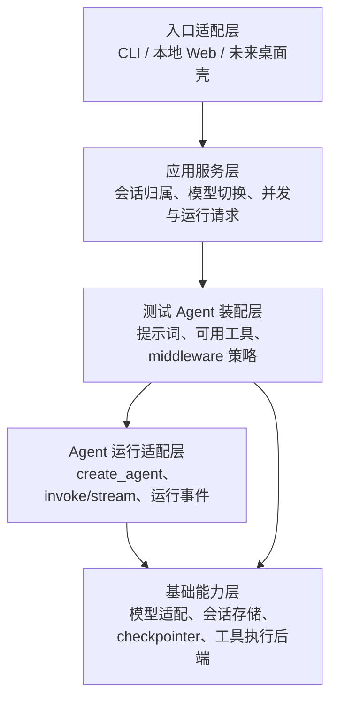
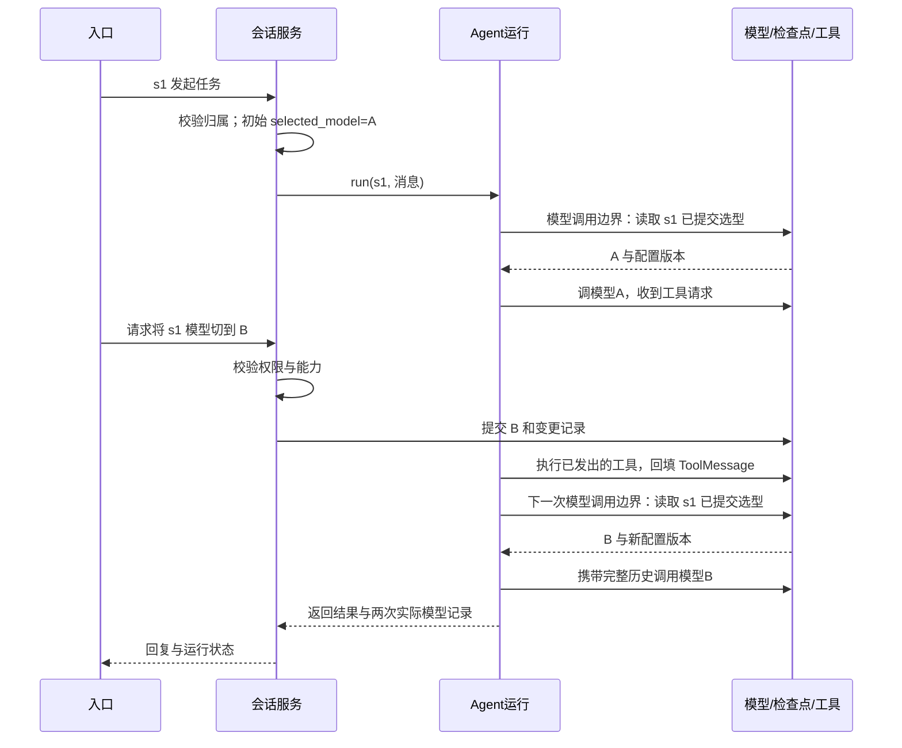

# Agent 运行、会话与工具架构草案（2026-09-29）

状态：讨论稿，不是阶段 Spec 或已实现能力。已确认同一会话允许切换模型；用户希望参考 Pi 的轮次边界，不局限于整条请求结束。模型正在输出时不替换其半段响应，具体 UI 请求/并发语义仍待设计。首期展示入口已选本地 Web，不做多用户或账号登录。

2026-09-30 现状更新：运行层正式命名 `agent_runtime`，按 [Spec 012](specs/012-agent-runtime-package.md) 将已有装配和选模代码归入同名 Python 包；这是包归类，不代表下述运行控制均已实现。`create_agent` 仍负责标准模型—工具循环。

2026-09-30 运行方式结论：当前 `SessionService.run → invoke_agent_run → agent.invoke` 是先验证一次运行及会话/失败边界的**同步入口**，不是最终唯一入口，也不是将所有工具限定为同步实现。Pi 本地 `a69bef789` 的 `Agent.prompt` 是可 `await` 的异步方法，运行中经 `AgentEventSink`/订阅者持续发事件；两者的模型→工具→结果回填机制相近，但运行 API、事件交付和错误语义并不相同。未来本地 Web 的实时进度与停止需求要单独验证流式/异步运行路径，现有同步入口可继续供确定性测试或简单 CLI 使用；模型接入、会话映射和 `create_agent` 循环不因此推倒重写。`stream_events`、异步 hook、取消和消费端的具体契约尚未确认，不能把此方向写成已实现能力。[本机事件来源探针](event-source-probe.md)仅验证同步 hook 和实验性 v3 事件的局部行为。

## 运行层职责与候选顺序（2026-09-30）

| 用户提出的能力 | 本项目的职责边界 | 当前状态与候选顺序 |
| --- | --- | --- |
| Agent 循环 | LangChain `create_agent` / LangGraph 负责模型、工具、状态更新与调度；`agent_runtime` 装配模型选择、工具边界和项目运行规则，不复制一套循环。 | 已有基本工具循环、选模与内存 checkpointer 接线。 |
| 运行中插入消息 | 参考 Pi 的 steering：当前模型响应和已发出的工具处理完成后，下一次模型调用前接入已排队消息。应用服务拥有消息入口、会话授权及队列顺序；运行层负责在可验证的模型调用边界消费。 | 后续独立切片；须先验证 LangChain hook 对工具结果、状态更新和竞争条件的具体时序。`after_model` 在工具调用前，不能直接当作 Pi 的 `turn_end`。 |
| 完成后补发消息 | 参考 Pi 的 follow-up：本次运行本可结束时，将排队消息作为后续输入继续。与普通的下一次用户 `invoke` 要区分：目前只验证后者，同进程历史可延续。 | 后续独立切片；由应用服务决定是否自动续跑及顺序、取消后的队列处理。 |
| 用户停止 | 入口识别并授权停止请求、标记 run 状态；运行层停止后续模型/工具调度并给出终局事件，传播取消到可取消的请求。对已开始的外部工具副作用标记结果未知并核对，不能宣称停止即回滚。 | 在正式可写/可执行工具前实现基本取消与验证；LangGraph 的 `interrupt()` 是暂停/恢复机制，不等同用户取消。 |
| 上下文窗口 | 运行层在模型调用前基于所选模型的限制、实际消息与工具输出做预算；必要时压缩或拒绝继续，并保留可追溯的原文/摘要关系。 | 等连续运行与轨迹可观察后，比较 LangChain `SummarizationMiddleware` 与定制策略；先测长工具输出和上下文超限，不盲目自动删历史。 |
| 消息与事件 | 框架消息类型/工具结果由 LangChain 维护；项目把一次运行的模型、工具、失败、取消和终局状态映射为可关联、脱敏事件。 | [Spec 013](specs/013-synchronous-run-events.md) 与 [Spec 015](specs/015-synchronous-tool-events.md) 已有同步运行路径的 run、模型和工具日志关联；turn、消费者、Web 实时交付和持久轨迹尚未接入。 |
| 持久会话 | checkpointer 保存 Agent 执行状态；应用服务拥有外部 `session_id` 与内部 `thread_id` 映射、所选模型、归属、切换记录、并发/队列规则。 | 已有内存 checkpointer 与进程内 `SessionService` 的同进程证明；跨重启恢复仍须单独选存储并同时验证两类状态。持久会话管理不能整体放进 `agent_runtime`。 |

参照当前本地源码：Pi `agent-loop.ts:166-274` 明确分 steering 内循环与 follow-up 外循环，并在工具结果加入后发 `turn_end`；`agent-session.ts:1347-1390` 排队两类消息，`:1561-1565` 触发 abort。AgentX `ConversationAppService.java:225-252` 先取会话、模型并组装请求，`AbstractMessageHandler.java:511-548` 从历史重建模型输入；`ChatSessionManager.java:94-129` 的可见路径设置中断标记并关闭 SSE，但本次源码搜索未找到其 `isSessionInterrupted` 在执行路径被调用，不能据此宣称底层模型/工具已停止。LangChain 当前[自定义 middleware 文档](https://docs.langchain.com/oss/python/langchain/middleware/custom)说明 `before_model`、`after_model` 的相对时点；[内置摘要 middleware](https://docs.langchain.com/oss/python/langchain/middleware/built-in)提供可参考机制；[LangGraph interrupt 文档](https://docs.langchain.com/oss/python/langgraph/interrupts)描述暂停与恢复及副作用重放边界。以上是设计参照，后续每项功能仍须在本机版本与项目场景下验证。

优先顺序建议：先统一运行事件和终局状态，随后建立可信会话映射与单会话运行规则；在正式副作用工具前验证取消。steering/follow-up、自动压缩和跨重启恢复各自成切片，按真实长任务/多轮需求推进，不把全部能力作为首个 HTTP 测试闭环的前置条件。

命名说明：项目统一使用[四层逻辑职责与实施路线](implementation-roadmap.md)；下图把 `application` 拆成 UI 和应用服务，把基础模块展开为能力节点，是具体组件图，不表示改成五层架构，也不要求现在创建这些目录。

## 先划清框架和项目的职责

| Pi 中的概念 | 本项目采用的对应能力 | 仍由我们负责 |
| --- | --- | --- |
| `pi-ai` 的统一模型调用 | LangChain 的 ChatModel 接口和供应商集成；`create_agent` 调用模型。 | 配置/凭证引用、供应商与模型能力校验、本地模型真实接入、实际调用模型的轨迹。不能说 LangChain 等于 Pi 的完整 `pi-ai` 产品。 |
| `pi-agent` 的模型→工具→模型循环 | LangChain `create_agent` 创建的执行图；底层使用 LangGraph，不再手写基本循环。 | 选择工具和 middleware、任务预算、业务错误策略与调用证据。 |
| Pi 的 AgentSession 与会话记录 | LangGraph checkpointer 可保存一次 `thread_id` 的消息/执行状态。 | 用户与会话归属、模型选择和变更历史、同会话并发策略、恢复与清理。checkpointer 不自动提供这些应用规则。 |
| Pi 的工具执行 | LangChain 负责工具描述、调用调度和结果回填。 | HTTP/RPC 测试工具的真实实现、参数和权限校验、执行隔离、超时与错误记录。 |

依据：[Pi 模型调用接入](https://github.com/earendil-works/pi/blob/a69bef789/packages/coding-agent/src/core/sdk.ts#L304-L323)、[Pi 核心循环与下一轮刷新](https://github.com/earendil-works/pi/blob/a69bef789/packages/agent/src/agent-loop.ts#L195-L245)、[Pi 会话下一轮快照](https://github.com/earendil-works/pi/blob/a69bef789/packages/coding-agent/src/core/agent-session.ts#L540-L559)、[Pi 会话中切换模型](https://github.com/earendil-works/pi/blob/a69bef789/packages/coding-agent/src/core/agent-session.ts#L1598-L1616)；[AgentX 请求装配](https://github.com/lucky-aeon/AgentX/blob/3fcfa0e/AgentX/src/main/java/org/xhy/application/conversation/service/message/AbstractMessageHandler.java#L115-L147)；[LangChain Agent](https://docs.langchain.com/oss/python/langchain/agents)、[短期记忆](https://docs.langchain.com/oss/python/langchain/short-term-memory)、[动态模型选择](https://docs.langchain.com/oss/python/langchain/models#dynamic-model-selection)。参考项目的事实不能直接证明本项目已接线或可靠。

Pi 当前核心代码使用 `agent_start/agent_end` 与 `turn_start/turn_end` 作为两层事件；没有在这条循环里把 `trace` 定义为并列的循环层。`turn_end` 在工具结果加入上下文后发出，然后 `prepareNextTurn` 可读取会话当下的模型/工具/上下文供下一轮使用。观测系统的 trace 可以覆盖一次运行及多轮 turn，但不要与 Pi 的循环事件名称混为一谈。

## 候选静态依赖图

箭头表示**项目代码中允许的依赖方向**，不是一次请求的时间顺序；上层可依赖下层，下层不得 import 上层。所有入口都调用同一个应用服务。

- **循环**由框架承担。运行适配层封装其调用和事件映射，不复制一套 LangGraph 调度器。
- **会话规则**由应用服务层拥有：`session_id → owner/workspace、selected_model、配置版本、运行状态`；记录可由下层存储组件保存。checkpointer 只处理该会话的 Agent 状态。入口传入经校验的会话标识，不能只凭请求方提供的 `thread_id` 取历史。
- **工具**由装配层决定本轮暴露哪些；具体执行后端在基础能力层，必须在真实副作用之前检查权限/路径/预算。Agent 运行层只接收框架的工具接口，不 import 测试业务模块。
- **模型**由应用服务校验并提交会话选项到下层存储，基础能力层构造供应商 ChatModel。为支持一次 `invoke` 内在工具回合后切换，候选方案是在 `wrap_model_call` 边界从下层存储读取该会话已提交的模型选择、生成本次模型调用快照，再 `request.override(model=...)`；运行层不调用上层应用服务，也不设跨会话共享的可变 `current_model`。提交后遇到的下一次模型调用才生效，已经开始的流式响应不变。
- **观测与评测**是独立消费链路：运行边界发出结构化事件，评测读取事件与产物；不能因图上省略就把二者藏在 UI 或模型适配里。

“下层绝不调用上层”如果按运行时函数调用字面理解，需特别讨论：`create_agent` 会调用我们传给它的工具和 middleware 回调，这属于框架的控制反转。可严格保证的是**项目模块的静态依赖单向**：低层不导入、不知道高层类型；高层把符合框架接口的能力传进去。若连这种回调也禁止，框架工具循环就无法照现有路线工作。首次实现时应检查 import 图，并对工具回调的权限边界写测试。

## 一次运行内按轮次边界切换模型的候选时序

示意：会话 `s1` 的同一次运行中，第一轮模型 A 请求工具，工具完成后，下一轮模型调用前刷新选型为 B；历史仍属于同一 `thread_id`。模型切换命令可由会话入口在运行期间登记，具体提交/并发协议待设计。此图是设计示意，不是应用运行证据。

待验证的关键点：A 的工具调用先完成并回填，B 才能收到配对的历史；B 必须能处理既有消息/工具结构；切换失败不得改变会话选项；同会话并发请求不能互相覆盖。切换命令若晚于下一次模型调用边界提交，则从再下一次调用生效。正在进行的模型流不被中途拼接；若要求立即中断该流，需单独设计取消、工具副作用和恢复。多轮内读选型可由 LangChain 模型边界 middleware 实现，不必重写整个循环。

机制级验证：使用项目当前 `.venv`、假模型 A/B、一个工具和 `wrap_model_call` 运行一次 `create_agent.invoke`。工具回合后更新示例选型，模型边界实际观察到 `['A', 'B']`；结果消息类型为 `['human', 'ai', 'tool', 'ai']`，最终内容 `B-reply`，退出码 0，输出 `turn-boundary-model-switch: PASS`。这只证明模型调用边界能够选型；尚未验证 UI 并发切换、跨供应商消息兼容、持久状态、权限或真实外部模型。

## 本地 Web 与桌面可执行应用

| 入口 | 首期收益 | 额外工作与风险 |
| --- | --- | --- |
| 本地 Web：本机启动服务，用浏览器访问 | Python Agent 和服务共用进程；开发、轨迹展示与调试较直接；原 AIAutoTest 已有[本地 Console 启动实现](/Users/zmw/AIAutoTest/aitest_kit/console/cli.py)可作为经验来源。 | 需限制监听地址、认证/授权、浏览器来源、文件访问和退出清理；“只监听本机”本身不等于安全。 |
| 桌面可执行应用：安装包/原生窗口 | 用户启动体验和分发形式更完整；后续可包裹相同应用服务。 | 除 Agent 本身，还要处理打包、平台差异、更新、签名、资源文件、故障日志。打包不自动提供权限隔离；[PyInstaller 文档](https://pyinstaller.org/en/stable/operating-mode.html)也指出单文件包有启动和临时文件代价。 |

已确认首期采用**CLI 验证核心 + 本地 Web 展示**：两者调用同一应用服务，本地 Web 展示会话、模型选择、工具轨迹和测试结果。暂不做多用户或账号登录；本地服务仍应限制监听到回环地址，并使用启动时访问令牌等最低限度的 API 授权，避免其他本机网页直接操作测试工具。若后续确有安装/分发需求，可在同一应用服务外加桌面壳；不要让 UI 直接调用 LangChain 或操作 checkpointer。采用本地 Web 前验证访问和文件操作边界；目前尚未开发 Web。

## 持久会话的分期建议

一次会话至少有两类状态，不能把“聊天能继续”误解为“会话已持久”：

| 状态 | 谁负责 | 首个技术切片 | 跨重启恢复切片 |
| --- | --- | --- | --- |
| 应用会话元数据：会话标识、所选模型、变更记录、运行状态 | 应用会话服务 | 进程内保存；重启后会话列表整体清空，UI 如实显示 | 与检查点一起持久化；恢复时校验模型配置是否仍可用 |
| Agent 消息与执行状态 | LangGraph checkpointer | `InMemorySaver` + 稳定的内部 `thread_id`，验证同进程多轮与换模型 | 数据库型 checkpointer；重启后验证历史、工具结果和恢复规则 |

依据：[LangGraph persistence](https://docs.langchain.com/oss/python/langgraph/persistence)区分线程检查点与跨线程 store，并明确 `InMemorySaver` 重启会丢失；[LangChain 短期记忆](https://docs.langchain.com/oss/python/langchain/short-term-memory)用 `thread_id` 连续调用，生产示例使用数据库型 checkpointer。对照项目：[Pi SessionManager](https://github.com/earendil-works/pi/blob/a69bef789/packages/coding-agent/src/core/session-manager.ts#L1015-L1041)可把会话条目写入 JSONL，并记录[模型变更](https://github.com/earendil-works/pi/blob/a69bef789/packages/coding-agent/src/core/session-manager.ts#L1082-L1093)；[AgentX](https://github.com/lucky-aeon/AgentX/blob/3fcfa0e/AgentX/src/main/java/org/xhy/application/conversation/service/message/AbstractMessageHandler.java#L511-L548)会为请求重建运行时消息窗口。它们展示不同的应用/框架存储分工，不能直接替代本项目的恢复测试。

建议**不在最小 Agent 链路里写数据库表、仓储接口或空的持久化适配器**。现在先固定外部 `session_id` 与内部 `thread_id` 的区分、所有会话读写都经过应用服务、模型切换要有版本/事件证据。首期优先完成 HTTP/RPC 业务闭环、轨迹/评测和本地 Web；持久化紧随其后作为独立切片。如果进度允许可提前做，但必须同时验证元数据和检查点跨进程恢复，不能只保存会话列表；中断在工具副作用附近的运行还要标明结果未知或已完成，不能盲目重放。仓库当前只安装了内存 checkpointer，未安装 SQLite/Postgres checkpointer；实现持久化时再做依赖与存储选型。未来 SaaS 可考虑数据库型后端，但本地 SQLite 验证不等于多实例生产能力。

无账号登录只适用于本地单用户范围。本地 Web 的启动令牌是访问控制，不是 SaaS 身份体系；日后对外部署前必须增加账号身份、会话归属授权、租户隔离与并发/保留策略，不能直接把本地服务暴露到公网。

## 当前待定与下一步

1. 参考 Pi 的 turn 边界已明确为方向；仍需决定用户切换命令在忙碌会话中的提交与取消语义，以及同会话并发策略。
2. 持久会话是最终目标；本稿建议首个技术切片及核心 MVP 不以跨重启恢复为前置条件，恢复作为随后独立切片。具体数据库和故障恢复语义在该切片 Spec 中确定。
3. 首期入口已选本地 Web，CLI 用于先行验证；具体页面范围与最低访问控制留到入口 Spec。

这些决定明确后，才能把本稿收敛为首个 Agent 运行/会话/工具单元的阶段 Spec，再按 TDD 写最小验证。当前没有新增业务代码、UI、会话服务或生产能力。
