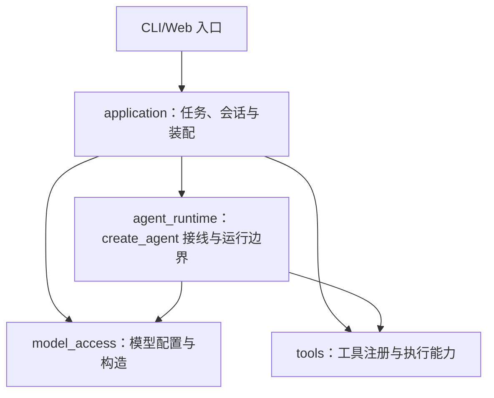

# Naiyue Test Agent：分层命名与首期实施路线

2026-10-18当前：[Spec109两片](specs/109-web-replay-and-persistent-diagnostics.md#9-109-02实际结果与spec109收尾)已完成Web每根256条/4 MiB重播双预算和schema10持久诊断。关键事件/根摘要分开，根子共享额度，1 MiB单根/30天/256 MiB工作区默认可配置；有限队列、关闭排空、缺口和整组淘汰已接线。新增只读诊断分页API，冷查询不装载图；原聊天/用量/checkpoint及审批恢复保持。后端2817、前端198及211模块构建通过，0次真实供应商请求。下一步先讨论Spec103的GFM消息呈现，再逐片推进其他UI；checkpoint修剪和两种项目重试继续延期，原机/更多供应商/PyPI交付独立。

版本边界（2026-10-18，105-02更新）：下列早期同步阶段为历史实施记录。[Spec093](specs/093-architecture-semantics-and-sync-cleanup.md)已删除独立同步App；当前产品唯一执行链为CLI线程桥/Web → AsyncApplication → SessionService协调准入 → AgentSession执行/审批恢复 → 直接await原生异步图 → 对象受保护收尾。IOCall/arun_steps已由[102-02](specs/102-session-state-lifecycle-refactor.md#18-102-02实际结果与下一片2026-10-18)删除，工具IO、CLI线程桥和框架同步hook按实际调用保留。

102-03已迁移配置/选模测试与有界探针，删除build_configured_runtime_agent和record_selection；当前入口及发前预算边界见[本片结果](specs/102-session-state-lifecycle-refactor.md#20-102-03实际结果与下一片2026-10-18)。[102-04](specs/102-session-state-lifecycle-refactor.md#23-102-04实际结果与下一片2026-10-18)已接SessionPort：根/子Runtime共用同一SessionService，保留各middleware真实方法依赖，根控制hook限定root；旧项目指令回退已清理。[102-05](specs/102-05-content-projection.md#5-实际结果2026-10-18)已将CLI/Web完整内容与Runtime增量文本接到content_text，保留strict/图片/响应ID/终端转义差异并删除旧解析及Web别名。[102-06](specs/102-06-web-setting-errors.md#6-实际结果2026-10-18)已接WebService局部_apply_setting，三项门禁/错误码/成功确认及取消保持；[102-07](specs/102-07-middleware-contracts.md#5-全量验收与spec102收尾2026-10-18)已补standalone/root/child装配顺序说明及实际生产链验收，两处生产AST不变；当前7个已确认分片收尾，原问题第7跨会话并发转104草案，先做105架构收敛。
状态：2026-09-30 更新实施顺序。这里确定职责和先后顺序；各功能的输入输出、文件范围和验收断言由对应阶段 Spec 确定。首期约 15–30 小时，包含学习时间，以一个可验证的 HTTP/RPC 测试闭环优先，不把远期能力算作首期完成。

## 先区分框架循环和项目代码

Pi 的 `pi-ai` 提供统一模型 API，`pi-agent-core` 自己实现 Agent 循环、工具执行和状态。本项目复用 LangChain ChatModel 与 `create_agent` 的循环；项目实现的是模型接入配置、框架运行边界、通用工具和应用会话规则。因此按**实际职责**命名，不复制 Pi 的包名或声称自写循环。AgentX 的请求装配、会话与模型配置可作职责对照，但其 Java LangChain4j API 不直接搬到本项目。

当前模块关系（2026-10-18）：`test_agent`历史原型源码已在Spec093C删除，本次清掉遗留字节码和空目录，不再把它作为应用与运行时之间的一层。测试工作由通用Agent结合提示词/Skills和注册工具完成；独立检索、测试执行与评测按具体需求接入，不预建策略包。以下图只展示核心装配与调用方向，contracts和持久化等共享模块按实际消费者使用。

| 模块 | 拥有的职责 | 当前入口 |
| --- | --- | --- |
| 模型接入 `model_access` | 读取模型配置，构造并校验供应商适配器，处理供应商参数、消息和失败描述 | `load_model_catalog`与`ModelCatalog` |
| Agent运行适配 `agent_runtime` | 接线`create_agent`，在模型/工具边界处理可信context、观察、控制、上下文和审批 | `_assemble_interactive_runtime`及原生异步运行入口 |
| 通用工具 `tools` | 提供文件、搜索、Shell、子任务等工具能力及注册契约；运行时负责调度与审批接线 | `ToolRegistry`及具体工具实现 |
| 应用 `application`与CLI/Web入口 | 装配模型/工具/运行时，管理会话与持久化，接受任务并投影结果 | `SessionService.assemble_runtime`、`AsyncApplication`与`AgentSession`；归属迁移进度见顶部105说明 |

`agent_runtime`通过SessionPort调用受信任会话能力，不静态import `application`。因此框架回调进入项目middleware属于控制反转，不意味着项目下层依赖上层；新增职责按实际边界决定是否拆包，不先创建占位目录。

## 实施顺序与每步证据

以下为早期各阶段的实施记录，状态词对应当时版本；当前入口、执行方式和后续顺序以上方说明及handoff为准，其中“四层/测试策略层”属于已撤销的历史划分。

| 顺序 | 一个小目标 | 完成证据 | 学习重点 |
| --- | --- | --- | --- |
| 已完成：运行边界验证 | `create_agent` 的真实最小模型→工具→模型诊断；假模型验证同一次运行在工具回合后 A→B 选模 | 真实诊断的两次模型调用/一次工具执行；3 个确定性测试通过。两类证据分开记录 | 消息、工具调用与结果、`ModelRequest`、middleware 的 `handler` |
| 历史已撤销：确定业务契约 | 曾选定 `discount_system` 的折扣优先级冲突场景，核对公开文档、源码、预期行为、环境和副作用；写 Spec 002 | Spec 区分公开要求、当前实现与历史测试；固定了请求和预期。Agent 尚未执行该场景 | 从接口契约推导有意义的测试点 |
| 已完成：模型接入层首版 | 已完成多供应商对象构造、选模接线、默认 thinking 映射、同步失败事件、部分 SDK 错误分类与 [Spec 010](specs/010-model-request-policy.md) 的请求超时/重试配置；后续按证据补每次调用的等级选择和更完整的错误边界 | HeiyuCode 已有真实工具循环与一次缓存读取统计；在线 SDK 的 503 尝试次数经本机 HTTP mock 验证。真实供应商推理等级、Anthropic/Ollama 服务、任务总预算及异步/流式未验证 | 统一模型接口与供应商参数/错误的边界 |
| 当前：Agent 运行与会话 | [Spec 011](specs/011-in-memory-agent-continuation.md)已接可选 checkpointer，[Spec 012](specs/012-agent-runtime-package.md)完成包归类，[Spec 013](specs/013-synchronous-run-events.md)提供同步运行事件入口，[Spec 014](specs/014-in-memory-session-service.md)新增进程内会话服务，[Spec 015](specs/015-synchronous-tool-events.md)补工具边界事件，[Spec 016](specs/016-local-application-composition.md)补进程内组合入口，[Spec 017](specs/017-local-cli-entry.md)接最小本地 CLI，[Spec 018](specs/018-model-stop-reason-and-truncated-tool-calls.md)接统一结束原因与截断工具调用保护，[Spec 027](specs/027-workspace-read-tool.md)接显式工作区只读文件工具；插话、取消、压缩分别验证 | 假模型证明经应用服务同进程延续、换模型、不同线程隔离及同步 run/工具事件；同会话并发被拒绝，失败后可再运行。CLI 使用现有配置完成两轮真实模型合成文本调用；文件工具只有临时文件与假模型 CLI 证据。旧诊断路径未统一接入，尚无写工具、流式事件消费或持久轨迹 | 框架检查点、运行事件与应用授权的边界 |
| 当前：运行控制后续验证 | 按 [Pi loop 差距分析](pi-loop-gap-analysis.md)逐片定义普通文本截断与未知原因的运行终局、异步/流式活动运行和真正的活动取消；保持 `create_agent` 负责标准循环 | [Spec 022](specs/022-synchronous-steering.md)、[Spec 023](specs/023-synchronous-follow-up.md)、[Spec 024](specs/024-stop-after-current-turn.md)已有进程内同步假模型接线；活动取消、真实请求停止和异步路径均未实现 | Pi 的 turn/run 边界与 LangChain hook、队列交付和取消语义的差异 |
| 后续：业务闭环 | 待用户重新确定业务需求与验收样本后，使用通用工具读取资料、生成产物和受控执行；Discount固定业务实验已撤销 | 当前工具能力与业务效果分别验收 | 模型生成与确定性校验/执行/评测的边界 |
| 后续：基础轨迹与评测 | 在以上模型、工具、证据与执行边界采集关联事件；用固定样本分别评价用例质量和轨迹行为 | 一条任务可追踪；评分规则、样本和真实输出保存；至少一个失败案例可解释 | 结果正确与执行过程正确为何要分开验证 |
| 后续：本地 Web 展示 | 在已验证应用服务外增加本地 Web，会话、模型选择、轨迹与测试结果使用真实数据 | 入口实际调用同一服务；回环监听和最小访问控制通过测试 | 界面与应用服务的依赖边界 |

工具阶段的明确先后顺序：**Read 分页（Spec 028，已完成）→ 会话可信工作区传递 → `allow/deny/ask` 权限决策 → 同进程审批中断/恢复 → 其他路径工具及写入/命令工具**。跨重启的待审批恢复依赖持久 checkpoint，在持久会话切片验收；本地 Web 只负责呈现审批请求和决定，不是权限执行的唯一位置。受限 Auto 与完全信任模式在权限契约稳定后单独定义，不能从模式名称推断允许哪些动作。此顺序让后续文件工具复用同一策略边界，而不是每个工具先固定工作区、之后反复改造。详细数据流及验证门槛见 [Spec 028](specs/028-read-file-pagination.md)。

按模型接入 → Agent 运行 → 测试策略 → 应用入口的依赖方向自底向上推进；最小 CLI 是对现有层的接线验证，随后回到运行层补控制能力，再进入工具。每层每次只取一个明确的功能切片。每一行仍可拆成几个 1–2 小时的开发学习单元：具体例子 → 阶段 Spec → TDD 红灯/最小实现/回归 → 逐行讲核心代码 → 用户复述或独立小改动。观测事件从相关功能接线时同步加入；后续评测切片把它们做成可比较的证据，不表示此前可以没有日志。若时间不足，保留单场景闭环及可验证证据，缩小可选检索和界面范围，不声称全部阶段完成。

跨重启会话、真实 Claude/开源/本地模型工具能力、完整 PDF/网页 RAG、混合检索/重排、MCP、沙箱、多用户 SaaS、SFT 和偏好优化属于后续独立切片。四类适配对象已经构造并与运行层接线，但 `BaseChatModel` 接口与假模型验证不能代替这些模型的真实调用及行为验证。

具体未完成项和各项验证标准集中维护在[后续开发与补充清单](future-work.md)；本表只保留分层与实施顺序。

2026-10-02 工具状态补充：上表早期“只有 read、write 未实现”等文字记录的是当时状态；当前 CLI 已接 `read/ls/find/grep/write/edit`，下一通用工具候选为 `bash`。在接入命令执行前，先按 [future-work C4](future-work.md)验证隔离、审批、时间与输出预算；详见[交接第 149 节](handoff.md)。这不改变四层职责或“工具之后再进入测试场景闭环”的总体顺序。

2026-10-17：用户撤销Discount历史需求；原Spec002/003只保留历史记录，对应实现与测试已删除，不再作为当前业务验收目标。
