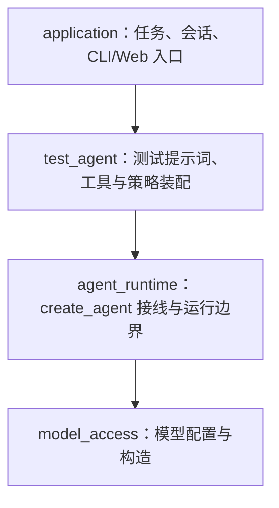

# Naiyue Test Agent：分层命名与首期实施路线

状态：2026-09-30 更新实施顺序。这里确定职责和先后顺序；各功能的输入输出、文件范围和验收断言由对应阶段 Spec 确定。首期约 15–30 小时，包含学习时间，以一个可验证的 HTTP/RPC 测试闭环优先，不把远期能力算作首期完成。

## 先区分框架循环和项目代码

Pi 的 `pi-ai` 提供统一模型 API，`pi-agent-core` 自己实现 Agent 循环、工具执行和状态。本项目复用 LangChain ChatModel 与 `create_agent` 的循环；项目实现的是模型接入配置、框架运行边界、测试策略和应用会话规则。因此按**实际职责**命名，不复制 Pi 的包名或声称自写循环。AgentX 的请求装配、会话与模型配置可作职责对照，但其 Java LangChain4j API 不直接搬到本项目。

四层是**逻辑职责**，从上到下的项目代码依赖方向如下；独立的检索、测试执行、评测和存储组件在具体 Spec 中接入，不为它们预建空目录。

| 逻辑层 / 暂定 Python 名称 | 拥有的职责 | 当前事实 |
| --- | --- | --- |
| 模型接入 `model_access` | 配置模型 ID、供应商/端点/本地凭证，构造并校验 `BaseChatModel`；本地模型通过实际支持的协议接入 | 已有 `.env/models.json` 加载与四类适配对象构造；HeiyuCode 配置完成真实工具循环，OpenAI 官方/Claude/Ollama 尚无真实模型调用证据 |
| Agent 运行适配 `agent_runtime` | 装配或调用 `create_agent`，在模型/工具调用边界传递可信 context、调用记录与错误 | 已归入 `agent_runtime/` 包；选模、checkpointer、同步事件及进程内 Steering/Follow-up/优雅停止均有假模型接线证据。尚无活动取消、流式或压缩 |
| 测试 Agent 策略 `test_agent` | 决定本次测试任务使用的提示词、证据与工具契约；将独立的检索/执行能力接入 Agent | 已有固定折扣场景的结构化输出实验；运行层已有通用 `read` 且 CLI 可选接入，测试策略尚未使用该工具，`write/bash` 未实现 |
| 应用与入口 `application` | 会话归属、选中模型、切换提交与运行请求；CLI 和本地 Web 调同一应用服务 | [Spec 014](specs/014-in-memory-session-service.md) 已有进程内会话服务、内部线程映射、切换提交和同会话 busy 拦截；[Spec 016](specs/016-local-application-composition.md) 已将一份模型目录、服务、Agent 和内存 checkpoint 配对。CLI 已支持进程内交互式 Steering/Follow-up；仍无 Web、身份授权或持久化。后续可在这一层内拆入口与服务，不改变四层的逻辑划分 |

`agent_runtime` 接收装配时注入的解析函数并在调用模型时使用，不静态 import `application`。因此框架回调进入项目 middleware 属于控制反转，不意味着项目下层依赖上层。当前文件承载选模与同步失败观测；新增职责时再按实际边界决定是否拆包，不先创建占位目录。

## 实施顺序与每步证据

| 顺序 | 一个小目标 | 完成证据 | 学习重点 |
| --- | --- | --- | --- |
| 已完成：运行边界验证 | `create_agent` 的真实最小模型→工具→模型诊断；假模型验证同一次运行在工具回合后 A→B 选模 | 真实诊断的两次模型调用/一次工具执行；3 个确定性测试通过。两类证据分开记录 | 消息、工具调用与结果、`ModelRequest`、middleware 的 `handler` |
| 已完成：确定业务契约 | 选定 `discount_system` 的折扣优先级冲突场景，核对公开文档、源码、预期行为、环境和副作用；写 Spec 002 | Spec 区分公开要求、当前实现与历史测试；固定了请求和预期。Agent 尚未执行该场景 | 从接口契约推导有意义的测试点 |
| 已完成：模型接入层首版 | 已完成多供应商对象构造、选模接线、默认 thinking 映射、同步失败事件、部分 SDK 错误分类与 [Spec 010](specs/010-model-request-policy.md) 的请求超时/重试配置；后续按证据补每次调用的等级选择和更完整的错误边界 | HeiyuCode 已有真实工具循环与一次缓存读取统计；在线 SDK 的 503 尝试次数经本机 HTTP mock 验证。真实供应商推理等级、Anthropic/Ollama 服务、任务总预算及异步/流式未验证 | 统一模型接口与供应商参数/错误的边界 |
| 当前：Agent 运行与会话 | [Spec 011](specs/011-in-memory-agent-continuation.md)已接可选 checkpointer，[Spec 012](specs/012-agent-runtime-package.md)完成包归类，[Spec 013](specs/013-synchronous-run-events.md)提供同步运行事件入口，[Spec 014](specs/014-in-memory-session-service.md)新增进程内会话服务，[Spec 015](specs/015-synchronous-tool-events.md)补工具边界事件，[Spec 016](specs/016-local-application-composition.md)补进程内组合入口，[Spec 017](specs/017-local-cli-entry.md)接最小本地 CLI，[Spec 018](specs/018-model-stop-reason-and-truncated-tool-calls.md)接统一结束原因与截断工具调用保护，[Spec 027](specs/027-workspace-read-tool.md)接显式工作区只读文件工具；插话、取消、压缩分别验证 | 假模型证明经应用服务同进程延续、换模型、不同线程隔离及同步 run/工具事件；同会话并发被拒绝，失败后可再运行。CLI 使用现有配置完成两轮真实模型合成文本调用；文件工具只有临时文件与假模型 CLI 证据。旧诊断路径未统一接入，尚无写工具、流式事件消费或持久轨迹 | 框架检查点、运行事件与应用授权的边界 |
| 当前：运行控制后续验证 | 按 [Pi loop 差距分析](pi-loop-gap-analysis.md)逐片定义普通文本截断与未知原因的运行终局、异步/流式活动运行和真正的活动取消；保持 `create_agent` 负责标准循环 | [Spec 022](specs/022-synchronous-steering.md)、[Spec 023](specs/023-synchronous-follow-up.md)、[Spec 024](specs/024-stop-after-current-turn.md)已有进程内同步假模型接线；活动取消、真实请求停止和异步路径均未实现 | Pi 的 turn/run 边界与 LangChain hook、队列交付和取消语义的差异 |
| 随后：单场景测试闭环 | 以 `discount_system` 为验收样本，逐步用通用工具读取资料、写出用例/自动化代码，再对产物做独立校验与受控执行 | 当前只有固定结构化输出实验；模型写文件质量、SUT 网络执行及断言结果尚未验证 | 模型生成内容与确定性文件/执行/评测边界 |
| 后续：基础轨迹与评测 | 在以上模型、工具、证据与执行边界采集关联事件；用固定样本分别评价用例质量和轨迹行为 | 一条任务可追踪；评分规则、样本和真实输出保存；至少一个失败案例可解释 | 结果正确与执行过程正确为何要分开验证 |
| 后续：本地 Web 展示 | 在已验证应用服务外增加本地 Web，会话、模型选择、轨迹与测试结果使用真实数据 | 入口实际调用同一服务；回环监听和最小访问控制通过测试 | 界面与应用服务的依赖边界 |

工具阶段的明确先后顺序：**Read 分页（Spec 028，已完成）→ 会话可信工作区传递 → `allow/deny/ask` 权限决策 → 同进程审批中断/恢复 → 其他路径工具及写入/命令工具**。跨重启的待审批恢复依赖持久 checkpoint，在持久会话切片验收；本地 Web 只负责呈现审批请求和决定，不是权限执行的唯一位置。受限 Auto 与完全信任模式在权限契约稳定后单独定义，不能从模式名称推断允许哪些动作。此顺序让后续文件工具复用同一策略边界，而不是每个工具先固定工作区、之后反复改造。详细数据流及验证门槛见 [Spec 028](specs/028-read-file-pagination.md)。

按模型接入 → Agent 运行 → 测试策略 → 应用入口的依赖方向自底向上推进；最小 CLI 是对现有层的接线验证，随后回到运行层补控制能力，再进入工具。每层每次只取一个明确的功能切片。每一行仍可拆成几个 1–2 小时的开发学习单元：具体例子 → 阶段 Spec → TDD 红灯/最小实现/回归 → 逐行讲核心代码 → 用户复述或独立小改动。观测事件从相关功能接线时同步加入；后续评测切片把它们做成可比较的证据，不表示此前可以没有日志。若时间不足，保留单场景闭环及可验证证据，缩小可选检索和界面范围，不声称全部阶段完成。

跨重启会话、真实 Claude/开源/本地模型工具能力、完整 PDF/网页 RAG、混合检索/重排、MCP、沙箱、多用户 SaaS、SFT 和偏好优化属于后续独立切片。四类适配对象已经构造并与运行层接线，但 `BaseChatModel` 接口与假模型验证不能代替这些模型的真实调用及行为验证。

具体未完成项和各项验证标准集中维护在[后续开发与补充清单](future-work.md)；本表只保留分层与实施顺序。

2026-10-02 工具状态补充：上表早期“只有 read、write 未实现”等文字记录的是当时状态；当前 CLI 已接 `read/ls/find/grep/write/edit`，下一通用工具候选为 `bash`。在接入命令执行前，先按 [future-work C4](future-work.md)验证隔离、审批、时间与输出预算；详见[交接第 149 节](handoff.md)。这不改变四层职责或“工具之后再进入测试场景闭环”的总体顺序。

用户已选 `/Users/zmw/discount_system` 作为首个待测项目。第一个具体场景是折扣策略优先级冲突；公开契约、当前源码核对和固定验收样本见 [Spec 002](specs/002-discount-policy-first-scenario.md)。该 Spec 只完成上述业务契约步骤；Agent 业务功能尚未实现。
