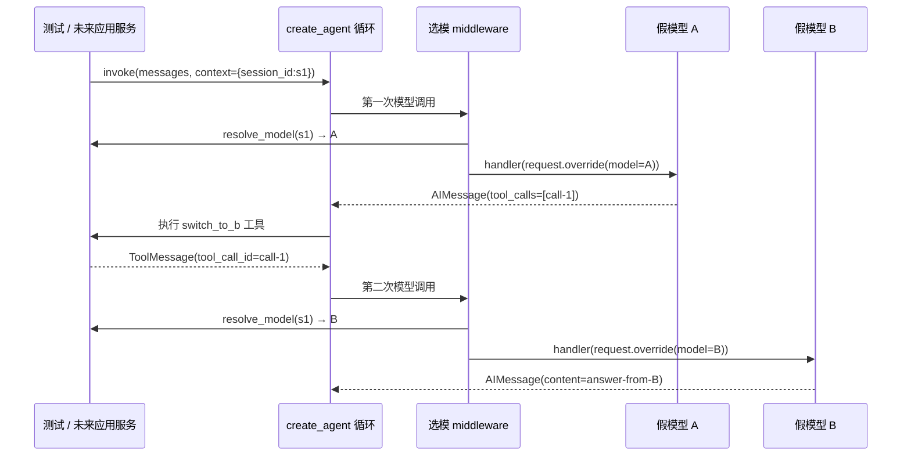

# Lesson 1：模型调用边界按会话选模

> 学习目标：知道一个 `create_agent.invoke` 内为什么能先调用模型 A、执行工具、再调用模型 B；能追踪 `session_id`、模型对象和选择记录是谁提供的。当前只完成代码讲解，尚未观察用户复述或独立改动。

## 本节代码地图

| 文件/入口 | 职责 | 证据 |
| --- | --- | --- |
| `naiyue_test_agent/agent_runtime/__init__.py:20-21` | 声明本次运行的 context 必须有 `session_id` | 运行层只读会话标识，不创建会话 |
| `naiyue_test_agent/agent_runtime/__init__.py:24-69` | 构造模型调用 middleware，每次模型调用前重新解析选型 | 本节唯一项目核心实现；后续新增运行装配入口见 Lesson 2 |
| `tests/test_agent_runtime.py:85-121` | 假模型 A 请求工具，工具改选 B；一次 `invoke` 验证两次选模、工具结果和最终回答 | 确定性接线证据 |
| `tests/test_agent_runtime.py:122-201` | A/B 会话隔离、缺少会话标识时拒绝 | 错误边界证据；中间还有其他测试 |

## 一条具体数据流

初始测试数据：`selected = {'s1': 'A'}`，`models = {'A': 模型A对象, 'B': 模型B对象}`。测试把 `context={'session_id': 's1'}` 传给 `agent.invoke`，不是传到 `messages` 里。框架第一次准备调用模型时，middleware 读到 `s1`；解析函数返回 `('A', 模型A对象)`，选择记录变为 `[('s1', 'A')]`。模型 A 的响应是一个 `AIMessage`，其 `tool_calls` 内有 `{name: 'switch_to_b', args: {}, id: 'call-1'}`。框架执行测试工具，工具把 `selected['s1']` 改为 B，并将结果写成 `ToolMessage(tool_call_id='call-1', ...)`。第二次模型调用前，**同一个** middleware 再次运行，解析函数现在返回 `('B', 模型B对象)`；选择记录变成 `[('s1', 'A'), ('s1', 'B')]`。模型 B 返回 `answer-from-B`。

图中的 `T` 在测试里是函数和字典；未来应用会话服务与模型适配能力属于另外的实现单元。图表示运行时调用顺序，不表示项目模块 import 方向。正式运行层只依赖 LangChain 接口和传入的函数，没有导入应用层模块。

## 核心代码逐段解释

下列行号已按当前 `naiyue_test_agent/agent_runtime/__init__.py` 校正；2026-09-30 包归类之前的原文件行号不再适用。

- **第 20–21 行**：`RunContext` 是给框架看的本次运行 context 形状。它与持久消息状态不同；`session_id` 不会因为声明了类型就自动获授权，未来入口仍需先校验。
- **第 24–27 行**：创建一个 middleware。`resolve_model` 是“输入会话 ID，返回模型 ID 和模型对象”的函数，例如 `resolve_model('s1') → ('A', model_a)`；`record_selection` 是“记录这次选择”的函数。`Callable[[str], tuple[str, BaseChatModel]]` 描述前者的输入与输出，不会自动执行它。
- **第 30–31 行**：`@wrap_model_call` 将内层 `select_model` 注册为每次模型调用的包裹函数。外层函数只在装配 Agent 时运行一次；内层函数在 A 和 B 两次模型调用前各运行一次。`request` 包含本次调用的消息、模型和运行时信息；`handler` 是继续执行框架下游模型调用的函数。
- **第 32–35 行**：从 `request.runtime.context` 取本次 `invoke` 提供的 `session_id`。无 context、非字符串或空字符串时抛 `ValueError`，不继续使用创建 Agent 时的默认模型。这使遗漏会话标识成为可见失败。
- **第 37–39 行**：在**调用模型的当下**解析，而不是只在创建 Agent 时解析。第一次 `selected['s1']='A'`，第二次工具已改成 B。解析失败会原样抛出；空的模型 ID 则显式拒绝。这里的 `model_id` 是业务配置标识，`model` 是实现 LangChain 模型接口的实际对象。
- **第 40 行**：记录 `(session_id, model_id)` 这一“选型尝试”。它发生在真正模型调用前，故不能解释为模型调用成功、网络侧实际身份已核验或完整轨迹。记录函数异常也不会被静默吞掉。
- **第 42 行**：`request.override(model=model)` 得到替换模型后的请求；`handler(...)` 把它交回框架继续。省略 `handler` 就不会正常继续模型调用。工具执行、生成 `ToolMessage`、判断是否进入下一轮仍由 `create_agent` 完成。
- **第 69 行**：返回已注册的内层 middleware 函数，供 `create_agent(middleware=[...])` 使用。这里返回的是函数对象，不是在第 69 行调用模型。

## 验证变量从哪里来

- `selected` 是测试自己创建的字典，模拟以后会话服务保存的当前选型。工具函数修改它；生产代码并不自带这个字典。
- `selections` 是测试自己创建的列表；`record_selection` 回调逐次写入，所以断言看到 A、B。它证明 middleware 真的两次执行，而不是只检查最终回答。
- `result['messages']` 由 `agent.invoke` 返回。第二个消息是带 `tool_calls` 的 `AIMessage`，第三个是框架回填的 `ToolMessage`；`tool_call_id == tool_calls[0]['id']` 证明结果对应那次请求。
- 隔离测试分别传 `s1`、`s2`；缺失 ID 测试用 `calls == []` 证明未进入解析函数，更没有选用任何模型。

## 易错边界与状态

本单元验证的是“运行层可在每次模型调用前根据会话 ID 选模”，尚不是完整会话管理。测试工具修改字典只是确定性地制造边界，不代表 Web 用户已经能在运行期间发送切换命令。`record_selection` 是模型选择记录，不是生产持久轨迹；`FakeMessagesListChatModel` 也不证明真实 OpenAI/Claude/本地模型之间的历史兼容。

学习状态：核心机制**已讲解**；“引导后理解”“可独立实现”“可应对面试追问”均**待验证**。下一次小练习：请你在 `test_model_selection_is_isolated_by_session` 中，让 `s1` 从 A 改选 B 后再发一条消息，并预测第三次选择记录会是什么。先口头预测也可以，不需要同时修改正式实现。
