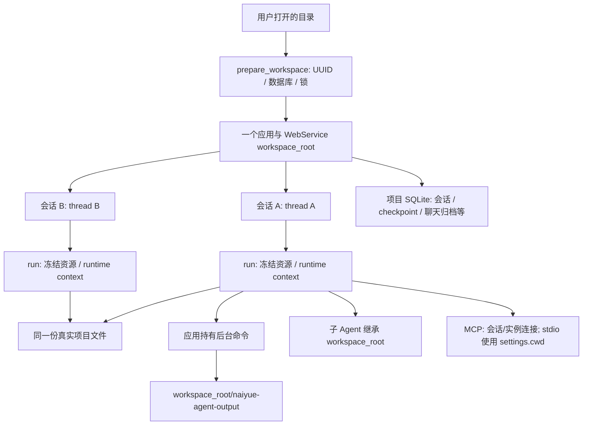
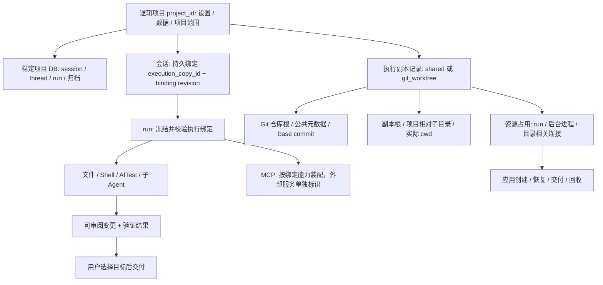

# 任务级 worktree 隔离：架构调研与讨论依据

日期：2026-10-22。状态：调研完成，D01—D10、D11的MCP目录规则及D12的项目共享/归档规则已确认，D13按用户选择采用父子Agent共用执行副本，D14资源占用与操作准入已确认，D15自然语言提交推送策略已确认，D16快照保留与D17故障恢复已确认，17项主要架构方向讨论完成；少量配置默认值及具体实施合同纳入总Spec统一审阅；未实施产品、配置、依赖、数据迁移或实际项目的 worktree 操作。

已确认的使用方式：同一会话跨多轮保留同一份 worktree；这些目录仍属于同一项目，会话与模型上下文各自独立；应用统一管理 worktree，Agent 在分配的目录里执行任务；Git 项目的新会话默认使用独立 worktree，直接使用当前目录需用户主动选择。非 Git 目录使用共享模式并明确没有 worktree 隔离，不自动初始化 Git。D05 已确认参考 Codex 桌面端：创建时选择代码起点，支持从当前工作状态继续。D06 用户进一步要求以配置决定新会话只带提交态还是也带入未提交改动，不再要求每次新建都手动选择携带模式；被忽略文件的带入已确认采用项目根目录 `.worktreeinclude` 显式清单：默认不带，只复制清单匹配的被忽略文件，独立于未提交改动开关。未提交开关默认值、其他起点的适用规则及应用数据排除等实现边界仍待明确；没有把 Codex 专用的 AGENTS.override.md 例外一并固化为本项目规则。D07 已确认参考 Codex 桌面端：初始不创建新分支，使用 detached HEAD，需要交付或用户手动接管时再创建分支。D08 已确认可选项目初始化脚本：新副本创建时执行一次，后续对话与重开不重复执行；未配置可直接使用但不宣称运行环境已验证，已配置却失败时保留目录与日志、暂停本次任务并允许明确重试；各副本使用自己的可写依赖目录，可复用下载缓存，后续工具须使用对应环境。D09 已确认由应用统一确定会话工具执行目录、本轮保持一致；权限配置按实际目标匹配，同会话同副本保留已记住的许可，跨会话/更换或重建副本不自动迁移；执行或恢复时副本丢失/归属不符须阻止运行，不回落到原目录。D10 已确认默认目录分离、跨目录复用现有权限，不新增 worktree 专用拒写层或 Shell 文本拦截器；当前不承诺进程无法访问其他副本/宿主资源，实际访问限制留后续沙箱。此确认不表示后文全部存储、权限、恢复与实现细节均已批准。

## 1. 本轮结论与业务背景

建议采用“逻辑项目拥有数据和执行副本，会话绑定执行副本，单次运行冻结这份绑定”的架构。Git worktree 是创建代码副本的一种具体机制。现有 Python + LangChain `create_agent` + middleware 路线可以保留；变化主要发生在应用的身份、执行上下文、资源与持久化边界。

实际场景：同一个项目中，会话 A 修改接口，会话 B 修另一处功能。当前它们有各自的模型历史，却访问同一份文件；A 的测试可能读到 B 刚写入的内容。worktree 解决这类代码文件干扰，同时允许用户审阅后再交付变更。它不能单独隔离端口、数据库、网络、宿主进程或 Git 共享引用。

本轮首先需要纠正“任务级”的歧义：一条用户输入到最终回答是一次 run；一个开发目标可能跨多轮对话。建议执行副本默认跨轮保留，绑定会话所承载的开发目标，不在每轮回答后重建或删除。这与已确认的后台命令跨轮运行要求一致。

依据分为：官方产品行为、固定版本源码、本机机制探针、项目建议。没有运行参考产品真实账户流程、云容器或真实模型请求；不把静态链路和探针视为生产效果证明。普通 ChatGPT 聊天与 Codex 代码执行任务不同，本轮工作目录参照指 Codex。

## 2. 参考方案：可核验的事实与适用边界

| 参照 | 核验到的机制 | 对本项目的价值与边界 |
| --- | --- | --- |
| Codex 本地产品 | 官方描述 Local / Worktree；受管副本通常关联一个 chat，并可跨轮返回；归档回收前保存快照，重开可恢复；另有长期保留的副本 | 学习会话、代码副本与归档的独立生命周期；桌面完整回收后端未开源核验 |
| Codex 开源 CLI | 独立 `WorktreeManager`；创建 detached checkout，保留仓库子目录位置；线程创建后绑定 owner；部分创建失败回滚，后续启动失败保留可恢复路径 | 创建、归属、有效目录、失败后保留均有确定性实现；CLI 创建路径不等同于桌面 Handoff 的全部行为 |
| Codex Cloud | 可复用环境与每个任务自己的执行状态分开；新任务从发布环境开始，原任务继续自己的已保存文件 | 借鉴模板与实例的边界；公开文档不能证明云端底层一定使用 Git worktree |
| Claude Code | 提供会话 worktree、子 Agent worktree、环境初始化与恢复入口；文档明确文件隔离检查与沙箱边界 | 作为入口和生命周期对照；具体内部管理器和数据库结构不可从闭源产品反推 |
| Pi 核心 | SDK 以 cwd 装配会话、资源和内置工具；历史默认在用户目录按 cwd 分类；已有 linked-worktree 资源发现处理 | 学习显式目录传递；所查默认会话创建链没有自动分配独立 checkout |
| Pi 社区 `pi-worktrees` + `pi-cwd` | 前者负责 Git 创建/合并/清理并记会话自定义条目；后者改工具参数与提示中的 cwd | 证明扩展能够覆盖流程，但也暴露工具目录、资源发现、原始 ctx.cwd 不一致的成本；本轮不推荐直接移植 |
| AgentX | 工具管理按 userId 取得用户容器、部署 MCP 工具，健康检查失败抛业务异常；容器有独立空闲清理 | 可借鉴应用持有资源、健康/恢复/清理职责；所查链是用户工具环境，不是每会话一份代码树 |
| Git 与 LangGraph | Git worktree 共享仓库历史/引用，各有工作目录和 index；LangGraph checkpoint 按 thread 组织图状态 | Git 不替应用管理会话；checkpoint 不保存或验证真实代码目录 |

主要官方来源：[Codex worktrees](https://learn.chatgpt.com/docs/environments/git-worktrees)、[Projects and chats](https://learn.chatgpt.com/docs/projects)、[Cloud environments](https://learn.chatgpt.com/docs/environments/cloud-environments)、[Local environments](https://learn.chatgpt.com/docs/environments/local-environment)、[Claude worktrees](https://code.claude.com/docs/en/worktrees)、[Git worktree](https://git-scm.com/docs/git-worktree)、[LangChain runtime](https://docs.langchain.com/oss/python/langchain/runtime)、[LangGraph persistence](https://docs.langchain.com/oss/python/langgraph/persistence)。这些描述有版本边界，不据此声称某方案在行业占多数。

### 2.1 固定版本源码调用链

源码固定值见 [source-versions.json](/Users/zmw/naiyue-test-agent/research/worktree-architecture-2026-10-22/source-versions.json)。Pi、AgentX 为本机已有版本的独立研究 clone，未更新原 checkout；Codex 与两项社区扩展为本轮网络 clone。

**Codex：`86e17e98c7f901277aeeb4649cf1b01462b082f2`。**

正常：exec 启动中的 worktree 分支 → `WorktreeSettings::for_cli` → `WorktreeManager::create(CreateWorktree)` → 解析 source cwd / repo root / commit，创建并填充 checkout → 用新 cwd 重新装配配置 → 创建 thread → `bind_thread`。`ManagedWorktree` 同时保存 root/cwd/source_root/source_cwd/head_sha，区别仓库根与用户打开的子目录。[创建实现](https://github.com/openai/codex/blob/86e17e98c7f901277aeeb4649cf1b01462b082f2/codex-rs/worktree/src/lib.rs#L62)、[exec 接线](https://github.com/openai/codex/blob/86e17e98c7f901277aeeb4649cf1b01462b082f2/codex-rs/exec/src/lib.rs#L479)。

绑定：`metadata::bind_thread` 在 worktree 的 Git 元数据写版本化 owner；同 owner 幂等，不同 owner 拒绝，临时文件 `persist_noclobber` 防并发覆盖。路径相同本身不代表归属正确；list 还检查公共 Git 目录与反向指针。[owner 实现](https://github.com/openai/codex/blob/86e17e98c7f901277aeeb4649cf1b01462b082f2/codex-rs/worktree/src/metadata.rs)。

失败：填充失败或目标子目录不安全时，create 尝试回滚新副本并返回错误；后续 TUI 启动未绑定 thread 时，`StartupRecovery` 留目录并报告恢复路径。受管 remove 验证目录注册关系，拒绝删除当前目录，额外检查 ignored 文件，再使用非 force Git remove。移动目录还检查其他 Agent、排队输入与后台终端；检查失败也阻止切换。[启动恢复](https://github.com/openai/codex/blob/86e17e98c7f901277aeeb4649cf1b01462b082f2/codex-rs/tui/src/worktree_startup.rs)、[目录切换准入](https://github.com/openai/codex/blob/86e17e98c7f901277aeeb4649cf1b01462b082f2/codex-rs/tui/src/app/managed_worktree_creation.rs)。

这里还存在产品表面的差异：所查 CLI create 从指定 commit/默认 HEAD 建树，链中未复制源目录的 dirty 内容；官方桌面文档另描述携带未提交改动的操作。不能把两条路径合写成一个实现。CLI 的保守 remove 也不能等同桌面的快照归档回收。

**Pi：`a69bef789bc95abf0acee16f7b4660b70b650bb9`。**

正常：`createAgentSession` 解析 cwd → `SettingsManager`、`SessionManager.create`、`DefaultResourceLoader` → `AgentSession._buildRuntime` → `createAllToolDefinitions(this._cwd)` → Bash `ops.exec(command, spawnContext.cwd, ...)`；read 等以装配的 cwd 解析相对路径。默认 session 目录由 cwd 编码；消息写 JSONL。可运行于已存在的 worktree，但不等于默认自动创建 worktree。[SDK](https://github.com/earendil-works/pi/blob/a69bef789bc95abf0acee16f7b4660b70b650bb9/packages/coding-agent/src/core/sdk.ts#L171)、[会话目录](https://github.com/earendil-works/pi/blob/a69bef789bc95abf0acee16f7b4660b70b650bb9/packages/coding-agent/src/core/session-manager.ts#L476)。

失败：Bash 执行抛错时先 finish 输出，再区分 aborted/timeout 或继续抛原错误；这条收尾处理输出，不承担 checkout 回收。[Bash](https://github.com/earendil-works/pi/blob/a69bef789bc95abf0acee16f7b4660b70b650bb9/packages/coding-agent/src/core/tools/bash.ts#L431)。

**Pi 扩展：`pi-worktrees eec1bc942270d13686a2f0c8a034f5480b2faa69`；`pi-cwd 7af506e696d214f0ee7087e817d2ee142b28a6b7`。**

创建：`handleWtCreate` → Git worktree add → 复制非 ignored 的未跟踪文件 → `switchCwd` 写状态条目并发送 `/cwd`。`pi-cwd` 的 `/cwd` handler 校验目录，更新 effective cwd；tool_call hook 给 Bash 加 cd、文件工具改绝对路径，before_agent_start 改 cwd 提示。原始 ctx.cwd、资源发现与 session 文件位置继续归原启动目录。[worktrees 入口](https://github.com/harms-haus/pi-worktrees/blob/eec1bc942270d13686a2f0c8a034f5480b2faa69/src/commands/wt-create.ts)、[cwd 消费](https://github.com/harms-haus/pi-cwd/blob/7af506e696d214f0ee7087e817d2ee142b28a6b7/src/index.ts)。

有两项静态边界：一是当前 `switchCwd` 未显式开启命令分发，而所查 Pi `sendUserMessage` 默认 `expandPromptTemplates=false`；不能仅凭扩展发了 `/cwd` 就宣称这组版本已完成切换。二是 `hasUncommittedChanges` 只读取 status stdout，cleanup 随后可能 force remove；查询失败的处理不足以作为我们的删除合同。未运行这组扩展的完整安装集成，因此这里是源码兼容性/失败路径风险，不是已复现的线上事故。[switchCwd 与检查](https://github.com/harms-haus/pi-worktrees/blob/eec1bc942270d13686a2f0c8a034f5480b2faa69/src/worktree.ts#L56)、[Pi 消费参数](https://github.com/earendil-works/pi/blob/a69bef789bc95abf0acee16f7b4660b70b650bb9/packages/coding-agent/src/core/agent-session.ts#L1492)、[cleanup](https://github.com/harms-haus/pi-worktrees/blob/eec1bc942270d13686a2f0c8a034f5480b2faa69/src/commands/wt-cleanup.ts)。只借鉴命令分工与状态条目，不照搬合并时自动 stash、reset、force 删除和静默复制。

**AgentX：`3fcfa0e5c224fc64ca63aa60fd871e5d2f25159f`。**

正常：`AgentToolManager.createToolProvider(..., userId)` → `McpUrlProviderService.getMcpToolUrl` → 用户/全局工具分支 → 用户分支 `ContainerAppService.getUserContainer(userId)` → 查找/创建/恢复用户容器 → 部署工具与构造 SSE URL → MCP transport/client。`ContainerDomainService.createUserContainer` 以 userId + USER 类型检查现有容器；独立的 `SessionDomainService.createSession` 只创建会话记录，不创建 checkout。[工具装配](https://github.com/lucky-aeon/AgentX/blob/3fcfa0e5c224fc64ca63aa60fd871e5d2f25159f/AgentX/src/main/java/org/xhy/application/conversation/service/message/agent/AgentToolManager.java#L35)、[环境获取](https://github.com/lucky-aeon/AgentX/blob/3fcfa0e5c224fc64ca63aa60fd871e5d2f25159f/AgentX/src/main/java/org/xhy/application/container/service/ContainerAppService.java#L80)。

失败：健康恢复失败 → BusinessException → MCP URL 提供者记录并包装失败 → 工具装配不能返回正常 provider。定时清理服务按最后访问时间暂停/删除容器；Docker 删除失败时仍可能标记记录为 DELETED。这里只核验此链，不将它描述为删除已原子成功或每个会话隔离。未在 Java 主源码找到 `git worktree` 链，这只是该版本和搜索范围的结果。[清理](https://github.com/lucky-aeon/AgentX/blob/3fcfa0e5c224fc64ca63aa60fd871e5d2f25159f/AgentX/src/main/java/org/xhy/application/container/service/ContainerCleanupService.java)。

## 3. 当前项目的真实主链与边界



当前数据形状：目录有 `.naiyue/workspace.json` 的 UUID；默认 DB 是应用 data_dir 下 `workspaces/<UUID>/sessions.sqlite`。SessionState 保存 thread_id、model_id、workspace_root、工具和权限；ActiveRun 保存当次运行身份与控制；后台 `_Operation` 保存 session_id/root/run_id/call_id 和冻结的 ProcessRequest。数据当前已不默认保存在代码树内，但数据库仍与一个真实 root 绑定。

正常调用链：Web `create_session` → `acreate_workspace_session(..., WebSettings.workspace_root)` → SessionService 的会话 → `SessionExecution.arun` → `_prepare_resources` 从该 root 加载 AGENTS/CLAUDE/Skills → `ainvoke_agent_run_with_resources` → `make_invocation_context` → 工具准备与权限 → Shell `ProcessRequest.cwd=root` 或文件路径解析 → 结果/checkpoint → `_afinish_run` 等待子任务并必要保存 → release run。后台命令在应用管理器中继续存在，不随 release run 消失。

失败链：`SessionExecution._on_failure` 检查局部状态/必要人工复核，finally 仍 `_afinish_run`；主异常与收尾/保存异常分开。若直接把新 worktree root 送入旧 DB，`SessionStorage._create` 的 root 检查可能拒绝；复制同 UUID marker 再按独立项目打开，`prepare_workspace` 也可能认定 workspace_id_conflict。这里是现有校验合同的推导，未拿真实用户 DB 注入错误。

| 当前消费者 | 本轮核验位置 | 架构变化要同步的内容 |
| --- | --- | --- |
| 项目身份、移动/拷贝判定 | `workspaces.py::prepare_workspace` | 普通目录副本与受管执行副本的身份不能混淆 |
| SQLite / saver | `async_persistent.py::open_async_persistent_application`、`session_storage.py::bind_workspace/_create` | 项目归属与会话执行 root 分开，不能用修改绑定重写所有会话目录 |
| Web 列表与会话访问 | `web/service.py` | 当前按服务 root 列表过滤、检查 status；新副本应仍属于同一逻辑项目 |
| run 与 prompt | `session_execution.py`、`skills.py`、`project_instructions.py`、`invocation_context.py` | AGENTS/Skills/上下文预览与实际执行要使用同一 binding；项目配置与代码指令的来源要明确 |
| 文件、Shell、AITest | `tools/paths.py`、`tools/shell.py`、`tools/aitest_kit.py` | cwd、绝对路径、审批 subject、归档和外部副作用需一致审计 |
| 子 Agent 与续跑 | `session_subagents.py` | 存活/恢复实例不能无提示地换到另一份树 |
| 后台进程与输出 | `application/background_tasks.py`、`tools/process_execution.py`、`tools/output.py` | 注册校验、列表过滤、通知、输出 guard、停止/关闭和目录回收都依赖原 root |
| MCP | `resources.py`、`connections.py`、`results.py` | 连接当前按会话/实例拥有，stdio cwd 来自服务配置；改工具 context 不会自动搬动外部 MCP 环境 |

完整入口定义行号与当前脏源码 SHA256 见 [current-source-evidence.json](/Users/zmw/naiyue-test-agent/research/worktree-architecture-2026-10-22/current-source-evidence.json)。该指纹只标识本轮读到的版本，不代表分支已提交。现有 Spec087/104/125/126 是相关存储、并发、后台与续跑合同；本研究不覆盖其已完成的验证结论。

## 4. 架构路线比较

| 路线 | 身份与生命周期 | 优点 | 主要成本/限制 | 建议 |
| --- | --- | --- | --- | --- |
| A：每 run 临时建树 | 每条用户消息新目录，结束回收 | 一轮操作简单 | 跨轮文件、后台命令、子 Agent 上下文都需不断迁移；环境准备重复 | 不适合已确认需求 |
| B：项目内显式执行副本 | 项目拥有多个 copy；会话稳定绑定其中一个；run 冻结绑定 | 能同时表达共享目录与隔离会话；存储与代码回收分离；便于后接沙箱 | 应用、DB、工具、API/UI 都需同步迁移 | 推荐的总体架构 |
| C：每 worktree 一个新项目/应用/DB | 直接复用现有单 root 模型 | 目录边界清楚，手工使用方便 | 同仓库会话/记忆/设置被拆散，跨副本聚合与交付绕回跨项目；重复应用资源 | 可作手工使用方式，不建议作为产品底层默认 |
| D：直接改为远端容器工作区平台 | 项目模板 + 任务环境 | 可进一步隔离进程与运行环境 | 执行服务、认证、网络、凭证、镜像、恢复与调度全面变化 | 作为沙箱后续路线单独评估，不由本次 worktree 自动决定 |

推荐 B 不意味着重写 LangChain。当前共享编译图可保留，各 thread 的状态继续独立；执行副本信息经应用校验后进入单次 runtime context。也不要求本轮改成一个进程管理所有项目：当前单项目服务先能拥有多个执行副本即可。



## 5. 需要讨论的决策项

D01—D17 的主要架构方向均已确认，包括 D16 的归档保留恢复点、删除会话清理专属副本及恢复点，以及 D17 的显式恢复与中断收尾。少量配置默认值、文件覆盖与 Git/恢复算法、接口和迁移验收在总 Spec 中统一审阅；这些具体实施合同不默认为已批准，也不把已确认方向重复列为新讨论项。当前完成的是架构讨论，不构成产品实施授权。

| 编号与问题 | 选项和决策依据 | 项目建议与影响 |
| --- | --- | --- |
| D01 隔离对象活多久 | 按 run / 按会话目标 / 按长期环境。Codex chat 关联与后台跨轮需求支持后两者；每轮重建会丢工作连续性 | 默认会话跨轮绑定一份副本；run 结束释放运行占用，保留副本。会话、应用退出、代码回收是三个事件 |
| D02 项目、仓库与副本如何关联 | 路径即项目 / 每 worktree 新项目 / 稳定项目下多个执行副本。当前 DB 与 marker 以物理 root 约束 | 采用 B；保留现有 workspace UUID 的逻辑项目身份意义，新增 copy 身份。项目可位于仓库子目录：repo root 和实际 cwd 分别记录，不按 remote URL 合并项目 |
| D03 谁创建、注册和恢复 | 模型自行 Shell 操作 / 应用持有 / 外部 MCP 托管。只有应用掌握会话、后台资源与持久化 | 应用负责受管副本；用户通过 UI/CLI 发起。模型若未来获工具入口，也调用同一应用操作，不能仅跑 git add 就成为受管副本。已有 worktree 的导入需校验归属 |
| D04 哪些会话默认隔离 | 默认共享无法解决两个新会话互相改文件的问题；首次写入自动切换也会改变会话的工作位置 | 已确认 Git 项目新会话默认独立 Worktree，Local 为用户主动选择的共享模式；存量会话不自动迁移。这里是新建会话的运行方式选择，额外全局能力总开关尚未确认，也尚未实现。非 Git 明确没有 worktree 隔离，不静默 git init 或降级 |
| D05 从哪份代码开始 | Codex 桌面端支持选择起始分支，并将所选本地工作状态中的未提交改动带入；与 CLI 的只建提交态路径区分 | 已确认创建时选择代码起点并支持带入当前未提交改动；D06进一步将是否带入交给配置。不擅定分支选择器默认值，不自动 stash/commit 原目录 |
| D06 dirty 起点如何继承 | 已提交内容由 Git 恢复，额外带入需分别定义 tracked 变更、untracked 新文件、ignored 配置及应用运行数据；不能从 Codex 的 ignored 清单文档推定所有新文件会自动带入 | 待确认建议：选择当前状态时保留已跟踪文件的修改/删除，并带入未被忽略的新普通文件；被忽略的本地配置按项目显式清单复制，被忽略的依赖/缓存不默认带入。应用自己的身份/锁/数据库/旧输出不复制；Git 关联由 worktree 命令创建。已跟踪项目文件不因目录名或数据库后缀被擅自排除。复制失败不宣告 ready，保留起点清单以区分已有改动和 Agent 新改动；链接、文件类型及源变化的具体校验待实现合同明确 |
| D07 branch 策略 | 每副本有名 branch / detached，交付时命名。前者易手工接管，后者避免大量分支与同分支双 checkout 冲突 | 已确认参考 Codex 桌面端：受管 worktree 初始使用 detached HEAD，不先创建新分支；需要交付或用户手动接管时再创建分支。在此之前可修改、测试与提交；应用须保证提交可达及副本恢复，不能只保存 SHA 就假定不会被回收 |
| D08 环境怎样准备 | 只 checkout / 明确复制清单 + 显式配置的 setup / 整目录复制。Codex 桌面端支持可选的项目本地环境及新 worktree 自动 setup，支持按操作系统覆盖，见[官方文档](https://learn.chatgpt.com/docs/environments/local-environment) | 已确认：可选项目 setup，仅在新建副本时自动执行；已有副本重开不重复执行。未配置时不声称环境已验证；已配置却失败时保留日志并阻止本次业务 run，支持明确重试。代码、本地配置与可重建依赖分开准备，各副本独立安装可写依赖，可共享下载缓存。setup 中临时激活环境不会自动影响后续独立 Shell；工具执行须使用对应环境。明确重试方向已确认；setup 的配置格式、状态展示及超时/停止等实施细节仍待确定；端口、测试 DB、外部账号不因 worktree 自动隔离 |
| D09 工具和权限跟谁走 | 只改 Shell cwd / 所有相关执行入口消费会话的固定执行信息。当前文件、Shell 与 AITest 已读取 runtime workspace_root，审批还记录实际路径；MCP 的 stdio cwd 另由配置决定 | 已确认：每轮开始由应用核验会话绑定的 copy 身份与目录，并冻结本轮执行信息；文件、两种 Shell、AITest、后台命令及对应显示使用一致目录，不使用进程级 chdir。项目权限配置沿用但按实际目标匹配；同会话同副本的已记住许可继续适用，不向新会话/其他副本转移，切换或重建后旧审批须重新核验。执行/恢复发现副本丢失或归属不符时阻止运行，不回落到原项目目录。copy_id/revision 仅标识绑定，仍保留已有目标校验；子 Agent 目录选择与 MCP 绑定细则分别留 D13、D11 |
| D10 绝对路径、Git 与沙箱边界 | 默认目录 + 现有权限 / 另加内置防误写检查 / OS 文件访问隔离。Codex 将沙箱与审批分开；Claude 额外阻止内置编辑写主目录、部分命令 cwd/git 重定向，但不追踪任意 Shell 实际写入，见[Codex 权限](https://learn.chatgpt.com/docs/permission-modes)、[Claude 检查范围](https://code.claude.com/docs/en/worktrees#how-claude-code-enforces-isolation) | 已确认：本期 worktree 提供代码副本与默认目录分离，越界文件目标保留真实路径并由既有权限规则/模式处理，不新增 worktree 专用强制拒写层或 Shell 文本拦截器。Default 下无显式允许规则的目录外文件请求会 ask，Auto/NoAsk/BypassApprovals 按已有合同处理，显式 deny 仍优先；Shell 审批的是命令，不能声称已知脚本全部读写路径。用户允许的跨目录操作不改写为当前副本路径。普通工作在本副本进行，Git 分支引用等共享资源的危险操作仍须权限审查，真正进程访问限制由后续沙箱设计与验证；当前不承诺其他副本或宿主资源无法访问。曾比较内置工具拒写主目录的防误操作检查；用户选择本期不增加，该机制也无法覆盖 Shell/MCP |
| D11 MCP 与项目资源来自哪 | 原目录统一读取 / 全部跟随副本 / 区分代码资源与应用配置。当前项目指令与 Skills 每轮从 workspace_root 准备；MCP 默认只读用户应用配置，stdio cwd 来自 settings.cwd，连接按 session/agent instance 持有。Codex 区分仓库与用户资源，且将 MCP cwd 作为独立配置，见[指令](https://learn.chatgpt.com/docs/agent-configuration/agents-md)、[Skills](https://learn.chatgpt.com/docs/build-skills)、[MCP](https://learn.chatgpt.com/docs/extend/mcp) | 沿已讨论的资源方案：AGENTS/CLAUDE 与项目 .agents/skills、.claude/skills 从实际 worktree 读取，保留当前选择优先级与每轮准备方式，缺失不静默回原目录找；被忽略资源按 D06 显式清单带入，不新增全局 Skills 发现范围。模型、权限、MCP 启动定义和凭证引用仍来自可信应用配置，不自动执行副本内新增 MCP 配置。用户已确认 MCP 目录规则：本地 stdio 未配置 cwd 时使用会话当前执行目录；显式配置 cwd 时按配置执行。args 原样传递、不自动替换固定路径仍作为前述建议保留。此前提出通用 ${workspace} 占位符并要求显式配置才跟随，不是已核验 Codex 行为，现撤回作为默认方案。仅改变 cwd 不等于改变服务器根参数或远端作用范围。跟随型服务的发现、连接与审批身份须绑定实际副本；同会话同副本可跨轮复用，更换/重建后重建连接并重新发现，不借用原目录的目录指纹或旧许可。固定与远程服务保留配置范围，不声称 worktree 自动改变远端文件或账号。跟随型服务启动/发现失败明确报错，不回退旧目录；本轮不创建通用 MCP 路径适配平台 |
| D12 历史、checkpoint、记忆和输出存哪 | 每副本 DB / 稳定项目 DB + copy 关联。当前数据库已经在 data_dir/workspaces/<workspace_id>/sessions.sqlite，但会话、history、memory 等校验仍绑定单一 root。初轮输出在执行目录，2026-10-22 后续核验发现并行源码已引入独立 archive_root，项目 artifacts 根与执行目录已分开；当前 writer 仍在 naiyue-agent-output 子目录中写随机命名的文件，尚未按会话/任务分层。本研究不把并行改动计为本轮实现。Codex 官方允许 worktree 回收后聊天仍保留，不据此推断其数据库结构 | 已确认产品方向：逻辑项目持有稳定 DB，会话/thread 分开，run 记录执行副本和当时代码状态；项目记忆继续独立业务表、个人记忆仍 data_dir/personal/memory.sqlite，不把长期记忆塞进 checkpoint。用户已确认 history/项目 memory 的原同目录范围映射为同逻辑项目：同项目各会话/worktree 在既有工具启用与权限下可按需互查历史、查询项目记忆，不要求用户重复授权该产品方向。工作副本不改变逻辑项目身份；各自消息/checkpoint仍独立，查询不等于自动全量合并上下文。其他项目范围不扩大；与 Spec127 的可信身份/查询/来源接线须在实施时同步，不修改本轮并行实现或注入算法，也不把某副本的测试结果当全项目结论。用户已确认归档按任务组织：data_dir/workspaces/<project_id>/artifacts/<session_id>/<task_id>/，不设 run_id 路径层；run_id 仅作来源元数据。纯前台调用以 tool_call_id 作逻辑归档任务标识，后台命令按稳定任务身份，自动转后台须复用原归档对象与位置；标识落盘做安全编码与冲突拒绝，不能覆盖旧文件。可配置 data_dir 决定根位置；归属/读取授权与引用解析须同步，不能只改写入路径。备份不包含 artifacts，数据库还原后旧库外归档引用统一不可用，即使原文件仍在；新任务输出正常，普通重启不按还原失效。代码、依赖、构建缓存及用户命令自行生成的报告仍属 worktree；显式交付的报告另行保存。回收 worktree 不删除聊天/图状态/记忆/已归档输出；checkpoint 修剪与日志不自动清理的既有规则保持。旧日志迁移、引用核验未完成则不回收对应副本，失败保留原位置并报告；查看历史与恢复代码后执行分别处理，checkpoint 不等于代码快照 |
| D13 子 Agent 共用还是独立副本 | 继承父副本 / 每个子实例独立。Codex 固定版本普通 spawn_agent 经 thread_spawn → prepare_agent_spawn_config → apply_spawn_agent_runtime_overrides，将父 turn.cwd 赋给子 config.cwd，所核验链没有自动为子实例创建 worktree，见[实际赋值](https://github.com/openai/codex/blob/86e17e98c7f901277aeeb4649cf1b01462b082f2/codex-rs/core/src/agent/child_config.rs#L179)。此为开源执行链事实，未据此推断所有闭源云端执行方式 | 按用户选择采用父子共用：父 Agent 绑定 worktree A，子 Agent 继承同一副本与实际目录；修改即时可见，不增加父子间交付/合并流程。子实例的消息/checkpoint和委派结果仍按现有合同独立；已结束子实例续跑保留并核验原绑定，且须与父当前执行副本一致；父切到另一副本时明确拒绝旧实例续跑，不静默改写旧记录或允许父B子A。现有 session_subagents.prepare_subagent_instance 已校验父 workspace_root 并将相同目录写入子实例，实施时同步接入新副本身份。共用不隔离同时编辑同一文件的冲突，由主 Agent 按文件/职责分工或串行安排。首期不增加子 Agent 独立 worktree 入口，不恢复已暂缓的后台子 Agent 范围 |
| D14 何时允许切换/交接/删除 | idle 就可 / 检查实际资源。Codex 开源 /cd 与 managed worktree transition 检查子 Agent、后台终端和 MCP inventory loading，并在异步准备后复查；未知终端状态也阻止操作。官方文档承诺进行中的 chat 不自动回收，未据此推断完整桌面 Handoff 内部实现 | 已确认：普通同副本下一轮、切换聊天页面、查看历史/diff照常进行；更换执行目录、改写源/目标的交接和回收必须没有活动或清理未确认的使用者。保留但未执行的子实例/checkpoint不是活动占用，待审批须先处理或明确取消。后台任务默认提示用户先停止，再重试，不自动杀进程；空闲目录相关 MCP 连接可由应用关闭并重建，不永久阻塞，进行中调用/发现须结束或取消确认。操作入口临时关闭受影响副本的新执行准入，再检查、释放相关连接、复查并执行；失败不删目录/不切绑定。按实际源及目标副本汇总全部使用者，含共享 Local 的其他会话；不以整个逻辑项目为互斥范围。不另建通用租约平台，复用已有 run/后台/子实例/MCP 状态 |
| D15 怎样审阅与交付（默认提交推送策略已确认） | Codex 官方支持在 worktree 创建分支、commit/push/PR，以及 Handoff 将 chat 与代码移到 Local 两条路径；前者交付代码，后者改变执行位置。Pi 扩展有 tracked提交→目标自动stash→checkout/merge→校验→恢复stash链，不能把其自动整理用户目录作为本项目默认合同 | 已确认默认策略：自然语言“提交并push”可连续完成，已有分支沿用、detached首次交付创建任务分支并推送，后续复用，不附带合入主分支或Handoff。具体交付细则纳入总Spec审阅：日常回复不自动提交或合回；提供实际Git文件清单/diff与验证记录，区分创建时带入的工作和后续变化，以及对交付目标的完整差异。用户发起交付后按确认范围创建分支/提交，以明确提交交付到指定目标；本地整合成功也不自动迁移会话绑定或删除副本。Handoff是独立的继续工作操作，源/目标资源检查沿D14。目标有未提交工作时暂停并让用户处理，不自动stash/覆盖；目标版本或待交付内容变化需重算预览，冲突保留双方、报告真实Git状态，不能声称目标原样未变。源worktree测试结果不等于目标合并后通过，合入后按项目要求验证。push/PR等远程交付仍按明确授权处理；merge/cherry-pick与Handoff的具体算法在实施Spec确定，不推定Codex闭源实现 |
| D16 关闭、归档、删除和资源回收 | 轮结束即删 / 归档保留或快照回收 / 永久保存。磁盘还包括 deps、输出、快照 | 用户已明确删除会话也须回收其专属受管worktree，不能仅删数据库而遗留副本；Local共享主目录不随会话删除。已确认归档/超额回收保留代码恢复点，删除会话清理其专属恢复点；已确认的生命周期方向：轮结束和关页面不清代码；应用退出停止自身进程并保存元数据，重启不声称旧进程继续运行。可配置数量/字节额度，后台检查仅候选；有活动资源、未安全保存的工作或未处理 ignored 文件则不删。无可回收对象时提示或拒绝新分配，不能强删保上限。快照自身也需额度/保留规则；日志不自动清理的既有决定保持，除非用户另改 |
| D17 丢失、崩溃与恢复如何处理 | 自动切回主目录 / 显式 missing/recovery 状态。路径可能被别的仓库复用，checkpoint 无法证明文件还在 | 已确认显式阻止执行，提供恢复/选择新副本/只读历史；不拿旧模型上下文悄悄操作主目录。校验 Git common dir、注册/反向关联、项目/owner 与版本信息；创建中、绑定前、归档中断均可重试或显示孤儿记录 |

### D14 已确认方案的依据与验证（2026-10-22）

正常例子：run A 启动服务后结束，run B 仍在同副本继续调用该服务，不因后台任务存在而禁止普通新一轮；用户切换聊天页面也不改变执行绑定。只有更换执行副本、改写交接目标或回收才进入维护检查。失败例子：用户申请回收时服务尚在运行，返回具体阻塞任务，不调用删除；停止请求返回后还须确认进程、管道、消费者与归档写入收尾，清理未知则保留副本并报告。

Codex 固定版本证据：`tui/src/app/managed_worktree_creation.rs:13-57` 请求 `thread/backgroundTerminals/list`，空列表才放行，错误也阻止；`working_directory.rs:194-212` 拦截 MCP inventory loading 和活动子线程，`:409-446` 在配置/信任准备后读取实际 thread 状态并重查后台终端。RPC 到 `thread_processor.rs:2554` 再到 `unified_exec/process_manager.rs:1860`，筛选真实尚未退出的进程，历史条目不等同活动占用。源码核验支持操作前后检查，不能据此宣称其闭源桌面端拥有我们建议的整套原子准入协议。

Pi 社区扩展 `/wt-cleanup` → `hasUncommittedChanges` → `git worktree remove -f` 的所核验链主要保护未提交改动，没有应用后台任务检查；不能作为本项目资源释放的充分依据。AgentX 的 `ConversationAppService.chat` → `ChatSessionManager.registerSession` → SSE completion/timeout/error 回调移除 activeSessions 管理的是对话流，也不能证明宿主后台进程已退出。不把两者推定为拥有 worktree 回收协议。

当前项目已有接线：`agent_session.is_busy` 仅表示 `_run is not None`，待审批由独立字段检查；`session_execution` 在 run 清理时等待并断言子实例收尾；`session_persistence.adelete` 已进入后台 deletion_guard；`BackgroundProcessManager._unsettled` 检查 cleanup_confirmed 和归档关闭，并在维护预留期间拒绝新后台提交。worktree 实施须将这些入口衔接到 copy 身份，不把现有会话/输出清理保护称为已实现的 worktree 管理。

本轮只运行已有维护保护测试，未改产品或新增测试；4个测试函数含1个参数化，共5例，实际结果 `5 passed in 1.32s`：

```bash
.venv/bin/python -m pytest -q \
  tests/test_background_task_lifecycle.py::test_unconfirmed_cleanup_retains_writer_and_blocks_maintenance \
  tests/test_background_task_lifecycle.py::test_application_maintenance_refuses_active_tasks_then_preserves_truth \
  tests/test_background_task_lifecycle.py::test_maintenance_reservation_closes_background_admission \
  tests/test_background_task_lifecycle.py::test_cleanup_guard_releases_reservation_on_failure_and_blocks_new_runs
```

这些结果验证当前会话/输出维护保护和异常释放，不验证尚未实施的 worktree 切换、交接、回收或跨进程/外部编辑器互斥；副本资源准入只覆盖应用实际持有的执行者，不宣称扫描并控制宿主全部进程。

### D15 自然语言提交推送策略已确认（2026-10-22）

用户新增明确要求：保留自然语言“帮我提交并push”的使用体验，不要求用户先逐个点击审阅、建分支、交付界面。前述审阅/范围/目标属于内部操作与可选可视入口；范围、远端与权限明确时连续执行，只对真实歧义补充确认。普通Git提交/推送可由Agent调用现有Shell，在应用提供的执行副本内完成；不因说了push自动Handoff，也不自动附加合并主分支、PR或发布。用户已确认保持此默认交付策略：已有命名分支默认沿用，detached worktree在首次交付时创建任务分支并建立推送关系，后续复用；推送任务分支不等于合入远端主分支。要求合入指定主分支时另按明确交付目标处理。Codex官方说明支持在worktree建分支后直接commit/push，无须Handoff；仅凭自然语言不能推断过去某次Codex实际新建了分支或迁移了会话，应以该次命令及分支/目录记录为准。

产品分清三个动作：查看改动；交付代码；移交会话。查看改动读取执行副本真实Git状态，展示选定比较范围和该版本的验证结果，不根据模型文字生成假diff。交付以明确的分支/提交和目标为合同，默认会话仍留在原副本；Handoff将会话后续执行位置与相应工作状态转移，应用须在Git步骤与必要保存完成后才更新绑定，失败保持可诊断状态，不把部分成功当作交接完成。创建时带入的未提交内容不自动算作Agent新增或默认全选提交；审阅需同时支持起点后变化与完整交付差异，不能自动承诺任意依赖改动可拆分。

正常例子：worktree A完成接口修改→用户查看文件/diff及测试结果→明确范围并创建分支/提交→选择目标整合→在目标重新验证，会话仍可留A继续。用户若要在Local继续相同会话，则另发起Handoff。失败例子：目标存在本地未提交修改，暂停交付并列明原因；整合冲突保留源分支/副本和目标Git冲突状态，允许用户选择后续处理，不自动强制reset、stash、删源或声称目标未被Git改动。

官方证据：[Codex两条工作路径](https://learn.chatgpt.com/docs/environments/git-worktrees#working-between-local-and-worktree)、[应用内Git审阅及提交](https://learn.chatgpt.com/docs/environments/local-environment#use-built-in-git-tools)。官方公开说明不足以确定其Handoff具体使用merge/cherry-pick或其他算法。本项目交付算法属于建议与后续Spec合同，不冒充参考产品源码事实。Git官方说明[cherry-pick](https://git-scm.com/docs/git-cherry-pick)应用已存在提交并在冲突时更新部分index/工作树；[merge](https://git-scm.com/docs/git-merge)明确未提交改动会影响冲突后的恢复，所以本项目建议目标未提交时暂停。

参考边界：Pi社区扩展`handleWtMerge`→`handleTrackedChanges`→`stashMainIfDirty`→`checkoutAndMerge`→校验/恢复stash/收尾，见[固定版本入口](https://github.com/harms-haus/pi-worktrees/blob/eec1bc942270d13686a2f0c8a034f5480b2faa69/src/commands/wt-merge.ts#L327)。只借鉴显式交付与冲突保留；不默认搬用自动stash和清理。AgentX所核验的会话/工具容器链不拥有此Git交付职责，不能为Git合并算法提供证据。当前项目`edit_diff`是单次Edit反馈，不等于项目级Git审阅/交付服务；并行Spec128仅拆项目身份/执行根，不将其视为已实现worktree交付。

本轮仅更新设计研究记录和已确认进度，未运行产品测试或操作实际Git副本；文档检查不等于功能验收。

### D16 关闭、归档、删除与回收规则已确认（2026-10-22）

已确认参考Codex桌面端产品方向区分日常保留与回收：run结束、切换/关闭聊天页面不回收；应用退出沿已有合同停止应用持有的进程并等待收尾，代码目录和会话元数据保留，重开不冒认旧进程继续存活。归档会话和删除会话都触发回收：用户已明确删除会话也必须处理其专属受管worktree，不能只删会话记录；超出可配置的近期副本保留数量时，旧且不受保护的副本也可成为候选。Local主工作区和外部未授权受管目录不进入自动删除范围。

实际回收沿D14关闭受影响副本的新执行准入并核验全部使用者；归档/超额回收先安全保存可恢复的提交和工作状态、记录与校验快照，再删除并确认实际结果，最后登记副本已回收；删除会话则按明确的删除范围处理，快照清理按下文已确认规则处理。快照或删除失败保留目录/诊断状态，不把部分成功当作完成。单独回收目录或归档时，历史消息/checkpoint/记忆/独立artifacts保持D12合同；删除会话则沿既有会话数据删除范围处理，不能把“回收目录保留聊天”误用于删除会话。删除流程须在资源检查后保留可重试的关联/操作信息，确认目录回收与会话数据删除的实际结果后才报告全部完成；两类IO不是一个数据库事务，任一步失败须显示未完成状态，不先抹去全部关联导致遗留目录失去归属。Local共享目录及仍被其他会话使用的副本不随单个会话删除；共享受管副本保留其他使用者，最后使用者释放后再按合同回收。已交付分支/远端提交和独立artifacts/项目记忆不因这条新增目录回收要求扩大删除范围；用户已确认删除后的代码恢复点处理：归档/超额回收保留用于会话继续的代码快照；用户确认删除会话后清理其专属worktree和专属恢复快照，不默认保留永久回收站。删除确认应展示未交付修改的影响范围；跨IO收尾所需的临时恢复资料仅用于保证删除可继续，完成后清理。已交付Git分支、提交、远端代码及既有独立日志/记忆/备份不随之扩大删除。归档请求遇活动资源时可完成聊天组织状态，但实际目录保留并显示未回收，不自动停止服务。

快照是代码恢复点，包含受保护的提交、未提交的代码修改及需保留的新文件；明确纳入的本地文件按规则处理。依赖与构建缓存作为可重建内容不默认完整打包，未分类或未安全保存的ignored文件须阻止自动回收。不能将.gitignore或.worktreeinclude自动等同于删除/快照排除清单。这是本项目的快照范围设计，具体覆盖与校验仍须在Spec中明确，不能从Codex官方“保存快照”反推其完整文件覆盖。

用户明确保留的副本、活动资源或清理未确认、未安全保存的工作和本地文件均不自动回收。重开聊天可先读历史；需要执行时，从快照恢复并核验副本，必要时重建依赖；不恢复宿主进程、端口连接或运行中的数据库状态。快照自身需可配置的保留/容量规则，不能把完整目录不断转存后声称磁盘已封顶。唯一恢复副本不能只因超额而静默删除；无安全候选或无法写快照时提示处理或阻止新分配，已有正常会话不因后台扫描被全局停顿。具体默认值与快照存储/备份覆盖在实施Spec列清，不在本轮默认为已批准。

证据：[Codex官方清理策略](https://learn.chatgpt.com/docs/environments/git-worktrees#worktree-cleanup)描述近期15份（可配置/可关闭自动删除）、归档/超限触发、活动/固定/永久副本保护、删除前快照与重开恢复。固定开源`WorktreeManager.remove`另有注册/当前目录/ignored文件检查并调用非force remove，见[源码](https://github.com/openai/codex/blob/86e17e98c7f901277aeeb4649cf1b01462b082f2/codex-rs/worktree/src/lib.rs#L285)；它不证明闭源桌面快照实现。Pi扩展cleanup检查dirty后force remove，AgentX检查闲置容器并调用Docker删除/更新记录，两者所核验链不提供同等代码快照恢复合同。只借鉴生命周期分工，不推断其删除/数据库更新具备原子成功。

本轮没有创建、删除、归档或恢复实际worktree，也没有产品实现/测试；仅更新研究和交接记录并做文档检查。

### D17 故障恢复方向已确认（2026-10-22）

已确认底线沿D09：目录失效或身份不符时阻止新执行，历史可读，不自动回落Local。本轮补充恢复路径：应用在现有副本登记中保存创建/绑定/交接/回收的阶段与必要关联，先持久记录意图再做目录IO，按实际成功结果推进。重启读取未完成记录并重新核验项目/Git/归属及资源状态；能够证明归属和已完成步骤时续做已授权操作或提供重试，无法确认时保持待处理并展示目录/原因，不凭同名路径接管或强删，不重放结果未知的业务命令。

| 场景 | 已确认的处理方向 |
| --- | --- |
| worktree正常存在、身份相符 | 正常继续同一副本；不重复checkout或setup |
| 归档/超额回收后重开会话 | 历史可先读，执行前显式恢复已有快照；恢复目录与身份确认、必要环境准备成功后再开放执行 |
| 目录被手工删除/移动，存在快照或受保护提交 | 显示待恢复；选择恢复代码快照或从确定提交重建，清楚区分能否找回未提交内容；不能宣称最新main等于原工作状态 |
| 无快照且原未提交文件已丢失 | 保留历史，说明缺失内容；只可在用户明确选择新起点后重建，不能从checkpoint伪造文件恢复 |
| 原路径被其他目录/仓库占用 | 身份不符则拒绝执行/覆盖，保留绑定和诊断；另选受管位置恢复并验证 |
| 创建后尚未绑定就崩溃 | 保留可归属目录与创建阶段，重启核验后继续登记或显示可重试/待清理，不自动创建第二份或删除未知目录 |
| 交接中断 | 保留源/目标与操作进度，核对实际Git结果和必要保存；未确认不标迁移完成，不强制reset某一侧 |
| 回收/删除只完成一部分 | 记录未完成步骤并保留清理关联；已删除目录但DB尚未完成时继续收尾，删除未确认时不可假报成功，避免遗留目录无人管理 |

正常链：打开归档会话→读取独立历史→请求继续→定位并校验恢复点→准备/恢复目录与必要环境→核验项目和Git归属→保存新绑定版本→重新准备目录相关MCP/审批/子实例续跑信息→开放新run。失败链：恢复IO或setup失败→保留快照及可归属的部分目录→记录具体失败阶段→阻止新run→重试时复查实际状态；不静默改为主目录、不拿旧审批直接执行。恢复后的后台服务需重新启动，原运行中的端口/连接/宿主副作用不被代码快照恢复。

固定Codex开源证据：`ManagedTuiWorktree.bind`在绑定成功后才结束启动恢复保护；`StartupRecovery`在绑定未完成时保留checkout并报告路径，见[实际链](https://github.com/openai/codex/blob/86e17e98c7f901277aeeb4649cf1b01462b082f2/codex-rs/tui/src/worktree_startup.rs#L15)。该实现支持失败保留和显式诊断的设计依据，不能证明本项目拟定的全部持久阶段/重启重试协议已经由Codex实现。归档快照重开恢复见[官方产品说明](https://learn.chatgpt.com/docs/environments/git-worktrees#worktree-cleanup)；删除会话清理快照属于本项目建议，未找到足够公开材料确认Codex相同。Pi/AgentX既有清理链不作为上述完整恢复协议的证据。

D16/17上述主要方向已由用户确认，17项架构讨论收束；具体配置默认值、快照格式与存储/备份覆盖、操作阶段和接口、迁移/分片/验收统一进入后续总Spec审阅，不将具体实现合同自动升级为已批准。尚未实施产品、创建/回收实际worktree或运行新的产品测试。

D06 配置化方向已获用户确认，尚未实现。配置名建议 `include_uncommitted_changes`：false 时只恢复选定提交态，true 时从适用的源工作目录带入未提交的修改/删除和未忽略新文件。默认 true 为拟议参数值，将在总Spec参数表统一审阅；新建时读取并记录生效结果，配置后续变化不改已有副本。ignored 文件清单机制已确认：项目根目录 `.worktreeinclude`，默认不带，按匹配路径复制，不自动纳入 Git；与未提交代码开关独立。应用数据排除的具体合同仍待明确。对显式选择其他分支/历史提交，建议按所选版本创建，不盲目混入当前分支的改动，此适用边界也待确认。临时仓库探针已验证两种模式、文本/二进制修改、删除/改名、新文件及源文件/暂存区不变，见 [uncommitted-config-probe-result.json](/Users/zmw/naiyue-test-agent/research/worktree-architecture-2026-10-22/uncommitted-config-probe-result.json)；不代表并发变化、特殊文件、跨平台、失败恢复或应用接线已验证。开关的增量成本小，可靠快照与失败处理仍属功能本身必要成本。


D11 Codex 对照补充：本轮重新核验固定源码 86e17e98c7f901277aeeb4649cf1b01462b082f2，本地 stdio 链是 session/mcp.rs::mcp_runtime_context 从所选本地环境或会话 cwd 生产 local_process_cwd，codex-mcp/src/rmcp_client.rs 将其传给 LocalStdioServerLauncher，launcher 使用显式 cwd 或 fallback，并将 args 原样传入。exec 的 worktree 路径将运行 cwd 改为 checkout.cwd。见[上下文生产](https://github.com/openai/codex/blob/86e17e98c7f901277aeeb4649cf1b01462b082f2/codex-rs/core/src/session/mcp.rs#L170)、[启动参数](https://github.com/openai/codex/blob/86e17e98c7f901277aeeb4649cf1b01462b082f2/codex-rs/codex-mcp/src/rmcp_client.rs#L1326)、[cwd 与 args 消费](https://github.com/openai/codex/blob/86e17e98c7f901277aeeb4649cf1b01462b082f2/codex-rs/rmcp-client/src/stdio_server_launcher.rs#L261)。官方还支持可信项目 .codex/config.toml；本项目仅使用应用配置是有意保留现状，不能说与 Codex 完全一致。官方文档与固定开源链路均未证明通用 ${workspace} MCP 占位符；桌面端完整闭源配置链和实机行为未验证。用户随后明确确认 MCP 未配 cwd 跟随会话、已配 cwd 按配置执行；未把 Codex 的全套配置发现规则一并批准，不构成产品实施授权。

D12 范围收束（2026-10-22）：用户纠正重复确认后，明确同一逻辑项目下各会话和受管 worktree 可以互查历史、查询项目记忆。原“会话上下文独立”描述的是各自消息/checkpoint，并不构成禁止查询。官方[Codex Memories](https://learn.chatgpt.com/docs/customization/memories)确认启用后可从符合条件的既往会话生成本地记忆，并由后续会话使用；当前桌面环境还提供会话列表与读取能力。不能把这些证据扩大为默认全量加载所有会话，或声称 ChatGPT 云端项目记忆与 Codex 本地存储是同一实现。记录与后续清单应合并产品方向和实施细节，避免将已讨论方向重新包装为待确认。

### D12 输出归档与备份补充合同（2026-10-22）

用户先确认任务目录和备份排除规则，随后明确同项目会话/worktree可按需互查历史、查询项目记忆。D12的产品方向不再列为待确认；数据模型、迁移与具体接口在实施Spec中完成接线设计，本轮不改并行源码或实际数据。

`artifacts` 的职责限于现有工具完整输出归档：Shell/后台命令的原始字节，以及需要时派生的可读文本；MCP 超长响应沿用同类归档。不新建第二份日志系统，不把聊天数据库、checkpoint、项目记忆、依赖或正式交付报告放进这里。前台仅在既有截断/文本转换等需要归档的条件下落盘；后台按既有日志规则。raw.log 保存原始字节，text.log 按需生成，二者共用当前单任务额度，不强制每任务同时生成两个文件。

```text
<data_dir>/workspaces/<project_id>/artifacts/<session_id>/<task_id>/
    raw.log
    text.log    # 按需生成
```

- 不再增加 run_id 层；同一轮中的多条命令分别归档，跨轮查询继续指向原任务。origin_run_id、tool_call_id 等来源信息放任务/归档元数据。
- 纯前台截断归档以 tool_call_id 作为逻辑任务标识；后台任务使用稳定任务身份。自动转后台必须复用已建立的归档对象和位置，运行时 task_id 与归档定位的关联保留在元数据中，不因交接复制输出、替换 writer 或移动目录。tool_call_id 不作为未经校验的路径分量，安全编码且冲突时不覆盖旧归档；现有后台接口的 32 位 task_id 校验与元数据映射在实施合同中同步。
- 现有 session_storage.delete 只删除数据库记录，不会删除库外日志；按会话组织目录便于会话级处理，不代表该文件清理已接线。本次不新增按 run 清理、定时淘汰或改变日志不自动清理的既有约定。
- 当前备份实际是 database.sqlite 与 manifest.json，artifacts 不进入备份。成功还原数据库后，所有旧任务的库外完整输出引用统一不可用；文件仍存在也不作为恢复成功证据。数据库中的历史正文/输出片段不抹除，新任务正常归档，普通重启不整体失效输出；不自动删除残留文件。
- 后续实施验收必须覆盖：同轮多调用独立归档、run A 启动/run B 读同一后台任务、自动转后台前后归档不变、text 按需与额度共用、路径/ID 冲突拒绝、备份不含日志、还原后残留旧文件仍显示不可用、普通重启与新任务行为。当前只完成源码与文档核对，没有上述新行为的实现/功能测试证据。

其中 D09 的 binding revision 只表明应用记录版本；并不证明目录内容没被外部编辑器修改。审批和交付仍需当前路径/文件/目标版本校验。API 应从已授权的 project/session/copy 身份解析服务端记录并核验归属，不能把客户端给出的目录路径当作授权。D14 的占用状态应接入实际 run、后台命令与 MCP 消费者；已结束的保留记录本身不是活动占用，不提前建设通用插件平台或分布式租约服务。

还有一个保留策略的约束：如果继续遵守“输出日志不自动清理”，就不能同时承诺整个应用磁盘总量永远有界。worktree 额度只能控制副本，checkpoint 裁剪只能控制图状态；长期输出与归档快照仍需明确人工清理或另行批准的保留策略。

## 6. 两条拟议链路：落实责任和失败边界

**正常例子：会话 A 的隔离开发跨两轮继续。**

1. UI/CLI 选择项目、隔离模式、基线与起点改动策略；应用分配 copy 身份，记录 preparing。
2. Git 创建目录并保留项目相对路径；应用执行经授权的环境准备，核验结果，将 copy 标为 ready；会话提交绑定。
3. 每轮准入从持久记录读取并校验绑定，再冻结 cwd/版本到 context；工具生产文件，保存 thread checkpoint/聊天及 run 来源。
4. 第一轮结束只释放 run；后台服务保留对该 copy 的占用。第二轮继续同副本，看到原来的代码及该会话后台状态。
5. 用户审阅相对起点的改动与验证结果，选定交付目标；应用核对目标最新版本，执行经确认的交付。完成后副本可以继续保留或申请归档。

**失败例子：重启后代码目录缺失，但历史 checkpoint 仍存在。**

1. 历史页面可读；准备执行时应用发现绑定目录缺失或 Git 身份不匹配，返回恢复状态。
2. 不调用模型工具链，也不自动把 workspace_root 换成主目录；等待用户恢复快照或明确选择新起点。
3. 恢复先准备新目录/环境并校验，完成后更新绑定版本；旧审批、目录相关连接和子 Agent 续跑能力重新核验。
4. 无快照或 ignored 文件未保存时，清楚说明只能恢复聊天或部分代码；不把 checkpoint 恢复说成文件/进程/数据库副作用恢复。

这两条链需要在最终 Spec 中落到实际接口与测试；本研究没有预建这些模块或提供占位实现。

## 7. 改动面、迁移和回退

这是超过 8 个模块的应用级调整，不能只改 `tools/shell.py`。影响包括：工作区准备和锁、DB schema/映射、SessionState/恢复、run context、权限/审批、prompt/Skills/上下文预览、文件/Shell/AITest、MCP 资源、后台任务、子 Agent 续跑、API/前端展示以及交付/回收入口。

建议迁移顺序是先定数据合同，再接执行与资源，最后开放 UI 与交付回收；这只是依赖顺序，不是已批准的开发分片：

- 现有 workspace 作为逻辑项目，现有 root 登记为 shared copy；已有 session/thread/checkpoint ID 保持。迁移前备份 DB，核对旧 root 关联，不能把 `bind_workspace` 的整体 relocation 当单会话切换使用。
- 内部 workspace_root 各消费点逐一按真实职责迁移：项目根、执行 cwd、产物根分别确定。旧状态向新绑定回填后，删除被替代内部路径；不能长期维持两套都声称权威的 root。
- 对外先清点 Web API、CLI、Python 支持合同及前端字段的真实消费者；公开签名变更、存储语义与配置由正式 Spec 另行确认，不默认授权 breaking change。
- 对已存在的临时授权、待审批、运行中记录和子 Agent 续跑分别定义迁移可用性；不能靠统一清空掩盖状态丢失。
- 存量 shared 会话不自动搬迁，新建会话按已确认的 Worktree/Local 运行方式选择；已有隔离会话仍须能读历史和恢复。此前草稿的产品能力总开关只是迁移预案假设，未确认配置/默认值，不据此要求用户先开启功能。schema 迁移后不能声称旧二进制可直接安全写回，需明确版本检测/备份恢复边界。

不为今后云执行预建镜像调度或通用 EnvironmentProvider；当前真实需求只需要应用持有执行副本和资源的清楚边界。沙箱可以以后接在执行入口，届时单独决定 Git 元数据挂载、文件访问、网络、凭证与进程恢复。

## 8. 验证证据与正式实现的验收要求

本机版本：LangChain 1.4.2、langchain-core 1.6.6、LangGraph 1.2.12、checkpoint 4.2.0、SQLite saver 3.1.1。已读安装源码 runtime 与 SQLite 查询：checkpoint 主键/查询以 thread_id、namespace 和 checkpoint_id 为中心，没有 project/worktree 身份校验；官方 runtime 的 context 依赖注入可继续使用。[框架版本](/Users/zmw/naiyue-test-agent/research/worktree-architecture-2026-10-22/framework-versions.json)。

验证命令：

```bash
.venv/bin/python research/worktree-architecture-2026-10-22/probe_boundaries.py
python3 /Users/zmw/.agents/skills/prior-art-scout/scripts/validate_workspace.py research/worktree-architecture-2026-10-22
```

实际结果：探针 exit 0；Git 2.50.1 验证仅提交态建树、index 分离、refs 共享、dirty/lock 拒绝普通删除，以及 ignored 文件不在 status 中且会随普通 remove 消失。LangGraph 探针验证同 thread 保留计数、不同 thread 独立，但同 thread 传入新 context root 仍运行；绑定必须由应用验证。仅使用临时 Git 仓库与内存 saver，未修改真实项目状态。探针没有调用 LLM。

调研工作区检查约束深验名额与证据结构；不证明参考项目功能正确。研究没有产品行为改动，本轮未运行应用全量测试/构建，不能报告其通过。Pi 扩展与 AgentX 未运行完整集成；Codex Rust 未编译，云端未实测。

正式实现验收应覆盖：双会话相同相对路径互不覆盖、跨轮与重启连续性、不同基线/dirty 输入、Git 子目录/空格/Unicode/Windows 路径、缺失/身份复用、创建与绑定各阶段崩溃、资源活跃时拒绝切换/清理、MCP cwd 不一致、旧审批不跨绑定、子 Agent 续跑、冲突/目标变化、ignored 数据保留、归档还原以及旧数据迁移。每项断言均应从公共入口追到实际文件/状态/事件，不只断言管理器方法被调用。

性能应分别测 checkout、dirty 快照、环境准备、首轮工具启动、重开和后台回收；记录仓库规模与平台。不能从临时小仓库推导真实项目耗时。架构上避免每轮 checkout 与反复安装，重 IO 在显式创建/回收阶段完成；占用复查仍在必要准入处执行。

## 9. 讨论收束与下一步

D01—D17主要架构方向均已确认，不再新增架构讨论项。用户随后明确先做Spec128架构重构，worktree暂不实施；兼容性核对见第10节。先将对齐建议纳入重构合同，后续以重构完成的实际代码/schema整理worktree总Spec与分片，集中列明参数默认值、数据/接口/操作阶段、快照与交付算法及验收。已确认方向不重问；新发现的实质分歧单独说明，不把本轮比较当作实施授权。

调研资产与查询记录在 [research workspace](/Users/zmw/naiyue-test-agent/research/worktree-architecture-2026-10-22/)。搜索归并候选是发现信号，绝大部分未深验；GitHub 深验 5 项、Web 官方方案组深验 4 项，未按 stars 判断可采用性。未核验候选不支持本报告机制结论；不从有限样本推出行业共性或成熟度。

## 10. 与Spec128重构方案的兼容性核对（2026-10-22）

用户明确先不实施worktree，优先开展另一份架构重构。本轮按当前仓库Spec128、128-01、128-02与live归档/子实例/context链对比。结论：总体兼容，Spec128是worktree前置基础；有一处明确的阶段性落盘合同差异，以及几处应在合同中写清的接线/身份边界，不需要推翻任何一方的主要产品方向。首次核对未修改Spec128、产品代码、配置或依赖；后续用户已确认archive_root的职责及迁移方向，仅将这一项补入128-02设计合同。其余对齐建议不自动升级为已批准实现。

| 核对项 | 当前证据与判断 | 对齐建议及责任 |
| --- | --- | --- |
| 归档路径 | 128-01第7节固定为项目artifacts/naiyue-agent-output及随机文件名；本方案D12最终为artifacts/session/task/raw.log与按需text.log。现有SessionService.session_archive_root与ShellOutputArchive也仍是前者。是阶段性接口差异，不是两套归档机制都要长期存在 | 128-01明确这一步只完成外迁，保持已验收行为；worktree后续在同一归档器上接会话/任务定位，保留旧引用版本边界，不再新建日志系统、不将run_id放进路径、不重做外迁 |
| 类型化context的archive_root | 初次核对发现128-02未明确列出archive_root新归属；用户确认后已补入02的RunScope示意和字段迁移表。当前RunServices.archive_root经make_invocation_context实际进入工具，类型化02仍未实施，不将文档补齐称为代码迁移完成 | 用户已确认并已补设计合同：archive_root作为RunScope的冻结工具输出归档位置输入，与执行目录分开，由既有data_dir派生，不新增用户必填配置；根/子、审批resume、后台handoff和MCP消费者同步迁移，不残留第二条扁平注入链 |
| 子实例续跑 | 128-01第6节要求保存子自身范围，第9节允许“续跑使用旧范围或明确失败”；本方案D13选择父子共用副本。父已从A切B时，前一种允许子在A执行的解释会偏离共用方向；当前没有切换入口，因此是未来语义歧义，不是已复现bug | 建议128-01收紧：保留旧子记录的范围但不得静默覆盖；续跑须匹配父当前受管执行副本及有效绑定，否则明确失败。本方案也应明确这一检查，而不是将父子共用理解成只在首次创建时共用。身份改变后的旧上下文迁移另按明确操作处理 |
| ExecutionRoot与copy/binding命名 | 128-01当前拟定路径+local/worktree类型，128-02通过RunScope.identity传执行信息；本研究图使用copy与binding revision。概念可合并，不要求并行创建同义对象 | 本方案实施沿用Project/ExecutionRoot/RuntimeContext/RunScope。未来受管worktree需要稳定副本身份与绑定版本，不能把路径字符串当永久身份或以conversation_revision替代；在后续Spec中补到同一执行身份合同。本片不强迫128预建worktree管理器、阶段状态机或无消费者字段 |
| 维护作用范围 | 已有output_guard按项目archive_root保护手动清理；D14回收worktree按执行副本汇总使用者。两者目标不同 | 128保留归档清理的正确保护；worktree新增目录维护时使用copy身份，不能复用项目日志清理锁去阻塞同项目全部副本，也不能用“此run没有在运行”替代后台收尾检查 |

明确兼容、无需改动的部分：

- 项目身份稳定、会话执行位置独立，history/memory按project_id查询；128-01第2/5节与D02/D12一致。canonical_root用作项目定位，不能作为所有工具默认cwd。
- 父子共用代码目录与父子RunScope独立没有矛盾：二者执行身份相同，run/control/publisher/许可及模型临时状态分别构造。128-02三层生命周期应直接作为worktree执行上下文基础。
- 应用主动回收时，活动后台进程阻止删除；执行目录被外部移动/删除后，已启动任务仍可输出、查询和停止。这是正常准入与异常降级两个场景，128-01第3/7节和D14不冲突，不能为了统一而强行停已有进程。
- 128只迁移存量为Local、不默认创建worktree，D04只要求将来新建隔离会话默认worktree，两者是实施阶段不同。128不因预留类型而宣称创建/注册已接线。
- 旧日志本轮不擅自迁动，与D12的旧引用保护可以并存；后续回收前必须检查遗留引用，不能拿新输出已外迁证明旧副本可安全删除。
- 128按实际版本迁移schema及备份验证、保留旧会话/thread/checkpoint，符合worktree渐进迁移；后续从完成128后的实际版本继续，不再重复一次同义身份迁移。

本轮实际验证：

```bash
.venv/bin/python -m pytest -q tests/test_execution_root_archives.py
```

结果：`3 passed in 2.47s`。覆盖已运行后台任务的目录移走后归档/读停、归档清理路径规范化及临时会话归档边界。只证明当前已接入的归档前置行为；未运行全量测试/构建，没有为尚未实施的身份迁移、typed context或worktree恢复宣称验收。

推荐顺序：先在Spec128明确上述边界，再按其既定01→02及后续重构顺序推进；worktree设计后续以重构完成的正式类型、归档能力和实际schema为基线扩展。不抢改并行实现，不重新选框架，不因为兼容性核对提前启动worktree功能。
