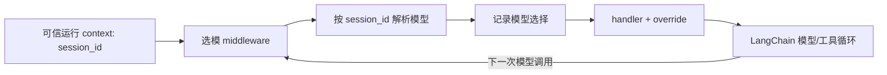

# Spec 001：模型调用边界按会话选模

状态：首个 Agent 运行层小切片；2026-09-29。先以确定性假模型验证框架接线，不接 UI、数据库或第二个真实供应商。

## 要解决的问题

现有 `scripts/probe_tool_loop.py` 已真实验证一次模型→工具→模型，但模型在 `create_agent` 时固定，诊断脚本没有正式运行层接口。需求是同一会话可以在 Pi 式轮次边界切换：一次模型调用开始后不换半段响应；工具结果回填后，下一次模型调用读取该会话当前选型。不同会话不能使用一个全局“当前模型”。

## 当前与目标数据流

当前：诊断脚本构造一个 `ChatOpenAI` → `create_agent(model, tools, middleware)` → `invoke` → 固定模型完成循环；观察 middleware 只记录消息/工具事件。

目标：上层传入可信 `session_id` 作为本次运行 context → `create_agent` 每次模型调用前进入项目 `wrap_model_call` → 通过注入的解析函数读取该会话当下 `(model_id, BaseChatModel)` → 记录选择 → `handler(request.override(model=...))` → 框架处理响应/工具/下一轮。解析函数、模型对象及事件收集由调用方提供；运行层不 import 应用会话模块。`session_id` 是运行内部 context，不直接信任将来的浏览器输入。

## 本次修改与接口

- `naiyue_test_agent/agent_runtime.py`：只提供 `RunContext`（含 `session_id`）与 `make_model_selection_middleware(resolve_model, record_selection)`。`resolve_model(session_id)` 返回 `(model_id, BaseChatModel)`；`record_selection(session_id, model_id)` 只记录本次选型尝试，不代表网络请求成功。缺少会话标识时抛出异常；解析失败原样上抛，禁止静默降级到其他会话模型。
- `tests/test_agent_runtime.py`：先写失败测试，再实现。假模型 A 请求工具；工具改变测试用选型；假模型 B 完成。同一次 `invoke` 内应观察 A、B；消息应为 human/ai/tool/ai 且工具 ID 配对。另测不同会话 A/B 隔离及缺少会话标识时拒绝调用。
- `docs/lessons/lesson-1.md`：实现后记录代码地图、具体数据流、关键行和一个用户小练习。`docs/handoff.md` 记录实际验证与学习状态。
- 不改 `scripts/probe_tool_loop.py`、`.env`、依赖、公开 API；不增加模型注册、会话存储、Web、持久轨迹或真实多供应商接入。上述内容之后按独立 Spec 推进。

## 验收与证据边界

1. 红灯：`.venv/bin/python -m pytest -q tests/test_agent_runtime.py` 在实现前因缺少模块/函数失败，确认不是测试数据自身错误。
2. 绿灯：同命令全部通过；A→工具→B 的实际消息和所选模型 ID 均满足断言；无 `session_id` 时不调用模型。
3. 回归：`.venv/bin/python -m pytest -q` 全部通过；`.venv/bin/python -m py_compile naiyue_test_agent/agent_runtime.py` 无语法错误；`.venv/bin/python -m pip check` 依赖完整。
4. 本次结果只证明同进程、假模型与 `create_agent` 接线；不证明会话权限、真实供应商兼容、重启恢复、持久轨迹或 HTTP/RPC 业务效果。

参考：[LangChain 动态选模](https://docs.langchain.com/oss/python/langchain/models#dynamic-model-selection)、[自定义 middleware](https://docs.langchain.com/oss/python/langchain/middleware/custom)、[Pi 下一轮刷新](https://github.com/earendil-works/pi/blob/a69bef789/packages/agent/src/agent-loop.ts#L224-L245)。
