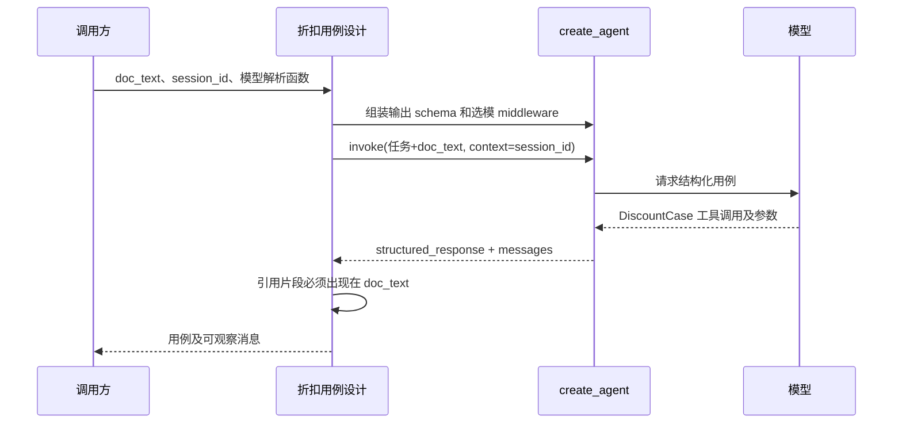

# Spec 003：从公开契约生成一条结构化折扣用例

状态：2026-09-29，**本单元已按 TDD 实现并用假模型验证**。承接 [Spec 002](002-discount-policy-first-scenario.md) 的黑名单、活动、空库存冲突场景。本单元只做**用例设计与基础校验**；不启动 SUT、不执行 HTTP、不接 UI/数据库/完整 RAG。

## 当前数据流与目标

现有 `agent_runtime.py` 只提供按可信 `session_id` 选模的 middleware；`create_agent` 的真实工具循环在诊断脚本中验证过，但业务模块尚无 Agent 调用点。公开 API 文档位于另一个只读参考项目，之前的人工 Spec 已确认规则优先级。

本单元目标：上层提供公开契约文本、已创建的模型对象和可信会话 ID → 测试 Agent 组装 `create_agent` 与现有选模 middleware → 模型通过 `ToolStrategy` 提交 `DiscountCase` → LangChain/Pydantic 校验结构 → 项目代码核对引用片段确实出现在输入文档中、请求与预期的 `request_id` 一致 → 返回用例及本次消息列表供后续轨迹分析。

`DiscountCase` 是**设计产物**，不是通过验证的真实接口行为。`ToolStrategy` 的结构化输出工具由框架处理；它不会执行 `POST /api/v1/discount/policy`。引用片段存在性校验只证明文本确实来自这份文档，不能证明模型对规则的解释正确；结果质量留给固定样本评测。

## 本次接口与文件范围

- 扩展既有 `naiyue_test_agent/agent_runtime.py`：`build_runtime_agent` 统一持有 `create_agent` 装配入口，并使用原选模 middleware；只接收上层给的工具、提示词和输出策略，不 import 测试业务。
- 新增 `naiyue_test_agent/test_agent/discount_case_design.py`（含真实代码，不建其他空层）：定义 `DiscountRequestCase`、`DiscountExpectedCase`、`DiscountCase` 和 `DesignResult`；`build_discount_case_agent(default_model, resolve_model, record_selection)` 把测试策略传给下层运行适配，创建可复用的 Agent；`design_discount_priority_case(agent, public_doc, session_id)` 调用它并校验引用。测试策略层 import 下层 `agent_runtime.build_runtime_agent`，下层不 import 测试策略层。
- 新增 `tests/test_discount_case_design.py`：确定性假模型通过 LangChain 结构化工具提交用例，验证输出、消息与选择记录；无文档时不调用模型；缺字段时不静默修补；引用不在文档中或请求/预期 ID 不一致时拒绝；模型异常不吞掉。测试只用短的公开规则片段，不读 SUT 源码或历史测试文件。
- 新增 `docs/lessons/lesson-2.md`：代码地图、一个真实对象形状、模型工具调用到 `structured_response` 的数据流、错误路径和待用户复述点。更新交接与 README 状态。
- 不改 `.env`、依赖、`/Users/zmw/discount_system`、`/Users/zmw/AIAutoTest`；不引入会话数据库、模型注册表、HTTP 执行、检索索引或 Web。

`DiscountRequestCase` 只包含公开 API 已规定的必填请求字段与约束。`DiscountExpectedCase` 只约束响应字段及类型，不把 `USER_BLOCKED` 等预期答案编码进模型输出 schema。`DiscountCase` 包含标题、HTTP 方法/路径、请求、预期 HTTP 状态/响应、原文引用片段。真正执行时的唯一 `request_id` 由执行层覆盖，不信任模型自行生成的 ID。

`build_discount_case_agent` 接收默认模型，因为 `create_agent` 创建时需要模型；每次实际模型调用仍由注入的 resolver 经现有 middleware 根据 `session_id` 选择。这里没有正式会话服务或配置持久化，调用方暂时提供解析函数。`design_discount_priority_case` 不读取文件或网络，只消费调用方给定的 `public_doc` 字符串，以免模型看到 SUT 源码或历史答案。空文档在模型调用前拒绝。`ToolStrategy(..., handle_errors=False)` 使 schema 错误直接浮出；不让默认自动修复循环消耗未知次数。真正模型请求另需配置调用预算和 token/费用上限，本单元不宣称已具备。

## 红灯、绿灯与证据边界

1. 已先写测试并运行 `.venv/bin/python -m pytest -q tests/test_discount_case_design.py`；红灯为缺少 `naiyue_test_agent.test_agent` 导入，退出码 2。加入实现后的 ID 一致性测试第二次红灯为 `Failed: DID NOT RAISE ValueError`，随后补最小检查。
2. 目标测试实际输出 `6 passed in 0.13s`；全量 `.venv/bin/python -m pytest -q` 输出 `9 passed in 0.16s`。测试穿过项目组装函数、现有 middleware 和 LangChain `create_agent`，假模型确实返回 `AIMessage` 的 `DiscountCase` 工具调用，框架回填配对 `ToolMessage` 并给出 `structured_response`。
3. `.venv/bin/python -m py_compile naiyue_test_agent/agent_runtime.py naiyue_test_agent/test_agent/discount_case_design.py tests/test_agent_runtime.py tests/test_discount_case_design.py scripts/probe_tool_loop.py` 退出码 0；`.venv/bin/python -m pip check` 输出 `No broken requirements found.`。项目目前没有独立构建目标。使用真实公开文档文本、仍由假模型返回固定用例的额外探测输出 `full-public-contract-probe: PASS`、两段引用均存在。后来把 `create_agent` 装配归位到运行层，未改变外部行为，全量测试再次输出 `9 passed in 0.15s`。
4. 假模型验证的是框架接线、类型/引用校验及异常传递；不证明 HeiyuCode、Claude/本地模型的结构化输出兼容，更不证明生成用例的业务质量或 SUT 执行。后续用固定评测样本和真实调用分别验证。

依据：[LangChain `create_agent` structured output](https://docs.langchain.com/oss/python/langchain/structured-output) 明确 `structured_response`、`ToolStrategy` 与 `handle_errors=False` 的行为；实施以本项目锁定的 LangChain 1.4.2 源码和运行结果为准。
