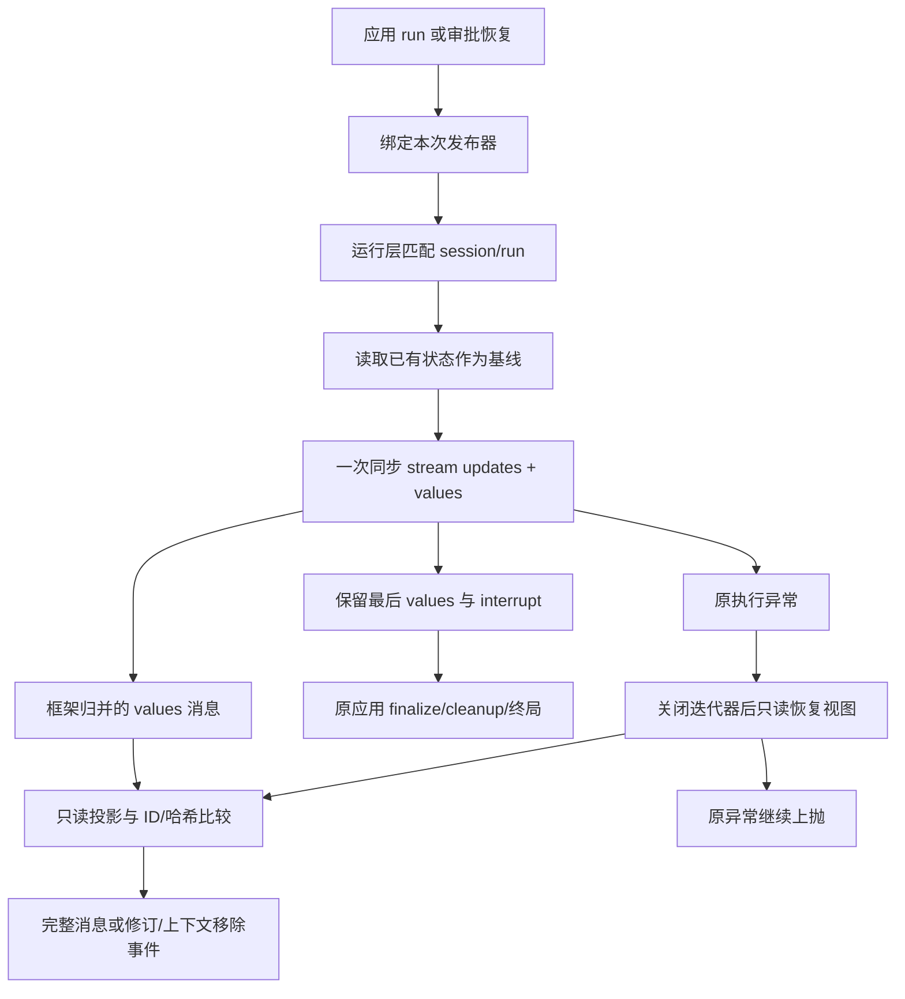

# Spec 064：完整消息的同步状态观察

状态：2026-10-08，用户“按你的建议做”确认先完整消息、后 turn。本片已接线并验证；turn 不在本片范围。

## 目标与建议划分

基于 [状态时点探针](../research/message-state-boundaries-2026-10-08.md)，先让受信任本地消费者获得已确认可读消息的展示快照；下一片单独处理 turn 和跨审批延续。不改消息 reducer、模型/工具/权限策略、原结果/异常、CLI 展示、存储或异步。

## 建议消息契约

- message_completed：首次观察到的完整消息已经在框架状态视图中可读，带 visibility=graph_values / recovery_view。不表示业务成功、工具执行成功或 saver 持久确认。
- message_revised：同一 message_id 的可见内容发生变化；与未来 token 增量 update 区分。
- context_messages_changed：当前模型上下文的消息 ID 集合发生变化/旧前缀被移除；不是删用户完整会话历史的命令。
- message_snapshot_unavailable：存在可读状态，但内容无法按支持格式投影；安全报告类型/原因，保留原运行结果/异常，不输出 repr 伪造快照。

消息 ID 使用框架实际 message.id，不与 model_call_id/tool_call_id/未来 turn_id 混用。初始历史不重复发布；新输入、steering/follow-up 实际进入状态后才报告。summary 根据现有 `naiyue_compaction_summary` 标记归为上下文摘要，不冒充新用户。

## 内容快照与日志

快照使用冻结 payload 和不可变 JSON 字符串，字段投影为 type/id/content/name/tool_call_id/status/tool_calls/invalid_tool_calls/summary 标志，按消息类型取实际存在的字段。不复制 Runtime.context、模型配置、原始 SDK response_metadata 或任意非 JSON artifact。

这是供展示/评测的可见内容投影，不是模型输入恢复格式；原 LangChain 消息不变。标准文本/JSON 内容块先支持，额外供应商 reasoning 字段、多模态和非 JSON artifact 分别核对，不能称原始协议全部字段已覆盖。

沿用同一 subscribe_events 受信任本地注册模型与统一序号；默认 _log_event 只写角色、ID、可见性、大小/状态等元数据，不含快照正文或工具参数。未来远端消费者须由应用授权和脱敏，不在本片宣称插件隔离/多租户权限。

## 状态来源与执行兼容

推荐用私有同步适配器消费 compiled agent.stream(updates+values, version=v2)，显式使用与 invoke 相同的 output_channels；完整耗尽一次图执行、保留最后 values，把 interrupt 重建为既有字典。只读状态，不手算 reducer，不创建额外模型/工具循环，不为观察再 invoke 一次。

保持 Native structured_response 类型，原异常继续上抛，应用原 finally 和 run_finished 接线不变。StreamPart v2 仅为状态流封装；这不是正式异步、token 流展示或活动取消。

启动前建立已有消息的基线，流中逐个观察实际快照。失败后可通过 graph.get_state 的恢复视图读取 pending writes 中已有结果，visibility 必须 recovery_view；读取/投影次级故障不能覆盖原异常，不重放工具。框架/进程控制不伪造失败消息或取消终局。

普通消息内容对相同 ID/相同投影去重；同 ID 新投影发 revised；被压缩移除的旧 ID 发 context 变化。消息类/Python对象别名、基线读取和 pending 恢复视图必须由确定性测试保护，不能仅依赖对象 identity。

对不支持状态 stream/get_state 的自定义旧调用对象，保留原 invoke 行为并安全记录观察不可用，不假报已确认状态；无应用发布器的直接入口保持原路径。

## 拟影响模块

- 新 agent_runtime/message_observation.py：只读投影、去重/修订/上下文变化和私有同步适配器，单文件低于 500。
- agent_runtime/events.py：有限消息载荷/事件合法时序；沿用 per-run 发布器，不添加第二消息总线。
- agent_runtime/__init__.py：仅匹配应用发布器时使用适配器；不改公开签名。
- application/run_events.py：日志白名单支持新消息元数据，内容不进入日志。
- 新消息状态/失败边界测试；Spec 062/063 测试明确过滤各自事件族，更新合法序号，不放宽原业务断言。CLI 本片不迁移。
- scripts/probe_message_events.py：沿正式应用构建入口做有界真实工具循环，只有合成输入/随机结果，安全输出计数与验证结论；不修改模型配置。

共 4 个产品文件与多个新测试/阶段文档，超过 8 文件；是状态观察接线，不同时实现 turn 或重构运行控制。标准 Graph 流由框架推进，研究脚本不是正式实现。

## 本次执行接口与边界

- 新冻结 MessageSnapshotData：message_id、message_type、visibility、snapshot_json、snapshot_sha256、snapshot_bytes、is_context_summary、可用 tool_call_id/status。completed/revised 共用载荷，UTF-8 JSON 展示投影独立于原对象。
- 新冻结 ContextMessagesChangedData：removed_message_ids/current_message_ids 的元组、visibility、reason=compaction/state_update；仅旧 ID 移除时发，不为每次追加重复发集合事件。默认日志只写移除/当前计数。
- 新冻结 MessageSnapshotUnavailableData：可用 ID/type、观察 stage=baseline/stream/snapshot/recovery、固定 reason、安全 error_type、可用 visibility；无原异常/正文。投影不支持和可选读取失败可观察，不能遮蔽业务错误。
- 私有 invoke_with_message_observation(agent, input, *, context, config, publisher)。仅支持原生 Pregel.invoke 的图（含 compiled agent）；自定义 invoke/旧 stub 保留原 invoke 并报告 unsupported_state_interface。无匹配应用发布器保持既有路径。
- 有 checkpointer 时执行前 get_state 建立去重基线；读取失败安全记录 baseline_read_failed 并回退原 invoke，不伪造历史基线。无 saver 的原生图用空基线。普通保存策略不变。
- 逐步消费 stream_mode=[updates,values]、version=v2、output_keys=agent.output_channels；只从 values 观察消息。最后 values/interrupts 重建传统返回，structured_response 保持对象；不加第二次模型执行。
- 保留原异常；正常异常退出后只读 get_state 观察 recovery_view 的 pending 结果。恢复读取/快照/关闭迭代器次级失败记录安全诊断，不覆盖主异常。非 Exception/GraphBubbleUp 控制不伪造失败消息，不擅自转为取消；关闭生成器，避免留下活跃执行器。
- 基线/去重缓存只存 message.id→投影摘要，不保留第二套全文历史。相同 ID/相同投影不重复；同 ID 变化 revised；无 ID/不可投影只报 unavailable。只有完整 ID 集合可信时判断移除，避免坏数据造成假删除。
- 显示字段限定为消息原生可见内容，忽略 response_metadata、usage_metadata、artifact 及任意 extra 字段；摘要只认 HumanMessage 的现有标记。不从投影恢复框架消息。
- 默认日志扩展有限消息元数据；完整 snapshot_json 仅在同进程受信任订阅回调中出现。没有新参数、权限模式或内容传输接口。
- Spec 062/063 的测试 helper 按原事件族过滤完整消息/上下文新事件；全量 sequence 包含新事件，因此旧精确序号同步实际数字。保留原业务、异常、关联、清理、消息配对和脱敏断言；不修改 conftest 或放宽断言。

新增 tests/test_message_observation.py 保护投影/冻结/去重/修订/上下文变化，tests/test_application_message_events.py 保护实际图/审批/压缩/结构化与输入交付，tests/test_message_observation_failures.py 保护 fallback/失败补读/原异常/不可投影。测试文件到 500 行前按职责拆开。

## 验证要求

TDD 先红：正常两次模型完整消息一次观察、并发/顺序工具和人工拒绝正文、同 ID 修订/重读历史不重复、输入可见但模型失败、fatal 后 pending 结果标识、压缩 summary/移除/保留、结构化输出、steering/follow-up 与 stopped、非 JSON 投影故障不遮蔽业务错误、独立快照不可篡改、日志无正文。

返回值/异常与 native invoke 对照，尤其 interrupt、structured_response 和部分失败状态；不能 skip 现有调用对象。全量 pytest、compileall、pip check。真实模型可后续有界验证消息内容配对，不能替代状态边界故障测试。

## turn 后续切片必须明确的事项

参照 Pi 的助手响应加相应工具处理，turn start 需要在模型工作前报告，finish 等待相应完整结果已确认；结构化人工 ToolMessage、工具错误结果、普通失败和 after_turn 停止分别处理。初次审批保持 turn 未完成，恢复使用同一 logical turn；重新执行失败尝试不假装同一次成功。延续数据归应用会话且可序列化，发布器/锁不保存。

还需核对同步状态消费与节点 callback 的通知顺序，避免消费者递归发布死锁或把延迟观察顺序当真实执行顺序。上述 turn 方案尚未选定，不从本片 message_completed 自动推导完整 turn 生命周期。

## 实际接线与数据流

message_observation.py 的 MessageStateObserver 只存 ID/摘要散列，不持有第二套全文历史；同一 ID 原生元数据变化但显示投影不变时不发 revised。新摘要伴随旧消息移除才标记 compaction；已有未变摘要旁移除普通消息属于 state_update。重复 ID、无 ID 或不支持的消息类不推导假移除。原 get_state/reducer/checkpointer 负责状态，不从 JSON 快照恢复消息。

原生 Pregel.invoke 未覆盖时使用此私有 adapter；仅有 invoke 的 stub 或覆盖 invoke 的自定义图保留原入口并报告观察不可用。有界基线读取失败同样退回原 invoke。可选 iterator.close 存在时关闭；失败后补读、关闭或报告的次级异常只记录安全类型，不能覆盖已有主异常。GraphBubbleUp/进程控制维持原语义，不伪造 failed/cancelled 终局。

典型一工具循环的实际序号：run_started(1)、Human 完整消息(2)、模型开始/结束(3/4)、AI 请求消息(5)、工具开始/结束(6/7)、ToolMessage(8)、模型开始/结束(9/10)、AI 回答(11)、run_finished(12)。这表示本 run 的通知顺序，不代表跨 run 全序、工具执行器进入时间或持久保存时间。

## 实际验证（2026-10-08）

- 基线：`.venv/bin/python -m pytest -q` → `605 passed in 15.84s`。
- TDD 红灯：先新增投影单测和实际应用消息测试。单测因新模块不存在收集失败；单独运行实际应用消息测试 → `5 failed in 0.59s`，原因均为缺少消息观察，原模型/工具运行成功。之后最小接线，单测发现“已有摘要旁移除普通消息”误归 compaction，修正按新增/变化摘要判断，再补边界测试。
- 后补边界验证覆盖审批恢复、结构化输出原对象、强制恢复 summary 提交、Steering/Follow-up 交付时点、after_turn 停止、并行工具、保存延迟、原异常/控制透传、失败批次 pending 结果、读失败降级、非 JSON 投影、消费者隔离和原 invoke 返回对照。这些后补测试不冒充全部先红。
- 关闭接口回归先红：合法 list_iterator 无可选 close 时产生 AttributeError；改为仅存在 close 时调用 → `2 passed, 12 deselected in 0.53s`（同时保留关闭次级异常不遮蔽主异常断言）。
- 最终全量：`.venv/bin/python -m pytest -q` → `635 passed in 15.83s`，新增 30 例，未 skip/放宽原业务断言。Spec 062/063 helper 按各自原事件族过滤，合法全量序号同步；新测试单独验证内容与默认日志不泄漏正文，没有修改 conftest。
- `.venv/bin/python -m compileall -q naiyue_test_agent scripts tests` → 退出 0。项目没有独立应用打包/构建目标，此项是语法编译验证。
- `.venv/bin/python -m pip check` → `No broken requirements found.`；产品/新测试/探针单文件均小于 500 行。
- `.venv/bin/python -m scripts.probe_message_events` → `real_message_events=PASS events=12 messages=4 model_calls=2 tool_calls=1 pairing=verified terminal=completed`。使用既有本地配置 `heiyu-gpt-5.5` / `gpt-5.5`、合成输入、随机纯工具结果；正文/配置/凭证不输出。最多 2 次逻辑模型请求和 1 次工具执行，父进程 95 秒总时限；SDK 内部重试仍按配置，不能当作 2 次 HTTP 尝试。
- 真实探针初版把 before_agent 压缩检查的 resolve_model 计成模型请求，提前被保护拦住并输出 RuntimeError；修正只在既有 record_selection 入口计请求，另加离线回归验证（先前失败为探针计数错误，非产品失败），第二次真实请求通过。不隐藏这次失败，也不把真实模型结果称为业务评测。
- 16 个本片文件的存在/行数/尾部空白检查 → `touched_file_structure=PASS files=16 python_line_limits=PASS trailing_whitespace=none`。仓库当前无提交且文件未跟踪，git diff --check 退出 0 本身不能证明这些未跟踪文件的改动范围，因此另做显式文件检查。

## 当前边界与下一步

已验证的是同步完整显示投影的订阅接线，默认日志只含元数据。没有 token 增量、turn 生命周期、CLI 消费迁移、活动取消、正式异步或持久事件。内容回调仍为本地受信任同步回调，慢消费者可能阻塞执行，未做生产压力/远端权限/脱敏验证；snapshot_json 不含任意 SDK extra/reasoning/非 JSON artifact，不是原生协议完整恢复格式。

唯一下一步：先明确 turn 开始/结束和跨审批延续数据的契约，再写独立 Spec/TDD；特别覆盖 rejected/structured ToolMessage、致命失败、恢复视图与 after_turn 停止。此片新代码尚未一起阅读，用户批准实现不等于已独立实现或能应对追问。
