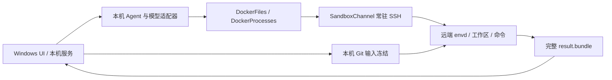
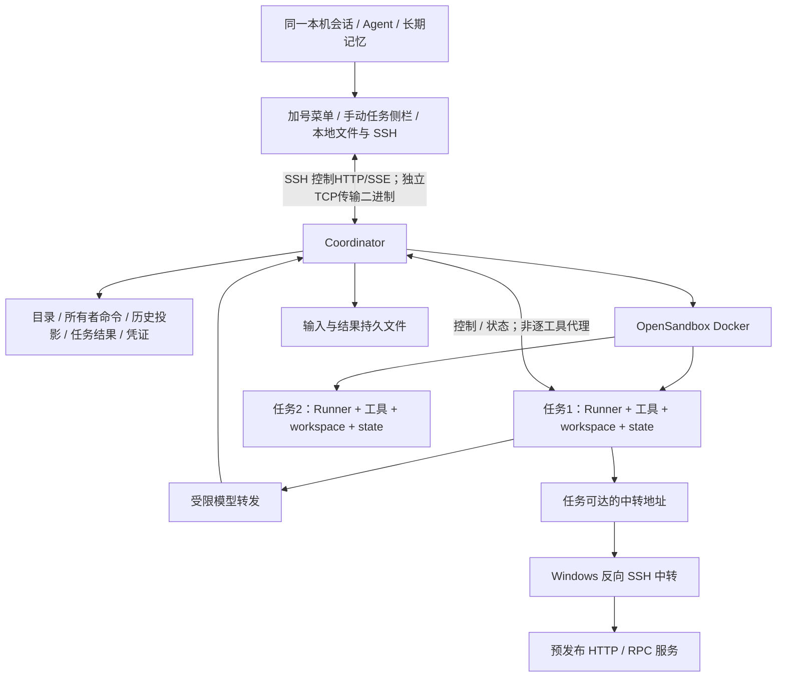

# Spec143：B 阶段云端任务总方案

2026-11-01用户确认的任务自动授权、外部网络开关与项目依赖合同见[143p](143p-s042a-task-capabilities.md)；该合同替代此前B逐工具审批计划，本机普通模式审批保留。

日期：2026-11-02。状态：**原S00本机通过，用户报告目标Linux与Windows三段通过；S01、S02、S03、S04、S05及S07.1本机实施范围见143j–143r**，最新模型转发/Runner正式catalog与验收边界见[143r](143r-s05-model-relay.md)。本轮按143f重拆为14个剩余实施单元；唯一下一片S06.1a持久档案，详细合同143t已补齐。原云端长期记忆取消，新增143u手动管理、143v资源收敛、143w结果接收专题，后续范围以143f为准；公司新增实机门禁单独保留。公司侧目前是S00实验，不是B产品部署，本轮不操作远端/真实配置或迁移数据。

当前B内部入口具有导入/缓存续传/任务创建/固定任务根子运行/必要历史控制/单产物下载/停止恢复/原生模型转发能力；显式配置model_proxy后从bootstrap装配真实SDK，无配置时如实waiting_model。确定性协议夹具不替代真实供应商验收。除已注明部分外，其余模块、路由和命令仍为拟实现合同。正式Web/CLI尚沿A；S09统一切换与删除A，不维护两种云端模式。

## 1. 结论与决策边界

采用“常驻管理服务 Coordinator＋每任务独立容器内 Agent Runner”。管理服务负责目录、准入、生命周期、任务过程/结果与凭证；模型—工具循环在任务容器内执行。首次导入形成固定输入，后续轮次持续使用原工作区。2026-11-02用户确认[143s本机会话委派](143s-local-session-cloud-delegation.md)：本机主Agent继续聊天和整理长期记忆，云端任务独立运行；首版从加号菜单打开任务侧栏，用户手动新增/选择任务、底部输入消息，不做本机Agent自然语言提交；侧栏观察云端Agent/工具并提供停止与显式恢复。

**B 替代 A 云端执行主链，不维护 A/B 两套模式。** 普通本机执行仍是实际需求，保留其现有模型、工具与应用能力；不能把“删除 A”扩大为删除所有 Host 实现。主会话保持本机执行，用户通过云端任务侧栏手动创建并发送要求，不切换或迁移主会话执行位置；不要求打开另一云端聊天。

| 决策 | 合同与依据 |
| --- | --- |
| 不兼容旧 A | 用户已确认；不导入旧会话、记忆、配置、绑定和交付回执。旧数据原地保留，不自动读取、改写或删除 |
| 首版入口 | 用户已确认 SSH 私有访问；管理服务仅监听开发机 loopback，Windows 发起 SSH。手机直接接入后续做 |
| 工作区隔离 | 默认一个持久云端任务对应一个容器及独立 workspace/state；同任务续聊复用；任务间不共享可写目录 |
| Runner 位置 | Agent/工具/项目依赖作为独立任务环境，直接复用本机IO、独立并发/版本/后续分叉；宿主Agent也可避免跨Windows，不能仅用往返成本证明必须同容器。首版同任务同UID的防篡改限制见143a第8节 |
| 容器后端 | 优先集成 OpenSandbox Docker；S00 必须证明隔离、存储、生命周期和容器到中转连通性。失败先修订 Spec，不退回 A |
| 输入/交付格式 | 归档＋内容清单导入；固定输入到最终文件的 binary patch 交付；报告独立传输。用户不需要远端提交历史 |
| 历史与记忆 | Runner保存本任务checkpoint/待发历史，Coordinator拥有过程投影和所有者命令/结果；长期记忆仅在本机，不建云端共享记忆库/API/整理作业。侧栏观察/下载/未发送草稿不进入记忆；用户发送分析请求并由本机模型真实读取后按原规则处理 |
| 生命周期 | 持久任务显式timeout=None；云端持久受理且输入就绪后独立运行，本机退出不取消。Coordinator按静止边界及运行/输出/必要保存/unknown保护空闲停止，未知继续占额度；不通过TTL销毁替代对账 |
| 模型密钥 | 本稿建议真实密钥留管理服务，容器拿受限任务令牌，经协议透明的模型转发调用。用户倾向此方向并要求参考项目核验；细则随本组 Spec 审阅 |
| 更新 | 不可变版本产物；自动下载、验证、预备，新任务采用已激活版本；存量任务固定原版本，不热换运行中进程 |

不新增 Kubernetes、多主机调度、容器池、多用户 SaaS、实时双向文件同步、远端提交历史回放或手机公网入口。分叉/辅助对话仍属于独立的 Spec142；本期只保证状态与文件边界能支持它，不提前实现这些功能。

本轮修订参考当前`envd/identity.py/workspace.py/file_mutations.py`、`tools/processes.py`、审批和生命周期实现，逐项继承受控路径/进程/保存语义，清单见143a第8节。B不照搬A的root及六项控制cap，也不声称同UID Runner能抵御本任务命令篡改；可信所有者状态移到Coordinator。若要求等价的任务内控制进程防篡改，须在S04前另行修订部署/身份边界，不能以S00通过替代该决策。

## 2. 文档与审阅入口

| 文件 | 审阅重点 |
| --- | --- |
| [143a 运行与状态](143a-runtime-and-state.md) | 进程、存储、身份、API、断线/崩溃、历史记忆、模型凭证 |
| [143b 输入与交付](143b-input-and-delivery.md) | 基线、清单、归档、续传、binary patch、安全交付与产物 |
| [143c 版本与运维](143c-version-and-operations.md) | 发布产物、自动更新、镜像、网络、限额、备份与故障 |
| [143d Web 与 CLI](143d-web-and-cli.md) | 本地/云端连接、导入、准备、结果、错误与前端影响 |
| [143e 迁移与清理](143e-a-to-b-cleanup.md) | 当前消费者、替代/删除项、保留项、协议和数据边界 |
| [143f 实施切片](143f-implementation-slices.md) | 已完成底座与14个剩余单元的唯一清单、依赖、交付与失败验证 |
| [143g 验收](143g-acceptance.md) | 自动化、真实平台、性能、证据与禁止外推的结论 |
| [143h S00原型](143h-s00-backend-gate.md) | 本机实际门禁、候选版本、SSH问题与Windows复验边界 |
| [143i 装配只读分析](143i-runner-assembly-spike.md) | 当前装配/保存真实链、Runner与Coordinator依赖归属、80项既有基线与S04拆分位置 |
| [143j S01详细方案](143j-s01-control-foundation.md) | 已实施控制底座、所有者与任务鉴权、历史台账；范围以该片实际证据为准 |
| [143s 本机会话委派](143s-local-session-cloud-delegation.md) | 已确认：手动入口、侧栏修复/隔离、本机长期记忆；下载后准备待确认分析草稿、关联任务阻止删除父会话 |
| [143t 历史/观察](143t-s061-history-and-observation.md) | S06.1a持久档案与S06.1b实时/用量/SSE，正常/失败链与接口 |
| [143u 手动任务](143u-s062-manual-tasks.md) | S06.2a连接/新建与S06.2b消息/控制/离线，关联/命令与父删除保护 |
| [143v 资源收敛](143v-s063-resource-lifecycle.md) | S06.3实际周期回收、额度/磁盘边界、释放与安全删除状态机 |
| [143w 结果接收](143w-s081-result-receive-and-analysis.md) | S08.1文件下载、材料身份、待发送分析草稿和真实工具来源；应用另归S08.2 |

## 3. 当前 A 的真实链路

正常路径：`service/app.py:create_service_app` → `application/sessions/execution_binding.py:create_sandbox_session/prepare_sandbox_session` → 并行准备输入和环境 → `application/environments/inputs.py` 安装输入 → SessionService 运行 → Docker 工具经 SandboxChannel 调 envd → 捕获 bundle → 本机验证与交付。

失败例子：Windows 工具配置中的 `D:\\...\\bash.exe` 被原样交给 Linux envd，显式路径解析失败；初始化探针使用空 settings 的成功不能覆盖实际网页配置。迁到 B 后必须分开 Windows 客户端配置与 Linux 模板配置，并在模板预备时验证命令，不能声称“Agent 在远端，所以 PATH/依赖问题自动消失”。

当前输入需要多次本机 Git 调用、对象准备、传输与安装；每个新环境都承担该成本。同会话已经复用容器和输入，不能将这种已有复用再计为 B 独有收益。删除 A 的旧 IO 协议不等于可以删除请求身份、未知写入、必要保存、权限和恢复合同。

## 4. B 的职责与数据流

Runner 复用当前 Python＋LangChain `create_agent`、middleware、原生模型适配器和本地 IO 工具。管理服务不再为每个云端项目装配一个可执行 Agent；它通过任务命令接口启动/停止 Runner 内单次运行。一个任务只允许一个根运行，已有子 Agent/后台命令在同一任务边界内执行，受总资源限额约束。

| 两种远端部署 | 优势 | 对当前需求的代价 |
| --- | --- | --- |
| Agent常驻开发机宿主、工具进容器 | Agent代码更新/集中观察简单；模型凭证天然可留宿主 | 每次工具仍跨服务边界；图状态/工具会话/容器绑定需共同恢复；任意工具不能混入宿主；与分叉的独立环境关系更复杂 |
| Agent随版本模板进入任务容器（本稿选择） | 循环/工作区/项目工具链作为独立任务环境；并行、固定版本与未来分叉边界清楚 | 每任务有Python/Agent内存成本；依赖需隔离预备；对外历史/根密钥须移出任务，同任务命令仍可能影响Runner |

常驻Coordinator与容器内Agent并不冲突：前者管理任务，后者执行任务。选择后者是由沙箱、并发与独立工作区需求驱动，不以“模板自带Agent就没有初始准备”作为依据。

正常例子：本机会话分析需求 → 加号菜单打开云端任务侧栏，手动新增并选择代码/proto → 冻结输入I并上传一次 → 环境准备就绪后用户在任务详情发送首条要求，Coordinator持久受理运行 → 本机继续聊天，侧栏查看Runner写pytest/工具结果 → 静止边界自主保存摘要/报告并冻结O → 本机下载结果，生成带材料引用的分析草稿，用户发送后分析/按原规则整理记忆；代码交付另预检确认。云端修复指令继续T的工作区，不上传原项目、不重装Agent；本机离线期间依赖Windows业务中转的调用仍可能失败。

失败例子：发送运行请求后 SSH 断线，Windows 不知道 ACK 是否收到。任务继续独立运行；连接器凭原 command_id 查询，不能重发成新 run。若 Runner 崩溃，管理服务标记需要核对；确认旧 generation 不能再写后，才启动下一 generation。必要保存失败不能显示完成。模型/测试外部副作用不因检查点存在就自动重放。

## 5. 参考项目如何影响本方案

参考的是已固定版本的源码行为；源码事实、设计建议与本机合成探针分别看待。详细证据见[原调研](../../research/cloud-b-runtime-and-transfer-2026-11-01/report.md)、[格式复评](../../research/cloud-b-runtime-and-transfer-2026-11-01/format-reassessment.md)、[DeepSeek 综合判断](../../research/cloud-b-runtime-and-transfer-2026-11-01/deepseek-synthesis.md)。原调研中的默认 bundle 建议已被格式复评替代。

| 项目 | 核实到的职责 | 我们采用/不采用 |
| --- | --- | --- |
| ZCode `a60ba6a` | 远端 Source Server 管 Agent/项目，默认打开远端目录，部署运行包；RPC/订阅可复用连接 | 采用常驻管理、发行包缓存、远端连续工作；其默认链不证明本机未提交文件可以免上传 |
| Codex 云端官方环境资料 | 云端环境准备、独立任务执行、环境配置与结果审查；私有调度/模型凭证内部实现未公开 | 参考产品边界，不能据此断言内部传输格式、密钥位置或秒数 |
| OpenHands SDK `9884945` | Docker runtime 中运行 Agent Server；SecretRegistry 选定值会 materialize 后交给 runtime | 采用容器内 Agent；它不是“所有真实模型密钥永不进容器”的证据 |
| OpenSandbox `a6c0cfc` | Docker 生命周期、执行/文件流、持久挂载、网络策略及可选 Credential Vault | 集成基础设施，避免重做 A 的容器/工具守护进程；仍自行实现应用历史、输入身份、结果交付和更新策略 |
| DeepSeek Harness `ce7073d` | workspace-changes 用私有 index/objects、只读 alternate 生成 tree，不要求新提交或 bundle；附件走字节流 | 借鉴轻量树比较；不照搬临时审查缓存生命周期。SSH 工具组合本身也不等于 Agent 已迁云端 |
| Pi / AgentX | Pi `a69bef7` 的AgentSession→runLoop→工具结果回填；AgentX `3fcfa0e` 的AgentMessageHandler→processChat→agent.chat/TokenStream→完成或异常处理 | 当前 Python `create_agent` 路线保持；两条链的来源/边界见原调研的调用链核对与既有[生命周期研究](../model-session-lifecycle-research.md)，不复制语言/框架API |

OpenSandbox 默认 host 网络不符合本方案，不能照抄 quickstart；选定 bridge 网络与只挂任务自身目录必须在 S00 验证。Vault 有额外 DNS/nft/egress 与 TLS 注入要求；本稿选择显式模型 HTTP 转发，详见 143a，不叠加两套凭证路线。

## 6. 收益、代价与耗时判断

| 项目 | B 的实际变化 | 不能据此承诺的事项 |
| --- | --- | --- |
| 首次准备 | Agent/依赖提前成为缓存镜像，输入导入一次复用；减少 Windows Git 子进程与工具桥接 | 全新机器下载/构建、首次大项目上传依然可能长；不保证新任务永远小于 10 秒 |
| 热态工具 | Agent、文件、Shell 同容器，工具结果不必往返 Windows | 模型延迟、测试服务响应、磁盘扫描仍存在 |
| 命令可靠性 | Linux 模板声明依赖/PATH并预检，Windows 路径不下发给 Runner | 依赖缺失、架构不符、显式坏路径必须报错，迁移不能自动修好 |
| 维护量 | 删除 envd、自定义 SSH 工具桥、Git bundle 主交付链及 A 生命周期分支 | 新增控制面、任务恢复、模型转发、输入/结果 API 和版本管理，不能声称无需维护 |
| 并发与远程访问 | 多任务容器独立、Windows 可离线，未来不同设备连接同一服务 | 预发布中转仍依赖 Windows 在线；云端独立运行不等于业务依赖独立 |

公司A首建观测9.953/16.875/11.297秒，用户已接受并停止该优化；Mac格式54次合成往返不是B/Windows性能。B产品暂无实测：热态环境目标p95≤1秒；缓存新任务的8秒目标仅适用143g冻结的标准文本样本，计入解包/全部内容核对/Runner装配，其他规模分档，不外推所有GB项目。首次导入与项目依赖预备单列，S00创建/身份检查时间不冒充产品ready成绩。

## 7. 交付完成的含义

本组文档完成只表示方案可审阅。B 实现完成需要 143f 各片行为/失败验证、143g 标准构建/全量回归和公司实际容器网络/HTTP/RPC/UI证据；模拟数据、测试全绿、模型回答与生产业务效果分别报告。

实施时每片同时接线并删除被替代的 A 分支；不会以“最后再清理”无限保留双栈。任何必要前提失败都先更新 Spec，不用静默回退、本机代跑或放宽隔离制造成功。

实施顺序按143f：装配只读spike已完成，S01先验证离线控制合同；S00新增实机项在相应S02后端/S04 Runner/S05模型能力接线前通过，不追认原报告覆盖或阻塞不依赖它们的S01。随后完成最小输入→确定性Runner→历史→产物下载的内部CLI闭环，再补完整能力；S08冻结机器消费者清单。S09.1删除A前必须完成真实模型/Windows HTTP与proto RPC/Web-CLI/结果交付门禁，切换同步删A运行消费者；S09.2单独收尾余留工具/文档。不是等S11才首次验证真实业务。
