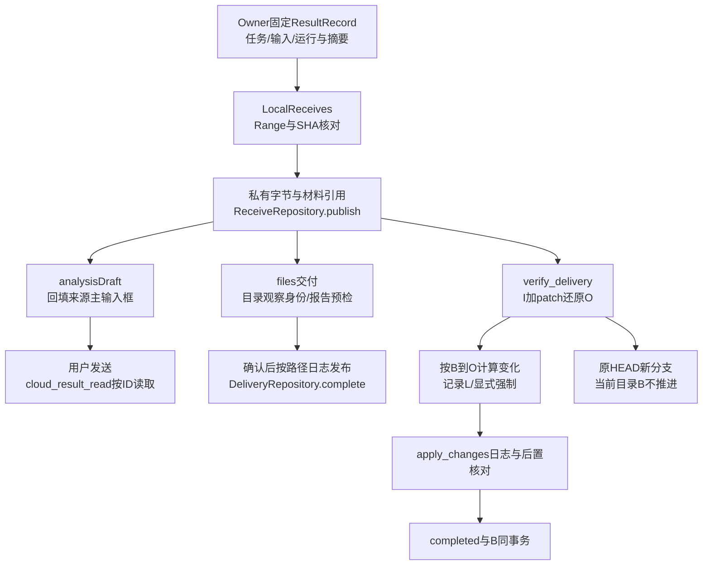

# Spec143AE：S09.1验收问题修复与结果取回收敛

状态：2026-11-03，已接入并完成本机验证，原机复验边界见第11节。用户已要求按讨论顺序实施。保持原未提交R1/R2及其他工作；不提交、发布、部署、修改真实配置或用户数据。初始34路径指纹与差异保存在build/s091-acceptance-fixes-20261103。

## 1. 当前主链与问题

云端列表按本机binding选择task；详情以该binding读取快照/历史、模型、命令及结果。发送先保存草稿，本机登记命令，producer重读task后转发；Coordinator校验revision并执行，前端通过命令与快照收敛。任务结果以原输入I和云端O生成清单/patch，报告来自本轮专用产物目录。接收校验固定文件后登记材料，主会话通过cloud_result_read读取。代码交付先在私有目录还原核对O，再预检和确认写入。

现有缺陷：本机拒绝result_pending而云端允许；无变化心跳递增revision；命令拒绝回执未提升为明确错误且删除确认无条件关闭；无run的后台停止仍叫停止本轮；历史AI预览丢tool_calls；模型空值成为加载占位选项；任务/结果名称与时间不足；多个面板挤压消息区。原机跨任务互见结果尚未复现，现有API按task隔离，不能靠猜测修改存储归属。Win11启动分支使用DETACHED_PROCESS，缺少显式无窗口参数。

## 2. 实施顺序

1. 发送准入/无变化心跳、命令失败与后台停止语义（原7/8/9），补跨任务边界验证（5）。
2. 保存历史工具卡（4）；模型空占位与发送反馈（2/3）。
3. 任务/结果可读身份及居中结果窗口、控制/历史分层（1/5/6）。
4. 报告保存目录、主Agent分析、代码强制预检/覆盖及应用基线。
5. Windows后台启动（10）；完成回归、构建和实际浏览器验收。

每片先运行最小失败回归，确认失败原因后实现；连续三次失败假设停下报告。相同根因的实际消费者同时修正，避免平行旧实现。最后做安全、架构与对抗审查。

## 3. 控制与展示合同

- 本机消息预检与Coordinator一致允许background_commands/result_pending；其余阻挡项保持。心跳仅在runner状态/阻挡/恢复信息发生实际变化时保存业务revision，静止起点不被同状态心跳刷新。
- 新命令的reserved/accepted/succeeded/failed/rejected/unknown分别呈现，HTTP成功不是操作成功。确定拒绝保留输入和任务；删除只在最终完成后移除，拒绝有alert与重新预览入口。unknown沿原ID核对，不用新ID重放。
- 有活动run显示停止本轮；仅有后台命令时显示停止后台任务，保持现有执行/清理合同，不增加后台控制API。
- 发送立即显示提交中状态及待确认内容；草稿版本和回执关联，确定拒绝保留/恢复原文本，用户新编辑不被迟到ACK清除，正式消息出现后去掉临时展示。
- 已加载模型目录中不出现空值/加载占位；未知已保存模型与真实目录区别处理。保存历史保留有界tool id/name配对信息及截断标志，完整参数仍由原详情API承担。
- 列表和结果使用真实title（若有）、创建/捕获时间与辅助短ID，不虚构数据；缺数据留空。结果列表/详情增加并核对task身份，切任务和迟到回包不得交叉采用；若仍不能复现原机互见，单独报告未闭合边界。

## 4. 结果窗口与文件保存

沿主界面既有字体、颜色变量、圆角与CSS Modules。视觉方向已由用户给定：紧凑工具界面，采用现有ProjectPicker/ResultReview式对话框；参考VS Code目录选择的目标确认与GitHub Desktop差异预览的动作分层，不迁移组件库。无新增字体、依赖或装饰动画。

内容顺序：固定任务/运行/时间与保存状态 → 结果选择 → 报告勾选/预览/保存及分析 → 代码动作/预检。原主任务线程选择和执行控制收紧，历史操作默认折叠。窗口内部滚动、Escape/关闭恢复焦点，375px不挤压主会话；关闭只收起观察，已登记producer继续，重开核对原ID。

报告列表只显示artifact，manifest/patch保留内部用途。移除浏览器单文件下载入口；保留底层传输。目录浏览复用DirectoryBrowser，选择已有目录或输入新文件夹名，不注册项目。保留产物相对结构。

同内容已有文件视为已保存；不同内容先列冲突，用户一次明确确认覆盖。本机目录身份及预检看到的文件状态固定到操作，写入前再次核对。完整下载并校验后逐文件发布；失败显示真实部分进度，重试不制造序号副本。新目录由该操作独占创建/核对，拒绝接管其他目录。

2026-11-03用户确认简化报告保存：删除“已核对保存位置和文件”普通确认勾选；预检完成后，由“确认保存文件”按钮直接表达写入确认。不同内容同名时仍须先勾选覆盖许可，重新预检/查询采用新回执后清除该许可。选择目录或完成预检不自动写入，partial/unknown仍沿原操作显式继续，回执未确认时先查询。代码交付的确认流程不在本次修改范围。

复用现有交付台账/producer，扩展DeliveryRequest.action=files以及观察过的destination_path/expected_directory和可选新目录name；files只消费artifact-only接收。ReceiveRequest新增include_code（缺省true），报告保存用false，不下载无关patch；旧接收/代码/分析默认合同保留。DTO/序列化/存储/前端类型/测试全链同步。

## 5. 代码预检、强制与基线

主界面只提供apply/branch，Git来源才显示branch。现有明确对外的export动作保持接口合同，去掉其普通UI入口；不顺便破坏既有API。

apply先选择结果并预检；变化以本机应用基线B→所选O计算，仅影响这些新增/修改/删除路径。初次B=I。I不可变，继续用于远端patch和O还原校验。后续B使用同一目标目录、instance/task/input下最后完整成功应用的O清单，不能将其他任务或用户无关本地修改吸收为基准。

预检记录这些路径的本机实际状态L。普通执行要求L匹配B；内容冲突可显式强制应用，覆盖/删除范围仍限B→O。完整性、路径/目录身份、权限、空间等失败不可强制。执行确认针对预检的L，L再次变化则拒绝并要求重新预检。强制备份真实L，包括云端新增但本机已有路径；保留原逐文件日志与后置核对。

DeliveryConfirm增加force（默认false）；DeliveryRecord增加可强制性、基准结果和预检状态所需的有界元数据。沿原command_id显式recheck重新预检，不让GET查询写文件或重放。公开旧入口签名及缺省行为保持。

成功后在同一SQLite事务保存completed与本机应用基线元数据及顺序。可复用现有delivery metadata_json保存所选O、基准归属和应用顺序，避免额外复制整个项目/合成提交；查询只取完整成功apply。partial/unknown不推进B，按原日志继续或重新核对，不能伪报完成。新分支只记录自己的ref，不推进当前目录B；报告和分析同样不推进。

## 6. 主Agent分析

结果窗口保留交给主Agent分析，准备所选报告及同一固定结果的代码差异材料，复用已校验缓存；准备完成后回来源主输入框，保留原草稿、去重附件，用户发送后才运行模型。无需先保存到普通目录或先应用代码。cloud_result_read继续按材料ID/项目/会话读取固定本机字节；二进制只有元数据的现有范围明确可见。

## 7. 影响文件

- 控制：application/cloud_local/command_dispatch.py、application/cloud/runner_actions.py、相关cloud tests。
- 历史/结果：storage/cloud/history_projection.py、application/cloud/results.py及当前本机代理/契约、历史与结果回归。
- 交付：contracts/cloud_receive.py、contracts/cloud_delivery.py、application/cloud_local/receives.py/deliveries.py、storage/cloud_delivery.py、cloud_files/delivery_apply.py及必要同职责新模块、service/cloud_deliveries.py。
- 前端：cloud*Types/Api/Presentation、CloudTasks/Detail/Actions/Results/ResultReceive/CodeDelivery、ModelMenu、DirectoryBrowser及相关CSS/测试。新增文件仅在职责/500行上限需要时拆分，先查已有入口。
- Windows：service/launcher.py与tests/test_service_startup.py。
- 必要接线：锁表、当前交付说明、handoff、消费者清单；不修改真实配置/依赖或独立Spec142。

## 8. 验证与证据边界

正常/失败均检查：result_pending后续消息、无变化/有变化心跳；保留后台和显式停止；返回拒绝回执与提交异常、reserved到失败、unknown核对；实时→历史/重开工具卡；空模型、迟到ACK与新草稿；两任务两轮与迟到响应；目录选择/新建/同名覆盖/确认后变化/中断恢复；I→O1→O2（新增、修改、删除、恢复）、用户并改、强制真实备份、完成保存故障、branch不推进B、非Git应用；Windows启动flag。

按项目标准执行定向与完整后端CI分片、前端完整测试/tsc+Vite build、标准构建及diff检查。涉及新文件时检查包内存在、实质和接线及消费者清单。浏览器检查1440/375、浅深主题、焦点/关闭重开、实际预览与保存；仅受控本机fixture不冒充公司或真实模型。Win11原生窗口行为仍需原机复验，不把Mac flag测试声称实机修复。

## 9. 收尾复核补充

- 已消除无变化心跳revision抖动、本机result_pending准入不一致、回执拒绝不显式呈现、后台停止误导、空模型占位和历史工具配对丢失；旧档案按原body补有界配对，不重写历史。
- 接收include_code与交付destination默认字段加入后，仓储通过原持久请求按当前DTO规范化比较，避免升级破坏旧ID幂等。
- 写入预留使用目标根/祖先目录身份，不能仅用Path字符串判断大小写别名。
- 明确缓存恢复是原receive显式refresh，保留材料ID/固定摘要。隔离坏的私有普通文件、原传输核对与identity CAS后事务发布；partial续原交付，避免更换receive绕开原日志。普通retry缺省不变。
- 原UI仅靠先手动接收才能分析/交付的流程已迁移，未使用的前端浏览器downloadResult实现删除；公开字节传输与export API保留。
- JSDOM不实现showModal/close，三个当前UI消费者的测试复用小型dialog模拟；只验证DOM开闭，原生焦点/中央位置/滚动另以真实Chromium检查，不拿模拟冒充浏览器证明。
- 四张照片的第5项原机结果互见未复现；已补任务身份校验、组件范围及迟到回包保护，但仍需原机两任务各两轮复验。Windows无窗口flag在本机mock覆盖，原生Win11+Terminal待复验。

## 10. 当前调用链与验收入口

- 代码正常例来自`test_delivery_rounds.py`的确定性用例：I中`test.py=fixture`；O1为`test.py=first, round1.py=added`；O2恢复`test.py=fixture`、删除round1.py、新增round2.py。`LocalDeliveries._run`先用I校验O，再由`rebased`按上次O1计算三条变化；`review`产生路径到InputEntry/None的L快照，消费者为`approved`与`apply_changes`。`DeliveryRepository.complete`最后将O2条目和完成回执原子提交。
- 代码失败例同一用例在预检后写入`test.py=concurrent edit`。`approved`抛`cloud_delivery_preflight_changed`，原文件保留；显式recheck后确认强制。完成保存故障留下partial和旧B；原日志继续核对，必要时显式刷新原材料，然后同ID完成。verified的unknown查询不会重新预检覆盖原journal。平台上的执行位比较与`matches`保持一致，Windows不因0644/0755差异出现预检/执行矛盾。
- 报告正常例为`test_files_delivery.py`真实认证ASGI链：选择本轮report.txt及观察过的目录→artifact-only接收→files预检→覆盖确认或独占新目录→普通文件保存。`deliver_files`核对材料归属与固定SHA/大小，通过`ReceiveFiles.verified`持同一FD完成私有临时副本后，才开始目标目录发布。
- 报告失败例注入复制期间修改私有缓存：验证上下文退出失败，抛`cloud_material_unavailable`，所选目录的原报告仍完整保留。另验预检后改目标文件、显式覆盖、重新预检、材料缺失/损坏同ID刷新；GET不触发修复。首次确定拒绝在本机登记前的保存请求可重新选目录；回执丢失继续固定ID。
- 界面正常/失败入口由CloudResults→CloudResultReceive→报告/代码交付及useCloudReceive接线；浏览器实写已有/新目录，分析只回填主草稿。DirectoryBrowser保留异步加载期间的新输入；保存新目录名称沿交付合同限128字符。结果dialog与侧栏分层处理Escape，按钮消失导致焦点退回body时也不误关侧栏。
- 查询Task与结果的必要身份核验、已保存工具配对、收到拒绝回执的提示均属于主链；折叠操作详情只是观察。关闭窗口不停止云端任务，也不取消已登记producer。没有新增模型调用、依赖、用户配置或远端部署。

## 11. 本轮验证结果（2026-11-03）

- 完整后端按标准ci_shards四片：2050＋1677＋1596＋1663＝6986，0失败/错误/跳过。初轮源码环境缺fd，已用项目现有native_assets按固定SHA准备，仅对验证进程加PATH，重跑完整分片通过；未改用户环境配置或测试断言。
- 前端79文件646项通过；默认及cloud-candidate的tsc/Vite构建均0错误，保留现有bundle体积提示。
- 新鲜本机服务＋真实Chromium：1440/375、浅深主题、中央dialog、确认覆盖、新建文件夹、实际保存字节、关闭重开与焦点、勾选冻结、代码预检、主草稿/材料引用及未自动发送通过。云端Owner为明确受控夹具；不作为真实公司/供应商或Windows/Linux新验收。
- 四目标标准wheel与Twine通过；每份包539个生产Python文件与当前工作区逐字节一致，前端资源与当前候选构建一致。Mac源码外全新venv安装、原生工具/协议/既有smoke通过；候选包仅本地保留。
- 安全与架构复核发现项均已收口：force恢复、旧DTO摘要、原ID材料刷新、目录身份/父链预留、固定选择、ACK等待历史，以及复制过程中缓存变化时先停止、后发布的源FD核验。
- 正常/失败主链、配置/执行、返回/异常与材料来源见第10节。当前方案不增加自动合并器；已支持Git及非Git的预检/按变化路径应用。
- 第5项原机结果互见未复现，当前身份校验/组件范围/迟到回包保护已加强；第10项Windows无窗口参数及mock回归通过，Win11＋Terminal原生仍需复验。未据此宣布S09实机门禁全部通过或切换正式入口。
- 精确命令、XML、构建/安装/浏览器日志、截图、候选hash与dirty保留记录：`build/s091-acceptance-fixes-20261103/verification.json`、`report.md`。未提交、push、发布或部署；真实配置/用户数据及独立Spec142保持。
